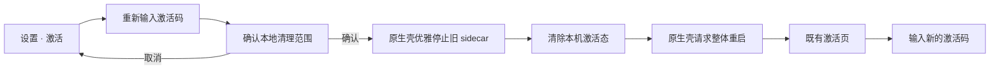

# CreatorOS 产品内重新输入激活码设计

日期：2026-08-09
任务：T-746
状态：独立评审修订中（Round 1：FAIL，3 项已按最小约束处置）

## 1. 用户确认与目标

用户明确把原定的独立脚本 / EXE 改为 CreatorOS 产品内功能。已激活的官方版用户可在
「设置 → 账户 → 激活」里选择“重新输入激活码”，清除当前电脑的本地激活状态，重启后回到既有
激活页输入新码。

本功能解决“永久码已经在当前电脑激活后，产品里没有入口改用另一枚激活码”的问题。它不提供服务端
解绑、吊销或换绑能力。

## 2. 用户流程

- 入口只在桌面端且当前存在激活态时展示；Web 和未激活状态不展示假入口。
- 确认层只做一次明确确认，不要求输入口令。
- 原生命令必须先优雅停止旧 sidecar，确认旧进程及其 licensed token 已失效，才允许清理和请求
  整体重启；不能只在当前已放行的 sidecar 会话里换路由伪装完成。
- 整体重启由原生壳请求，不依赖前端 `relaunchApp()` 作为安全条件。若重启动作异常，旧 sidecar
  已停止，当前页面也不得继续访问受保护页面 / API；用户手动退出并重新打开后进入激活页。

## 3. 精确数据边界

允许清除的本机项只有：

- `<appDataDir>/.license`：当前激活放行快照；
- `<appDataDir>/.license-seen`：本机防回拨点；
- `<appDataDir>/.channel-model-config`：旧激活渠道的模型配置缓存；
- `<appDataDir>/.channel-links`：只为清除旧版本遗留的渠道链接缓存；
- macOS Preferences 域 `cloud.aitongban.creatoros.license` 的 `lastSeenMs`；
- 非 macOS 的 `.creatoros-seen` 必须复用授权读端 `prod_points()` 的同一解析结果：先取 `HOME`，
  缺失时才取 `USERPROFILE`；禁止在重置端另写一套“Windows 用户目录”推导。

必须保留：

- `db/`、`.auth/`、`logs/`；
- `machine-id`、`.master-key` 与系统密钥库中的模型凭据；
- `~/CreatorOS` / `%USERPROFILE%\\CreatorOS` 工作区；
- 项目、素材、知识、定位、账号、模型配置和所有创作数据；
- 服务端的激活码消费、设备绑定、吊销与渠道记录。

## 4. 契约与安全

- UI 只调用新的 Tauri 原生命令 `license_reset_local`，不经过 HTTP、query、日志或剪贴板。
- 原生命令不接收路径、应用标识、激活码或服务器地址；所有目标均为编译期白名单。
- 原生命令与授权心跳共用 `chain_lock`；持锁后从壳层 `SidecarHandle` 取出并执行既有优雅停机
  序列（macOS 进程组 SIGTERM→等待→兜底；Windows 停机哨兵→Job 等待→兜底）。只有旧 sidecar
  确认退出后才清理文件，因此旧 licensed token 和已读取旧授权的在途渠道配置刷新一起失效，
  `.channel-model-config` 不得在 reset 后被旧会话写回。
- 清理完成后把进程内最近授权判定更新为 `inactive`，并由原生壳调用 `request_restart()`；重启后
  新 sidecar 只能从已缺失的 `.license` 签发 activation-only token。前端 relaunch 不是安全依赖。
- 任一白名单项清理失败即返回错误，不声称成功；不得扩大范围补救。

## 5. 验收

1. 设置页已激活卡出现“重新输入激活码”；未激活和 Web 不出现。
2. 取消确认不调用原生命令；确认只调用 `license_reset_local`。旧 sidecar 必须先退出，随后才清理并
   由原生壳请求重启。
3. 原生测试证明六类白名单项被清除，`db/.auth/logs/machine-id/.master-key/CreatorOS` 原样保留。
4. 源码静态测试证明重置模块不含 URL、网络客户端或激活服务地址。
5. 停机/重启故障测试证明：即使整体重启请求没有完成，旧 sidecar 已失效，受保护页面 / API 不再
   可用；手动重启后进入激活页。
6. 并发测试覆盖“sidecar 已读取旧授权、渠道配置刷新仍在途”与 reset 交错；reset 返回后旧缓存
   不能写回或被新会话消费。
7. Windows 测试显式设置不同的 `HOME` 与 `USERPROFILE`，断言 reset 删除的正是
   `prod_points()` 实际读取的 `.creatoros-seen`，且两个根目录下的工作区均未触及。
8. macOS 与 Windows 编译检查通过；正式包仍需各平台实际点击一次验证重启后进入激活页。

## 6. 明确不做

- 不做独立 EXE、安装包或公开下载工具；
- 不做服务端解绑 / 换绑 API；
- 不删除系统密钥库中的模型密钥；
- 不新增视觉体系，不改激活页样式，不改正式发布流水线。
