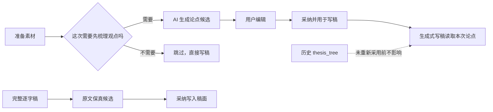

# T-730 可选“立论点”UI恢复与显式写稿采用 SPEC

> 状态：用户已于 2026-08-09 确认实施。
> 上游：[T-726 论点骨架退役](2026-08-08-thesis-skeleton-retirement.md) · [T-727 完整逐字稿保真导入](2026-08-08-verbatim-script-import-and-instruction-precedence.md)
> 变更性质：用户反馈证明论点梳理对部分创作仍有价值。本 SPEC 只替代 T-726 中“用户表面完全退役、禁止任何新建”的结论；继续保留其“不得强制前置、不得隐藏消费、不得自动用词面相似度选材、历史数据不删除”的安全边界。

## 1. 用户结果

项目稿面恢复“论点骨架（可选）”。需要梳理复杂观点的用户可以让 AI 生成核心论点、支撑依据、证据和反驳，编辑后明确选择“采纳并用于写稿”；已有完整逐字稿或只想快速成稿的用户可以跳过，直接进入口播脚本。



## 2. 范围

### FR-730-01：恢复可选 UI 与场景引导

- 稿面在素材区与口播脚本之间恢复“论点骨架（可选）”面板；创作快捷动作恢复“先梳理观点”。
- 面板明确说明：
  - 适合知识讲解、观点评论、测评对比、较长内容，或需要证据与反驳的稿件；
  - 已有完整逐字稿、简单通知、短口播、纯记录或只需快速成稿时，可以跳过。
- 同一屏提供真实可用的“先梳理观点”和“跳过，直接写稿”；后者把用户带到口播脚本，不创建任务、不写 artifact、不改变采用状态。
- UI 不把立论点描述成必经步骤，不以缺少论点阻断写稿、审核、制作或逐字稿导入。

### FR-730-02：恢复真实 AI 生成、编辑与保存

- “先梳理观点”在当前项目编导对话中调用 `planning.thesis`，基于当前定位、项目 Brief、选题和已有资料生成候选；没有项目上下文时诚实报错。
- `planning.thesis` 继续走现有受管文本模型解析，不新增单独密钥或客户端模型选择；当前渠道配置为 MiniMax 时，真实请求必须使用该 MiniMax 文本模型。
- 候选卡展示核心论点、支撑依据、证据和反驳，主动作命名为“采纳并用于写稿”。AI 只产候选，用户点击后才追加 `thesis_tree` artifact version。
- 面板支持现有固定四栏内的新增、删除、编辑、同栏排序和人工挂/卸项目资料；保存失败保留本地草稿并允许重试。
- 本次不做分场景模板、字段改名、跨栏任意结构或行业框架；这些进入 T-731。

### FR-730-03：显式采用，而非隐藏消费

- 新版本 `contentData` 在现有 `nodes` 之外增加：

```json
{
  "scriptBasis": { "status": "adopted" }
}
```

- AI 候选只有在用户点击“采纳并用于写稿”并成功确认后，带 `scriptBasis.status=adopted` 落为当前版本。
- AI 任务、候选和当前 artifact version 是两组正交状态：再次生成、候选待确认、放弃候选或生成失败都不得改变当前 version 及其采用状态。已有 adopted version 时继续用于生成式写稿，直到用户成功确认新候选或明确停止使用；没有 adopted version 时仍保持零消费。
- 当前版本没有该标记、标记非法或标记为 `inactive` 时，面板显示“尚未用于写稿”，`script.draft` 不得读取其中任何节点。
- 面板提供“采用并用于写稿”和“停止用于写稿”两个可逆动作；两者都通过追加 artifact version 表达，不覆盖、不删除旧版本。
- 当前版本已采用时，面板显示“本次写稿采用”；编辑保存必须保留当前采用状态，不得因一次普通编辑静默开启或关闭消费。
- `CreativeContext.thesisBrief` 只允许从当前项目、当前 `thesis_tree` 版本且 `scriptBasis.status=adopted` 的节点生成；历史无标记版本默认不可消费。
- 读取与采用/停用写入必须经现有 user-scoped service 绑定当前 `RequestContext.userId + accountId + projectId`，并核对 artifact 属于该项目、目标 version 属于该 artifact；客户端传入的伪造、跨项目或陈旧 ID 不得成为读取或写入依据。
- 同一候选的“采纳并用于写稿”是原子、幂等、可重试的确认结果：候选确认、唯一 adopted version 追加、当前 version 切换和任务终态在同一 Unit of Work 内完成。双击、超时重试或响应丢失最终只产生一个 adopted version；任一步失败时当前 version 与任务确认状态保持失败前真值，候选仍可重试，不得留下任务已成功但 version 未落的夹生状态。

### FR-730-04：写稿优先级与安全边界

- `script.draft` 的 `generate` 模式读取显式采用的论点，把它作为用户本次确认的创作依据；没有采用论点时继续按 Brief、素材、合同和结构方案生成。
- T-727 的 `verbatim` 模式不调用写稿模型，也不读取或应用论点、Brief、定位和创作建议；完整逐字稿保真导入始终优先。
- 论点不得重新进入制作/B-roll 素材来源；制作仍只读脚本点名与项目 `materialLinks`。
- 恢复 `planning.thesis` 时必须删除旧 runner 中的 token/Dice 素材预挂路径。AI 负责论点语义，确定性代码只校验真实项目、artifact、版本、节点类型、显式采用状态和用户权限。
- 项目重建仍不自动新建或采用 `thesis_tree`；自动化、导入和后台任务不得替用户打开 `scriptBasis`。

### FR-730-05：历史与失败恢复

- 历史 `thesis_tree` 不删除，恢复 UI 后可以查看和编辑，但在用户重新点击“采用并用于写稿”前显示为“尚未用于写稿”并保持零消费。
- 重复点击生成遵循现有任务幂等；运行中、失败、候选待确认和完成状态均有真实提示，不伪造已保存或已采用。
- AI 失败不创建 artifact version、不改变当前采用状态；确认或保存失败不改变当前版本。
- 保存失败时，未保存编辑只保证在当前已打开页面的内存中保留并可重试；页面显示“尚未保存，刷新或离开会丢失”，在用户刷新、切换项目、关闭页面前触发未保存改动确认。强制退出或崩溃后的未保存编辑不承诺恢复，不能伪装成已保存。
- 成功保存后的刷新、切换项目和重启，面板内容与采用状态都从当前 artifact version 读回，不依赖浏览器临时状态；换项目时不得带入上一项目的内存草稿。

## 3. 状态机

| 状态 | 页面提示 | 可用动作 | 对生成式写稿的影响 |
| --- | --- | --- | --- |
| 无论点 artifact/version | 还没有论点骨架 | 先梳理观点 / 跳过 | 无 |
| AI 任务运行中 | 正在梳理观点；当前采用状态另行显示 | 查看任务 / 继续直接写稿 | 保持当前 version 原状态 |
| 候选待确认 | 等待你确认；当前采用状态另行显示 | 采纳并用于写稿 / 放弃 | 保持当前 version 原状态 |
| 有历史或未采用版本 | 尚未用于写稿 | 编辑 / 采用并用于写稿 / 跳过 | 无 |
| 当前版本已采用 | 本次写稿采用 | 编辑保存 / 停止用于写稿 | 注入 `thesisBrief` |
| 生成、确认或保存失败 | 显示真实失败原因 | 重试 / 保留当前稿继续写 | 保持失败前状态 |

## 4. 实现边界

### 4.1 复用

- 复用 `planning.thesis` 模板、结构化 MiniMax 兼容输出、AI task/candidate 确认门和 generic artifact version 追加链。
- 复用 `thesis_tree` artifact 类型和历史数据，不新增数据库表、不迁移旧行。
- 复用稿面旧四栏编辑能力，但改写文案、采用状态和候选确认语义。

### 4.2 不恢复

- 不恢复“必须先立论点才能写稿”的流程；
- 不恢复历史论点无提示自动进入新稿；
- 不恢复论点资料引用进入制作素材清单；
- 不恢复 token、Dice、关键词或固定业务名称的自动素材匹配；
- 不恢复独立“论点树模型”配置入口，继续使用受管文本模型；
- 不新增分场景框架或电商专用字段。

## 5. 验收标准

### AC-730-01：可见但可跳过

普通与最小支持视口打开真实项目稿面，能看到“论点骨架（可选）”、适用/可跳过提示、“先梳理观点”和“跳过，直接写稿”。点击跳过后焦点/视图进入口播脚本，任务数、artifact 数、version 数和采用状态均不变。

### AC-730-02：真实生成与 MiniMax 路由

在当前项目点击“先梳理观点”，创建一个 `planning.thesis` 任务；真实配置为 MiniMax 时，模型解析与运行日志显示使用当前受管 MiniMax 文本模型。成功结果为四类节点候选，不直接写 artifact version；失败时零版本写入且页面可重试。

### AC-730-03：明确采用后才消费

同一项目依次验证：

1. 历史无标记树存在时生成 `script.draft(generate)`，prompt 不含论点块，reader 读取后因标记缺失返回空；
2. 点击候选“采纳并用于写稿”后，当前 version 带 `scriptBasis.status=adopted`，面板显示“本次写稿采用”；
3. 再次生成 `script.draft(generate)`，prompt 包含当前四栏论点；
4. 点击“停止用于写稿”后追加 `inactive` version，下一次生成 prompt 再次不含论点块；
5. 全过程不修改旧 version，不删除历史数据。

另从“已有 adopted version”起步触发再次生成：任务运行、候选待确认、放弃候选和生成失败四种结果都继续消费旧 adopted version；只有新候选确认成功后才原子切到新 adopted version。对同一候选并发双击、响应丢失后重试及 version 追加故障注入，分别断言最终只有一个 adopted version，或当前 version/任务状态均保持原值且仍可重试。

### AC-730-04：编辑闭环

对未采用和已采用两种版本分别执行新增、删除、编辑、排序、挂/卸资料与保存；刷新后内容、顺序、资料引用和采用状态与成功保存结果一致。失败时当前页面保留编辑内容并显示“尚未保存，刷新或离开会丢失”与重试动作；尝试刷新/切换项目触发未保存确认，强制放弃后从服务端旧版本读回，不能显示为已保存。

### AC-730-05：完整逐字稿不受影响

项目即使存在已采用论点，T-727 的混合消息边界识别与 `verbatim` 候选仍逐字保真，hash 与输入正文一致，prompt 不读取论点，用户无需先取消论点或改项目规则。

### AC-730-06：无旧副作用

- `planning.thesis` runner 不再导入或调用词面相似度素材预挂；
- 新制作与 B-roll 测试继续证明没有读取 `thesis_tree`；
- 项目重建不会自动创建/采用论点；
- 没有论点时生成稿、保存稿、审核和制作均可正常进行。

### AC-730-07：账号、项目与版本隔离

用两个账号分别创建同名项目和已采用论点，分别运行 `script.draft(generate)`，每个 prompt 只能出现本账号当前项目的特异论点，交叉命中为 0。账号 B 伪造账号 A 的 project/artifact/version ID，以及同账号项目 B 伪造项目 A 的 artifact/version ID 时，读取返回空或所有权错误、采用/停用写入为 0；陈旧 version ID 不能覆盖当前 version，也不能改变当前采用状态。

```frontend-journey-contract
{
  "schema": "frontend-journey-contract/v1",
  "taskId": "T-730",
  "surface": "project-draft-workbench",
  "intent": "需要复杂论证时先梳理并明确采用观点，不需要时直接写稿",
  "actions": [
    "打开一个非 fixture 的真实项目稿面",
    "确认论点骨架标为可选并显示适用与可跳过场景",
    "点击跳过并确认进入口播脚本且没有创建任务或版本",
    "点击先梳理观点并等待真实 AI 候选",
    "点击采纳并用于写稿，刷新后确认采用状态与内容回显",
    "停止用于写稿，刷新后确认内容保留但状态变为尚未用于写稿",
    "在最小支持视口重复检查主动作、状态和错误提示"
  ],
  "settledPostcondition": "论点内容与是否用于写稿都是可见、可恢复、可撤销的服务端真值",
  "nextAction": "继续编辑论点或直接进入口播脚本",
  "visibleCopyMustInclude": ["论点骨架（可选）", "先梳理观点", "跳过，直接写稿", "尚未用于写稿", "本次写稿采用"],
  "visibleCopyMustExclude": ["必须先立论点", "完成论点后才能写稿", "论点树模型"]
}
```

## 6. 明确不做

- 不做电商、直播、测评等分场景模板；
- 不做字段改名、跨栏拖动或任意 JSON 框架编辑器；
- 不删除历史 `thesis_tree`、旧任务、脚本、素材或成片；
- 不打包、不发布；
- 不读取或改写用户真实素材数据来补测试。
