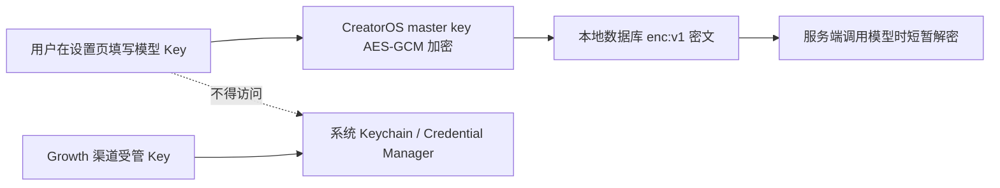

# 用户自填模型 Key 恢复本地加密保存 SPEC

> 任务：T-739
>
> 用户确认：2026-08-09
>
> 决策：`DEC-SEC-043`
>
> 与上游关系：这是 T-731 FR-731-05 第 5 条的后续产品口径修订；保留 T-731 历史评审工件，不回写旧收据。

## 1. 人话目标

V1 候选把用户在设置页自己填写的模型 API Key 直接交给捆绑的 `next-server` 访问系统钥匙串，
保存或使用时会弹 macOS 登录钥匙串密码框，已经影响正常使用。本次撤回这条用户模型路径：
Key 仍只在本机保存并加密，但不再由 sidecar 直接读写系统钥匙串。

Growth/Activity 下发的渠道受管长期 Key 不是用户自己填写的 Key，继续保持系统 Keychain /
Windows Credential Manager-only，不因本次可用性修复降低安全边界。

## 2. 已确认范围

1. 用户自填模型 Key 只保存 `enc:v1` AES-256-GCM 密文；公有 DTO、RSC、浏览器、日志不出现明文。
2. master key 继续由桌面受保护启动通道提供；不可用时拒绝保存 Key，不得落明文或固定降级密钥。
3. 保存、读取、启动迁移均不得访问 `com.creatoros.user-model-credentials.v1`。
4. 已经迁入旧用户模型 Keychain service 的条目不自动读取、不自动删除；数据库行显示为密钥不可用，
   用户重新填写后写本地密文并清除旧引用。
5. Growth 渠道受管长期 Key 继续只进 `com.creatoros.managed-credentials.v1`，数据库只存不可逆引用。
6. 不改视觉、不新增设置项、不改模型供应商契约，不自动打包或发布。

## 3. 验收

- 保存用户模型 Key 后，数据库只出现 `enc:v1` 密文，透明读回值一致，系统凭据库调用为 0。
- 部分更新不清空既有密文；不同用户和不同 capability 不串 Key。
- master key 缺失或密文校验失败时失败关闭，客户端得到既有“需重新填写”状态。
- 存量 keyring-only 行不触发系统读取；用户重填后 `keyring_ref` 清空、状态改为 `encrypted_v1`。
- 长期凭据启动迁移只扫描渠道受管凭据；渠道 Keyring 写入、读回、迁移失败保留旧唯一副本的测试不退化。
- settings 全量测试、两端 typecheck、boundary、semantic、orphan、test-integrity 通过；按用户要求不跑视觉校验。

## 4. 明确不做

- 不读取或清理用户机器上已经存在的旧 Keychain 条目。
- 不把 Growth 渠道受管 Key 回退到本地数据库密文。
- 不修改界面样式、文案布局或任何创作功能。
- 不在本任务创建 tag、Release、上传或分发安装包。
