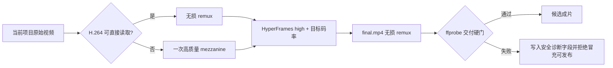

# 正式视频渲染与交付清晰度根治 SPEC

> 任务：T-765
> 用户确认：2026-08-10
> 决策：DEC-VIDEO-038
> 前置证据：[抖音成片清晰度审计](../../research/2026-08-10-douyin-published-video-clarity-audit.md) · [成熟方案调研](../../research/2026-08-10-video-delivery-industry-solutions.md)

## 1. 人话目标

CreatorOS 现在把每段原视频先压成普通 H.264 proxy，HyperFrames 合成时再压一次，最后又压一次。
这会让文字、录屏细线和人物细节在上传抖音前就已经损失多代。此次把正式链路改成：只在浏览器确实
无法安全读取源编码时生成一次高质量中间文件，由 HyperFrames 完成唯一一次交付编码，最后只整理
MP4 容器，不再重新压画面。

## 2. 已确认范围

1. `video.render` 正式任务仍只读取任务 manifest 已物化的当前项目资产，不扩大到全局素材。
2. 只有同时满足以下条件的输入才允许 `-c copy`：`codec_name=h264`，profile 为
   Baseline/Constrained Baseline/Main/High，`pix_fmt=yuv420p`，没有 HDR transfer/BT.2020，且
   ffmpeg 全流 decode smoke 成功。remux 后还必须用本次实际随包 Chromium 的 `<video>` 完成
   metadata + 首个有效帧 decode smoke。任一字段缺失或不在 allowlist、ffmpeg decode 失败、remux
   失败或 Chromium smoke 失败，都切换到一次高质量中间转码；不能只看到 `h264` 就假定浏览器安全。
   mezzanine 再做同一 Chromium smoke，仍失败才结束任务，不得静默改绑或产出黑屏。
3. HEVC、H.264 10-bit/4:2:2 等浏览器不稳定编码只转一次高质量 H.264 中间文件：`libx264`、
   `slow`、CRF 10、`yuv420p`、BT.709；它是正式渲染中间文件，不是预览 proxy。HDR 输入必须用
   zscale + tonemap 做真实 SDR 转换；随包 ffmpeg 不支持或转换失败时失败关闭，禁止只改色彩 metadata
   冒充 SDR。
4. HyperFrames 使用现有 0.7.54 官方 CLI 的 `--quality high`、`--video-frame-format png` 与
   `--video-bitrate`。目标值精确为
   `targetKbps = clamp(roundTo100(10000 × width × height ÷ 2073600 × fps ÷ 30), 4000, 24000)`；
   `roundTo100(x)=Math.round(x/100)×100`，CLI 传 `${targetKbps}k`。这使 1080p30 为 10000k、
   1080p60 为 20000k，并限制异常参数不会产生无限码率。
5. HyperFrames 输出到 `render_raw.mp4` 后，最终步骤只能 `-c copy -movflags +faststart`；测试
   必须阻断重新出现 `libx264`、`libx265` 或其他最终视频编码器。
6. 最终成片的 ffprobe 必须读取 video stream 的 `codec_name/profile/width/height/pix_fmt/
   avg_frame_rate/r_frame_rate/color_space/color_primaries/color_transfer/bit_rate/duration`，以及 format 的
   `duration/size`。fps 以有理数解析并按 `max(0.01, expectedFps/1000)` 误差比较；视频/容器时长与
   `talkingHead.durationSec` 误差不得超过 `max(0.25 秒, 2/fps)`。
7. 最低视频码率为 `minimumKbps=Math.floor(targetKbps×0.5)`。优先使用正数 `stream.bit_rate`；
   缺失时由 ffprobe 只枚举 `v:0` packet 的 `size`，以
   `Math.floor(sum(videoPacketBytes)×8/videoDuration/1000)` 计算真实视频平均码率；packet size 或
   video duration 无效则 `PROBE_INVALID`，禁止从容器总码率猜测或固定扣除音频。低于门槛报
   `BITRATE_BELOW_MIN`；codec、
   尺寸、fps、像素格式、色彩或时长不符报 `DELIVERY_MISMATCH`。错误只写失败任务现有安全错误字段，
   包含计算输入与真实探针数值，不含绝对路径；现有 runner 仍清理失败沙箱，不承诺保留失败视频。
8. 本次保持现有用户明确选择的横屏/竖屏和 contract 的 24/30/60fps；不新加平台 preset、
   不静默改变画幅或帧率、不改任何视觉。

## 3. 机器可验收契约

- 安全 H.264 输入在 allowlist、全流 ffmpeg decode 与随包 Chromium metadata/首帧 smoke 通过后，
  准备命令出现 `-c copy` 且不出现视频编码器；10-bit/4:2:2/HDR/BT.2020/未知关键字段不得走 copy。
  remux 的 Chromium smoke 失败时必须自动切换一次 mezzanine，mezzanine smoke 仍失败才终止。
- 非 H.264 输入只出现一次高质量中间转码，禁止沿用 `veryfast / CRF 18 proxy`。
- HyperFrames 命令同时包含 `--quality high`、`--video-frame-format png` 和确定性目标码率。
- 最终 MP4 命令只允许 stream copy；ffprobe 不满足 codec、尺寸、fps、像素格式、SDR BT.709、
  时长或最低码率时 `video.render` 必须以三个稳定错误码之一失败。
- 成功 manifest 记录输入准备策略、目标码率和最终真实探针值；失败只进入现有安全错误字段并随
  runner 清理沙箱，禁止记录本地绝对路径或密钥、禁止把失败产物转为可确认资产。
- 后端聚焦测试、backend typecheck、boundary、orphan、semantic 与 test-integrity 按真实结果记账。
- 用本机 FFmpeg 生成一段短 H.264 测试素材与一段非 H.264 测试素材，至少完成真实命令级准备、
  remux 和 ffprobe Gate；若完整 HyperFrames 小样受 Chromium/运行时环境阻断，必须如实记录，
  不得伪造真渲染通过。

## 4. 复用与边界

- `PAT-001 / T1`：直接复用仓库已锁定的 HyperFrames 0.7.54 与现有 FFmpeg/ffprobe 执行端口，
  只在 CreatorOS executor 加薄策略与交付 Gate，不引入新渲染框架。
- 不新增数据库表、不改公有 API、不改素材归属，不让 AI 决定编码策略。
- 编码兼容判断是确定性协议校验，不是创作语义判断。

## 5. 明确不做

- 不在本任务设计新的画幅 UI、抖音 preset 或 30/60fps 选择界面。
- 不把运行时 VMAF 作为硬门：合成成片没有逐像素等价参考源，直接比较会把正常字幕、卡片和裁切
  误判为质量损失；固定样片的感知质量基准可在有明确 reference 后另建任务。
- 不上传抖音、不替换已发布作品、不创建 GitHub 包、tag 或 Release。
