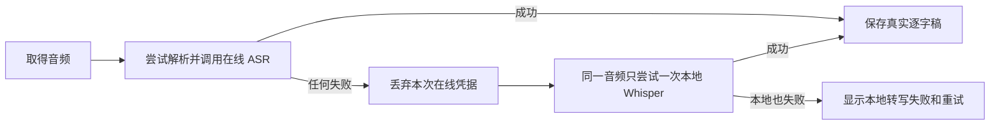

# T-768 任何云端 ASR 故障都必须自动回退本地 Whisper

> 状态：用户已确认；独立复审通过 `PASS[REV:302bddcee225]`。  
> 用户确认（2026-08-11）：不管云端或渠道 ASR 出什么问题，Whisper 都要兜底。  
> 范围：CreatorOS `transcribe.audio` 的解析、渠道短时授权、供应商调用、本地 Whisper 准备与桌面包运行时；不修改视觉布局、不修改 Growth 或 Activity。

## 1. 大白话结论

语音转文字以后只有一条用户规则：在线转写能用就先用；在线转写任何一步不行，就在同一台电脑上
改用本地 Whisper。未绑定账号、没额度、临时密钥拿不到、网络断开、请求超时、服务限流或返回格式
错误，都不能再把逐字稿卡死。

本地 Whisper 不是“假成功”。如果电脑连本地转写本身也无法运行，系统必须明确报告“本地转写失败”，
不能继续显示云端额度或渠道密钥错误，也不能编造逐字稿。

## 2. 已确认需求

### FR-768-01 全错误族本地兜底

以下在线阶段任一失败，都必须改走本地 Whisper：

- 没有云端 ASR 配置、配置不完整或已保存供应商不可用；
- 渠道配置票据、签名配置或单次 ASR lease 解析/申请失败；
- 未连接 AI 额度账户、额度不足、权益拒绝、临时授权过期或状态未知；
- 鉴权、限流、网络、DNS、TLS、超时、上游 4xx/5xx、空结果或响应合同漂移；
- 已取得临时授权，但实际语音转文字调用失败。

上述错误不得继续驱动第二次在线申请，也不得阻断本地尝试。坏签名或不可信在线配置只能被丢弃，
不得用于请求；改用本地不等于接受不可信配置。

云端请求已发出但因超时、5xx 或响应丢失而结果未知时，仍按用户已确认规则启动本地 Whisper，但必须
把云端调用永久保留为 `unknown` 计费事实，禁止在线重放；本地路径使用独立且稳定的 fallback
operationKey，成功结果明确标记 `whisper-local` 与 `cloudCallStatus=unknown`。本地成功只完成逐字稿业务，
不得把未知云端调用伪记为失败、已退款或未发生。

### FR-768-02 单次、无重复扣费

- 每段音频最多尝试一次在线路径和一次本地路径。
- 在线失败后不得换幂等键重新申请 lease，不得再次产生在线 ASR 消耗。
- 在线调用结果未知时永久禁止重放该在线 operation；本地 fallback 的独立 operationKey 也只结算一次。
- 本地 Whisper 已是当前 provider 时，不得递归调用自己或形成无限降级循环。
- 批量任务中一条失败不得让其他音频重复申请或重复转写。

### FR-768-03 本地兜底必须是真能力

- macOS 与 Windows 官方包必须带齐 `@xenova/transformers`、对应 ONNX 原生运行时、随包
  `ffmpeg` 和 worker 入口；缺任一项时构建失败，禁止只在开发机成立。
- 首次使用若模型尚未准备好，必须走可重试、可观测的准备链；不能把云端错误替换成无解释的
  `fetch failed`。
- 是否把模型权重直接随包，由包体与干净机证据决定；但在官方候选进入发布前，至少必须完成
  macOS 与 Windows 安装版的真实短音频转写，不能只用 `require()` 自检冒充本地推理可用。
- 本任务不承诺在磁盘损坏、系统不支持或本地模型本身无法加载时伪造成功；这时唯一合法终态是
  “本地转写失败”，并保留重试入口和安全诊断。

### FR-768-04 用户表面与安全

- 自动回退不新增弹窗，不修改现有视觉布局。
- 回退成功后任务按正常逐字稿成功收口，不要求用户先充值或绑定额度账户。
- 失败文案只说明本地转写发生了什么和可重试动作，不暴露 provider、Base URL、serviceId、
  ticket、临时 token 或内部错误结构。
- 临时 token 无论成功失败都只停留在当前调用内存，不进入数据库、系统密钥库、日志、URL 或缓存。

## 3. 运行合同

0. **所有权**：Backend 独占 RequestContext、在线凭据解析、execution task/calls 账本和逐字稿结果投影；
   ai-worker 独占在线/本地 ASR adapter、Whisper pipeline、模型准备、推理及 ffmpeg 子进程寿命；frontend
   只经 contract/RPC 读取状态和发控制命令。Worker 不直连数据库。单 Worker 内同模型首次准备必须单飞，
   失败可重试；取消、Worker 退出和应用退出都要清理 ffmpeg 与推理子进程。

1. **解析阶段**：`resolveTranscribeSpec` 对所有在线/渠道配置解析异常返回规范的
   `whisper-local` spec；不得只捕获“未配置”这一种异常。
2. **授权阶段**：`prepareManagedTranscribeSpec` 对所有 lease 获取异常返回本地 spec；额度相关错误
   可用于安全诊断，但不能继续作为用户侧阻断。
3. **调用阶段**：统一的 `transcribeWithLocalFallback` 必须把“调用 + 结果合同校验”放在同一个一次性
   回退边界内。在线成功的唯一判定是 adapter 调用完成、响应通过既有合同且 `text.trim()` 非空；
   抛错、字段不合法或空白文本都计为已经完成一次在线尝试，并使用同一音频调用
   `whisper-local` 一次。用户自配和渠道受管 ASR 共用这条规则。本地调用异常进入本地失败控制流，
   不得递归回退。
4. **结果阶段**：统一调用返回值必须同时携带真实逐字稿和实际成功的 `effectiveSpec/mode`，该执行
   模式由 wrapper 在成功调用点生成，调用方不得从初始在线 spec 猜测。保存、任务步骤、运行日志和
   诊断必须读取这一个返回值：在线受管成功记 `channel-managed`，用户自配在线成功记
   `configured-cloud`，任何本地成功只记 `whisper-local`。
5. **重放阶段**：同一任务/音频的现有幂等键保持稳定；回退不创建新的在线请求。
6. **错误投影**：本地 adapter 的原始错误只用于既有脱敏、限长的非用户面诊断。用户可见及持久化
   任务文案只能使用稳定的“本地转写失败，请重试”类别，不得包含绝对路径、ffmpeg stderr、ONNX/
   worker 加载详情、模型下载 URL 或底层异常正文。
7. **执行账本与恢复**：在线调用、fallback 选择、本地调用和逐字稿投影都绑定同一个 execution_task，
   冻结音频 SHA-256、可信 user/account/task、稳定在线/fallback operationKey、attempt/fence 与
   executionCalls 的 `reserved | started | settled | rejected | unknown`。恢复先回放 settled 回执；只有已
   证明拒绝、合同坏或空结果才直接进入本地计划，unknown 按 FR-768-01 的独立 fallback 继续但不重放在线；
   旧 fence、暂停或取消生效后不得启动新调用，也不得覆盖终态。
8. **当下真值**：userId、accountId、taskId、attempt、fence 和宿主权限只能由 Backend 从 execution_task
   与当前 RequestContext 恢复，Worker 参数不是身份真值。每次准备凭据、读取音频、保留调用回执和保存
   逐字稿前都重查任务、业务资源、音频摘要与账号归属；资源删除、转移或归属变化时明确冲突，不跨账号复用。

## 4. 验收标准

- **AC-768-01**：未绑定、额度不足、授权拒绝、坏响应、网络异常、限流、超时和任意普通异常均实际
  调用本地 adapter，并且在线申请次数不超过 1；在线返回空白 `text` 或不合法结果同样满足此断言。
  云端结果 unknown 的用例保留 unknown 账本、在线不重放，本地按独立稳定 key 只执行一次。
- **AC-768-02**：用户自配云端 ASR 与渠道受管 ASR 的调用失败都走同一兜底；`whisper-local` 自身失败
  不递归，错误明确属于本地转写。
- **AC-768-03**：在线调用成功时不调用本地；本地成功保存真实文本且任务成功收口。
  在线失败、本地成功时，保存、步骤与日志的实际执行模式都只能是 `whisper-local`。
- **AC-768-04**：安全测试证明坏在线配置没有被使用，token 不落库/日志，回退不重新申请或重复扣费。
  含绝对路径、ffmpeg stderr、ONNX/worker 详情的本地伪异常不得进入用户可见或持久化任务文案。
- **AC-768-04A**：分别在在线调用前后、fallback 选择后、本地推理完成后和最终投影前杀 Worker/父进程；
  恢复只回放已结算回执，不重复在线调用、本地推理或投影，旧 fence 不能写入。覆盖同 user 不同 account、
  账号切换、音频删除/转移、伪造 Worker accountId 与相同 intentId，证明配置、音频、回执和结果不串用。
- **AC-768-05**：打包合同覆盖 macOS/Windows 本地 ASR 运行时、ONNX 与 ffmpeg；正式发布前两平台安装
  候选各完成一条非 fixture 短音频本地 Whisper 真转写。
- **AC-768-06**：现有 ASR、逐字稿批处理、类型检查与桌面打包契约通过；无视觉文件改动。
  边界与生产消费者盘点证明 Backend/Worker/frontend 所有权唯一，并覆盖并发首次模型准备、准备失败重试、
  取消及退出清理 ffmpeg；旧宿主路径不得形成第二执行 owner。

## 5. 与既有任务的边界

- T-679/T-715 的“未绑定/额度不足只打开额度入口”在 **ASR 转写阻断语义**上被本任务取代；额度入口
  仍可在设置中存在，但不能阻止本地转写。
- T-676 继续负责 StepFun 专用适配器、连接测试真实性以及已发现的 Windows worker/GLib 根因；
  T-768 先建立所有 ASR 调用必须遵守的统一回退合同。
- T-762 继续负责短时租约计费、补偿与跨仓闭环；本任务只保证 CreatorOS 用户侧不会因为在线租约
  失败而失去逐字稿能力。

## 6. 测试映射

| 需求 | 测试 |
| --- | --- |
| FR-768-01 | lease 全错误表、resolve 任意异常、用户云端/渠道调用失败与空文本回退 |
| FR-768-02 | 在线一次 + 本地一次、无第二 lease、本地失败无递归 |
| FR-768-03 | Whisper adapter 真依赖装配、桌面双平台静态运行时合同、安装版短音频 smoke |
| FR-768-04 | token/URL/日志扫描、实际执行模式回传、本地底层错误用户面脱敏 |
