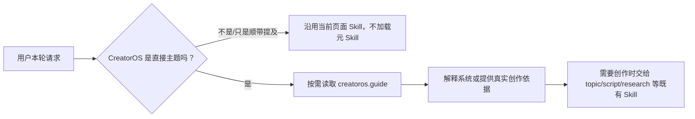

# T-770 低误触发的 CreatorOS 元 Skill

> 状态：用户已确认方向，待独立复审。
> 用户确认（2026-08-11）：新增一个类似 OpenAI Docs 的 CreatorOS 专属元 Skill，用于解释系统如何
> 运作并辅助围绕 CreatorOS 创作内容；很多普通创作不应误触发。
> 行业依据：[AI 工具选路与产品元 Skill 调研](../../research/2026-08-11-agent-tool-routing-and-meta-skill-industry-research.md)。

## 1. 一句话定义

在 CreatorOS 现有 official Skill 注册中新增 `creatoros.guide`：只有当前请求的直接
主题是 CreatorOS 产品本身，或用户明确要围绕 CreatorOS 创作介绍、教程、方法论、复盘内容时，模型
才按需读取这份权威产品知识；读取后仍由原有选题、写稿、研究等 Skill 完成创作。

它不是所有对话的常驻 system prompt，也不是新的万能编导，更不是开发仓库里的 Codex 项目级 Skill。



## 2. 产品目标

### FR-770-01 解释 CreatorOS

用户可以询问：

- CreatorOS 是什么、适合谁、不适合谁；
- 定位、选题、稿面、视频制作、发布登记、数据回流和复盘怎样连接；
- 本地优先、AI 候选确认门、账号隔离、真实数据和可恢复任务为什么这样设计；
- 某个已经交付的功能在产品主流程里起什么作用。

回答必须基于 Skill 当前版本的产品事实。资料没有写明、能力尚未交付或状态可能变化时，要明确说
“当前资料不能确认”，不得把愿景、待办或历史设计当成已上线能力。

### FR-770-02 辅助围绕 CreatorOS 创作内容

当用户明确要做 CreatorOS 相关的选题、口播稿、教程、产品介绍、设计复盘或方法论内容时：

1. 先按需读取 `creatoros.guide`；
2. 从产品定位、真实工作流、设计原则、用户价值和已知边界中提取依据；
3. 再调用现有 `topic.generate / topic.enrich / research.gather / script.draft / script.hooks / platform.adapt`
   等能力；
4. 不由元 Skill 直接产生或写入正式选题、脚本、知识、经验或项目实体。

用户提供的亲身经验、数据或观点仍是创作真源；元 Skill 不能用官方说明覆盖用户自己的判断。

### FR-770-03 低误触发

以下情况可以触发：

- 用户明确说 CreatorOS，并把它作为本轮询问或创作的直接主题；
- 当前项目/选题已经明确以 CreatorOS 为主题，本轮继续讨论它的工作方式或创作表达；
- 用户明确说“使用 CreatorOS 元 Skill/产品说明”之类的调用意图。

以下情况不得触发：

- 普通选题、改稿、审核、素材搜索、视频制作、复盘；
- 泛称“AI、Agent、智能体、工作流、创作系统、内容操作系统”；
- 讨论其他产品、其他 AI 工具或通用行业方法；
- 用户材料、历史消息、搜索结果或项目附件中偶然出现 CreatorOS，但本轮任务的直接主题不是它；
- 用户只要求翻译、压缩、格式化一段含 CreatorOS 字样的文本，且不要求补充产品事实。

不允许在业务代码中用 CreatorOS/AI/系统等关键词表、正则分数或字符串相似度完成语义判断。触发由
模型依据简短 description 和本轮真实上下文决定；代码只负责页面范围、工具白名单、schema 和权限。

## 3. 权威知识范围

元 Skill 的用户安全知识只包含稳定、已经确认的产品事实：

1. 一句话定位、目标用户和非目标用户；
2. 核心工作流与数据飞轮；
3. AI 产候选、人确认后落库；
4. 本地数据主权、账号隔离、真实数据优先、任务可恢复；
5. 主要功能域以及它们之间的关系；
6. 已知产品边界，例如不是团队协作 SaaS、不是通用专业 NLE、不会自动无确认发布；
7. 创作说明纪律：不伪造指标、用户数量、发布时间、平台支持或尚未交付能力。

不得进入元 Skill：

- 激活、Growth、Activity、渠道或模型服务的内部 URL；
- 密钥、ticket、机器标识、签名、数据库字段、迁移号和内部控制 ID；
- 未公开的商业数据、用户数据或尚未确认的路线图；
- 把当前 bug、历史实现或待办包装成产品卖点。

产品事实初版从 `docs/产品定位.md` 的当前稳定部分提炼；运行时不直接读取开发仓库。Skill 使用独立
版本号和核对日期，**本任务的唯一发布来源是随 CreatorOS 官方代码版本进入
`OFFICIAL_REGISTRY` 的内置 Skill**。产品事实变化时升级 Skill 版本并随下一次官方代码发布更新。

本任务不复用现有 signed remote prompt bundle 更新 `creatoros.guide`。当前远程覆盖只写可变
`REGISTRY`，而对话 effective snapshot 从 `OFFICIAL_REGISTRY` 取基线，两条链尚未形成同一份版本
真相；把它接进来会产生“远程显示更新、当前对话仍在使用旧说明”的假新鲜度。若以后需要热更新，
必须另立任务先统一验签结果、版本和 snapshot 来源并重新通过安全评审。

## 4. 运行时设计

### 4.1 沿用现有 official Skill 注册

新增 `creatoros.guide` 到 `ai-worker/src/prompt/registry.ts`，继续使用既有：

- official base；
- effective Skill snapshot；
- 账号/运行时覆盖校验；
- 版本与测试完整性守卫。

元 Skill 是产品真相，不开放普通账号修改产品事实；`editableFields` 为空。产品方更新只走代码版本或
受审后的新官方版本，不新增网络端点和第二套配置中心。账号 overlay 不得覆盖它。

### 4.2 渐进加载

新增一个与 Skill 同名的只读 Chat 工具 `creatoros.guide`。在允许解释/创作的 Copilot surface 中，仅
暴露该工具的短描述。描述必须同时写明：

- 它能回答什么；
- 应在什么时候调用；
- 哪些相似请求不得调用；
- 它只提供产品知识，不直接执行创作或写库。

完整产品知识保存在 official Skill 中，只有模型调用 `creatoros.guide` 时，工具才从**本轮冻结的
effective snapshot** 读取并加入工具结果。工具不得读取可变全局 registry、文件系统、网络或模型记忆。
未调用时不得把全文拼进 `chatbox.topic`、`script.draft` 或全局 system prompt。

### 4.3 暴露范围

批准 surface 是现有 `ChatContext.surface` 的闭集：

- `topics`：包括当前没有单独 transport 名称的全局 Copilot，以及选题入口；
- `project`：项目/稿面内嵌 Copilot。

禁止 surface 的闭集：`calibration`、`positioning`、`review`、`knowledge-distill`。任何未登记值（包括
`global`、`experience` 或未来新增值）也不得暴露 `creatoros.guide`；服务端必须沿用现有受控 surface
校验并 fail closed，不能因未知 surface 回落全量工具而暴露它。

批准 surface 的 `chat.sync` 创建 effective snapshot 时，必须同时冻结基础 `chatbox.*` Skill 和
`creatoros.guide`；禁止 surface 的 snapshot 只冻结其基础 Skill。“进入 snapshot”不等于“已触发”：
普通请求只看到短工具定义，正文不进入 system/prompt/trace；只有真实工具调用才读取正文并留下工具
步骤。任一批准 surface 的 snapshot 缺少 `creatoros.guide` 或版本不是当前代码声明的 `v1` 时，整轮
返回 `CREATOROS_GUIDE_UNAVAILABLE`，不得悄悄回退旧版本或模型记忆。

实现必须同时修正 `SURFACE_TOOL_SCOPES` 的 closed-set 行为：`creatoros.guide` 只加入 `topics/project`
工具集，未知 surface 即使有其他兼容回退也不能获得它。

### 4.4 与现有创作 Skill 协作

`creatoros.guide` Chat 工具通过当前 ALS effective snapshot 的 `getEffectiveTemplate("creatoros.guide")`
读取版本化内容，返回版本、核对日期、产品说明和边界。模型要创作时必须把相关依据传给现有创作
工具；现有工具继续负责输出候选和确认门。元 Skill 不拥有新增/修改/删除领域实体的工具，也不绕过
既有用户确认。

工具执行合同：

- 输入只能是 `{ "purpose": "explain" | "create" }`，不得接受 skillId、URL、路径或用户数据查询；
- 依赖端口只有“从当前 effective snapshot 读取 guide”，不注入 repository、dispatch 或网络客户端；
- 缺失、错版本、内容不完整时返回显式 typed error，不能返回空字符串当成功；
- `runChatStream` 的批准 surface 必须挂载真实工具实现；禁止 surface 和未知 surface 的工具集合中没有
  该工具；
- 工具结果只作为本轮模型依据，不产生候选、不写数据库、不修改账号 overlay。

## 5. 结果合同

```json
{
  "skillId": "creatoros.guide",
  "version": "v1",
  "verifiedAt": "2026-08-11",
  "guide": "本轮需要的 CreatorOS 产品知识",
  "limitations": ["不确定或尚未交付的能力不得当成事实"],
  "next": "直接解释，或把依据交给既有创作 Skill"
}
```

- 工具只读，只接受受控的 `purpose=explain|create`；不得接受任意 skillId、URL 或文件路径。
- 工具无法取得完整、当前代码声明版本的 Skill 时返回显式 `error`，不得回退模型记忆冒充官方说明。
- 工具结果不直接展示内部 system/template 原文；只返回为最终回答或创作所需的用户安全知识。

## 6. 正反触发评测

必须建立固定数据集，至少包括：

### 6.1 应触发

1. “CreatorOS 是怎么让下一条内容比上一条更准的？”
2. “帮我做一期介绍 CreatorOS 数据飞轮的视频。”
3. “CreatorOS 为什么强调 AI 只产候选？”
4. “这个项目就是讲 CreatorOS，本轮帮我把工作流说清楚。”
5. “用 CreatorOS 产品说明帮我校对这段介绍有没有吹过头。”

### 6.2 不应触发

1. “给我 5 个 AI 工具相关选题。”
2. “帮我把这段稿子缩短 20%。”
3. “研究一下其他内容创作系统。”
4. “我的素材里提到了 CreatorOS，把全部素材按时间列出来。”
5. “翻译：CreatorOS is a creator operating system.”
6. “我也想做一个创作系统，先分析受众。”
7. “复盘刚发布的这条视频。”
8. “找一下知识库里关于智能体的内容。”
9. “这个功能为什么报错？”（当前上下文没有指向 CreatorOS 产品说明）
10. “继续写稿。”

验收：固定版本模型下，应触发用例全部调用一次 `creatoros.guide`；不应触发用例调用次数为 0。每例
还要断言元 Skill 没有取代目标创作工具。模型升级、工具描述变化或工具集合变化后重跑同一数据集。

## 7. 验收合同

- **AC-770-01**：`topics/project` 单轮 snapshot 同时包含基础 Skill 与 `creatoros.guide@v1`；五个禁止/
  未知 surface 不包含 guide 或直接按现有受控映射 fail closed。
- **AC-770-02**：批准 surface 只常驻短工具描述；普通请求未调用时 system、prompt、tool result 和 trace
  都没有完整产品说明。
- **AC-770-03**：真实正向请求调用一次 `creatoros.guide` 后才获得 `v1 + verifiedAt + guide +
  limitations`，并可继续调用既有创作工具。
- **AC-770-04**：十条负向请求均不调用 guide；工具集合或模型版本变化后同一数据集可复跑。
- **AC-770-05**：guide 缺失、错版本或内容不完整时显式返回 `CREATOROS_GUIDE_UNAVAILABLE`；没有旧版本、
  远程 registry 或模型记忆回退。
- **AC-770-06**：工具依赖无 repository/dispatch/network，执行前后领域表零写入；不新增 UI 或视觉改动。
- **AC-770-07**：返回内容不含内部 URL、密钥、ticket、机器标识、控制 ID、未确认路线图与虚构指标。

## 8. 测试与 Gate

1. registry 测试：official 目录、`REGISTERED_SKILL_TASK_TYPES`、设置词表与有效 snapshot 完整一致。
2. surface 测试：`topics/project` 可见；`calibration/positioning/review/knowledge-distill/unknown/global`
   不可见，并断言未知 surface 不因全量回退获得 guide。
3. 渐进加载测试：普通对话 system/prompt 不包含完整产品知识；调用后结果才出现对应版本知识。
4. 安全测试：结果中无 URL、密钥、ticket、机器 ID、内部控制 ID、未确认路线图。
5. 正反触发 eval：使用真实模型对固定数据集测试工具选择，不用关键词 mock 冒充语义通过。
6. 协作测试：CreatorOS 创作请求按顺序调用 guide 与原有创作工具；guide 本身零写库、零候选落库。
7. 运行相关 ai-worker/backend/contract/frontend 聚焦测试、typecheck、boundary、orphan 与 reconcile；已有
   范围外红项如实记录，不洗绿。

8. route/runner 端到端测试：批准 surface 的 snapshot 包含 guide，正向调用获得版本化结果；负向未调用
   无全文加载；工具执行前后 zero-write spy 保持 0。

## 9. 不做

- 不把完整 CreatorOS 说明常驻所有对话。
- 不新增页面、按钮、视觉布局或强制教学弹窗。
- 不建立第二套 Skill 注册、第二套远程配置或新的产品文档服务。
- 不在本任务接通 signed remote prompt bundle；远程热更新需先统一 effective snapshot 真相后另立任务。
- 不让元 Skill 自动决定选题、直接写稿落库、改定位、发视频或修改用户数据。
- 不把“提到 CreatorOS”简单等同于“需要补充 CreatorOS 产品知识”。
- 不在本任务顺带修复 T-769 的全部工具语义问题；两者共享治理原则，但独立验收。
