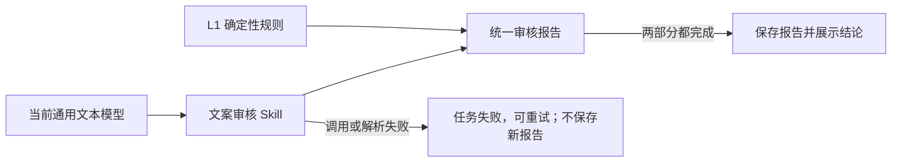

# T-766 文案审核统一使用通用文本模型

> 日期：2026-08-11  
> 状态：用户已确认，待独立复审  
> 取代范围：取代 [T-086 原 SPEC](2026-07-03-content-review-gate.md) 中“文案审核专用模型”、
> `script.review` 模型配置、非专用模型标签与 L2 失败后保存 L1-only 成功报告的口径；L1 规则、
> 审核 Skill/任务 ID、稿件版本绑定、改写建议确认门和稿件改动后重审继续保留。

## 1. 大白话结论

CreatorOS 只有一套文本模型配置。文案审核只是文本模型承担的一项工作，不再是一种需要用户另配
模型的能力。点击审核后，系统用当前通用文本模型同时完成语义审核；模型调用没有完成，就明确
告诉用户本次审核失败并允许重试，不能只跑词表后仍显示“通过”。

## 2. 已确认产品口径

1. `script.review` 只保留为审核任务类型与 Skill 模板 ID，不再作为模型配置 capability。
2. runner 必须显式解析 `default`，不能查询、优先使用或标注历史 `script.review` 模型行。
3. 历史 `script.review` 配置行不删除、不覆盖，仅为升级兼容保留且不再被审核链消费。
4. 设置页继续只展示文本、ASR、生图和生视频四类能力；所有“审核模型”“专用/非专用审核模型”
   的用户提示和引导退役。
5. 审核成功报告只展示实际文本模型名，例如“语义审核：MiniMax-M3”，不增加新的视觉组件。
6. L1 规则检查与 L2 语义审核共同构成一次审核。L2 的模型调用、结构化输出或解析失败时，任务
   进入失败态、保留可重试入口且不写入新报告；禁止保存 L1-only 报告并把 verdict 算成 pass。
7. 已由旧版本写入、且带有已知“语义审核暂未完成/运行”标记的 L1-only 报告统一视为“审核未
   完成”：无论其原始 `verdict` 是 pass、risk 还是 block，都不得进入稿面三态、发布 hard/soft
   gate、成熟度或其他审核状态派生。稿面只显示中性重试提示；不删除历史数据，用户重新审核
   成功后由新报告自然覆盖。所有消费者必须复用同一个纯、确定性的
   `isLegacyIncompleteReview(report)` 判断，禁止各自解释历史报告。
8. 稿件修改后提示重新审核、block/risk/pass 三态、发布侧既有软/硬门规则与改写建议逐条确认
   均不改变。

## 3. 根因证据

本机正式版加密日志解密后显示，2026-08-10 16:00 的任务 `ai-task-5f6882ff-4590` 已经解析到
`MiniMax-M3`，但 `script.review` 的结构化调用和文本降级均未产出可解析响应；runner 随后仍把
任务记为 `succeeded` 并保存 L1-only 报告。说明问题不是“缺审核模型”，而是失败策略把真实的
文本模型调用失败伪装成了审核成功。

日志证据只记录 taskType、模型 ID、结构化节点状态和终态；不把用户正文、密钥或响应体写入本
SPEC。

## 4. 实现边界

- 后端：删除 runner 的 `hasDedicatedReviewModel` 依赖和 composition root 的专用解析；仅解析
  `default`。L2 失败抛入既有 `markFailed` 路径，只有完整结果才能 `saveReport` 与
  `markSucceeded`。
- 结构化兼容：本机日志证明 MiniMax-M3 出现“有 reasoning token、无 final text”。在既有
  `runStructuredNode` 增加**调用方显式开启且默认关闭**的恢复开关，`script.review` 是本轮唯一
  开启者。仅当本次 `generateText` 返回的 `result.text.trim()` 为空时，才允许读取同一响应的
  `result.reasoningText`；正文非空时即使解析失败也不得回读 reasoning。恢复源不得来自错误
  `cause`、provider metadata、日志或其他旁路字段。
- 恢复资格：从 reasoning 抽出的原始 JSON 必须在自己的字段中显式包含合法
  `verdict`（pass/risk/block）、非空 `summary` 字符串和 `findings` 数组；先通过该原始完整性
  检查，再交给既有 outputSchema 校验，禁止依靠 schema 默认值把 `{}` 或零散对象补成通过。
  只把最终校验后的对象交给审核 runner；原始 reasoning 不进入报告、步骤日志、错误日志或 UI。
  没有完整合法对象时继续真实失败。未显式开启的其他结构化任务不得读取 reasoning。
- 前端：用一个确定性兼容判断识别旧版已知 L1-only 报告，页面显示“上次审核未完成，请重新
  审核”，不渲染 pass/risk/block 徽章；同一判断供发布派生、成熟度和所有审核状态消费者使用，
  历史 raw block 也不得继续阻断发布。对话任务失败继续显示可重试错误。不改卡片结构、颜色、
  间距或按钮。
- 契约/数据：不新增 API、不迁移或删除用户数据；`modelLabel` 字段继续承载实际模型名。只修正
  注释、测试与派生规则中的旧口径。
- 失败边界：通用文本模型真的未配置、密钥不可用、网络/供应商失败或输出不可解析时均保持真实
  失败，不回退为假报告，也不静默改用其他模型。

## 5. 验收标准

1. runner 测试证明只请求 `default`，即使存在历史 `script.review` 配置也不会读取。
2. L1 与 L2 均成功时保存一份报告、记录实际文本模型名并将任务标为成功。
3. 模型解析失败或 L2 调用/解析失败时：`markFailed=1`、`saveReport=0`、
   `markSucceeded=0`。
4. MiniMax 型恢复必须覆盖：正文为空且 reasoning 含显式完整合法报告 JSON 时成功；`{}`、夹杂
   `{}` 的推理文本、无/非法 JSON 均按第 3 条失败；正文非空时不读取 reasoning；未 opt-in 的
   其他结构化任务也不读取 reasoning。原始推理内容不得进入报告、步骤日志、错误日志或 UI。
5. 同版本的旧 L1-only pass、risk、block 三种报告在稿面、发布派生、成熟度和其他审核状态中
   都统一视为“未完成”，不产生三态结论或发布阻断；普通完整报告的 pass/risk/block、stale 与
   改写确认行为不变。
6. 用户可见文案不再出现“审核模型”“专用审核模型”“非专用审核模型”或让用户去配置独立审核
   模型的引导。
7. 后端、前端聚焦测试与两端 typecheck 通过；boundary、semantic-boundary、orphan 与 reconcile
   据实记录。真实文本模型调用若未获单独消费授权，不伪造为已验证。

## 6. 非目标

- 不重新设计审核卡、不改变视觉样式。
- 不取消文案审核本身，也不取消稿件修改后的重审提示。
- 不更改抖音审核规则、模型 prompt、发布门强度或 AI 改写确认门。
- 不删除历史模型配置、历史报告或用户稿件。
