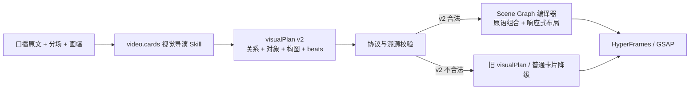

# T-802 可组合 Scene Graph 内容动效 SPEC

**状态**：用户已确认方向，待独立评审

**用户确认**：2026-08-12，用户认可 T-801 的 `Scene Graph + 可组合视觉原语 + 案例检索`，并明确
要求先看真实效果，重点防止不同内容“千篇一律”，同时希望画面更丰富。

**范围**：`video.cards` 官方 Skill、内部 `visualPlan` 候选/渲染契约、既有 HyperFrames/GSAP
信息卡渲染器、设置页自动展示的官方 Skill、跨主题生成与视觉验收 Loop。

**不做**：不增加页面、数据库、公开 API、第二套视频引擎；不把 297 个 Remotion 样例整库复制进
产品；不让模型生成或执行任意 TSX/HTML/JavaScript；不改变用户确认后才进入制作和渲染的边界。

## 1. 问题与目标

T-794 已让 AI 能声明 `magnitude / contrast / sequence / cause_effect / replacement / statement` 及
可溯源的原文部件，但 renderer 又把每种抽象关系绑定成唯一隐喻：因果总是纸卷和机器，步骤总是
六边形回路，替换总是说明书与圆球。跨主题实测已经证明逻辑关系可以选对，画面仍会重复，而且固定
运动物件在六条横竖样片中都出现过穿字。

本轮目标不是增加完整模板数量，而是把“关系”与“长什么样”拆开：AI 根据当前内容选择视觉对象、
构图、状态变化和时间节拍；确定性代码只执行已注册原语、处理横竖屏布局、检查文字/人物/字幕安全
并在失败时兼容降级。



## 2. 已确认需求

### FR-802-01 内容决定视觉，而非关系决定模板

同一种 `relation` 在不同内容下可以使用不同主体、构图和变化机制。例如三个 `cause_effect` 可以
分别表现“功能块堵塞路径”“通知侵蚀睡眠时间条”“素材涌入但发布轨道为空”，不得因为关系相同就
统一渲染为纸卷、机器和输出纸。

### FR-802-02 丰富来自原语组合，不来自无限完整模板

第一版开放一组受控对象、构图和动作原语。模型可以组合它们，但不能输出 renderer 代码或任意 CSS。
Remotions 项目只作为评测和未来案例检索的视觉语法来源，不进入运行依赖。

### FR-802-03 保持事实、文字与制作安全

- 需要上屏的 `parts[].text` 继续逐段溯源于口播原文；对象的 `semantic` 只描述隐喻用途，不得冒充
  真实产品界面、新闻截图、人物、成绩或数据。
- 模型只产候选，现有用户确认、预览和渲染入口不变。
- 不执行模型生成代码；代码只接受枚举原语、有限数值和真实引用 ID。

### FR-802-04 横竖屏不是缩放同一张固定画布

Scene Graph 必须声明 `aspectStrategy`。横屏和竖屏由 renderer 在统一安全约束下重排；不得拉伸，
不得把横屏绝对坐标直接压进竖屏。无人物样片使用完整舞台；有人物时继续避让人物与字幕安全区。

### FR-802-05 官方 Skill 与设置页一致

`video.cards` 官方模板是运行时和设置页的共同真值。本轮更新后，设置中打开“信息卡设计”必须能
看到新的 Scene Graph 生成纪律；账号已有 overlay 继续按现有合并规则生效，恢复官方默认后得到
本轮新版。

### FR-802-06 用多主题、多候选 Loop 验证“不千篇一律”

冻结至少 6 个跨主题案例，至少覆盖内容生产、个人成长、产品思考、知识管理、经营或组织协作；其中
至少 3 个案例使用相同 `relation`，以检验同关系是否仍重复。每个案例生成至少 2 个候选机制，经过
结构预检、关键帧/短样渲染、自动评尺后选出赢家，并输出横竖屏真实样片供用户验看。

## 3. `visualPlan v2` 内部契约

旧字段保留，新增可选 `scene`。这是内部 AI 候选和 render props 契约，不落库、不新增公开操作。

```json
{
  "relation": "cause_effect",
  "parts": [
    { "text": "功能越堆越多", "role": "cause" },
    { "text": "用户完成任务反而更难", "role": "result" }
  ],
  "scene": {
    "cognitiveGoal": "看见功能堆积如何堵塞用户路径",
    "layout": "path",
    "aspectStrategy": "reflow",
    "entities": [
      { "id": "features", "kind": "tile_collection", "glyph": "feature", "semantic": "不断增加的功能", "textRole": "cause" },
      { "id": "path", "kind": "path", "glyph": "route", "semantic": "用户完成任务的主路径" },
      { "id": "outcome", "kind": "target", "glyph": "target", "semantic": "完成任务", "textRole": "result" }
    ],
    "beats": [
      { "action": "trace", "target": "path", "start": 0.00, "duration": 0.22, "from": { "progress": 0 }, "to": { "progress": 1 } },
      { "action": "overflow", "target": "features", "affects": ["path"], "start": 0.18, "duration": 0.36, "from": { "count": 2 }, "to": { "count": 9 } },
      { "action": "compress", "target": "path", "start": 0.42, "duration": 0.25, "from": { "scale": 1 }, "to": { "scale": 0.35 } },
      { "action": "reveal", "target": "outcome", "start": 0.68, "duration": 0.22, "from": { "opacity": 0 }, "to": { "opacity": 1 } }
    ]
  }
}
```

### 3.1 第一版白名单

- `layout`：`stage / path / stack / field / orbit / split / flow`；
- `aspectStrategy`：第一版只有 `reflow`；横竖屏分别求槽位，禁止整体 `scale` 或 `crop` 冒充重排；
- `entity.kind`：`text / shape / icon / document / tile_collection / node / path / container / target /
  meter / device / archive / clock`；
- `entity.glyph`：`none / document / message / notification / moon / clock / folder / archive / route /
  target / filter / feature / person / team / chart / calendar / inbox`；它决定可见符号，不从 `semantic`
  猜图标；
- `beat.action`：第一版只开放 `enter / exit / move / grow / shrink / overflow / compress / replace /
  trace / reveal / focus`。无法唯一执行的 `split / merge / filter / block / connect` 暂不进入契约。

边界：实体 1–8 个，beat 1–8 个，稳定唯一 ID；`entity.textRole` 可选且必须引用唯一存在的
`parts[].role`，只有这样原文才绑定到该实体；`semantic` 只用于模型解释和审核，不直接烧进画面。
每个 beat 必须声明归一化 `start`、`duration`（均为 `0..1` 且 `start + duration <= 1`）、`target`，
`affects / with` 中的引用也必须存在。`from / to` 只允许以下受限状态：

- `x / y`：舞台归一化坐标 `-1..1`；renderer 映射到各画幅安全区域；
- `scale / opacity / progress`：`0..1.5`，其中 opacity/progress 上限为 1；
- `count`：`0..12` 的整数；
- `rotation`：`-180..180`；
- `direction`：`left / right / up / down / inward / outward`。

动作与允许变化的状态键唯一绑定：`enter / exit` 只改变 `opacity`；`move` 只改变 `x / y` 且起止
坐标不同；`grow / shrink / compress / focus` 只改变 `scale`，并分别要求变大、变小、变小、变大；
`overflow` 只改变 `count` 且增加；`trace / reveal` 只改变 `progress` 且从小到大；`replace` 必须用
`with` 指向接管实体，并让 target 的 opacity 从 1 到 0、with 实体从 0 到 1。任何额外状态键、错误
方向或无可观察状态差都使整个 `scene` 结构无效。模型由此决定“什么
改变、何时改变、改到什么程度”；renderer 只把归一坐标换算成横竖安全坐标并应用状态，不再替模型
选择运动路径或补参与对象。

`parts[].text` 采用严格原文锚定：双方先做 Unicode NFC、把连续 Unicode 空白折叠成一个空格并
trim；归一后的整个 part 必须是归一后完整口播稿的连续子串。不能删除、同义替换或在真实短片段后
追加新主张。任一 part 失败时丢弃整个 `visualPlan`，但保留已经通过自身 content 溯源的普通卡片。

### 3.2 兼容降级

- 没有 `scene`：原样走 T-794 旧 `visualPlan`；
- `scene` 结构或引用不合法：只丢弃 `scene`，保留合法旧 `relation + parts`；
- `scene` 结构合法但当前画幅的布局预检或逐帧安全检查失败：该画幅唯一后置状态是丢弃 `scene`，
  使用同一张卡的旧 `relation + parts` renderer；旧计划也不可用时再走普通信息卡。不得输出碰撞画面，
  也不得因此让整条视频渲染失败。评测 Loop 中发生任何降级仍记为 v2 候选硬失败，不能用 fallback 晋级；
- 整个 `visualPlan` 不合法：保留可溯源普通信息卡；
- 旧候选、弱模型、已有账号 Skill overlay 均不能因此崩溃。

## 4. Skill 生成纪律

`video.cards` 先从内容中提取“可见主语”和“可观察变化”，再选 relation。禁止从 relation 反推固定
隐喻。对每个值得场景化的卡片：

1. 用一句话写 `cognitiveGoal`；
2. 选择 1 个视觉主语，必要时补 1–4 个协作对象；
3. 选择能让对象真实改变状态的 2–6 个 beat；
4. 选择能承载关系的构图和双画幅策略；
5. 自检：遮住文字后是否仍能看见变化；把主题换掉后这套对象是否仍会原样出现；若答案分别是
   “不能”或“会”，重做或不产 `scene`。

禁止：

- 把 `cause_effect` 默认绑定纸卷/机器、`sequence` 默认绑定回路纸片、`replacement` 默认绑定
  说明书/圆球；
- 只更换文字和颜色，DOM 结构与动作路径不变；
- 为追求不同而编造内容中不存在的事实对象；
- 三个以上等权圆角框、编号和直线箭头；
- 让 `semantic` 文本直接上屏绕过原文溯源。

## 5. Scene Graph renderer 职责

Renderer 是一个受限编译器，不做创作语义判断：

- 根据 `layout` 和画幅计算安全区域与实体槽位；
- 按 `entity.kind` 渲染通用 SVG/DOM 原语，而不是完整主题模板；
- 按 beat 的 `start / duration / from / to / with` 生成 GSAP 时间轴，动作只修改白名单属性；
- 把 `parts` 分配到独立文字安全层，运动物件默认在文字层下；
- 导出 `data-scene-layout / data-entity-kind / data-beat-action`，供自动审计；
- 不认识的 v2 输入整段降级，不能执行部分未知动作；
- 旧 renderer 继续保留为兼容 fallback，不能作为 v2 成功证据。

## 6. 丰富度评尺与 Loop

### 6.1 单候选 100 分

| 维度 | 分值 | 判断 |
| --- | ---: | --- |
| 内容对象相关性 | 20 | 主语和变化来自当前内容，不是万能隐喻 |
| 认知增量 | 20 | 画面增加了因果、过程、差异或后果理解 |
| 静音可读 | 15 | 遮住文字仍能看见基本事件 |
| 运动叙事 | 15 | 对象真实改变，不是整卡进场 |
| 非套版感 | 15 | 与冻结集其他赢家在对象、构图、动作路径上有实质差异 |
| 横竖屏与文字安全 | 15 | 双画幅无越界、穿字、字幕/人物冲突 |

语义分由与生成模型隔离的独立 judge 评定。judge 输入固定为：冻结口播原文、匿名候选 Scene Graph、
横竖短样和全 beat 接触表；输出逐维分数、硬失败、引用到具体 beat/关键帧的理由。生成模型不得给自己
打分。每题两个候选先过确定性门，再由 judge 选高分；总分相同依次比较非套版感、内容对象相关性，
仍相同则选择实体与 beat 更少的候选，保证结果唯一且偏向克制。

同题两个候选在进入 judge 前，必须至少有两轴不同，并且差异轴中的实体和 beat 都实际出现在渲染
DOM、具有非零可见面积且在有效时间内产生状态变化；否则第二候选视为复制品，不进入评分。

### 6.2 确定性重复度指标

每个候选从**实际渲染 DOM 与 GSAP timeline**生成三轴指纹，而不是直接相信模型声明：

- 对象轴：排序后的 `entity.kind` 集合；
- 构图轴：`layout + aspectStrategy`；
- 运动轴：按时间排序后的实际属性轨迹等价类，例如 `opacity:0→1 / count:2→9 / scale:1→.35`；
  action 名称不进入指纹。

只有成功渲染、非零可见面积、并在有效时间域内产生可观察状态差的实体/beat 才计入指纹；属性轨迹
从实际 GSAP tween 的 target、起止属性和值域桶读取，所以只改 action 标签不会改变运动轴。未消费的
声明、零面积节点、恒定状态和降级路径全部不计入，并让候选触发“声明与渲染不一致”硬失败。

同一冻结集中：

- 任意两个不同主题的赢家不得三轴完全相同；
- 相同 relation 的 3 个案例，其对象轴、构图轴、运动轴每一轴都至少出现 2 种；
- 6 个赢家的完整三轴指纹唯一率必须为 100%；
- “换字换色但三轴相同”直接判定为重复，不允许用视觉评分洗白。
- 增加反例：两个候选只有 action 名称不同、实际属性轨迹相同，必须得到相同运动轴并判重复。

这只是协议级重复检测，不用关键词或字符串相似度替 AI 做创作判断。

### 6.3 硬失败

- 上屏文字不可溯源或增加未经输入支持的数字/成绩；
- 动效必须依赖大段文字才能解释；
- 动态 PPT；
- 文字、人物、字幕或运动轨迹发生碰撞；
- 横竖任一画幅主体出界或不可读；
- 使用未知原语、坏引用、任意代码，或声称 v2 成功但实际走了旧模板降级；
- 跨主题赢家三轴指纹完全相同。
- Scene Graph 声明的实体或 beat 没有进入实际渲染，或没有产生可观察状态差。

### 6.4 安全区域与全程碰撞

权威输入沿用现有 `VideoRenderProps`：画布由 `delivery.width/height` 给出；字幕区由当前时间命中的
`captions` 与 renderer 既有字幕轨高度得到；人物区由 `talkingHead` 是否展示及正式模板的人物槽位
得到；无人物/`visualOnly` 时人物区为空。全部转换到同一个画布像素坐标系后再布局，Scene Graph
不得自行声明或缩小这些安全区。

自动检查覆盖每条成片的**每一个输出帧**，不是只抽四帧：逐帧读取文字安全层、人物/字幕安全区、
运动物件和轨迹扫掠包围盒；任何一帧相交即硬失败。进入、中间、稳定、退出接触表用于人工审美复核，
不能替代逐帧确定性检查。

## 7. 验收标准

### AC-802-01 契约与兼容

新旧 schema、runner、assembler、contract 和 renderer 聚焦测试全绿；坏 `scene` 只降级 v2，不误删
合法旧卡；未产 `scene` 的弱模型和旧候选继续渲染。

### AC-802-02 不千篇一律

6 个跨主题赢家满足 §6.2 全部确定性指标；至少 3 个相同 relation 案例没有复用同一套对象、构图和
动作序列。每个赢家单候选总分至少 78，且“非套版感”至少 12/15。

### AC-802-03 真实效果

至少 6 个赢家各输出横竖屏真实 MP4 或 WebM；每条抽取进入、中间、稳定、退出关键帧。用户能直接
打开验看，不以 JSON、DOM 或单元测试代替成片。

### AC-802-04 安全与布局

双画幅逐输出帧自动检查为零越界、零文字/运动物件/人物/字幕相交；关键帧人工复核不出现顶部空置、网格不可见、文字
重叠、运动路径穿字或横屏缺验。

### AC-802-05 Skill 同步

`VIDEO_CARDS_TEMPLATE` 版本递增，运行时 official registry 与设置页返回同一新版正文；设置页
恢复官方默认后能看到同一 Scene Graph、多候选和丰富度自检规则。外部全局 `video-editing` Skill
本轮只作为执行方法使用，不作为产品完成条件，也不修改其文件。

### AC-802-06 现有制作链不回归

不新增页面/数据库/第二引擎；现有用户确认、素材优先、预览、渲染和普通信息卡 fallback 不变。项目
边界、语义职责门卫与相关类型检查通过。

## 8. 实现与测试边界

预计修改：

- `ai-worker/src/prompt/templates/video-decisions.ts` 及测试；
- `contract/src/resources/video-render.ts`；
- `backend/src/modules/ai-runtime/video-decisions-runner.ts` 及测试；
- `backend/src/modules/execution/video-render/template.ts` 及测试；
- `frontend/src/features/production/assemble-video-render-props.ts` 聚焦回归；
- 设置页只验证 official Skill 自动投影，不增加新控件；
- `ai-worker/evals/motion-card/` 新增冻结案例、丰富度评尺和结果；
- 设置页 official Skill 投影与恢复默认回归测试。

不允许为了通过丰富度指标在代码里根据行业词、标题或业务名称选择对象。模型选择场景，代码只按
已声明 Scene Graph 执行；确定性指纹只评估输出协议的重复度。

## 9. 完成定义

- 独立 SPEC 评审 PASS；
- 先留下当前固定 renderer 在跨主题重复度测试上的 RED，再实现 GREEN；
- 所有 AC 留下可复验命令、样片、关键帧和评分结果；
- 更新官方和已安装 Skill，完成文档/规则/记忆核对；
- `pmem sync`、相关 gate、`taskctl complete` 与提交完成；全局既有漂移如仍存在，必须单独诚实记录。
