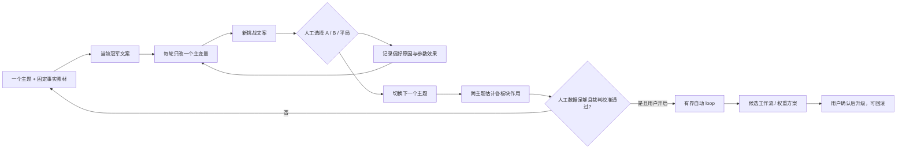

# T-790 CreatorOS 文案权重与工作流优化闭环 SPEC（草案 v2）

> **已被用户纠偏，不实施。** 该版本曾把评估 loop 设计成产品功能；用户明确要求的是迭代现有写文案 Skill。当前真值见 [T-790 `script.draft` 写作 Skill 迭代闭环 SPEC](2026-08-12-script-draft-skill-iteration.md)。原文仅保留为历史决策与旧评审回执的上下文。

> 状态：用户已于 2026-08-12 以“启动一下”确认本 SPEC 推荐默认门槛并授权进入独立评审；评审 PASS 前不进入 BUILD。
> 研究依据：[文案方法、提示词、定位与评估闭环调研](../../research/2026-08-12-copywriting-prompt-positioning-eval-loop-research.md)
> 继承边界：T-642 内容雷达创作依据、T-727 逐字保真、T-730 可选论点、account skill overlay/effective snapshot、现有合规审核与 AI 候选确认门。

## 1. 用户结果

用户每次给出一个主题，CreatorOS 只返回可直接阅读的完整文案，不混入分镜、字幕、画面建议、方法说明或评分报告。系统以当前最优稿为基准，每轮只微调一组明确参数，再生成一个挑战稿；前几轮由用户在两篇文案之间做判断并说明原因。

当系统积累了足够多、跨主题且一致的人工偏好后，才允许启用自动 evaluator-optimizer：自动裁判先模仿已经校准的质量判断，自动提出下一组受控参数，但生产写稿配置仍需用户确认后才能升级。

最终优化对象不是某条“万能 prompt”，而是 CreatorOS 各创作板块的影响权重、上下文预算、优先级与工作流顺序，使定位、素材、观点、结构、对标方法、历史经验和生成参数各自在正确的位置发挥作用。

## 2. 产品裁决

### DEC-COPY-01：实验面只出文案

- 用户可见的每轮结果只有完整连续文案；
- 不展示分镜、字幕、画面、内部评分、方法卡或长篇解释干扰判断；
- 事实与版权硬 Gate 在后台执行，失败稿不进入比较；
- 分镜和视频制作仍可在用户采纳文案后沿现有下游链路工作，但不属于本评估 loop 的优化输出。

### DEC-COPY-02：单主题冠军挑战制

- 一个 experiment 只绑定一个主题及其固定输入快照；
- Round 0 只生成当前配置的 baseline 并冻结为 incumbent，不产生偏好、不占用“最多 6 轮比较”的名额，也不以单篇稿件让用户先入为主；
- 首次 A/B 从 Round 1 开始：它只改变一个声明主变量并生成 challenger，页面在两篇都就绪后才匿名展示 incumbent 与 challenger；
- Round 1—6 每轮都只改变一个声明主变量，生成一个 challenger；
- 用户只选择 incumbent、challenger 或平局，并可勾选原因、补一句自由反馈；
- challenger 获胜后成为下一轮 incumbent，失败稿保留审计但不进入下一轮；
- 同一主题最多默认 6 轮；连续两轮没有新冠军、用户结束或预算达到上限即停止。

### DEC-COPY-03：“权重”不是关键词打分

大模型没有可靠的“定位 20%、素材 40%”原生旋钮。本产品把板块权重落实为四种可复现控制：

1. **是否进入**：`off / on`；
2. **约束级别**：`reference / strong / hard`；
3. **上下文预算**：该板块允许占用的输入长度与示例数量；
4. **工作流位置**：由哪个节点读取、在观点前还是成稿前进入、是否拥有否决权。

创作语义仍由 Skill/模型判断；代码只执行用户确认的配置、真实 ID、预算、版本、顺序和安全边界。禁止用关键词计分、字符串相似度或业务名称分支冒充板块权重。

### DEC-COPY-04：人工先校准，自动化后启用

运行状态固定为三态，但同属一个完整功能，不拆成交付阶段：

| 状态 | 谁判断好坏 | 谁决定下一参数 | 谁能升级生产配置 |
| --- | --- | --- | --- |
| `human_calibration` | 用户 | 系统提一个单变量建议，用户继续/停止 | 用户 |
| `assisted_loop` | 模型先判，用户处理抽样与分歧 | 系统 | 用户 |
| `auto_experiment` | 已校准模型裁判，低置信/冲突回人工 | 系统在预算内自动跑 | 用户 |

默认从 `human_calibration` 开始。任何自动状态都必须由用户显式开启；不允许按日期、调用次数或后台任务自动切换。

### DEC-COPY-05：单主题只选冠军，跨主题才改产品

- 单个主题的结果只证明“这一题哪版更好”，不能直接重写全局 prompt；
- 同一板块调整必须在多个不同主题上重复获胜，系统才可提出全局权重/工作流候选；
- 主题级偶然偏好可以保留为实验事实，但不能被写成通用规则；
- 全局候选必须通过未参与调参的保留主题，再由用户确认写入 account overlay；
- 自动 optimizer 没有直写生产 prompt、正式稿件、定位或经验库的权限。

## 3. 可调板块与参数面

### 3.1 创作板块

| 板块 | 它应该解决的问题 | 可调旋钮 | 典型失败 |
| --- | --- | --- | --- |
| 主题 / Project Brief | 这条到底讲什么、想让观众得到什么 | hard 优先级、信息预算、缺失阻断 | 主旨漂移、泛写 |
| 用户素材 / 来源证据 | 哪些事实、经历、案例可用 | hard/strong、全文或摘要预算、引用要求 | 空洞或编造 |
| 定位 | 谁讲、给谁、差异与禁区 | off/reference/strong、仅相关字段或全量 | 定位口号反复出现、挤压主题 |
| 已采用论点 | 本条核心判断与证据路径 | off/reference/strong/hard、进入角度或成稿节点 | 结构被固定四栏绑死 |
| 结构方案 / 合同 | 如何展开与收束 | off/reference/strong、进入时点 | 套模板、双重结构打架 |
| 对标方法 | 借什么底层机制 | off/reference、只给抽象拆解 | 仿写、身份串味 |
| validated 经验 | 历史上验证过什么 | off/reference/strong、条数预算 | 旧经验一锅端污染新主题 |
| 观众心智规则 | 信息密度、解释深度、行动门槛 | off/reference/strong、按任务选择策略 | “少论证、多断言”误伤观点稿 |
| 固定爆款公式 | 是否强制钩子/痛点/价值/CTA | off/reference/strong | 每篇同骨架 |
| 编辑修订 | 是否在首稿后做针对性改写 | off/on、只修指定失败维度、轮数 | 无限自改、越改越平 |

### 3.2 模型生成参数

- 模型/provider：同一轮 A/B 比较默认固定，换模型必须单独成为实验变量；
- `temperature`、`top_p`、`max_tokens`、reasoning 配置和节点超时：每轮最多改变一组相关参数；
- 同一个 round 每套配置只产生一篇进入比较的文案，不通过“多抽几次挑最好”伪装成参数提升；配置稳定性另用独立复跑检查，不计入本轮人工胜负；
- 任何 provider 不支持的参数必须显示为不可用，不发送假参数。

### 3.3 工作流参数

可比较但不能一次全改：

- 直接成稿 vs 先提炼主张再成稿；
- 定位在主张节点进入 vs 仅在成稿节点进入；
- 论点/结构作为参考 vs 作为硬约束；
- 外部拆解先转成抽象方法 vs 直接混入成稿上下文；
- 一次成稿 vs 首稿后一次定向修订；
- 全量上下文 vs 先做相关上下文选择。

实验 runner 必须记录本轮唯一主变量；如果需要组合变量，先让每个变量单独跑出证据，再建立组合实验。

## 4. 人工校准 loop

### 4.1 新建主题实验

入口复用「设置 → Skills」中的 `script.draft` 管理面，增加“文案实验”入口；实验比较在独立抽屉/页面完成，不新建第二套正式脚本编辑器，也不改写用户项目稿件。用户输入主题，并选择或补充事实素材、目标、目标时长和不可编造项。系统冻结：

- 主题与本次指令；
- 来源文本/hash；
- 当前定位、论点、结构、经验与对标引用版本；
- 当前 model/prompt/workflow snapshot；
- 成本与轮数预算。

输入变化必须新开 experiment 或明确重置 Round 0，不能把两套主题条件混进同一胜负记录。

### 4.2 每轮交互

0. 新实验先生成 Round 0 baseline；只有 baseline 与 Round 1 challenger 都通过硬 Gate 后，才第一次向用户展示 A/B。Round 0 本身不显示投票控件、不保存偏好；
1. 系统根据已有胜负和原因，只提出一个下一主变量；
2. 生成 challenger，通过事实、版权、非空和合规硬 Gate；
3. 页面匿名展示 A/B 两篇完整文案，不显示哪个是当前版、改了什么；
4. 用户选择 A、B 或平局，并选择一个主原因：`观点更强 / 更具体可信 / 推进更顺 / 更自然好读 / 模板感更少 / CTA更自然 / 事实更稳 / 其他`；
5. 用户可补自由反馈；保存后才揭示本轮参数差异；
6. 胜者成为 incumbent，进入下一轮或结束。

### 4.3 人工数据如何变成板块结论

每条判断必须同时绑定 theme、input snapshot、A/B 文案、config snapshots、唯一主变量、选择和原因。系统跨主题汇总：

- 某板块打开/关闭后的胜负；
- `reference / strong / hard` 各级效果；
- 工作流顺序的效果；
- 与内容类型、素材充分度和目标时长的交互；
- 成本、时延和硬 Gate 失败率。

默认至少在 5 个不同主题、12 次有效人工比较中重复观察到同方向效果，且候选胜率不低于 70%，才允许提出“全局候选”；这只是建议门，不是自动生效门。

## 5. 自动 loop 启用与运行

### 5.1 启用门

默认建议满足全部条件后，系统才显示“可开启辅助/自动评估”：

- 至少 30 次有效人工 A/B 判断；
- 覆盖至少 10 个主题和 3 种内容类型；
- 留出至少 20% 的人工判断不参与裁判 prompt 调整；
- 模型裁判在保留判断上与用户 winner 一致率 ≥80%；
- A/B 与 B/A 顺序交换一致率 ≥90%；
- 事实、版权和合规硬 Gate 仍由确定性/独立审核承担，不交给偏好裁判；
- 用户显式点击开启，并选择单次预算。

未达标时模型裁判可以显示诊断，但不能替用户积累“伪人工标签”，也不能进入 auto 状态。

### 5.2 有界自动实验

- 每个主题最多自动 4 轮；
- 每轮仍只改变一个主变量；
- evaluator 同时跑 A/B 与 B/A；不一致、低置信或触碰未见过的内容类型时暂停并请求人工判断；
- 连续两轮无提升、硬 Gate 失败两次、预算耗尽或输出趋同即停止；
- 自动运行只产生 theme winner 和全局配置候选，不写生产配置；
- 用户可以查看完整参数轨迹、赢稿、输稿和停止原因，再决定采纳、继续或丢弃。

### 5.3 裁判持续校准

进入自动状态后仍抽取至少 20% 的比较给用户复核。最近 20 条复核中一致率低于 80%，或顺序一致率低于 90%，立即退回 `human_calibration`；历史结果保留，不伪造持续可靠。

## 6. 生产升级与回滚

- 全局候选必须在未参与调参的保留主题上比较当前生产配置；
- 候选在保留主题按主题汇总的人工胜率 ≥70%，且任何内容类型胜率不低于 50%，才能提交用户确认；
- proposal 必须把每个 diff 映射到下表唯一写入目标；没有可版本化目标的字段只能保留为实验观察，不能进入“可确认” proposal；
- 用户确认走一个 backend 聚合事务：创建所需的 account skill overlay version 与 copy runtime profile revision，再原子切换账号的 active copy profile；任一步失败，全部不生效；
- 运行中的任务保持启动时冻结的 composite effective snapshot，新任务读取新的 active profile revision；
- rollback 选择历史 copy profile revision，原子恢复其关联的 overlay version 与 runtime controls；实验、偏好、历史稿件和旧 revision 不删除；
- 自动 loop、模型裁判和线上数据都无权绕过确认门；
- 单条播放、完播或互动不能独立改变权重，真实线上数据只能作为新主题/新回归 case 的线索。

### 6.1 生产配置真相与字段落点

| 实验旋钮 | 既有/新增真相 | 可版本化写入目标 | 新任务读取方式 |
| --- | --- | --- | --- |
| `system`、`template`、`tools`、`requiredFacets`、`outputSchema`、`completionPolicy` | 既有 account skill overlay | 复用 `settings.prompts.put` 产生的 immutable overlay version | active copy profile 引用精确 `overlayVersionId`，effective skill resolver 按该版本读取 |
| 板块 `off/on`、`reference/strong/hard`、字符/条数预算、进入节点与否决权 | 新增 account-scoped copy runtime profile | immutable `CopyRuntimeProfileRevision.sourceControls` | context resolver 只按 revision 枚举允许的 facet、预算和目标节点；不做关键词语义选择 |
| 直接成稿/主张后成稿、定位进入节点、一次定向修订等节点图 | 新增 account-scoped copy runtime profile | immutable `CopyRuntimeProfileRevision.workflow`，只能取 CONTRACT 注册的有界节点图 | runner 从冻结 revision 解析节点图；未注册组合拒绝运行，不靠 prompt 假装换工作流 |
| provider/model 选择 | 既有 user-scoped `model_configurations` | runtime revision 只写 `modelCapability` 引用，不复制 secret/provider 真相 | 任务启动时按 RequestContext 解析该 capability，并把实际 provider/model 冻结进 task snapshot |
| `temperature`、`top_p`、`max_tokens`、reasoning 与节点超时 | 新增 account-scoped copy runtime profile | `CopyRuntimeProfileRevision.generationOverrides`；仅允许 provider 能力表声明支持的字段 | model resolver 以 model config 为基础合并该 revision 的白名单覆盖，不支持字段 fail-closed |

`CopyRuntimeProfileRevision` 不复制 prompt 正文、模型密钥或 provider 配置；它只保存编排控制、允许的生成覆盖和对既有 immutable overlay version / model capability 的引用。账号的 `AccountCopyProfile.activeRevisionId` 是新任务选择哪套组合的唯一指针。`settings.prompts.put/rollback` 若从原设置页直接发生，也必须经同一聚合 service 创建新的 composite revision，避免“设置页显示一套、写稿 runner 读另一套”。

## 7. 实现边界与数据真相

需要在 CONTRACT 阶段定义并独立评审以下服务端真相，不能只存在前端状态：

- `CopyExperiment`：主题、冻结输入、状态、预算、incumbent；
- `CopyExperimentRound`：A/B config snapshots、唯一主变量、两篇文案、硬 Gate 和成本；
- `CopyPreference`：用户选择、原因、自由反馈、是否用于裁判校准；
- `CopyOptimizationProposal`：跨主题证据、目标 account overlay diff、保留集结果和状态。
- `CopyRuntimeProfileRevision`：账号级不可变编排 revision，保存 source controls、workflow、generation overrides、`overlayVersionId` 与 `modelCapability`；
- `AccountCopyProfile`：账号当前生效 revision 指针；确认/回滚只允许 backend 聚合事务修改。

物理边界：

- ai-worker 负责生成、语义评价和参数建议，只返回候选；
- backend service 负责账号/主题/来源/版本/预算/幂等、偏好和 proposal 真相；
- frontend 只展示文案 A/B、收集真实选择和触发确认，不计算语义权重；
- AI 不直写数据库、不修改正式文案、定位或生产 prompt；
- 现有 `script.review` 继续负责发布合规，自动偏好裁判不替代它；
- T-727 `verbatim` 路径不进入优化 loop，不得因实验参数改写原文。

## 8. 验收标准

### AC-COPY-01：每轮只出文案

真实主题进入实验后，Round 0 只在后台生成 baseline，不展示单篇投票；Round 1—6 只有在 incumbent 与 challenger 都就绪后才出现两篇完整文案与 A/B/平局选择，不出现分镜、画面、内部评分或参数提示。任一硬 Gate 失败时不展示不完整比较，并说明可重试/结束。

### AC-COPY-02：单变量与输入冻结

同一 round 的 A/B config diff 只能命中一个声明主变量；模型、主题、来源或其他参数暗变使 round invalid。修改主题或事实素材时必须新建/重置 experiment，旧偏好不混入新条件。

### AC-COPY-03：冠军挑战与停止

challenger 获胜后成为下一轮 incumbent；失败和平局不错误替换冠军。Round 0 不计比较轮；默认完成 Round 6 比较、连续两轮无新冠军或预算耗尽时真实停止，用户仍可查看每轮文案、参数和选择。

### AC-COPY-04：板块权重不是确定性语义打分

定位、素材、论点、结构、经验等只通过进入/约束级别/预算/工作流位置配置；仓库检查和测试证明没有关键词词表、字符串相似度或业务名称分支决定创作权重。

### AC-COPY-05：人工校准数据可追溯

每条偏好能反查 theme、input hash、A/B 文案、config snapshots、主变量和原因。拒绝保存、重复提交和响应丢失不会产生重复偏好或错误冠军。

### AC-COPY-06：自动启用门

不足 30 条/10 主题/3 类型、保留一致率不足 80%、顺序一致率不足 90% 或用户未开启时，系统不能进入 auto。构造位置偏置裁判时 A/B 与 B/A 不一致，round 暂停并回人工。

### AC-COPY-07：自动 loop 有界且不直写生产

自动状态每主题最多 4 轮，触发任一停止条件即结束；无论胜率多高都只产生 proposal。用户确认后才新增 account overlay revision；拒绝 proposal 零生产写入。

### AC-COPY-08：跨主题才允许全局升级

单主题连续获胜不能生成可采纳的全局 proposal。达到跨主题证据门后，proposal 必须列出各板块效果、适用/退化主题、成本与保留集胜负；保留集未过时不得确认。

### AC-COPY-09：版本与回滚

确认新配置后，旧运行保持旧 composite snapshot，新任务使用新 active copy profile revision；覆盖层、编排、模型 capability 与生成覆盖必须与 proposal diff 等价。rollback 后新任务恢复目标历史 revision，实验、偏好与历史稿件均不删除。

## 9. 明确不做

- 不做声音指纹、历史本人稿风格模仿或“像不像本人”专门评分；
- 不获取、下载或传播付费内部课，不声称复原讲师内部 prompt；
- 不把分镜、字幕或视频画面放进文案优化 loop；
- 不用一个 LLM 总分直接决定生产配置；
- 不让 AI 自动写正式稿、定位、经验或生产 prompt；
- 不新建第二套脚本编辑器、采纳链或 prompt 设置；
- 本 SPEC 参数门未确认、未独立评审通过前，不改生产代码、不打包、不发布。

## 10. 已确认参数

用户于 2026-08-12 确认按以下参数启动：

1. 单主题人工 loop 最多 6 轮，连续两轮无新冠军即停止；
2. 全局候选至少来自 5 个主题、12 次人工比较、胜率 ≥70%；
3. 自动能力启用前至少 30 次人工判断、10 个主题、3 种内容类型，保留一致率 ≥80%、顺序一致率 ≥90%；
4. 自动 loop 每主题最多 4 轮，且生产配置永远需要用户最终确认。

## 11. 独立评审处置

- `REV-001`：明确 Round 0 仅生成 baseline 且不投票，Round 1 才开始第一组 A/B；Round 0 不计入 6 轮比较、偏好和停止计数，AC-COPY-01/03 已同步。
- `REV-002`：新增 §6.1 字段落点与 composite revision 合同；现有 prompt overlay 只承接它真实可表达的字段，编排/预算/生成覆盖进入新的不可变 runtime revision，model 只引用既有 capability，确认与回滚通过账号 active revision 聚合事务收口。
