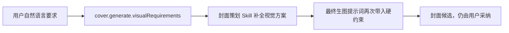

# T-795 封面生成支持用户画面要求

## 用户结果

用户在项目右侧编导对话里可以直接说：

> 帮我生成封面，画面里要有一把剪刀切断混乱的流程线，人物放右侧，不要电脑。

系统会把“画面里要有什么、怎么摆、不要什么”作为独立硬约束送进现有封面生成链，而不是只把它留在聊天记录里。用户不填写时，现有生成行为保持不变。

## 范围

- 在既有 `cover.generate` 工具增加可选 `visualRequirements` 字符串。
- 对话模型只提取用户本轮明确表达的画面要求，不得自行伪造成“用户要求”。
- 参数经 chat tool、chat runner、persistence dispatch、AI task `inputData` 贯穿到 cover runner。
- `cover.brief` Skill 把该字段作为视觉方案硬约束；系统仍负责结合内容主张补全主视觉、构图和色调。
- 最终 `composeCoverImagePrompt` 再显式加入该字段，防止结构化方案遗漏。
- 结果候选记录实际采用的用户画面要求，便于回看和诊断。

## 优先级与边界

1. 用户明确的主体、物体、场景、动作、构图和排除项优先于系统自动视觉建议。
2. 用户画面要求不能覆盖内容事实、封面文案诚实门、版权、安全和模型提供方限制。
3. 用户要求与内容主张冲突时，Skill 保留用户想要的可见元素，但不得借此改写内容主张或编造结果。
4. `visualRequirements` 不是封面数字、成绩、人物身份或新闻事实的可溯来源。
5. 空白、纯空格或未传字段均按旧行为处理；超长输入在工具边界有界裁剪。

## 验收

- 工具 schema 能接收 `visualRequirements`，并对其 trim 后送到分派端口。
- task `inputData` 原样保存该要求；runner 的 Skill facets 与最终生图 prompt 均包含它。
- 候选 `resultData` 能回显实际要求。
- 未传时不新增空白提示块，现有封面和参考图路径继续通过。
- 聚焦测试覆盖参数贯穿、Skill 约束、最终 prompt 和留空兼容。
