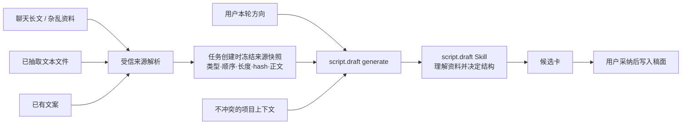

# T-791 `script.draft` 资料驱动生成工具 SPEC

> 状态：用户于 2026-08-12 明确要求从 T-790 拆出独立工具任务。T-790 只改写作 Skill；本任务只补资料从对话/文件/既有文案进入 `script.draft` 的工具与运行链。
> 根因证据：[真实对话与任务输入诊断](../../research/2026-08-12-material-driven-script-draft-gap-diagnosis.md)。

## 1. 用户结果

用户可以在编导对话里交付一大段杂乱资料、聊天长文、一个或多个已抽取出文本的文件、已有文案，或这些内容的组合，再说明“基于这些资料写一版”“按这个方向调整”“基于这篇润色”。系统应在同一轮直接创建 `script.draft` 生成候选，并把本轮资料和调整方向可靠送进写稿 Skill。

写作结构、资料取舍和表达继续由 `script.draft` Skill/模型决定；工具代码只负责把真实输入送到、守住来源与权限、冻结异步任务快照，并诚实处理容量和读取失败。

## 2. 为什么必须改工具

真实失败中，用户粘贴了 1110 字完整原稿并要求润色，但最后创建的 `script.draft` 任务只带了旧项目 Brief 的“400 亿 Token、4 坑压 3 坑、截图锚点”等约束，原稿正文没有进入任务输入。结果不是单纯“写作结构不好”，而是写稿 Skill 根本没拿到本轮主资料；只改 Skill 无法修复。

## 3. 范围与非目标

### 3.1 本任务负责

- 增量扩展现有 `script.draft generate` 内部工具入参，使其能声明本轮 `instruction` 和一组受信资料引用；
- 在服务端解析、校验并冻结来源快照，写入现有 `ai_tasks.input_data`，供异步 runner 使用；
- runner 将资料正文作为有边界的数据块交给 `script.draft` Skill，同时保留当前项目定位、Brief、素材等辅助上下文；
- 修正 Copilot 路由与工具说明：“基于这篇润色/重写”属于带资料的 `generate`，“一字不改/逐字导入”才属于 `verbatim`；
- 覆盖聊天长文、杂乱多源资料、已抽取文本文件、已有文案、异步执行、旧 Brief 冲突和容量超限的回归。

### 3.2 本任务不负责

- 不修改 T-790 的写作方法、A/B loop 或 Skill 质量结论；
- 不新增页面、设置项、数据库、迁移、第二文档库或用户可见的“资料管理”系统；
- 不改变 `shots[]` 输出、候选卡、用户采纳门、稿面版本或模型配置；
- 不让模型把长资料重抄进 `extraBrief`，不让通用对话模型先做不可追溯摘要再冒充原文；
- 不在本任务假装支持无限大文件。超过当前模型可安全处理的预算时诚实阻断；带 chunk 引用与覆盖报告的超大文档检索另行立项。

## 4. 输入与优先级契约

### 4.1 统一的用户输入

| 用户给的内容 | 写稿 Skill 的职责 | 确定性代码的职责 |
| --- | --- | --- |
| 杂乱笔记、访谈摘录、会议记录、聊天长文 | 理解主题、事实、观点和可用细节，按本轮方向组织 | 保留来源边界、归属、顺序、正文、长度和 hash |
| TXT / Markdown / 已确定性抽取的 DOCX、PDF 文本 | 结合其他来源做语义取舍 | 只接收抽取成功且已验归属的文本；失败诚实返回 |
| 已有文案 + “润色/重写/改方向” | 以原稿为主按本轮方向重写 | 将原稿作为 `generate` 来源，不误走 `verbatim` |
| 已有文案 + “原文不改/逐字导入” | 不做创作判断 | 继续走现有 `verbatim` 精确恢复与 hash 校验 |
| 多份资料 + 项目上下文 | 判断相关性、冲突和组织方式 | 不用关键词、相似度或文件名分支替模型做创作选择 |

“润色”已经同时给出了资料和执行方向，创建候选不需要再次确认；候选仍须用户点击采纳才写入稿面。只有来源不存在、不可读、越权、安全拒绝，或用户给出会导致实质不同结果的互斥指令时才追问。

### 4.2 创作优先级

1. 用户本轮明确的写作方向和限制；
2. 用户本轮明确交付或选择的资料；
3. 当前项目已确认且与本轮不冲突的 Brief、定位、论点、结构和素材；
4. 历史经验、知识、对标和旧对话共识。

低优先级内容与高优先级冲突时必须降为参考或忽略。旧 Brief 中的要求若未被用户本轮重申，不得被包装成“立项硬约束”覆盖本轮原稿。

## 5. 最小工具与任务契约

### 5.1 调用期

`script.draft generate` 在现有字段上增量接收：

- `instruction`：用户本轮明确要求；
- `sourceRefs[]`：本轮实际选择的受信来源引用及顺序。

`sourceRef` 只能引用当前请求中真实可见的消息内容、已完成归属校验和确定性文本抽取的附件，或用户明确选择且当前账号/项目可访问的项目文本资源。模型不能猜 ID、跨会话引用临时消息，也不能自行声称某个文件已经读取。

每类引用在工具真正执行时都按当前 `RequestContext` 从服务端真相重读，模型调用载荷中的正文、文件名、抽取状态或资源内容一律不作为执行真值：

- **消息正文**：只接受服务端已落入当前会话的 `ai_message` ID；由 chat service 重新读取当前用户可见的不可变消息正文和归属。当前用户消息必须先完成持久化，模型只看到由服务端附带的 opaque message ref，不能把自己重抄的正文伪装成来源。
- **文本附件**：只接受当前消息/项目已关联的 attachment/asset ID；由文件/素材 service 重读当前归属、抽取状态和成功抽取结果。只有当前仍为成功且 hash 对得上的确定性抽取文本可冻结。
- **项目文本资源**：只接受用户本轮明确选择的稳定资源 ID；由该资源的 backend service port 重读当前账号/项目归属、当前版本和正文。

上述重读、归属校验、hash 计算与任务快照写入必须发生在同一个服务端任务创建边界内。目标已删除、归属变化、抽取失效或版本无法唯一确定时直接拒绝本次调用，不使用旧对话快照补齐。

### 5.2 异步任务快照

服务端必须在创建异步任务时解析 `sourceRefs[]`，并把以下 snapshot 写入现有 `ai_tasks.input_data`：

- 本轮 `instruction`；
- 每份来源的稳定类型、来源标识、顺序、字符数、hash 和完整正文；
- 是否完整纳入；拒绝时的确定性原因；
- 本次项目上下文 snapshot 与 Skill snapshot 的既有版本信息。

`sourceRefs[]` 中每一项都视为用户本轮明确要求纳入的必需来源，解析采用全有或全无：任一来源缺失、越权、抽取失败、hash 不一致或无法完整纳入时，不创建 `ai_task`、不创建候选；一次返回全部已确定的拒绝来源及原因。系统不得静默跳过坏来源后用剩余资料继续生成。若用户随后明确移除某份来源，应以新的 `sourceRefs[]` 发起一次新调用，而不是修改失败调用的语义。

runner 不得在启动后依赖临时请求内存、另一个新会话或模型记忆恢复正文。任务重启/重试读取同一冻结 snapshot，确保同一任务不会因聊天窗口变化而换资料。

### 5.3 Skill 装配

runner 将每份来源以明确边界和顺序送入 Skill，正文与指令分区，避免资料中的文字被误当系统指令。项目 Brief/定位等继续沿用现有 context 装配，但必须标为次级背景，不能覆盖本轮指令和资料。

日志与遥测不输出来源正文，只记录任务 ID、来源类型/引用、字符数、hash、纳入/拒绝原因和预算结果。正文只保存在现有业务真相与任务快照中，不建立第二份长期资料库。

## 6. 容量、安全与失败语义

- 所有来源先做当前用户、账号和项目归属校验；越权、伪造或已经失效的引用拒绝进入任务。
- 文本附件只消费现有确定性抽取成功的文本；不让写稿模型自行打开本机路径、网页或未知二进制文件。
- 任务创建边界先用现有模型解析链确定本次实际文本模型，并同时冻结 `modelSnapshot`（provider/model/contextWindowTokens）、`skillSnapshot`、项目上下文和 `maxOutputTokens`；缺少可信 `contextWindowTokens` 元数据时诚实拒绝，不猜容量。
- 唯一预算算法为保守 token 上界：把最终会送给模型的 system、Skill、工具说明、项目上下文、`instruction`、来源边界标记和全部来源正文按真实装配顺序序列化；输入 token 上界取该 UTF-8 序列的 byte 长度，允许输入上限为 `contextWindowTokens - maxOutputTokens`。只有上界不超过允许输入上限才创建任务。该算法可以保守拒绝，但不得接受一个无法保证全文进入的任务。
- 预算判定只在任务创建时针对已冻结的 model/Skill/context snapshot 作最终决定；通过后 runner 必须消费同一 snapshot，不重新选模型或换 Skill。runner 在调用模型前重算序列 hash 与同一预算断言，若 snapshot 损坏则把任务置为明确失败且不调用模型，不能截断或摘要补救。
- 单份或合计资料通过预算时，原文完整进入 Skill；任一来源导致整体超限时整次调用不创建任务，返回可理解的容量提示、总预算和来源清单，不静默截断、不只传通用摘要。
- 来源中的提示词、命令或角色文本都作为数据块，不改变系统/Skill 指令层级。
- `verbatim` 的精确恢复、hash 校验和采纳门保持不变；资料驱动 `generate` 不复用其“保真即不可改写”的语义。

## 7. 任务边界与 T-790 的关系

T-790 和 T-791 可以独立验收：

- T-790 回答“同样事实输入下，写作 Skill 能否写得更好”；
- T-791 回答“用户本轮给的事实输入，是否真实、完整、按正确优先级到达写作 Skill”。

两者可能修改 `script.draft` 周边文件，因此实施时按写集串行协调，避免覆盖彼此未提交改动；但 T-791 不以 T-790 的 A/B 结果为完成条件，T-790 也不以 T-791 上线为开工条件。

## 8. 验收

- **AC-TOOL-01**：真实回归“完整原稿 + 基于这个稿子润色一下”在同一轮只创建一次 `generate` 候选，不调用 `verbatim`、不反复确认；任务 snapshot 包含原稿完整正文、字符数和 hash，旧 Brief 不覆盖本轮资料。
- **AC-TOOL-02**：聊天长文、杂乱多源资料、已确定性抽取的文本附件和已有文案分别都能成为受信来源并到达 runner；来源顺序和边界可追溯。
- **AC-TOOL-03**：多源内容的相关性、冲突和结构取舍由 Skill/模型完成；代码没有行业词表、关键词计分、字符串相似度或文件名分支冒充创作判断。
- **AC-TOOL-04**：异步 runner 重启/重试仍消费任务创建时冻结的同一来源正文、model/Skill/context snapshot 与序列 hash，不依赖临时会话或模型记忆，也不重新选模型。
- **AC-TOOL-05**：用户明确“一字不改”时继续走现有 `verbatim`，逐字保真、来源边界和采纳门回归通过。
- **AC-TOOL-06**：多来源采用全有或全无；任一来源缺失、越权、抽取失败或按 §6 唯一算法超过上下文预算时不创建任务/候选并一次返回拒绝清单；不静默跳过、截断，不用无引用摘要冒充全文，不声称已经读取未读取文件。
- **AC-TOOL-07**：日志/遥测不出现来源正文；没有新增页面、数据表、迁移、第二文档库或改变 `shots[]`/采纳/稿面版本契约。
- **AC-TOOL-08**：聚焦测试覆盖 Copilot 工具路由、服务端来源解析与归属、任务 snapshot、runner 装配、提示注入边界、旧 Brief 冲突、预算超限和现有候选卡显示。
