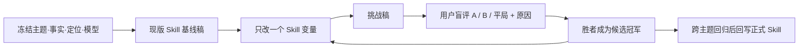

# T-790 `script.draft` 写作 Skill 迭代闭环 SPEC

> 状态：用户于 2026-08-12 明确纠偏，本任务只迭代现有写文案 Skill，不把评估 loop 做成产品功能。用户随后又明确要求把资料驱动生成能力拆为独立工具任务 T-791；本 SPEC 不再承担工具输入链改造。
> 取代：[2026-08-12-copywriting-quality-evaluation-loop.md](2026-08-12-copywriting-quality-evaluation-loop.md)（旧方向仅作历史，不实施）。

## 1. 目标

用真实主题和同一份事实输入，对现有 `script.draft v7` 进行可归因的写作方法迭代，降低“钩子→痛点→价值→CTA”的生搬硬套感，提高单一主张、具体冲突、因果推进和连续口播感。

迭代对象只包括 Skill 本身：

- `system` 中的写作角色与优先级；
- `template` 中的写作步骤、结构权威和禁止项；
- 定位、素材、论点、结构、公式等上下文在 Skill 内的职责边界与优先级；
- 必要时的“先在内部形成连续口播，再映射为 `shots[]`”写作指令。

## 2. 非目标

本任务明确不做：

- 不新增页面、设置项、实验台、API、数据表、迁移、运行配置或复合 revision；
- 不改 `script.draft` 工具入参、任务输入、模型解析、runner、采纳门、稿面版本语义或 `shots[]` 输出契约；资料驱动工具链由 T-791 独立负责；
- 不做声音指纹、个人语气克隆或讲师风格模仿；
- 不获取、复原或传播付费内部课提示词；只吸收用户提供样稿中可观察的写作机制。

## 3. 评估 loop 是 Skill 开发方法

1. 每轮冻结主题、事实素材、定位、目标长度、模型和采样条件。
2. 基线必须由未修改的现版 `script.draft` 生成并留存，不得事后补写。
3. 挑战版每轮只修改一个可指认的 Skill 变量；不同时调结构、定位和参数。每轮离线记录至少保存冻结输入、Skill 版本/提交、唯一 prompt diff、模型标识、原始 `shots[]`、拼接口播、用户选择与原因；不建 UI 或数据库。
4. 评判时只展示按原顺序拼接的完整「口播」，不展示版本、参数、分镜、画面或内部评分。每轮随机分配 A/B，内部记录映射，用户评判前不揭示。
5. 前几轮只采信用户的 A/B/平局与自然语言原因；不用模型总分代替用户偏好。
6. 单主题胜利只更新实验候选，不立即写入正式 Skill；正式回写前必须在第 4 节三个场景全部跑过且无事实/契约退化。不同场景偏好冲突时交回用户决定，不用自动总分盖过。

## 4. 首批回归场景

Skill 修改前先建立以下 3 个真实压力场景，首轮使用场景 1：

1. **观点 + 经历**：“AI 产出差不是工具的锅”；事实仅来自仓内真实项目 Brief：与两位朋友（自媒体+电商）聊 3 小时，卡点是未拆解工作流，可用“输入/处理/输出+端到端可视化”定位。
2. **反常识论证**：“Markdown 不会淘汰，HTML 也替代不了它”；检查 Skill 是否能围绕一个判断完成因果推进，而不是平均介绍两个工具。
3. **产品案例**：“存下对话 ≠ AI 真正认识你”；检查 Skill 是否从具体用户反馈推到机制，不把产品功能写成卖点清单。

T-791 的“完整原稿 + 润色”场景可在工具链完成后复用为额外回归，但不作为 T-790 开工或完成的前置依赖。

## 5. 评判与证据

用户不需要填评分表，只需选 A、B 或平局，并说最刺眼的一点。迭代记录内部再将原因归入以下观察维度：

- 主张是否单一、清楚且值得听；
- 开头是否是事实内的具体触发瞬间；
- 冲突、原因、方法与结论是否一步步推进；
- 是否像一段能一口气讲下来的话，而不是分类要点、金句或模板槽位的拼接；
- 是否只使用冻结事实，且没有照搬对标文案表达。

## 6. 单变量迭代顺序

默认从最可能导致“生搬硬套”且不改契约的变量开始：

1. 把固定“爆款公式”从必须铺满的段落槽位，改为成稿后的节奏自检；
2. 在 Skill 内明确“只有一个主张，所有细节都必须推进它”；
3. 先在内部形成连续口播，再无损切为分镜字段；
4. 收紧定位职责：定位只决定“对谁讲、以什么身份讲、什么不能讲”，不直接规定每段结构和句式；
5. 按内容类型决定论证/演示比例，而不把“少论证、多断言”当作全局硬规则。

每个新变量必须以上一轮冠军为基准，不得在一轮里合并多个“看起来都对”的修改。

## 7. 自动 loop 的后续边界

自动化若后续启用，也只是仓内 Skill eval 工具，不是 CreatorOS 的用户功能。它只能根据已有人工偏好提出下一个单变量候选，低置信、换序冲突、新类型或事实风险必须回到人工。它不能自动覆盖正式 Skill。

## 8. 验收

- **AC-SKILL-01**：仓库无 T-790 新页面、API、数据表、迁移、运行配置、工具 schema 或 runner 改造；旧实验产品误线全部撤回。
- **AC-SKILL-02**：修改正式 Skill 前，现版 `script.draft v7` 在第 4 节三个压力场景的真实基线和失败观察已留存。
- **AC-SKILL-03**：每轮只有一个 Skill 变量差异，给用户的评判面只有两篇完整口播文案。
- **AC-SKILL-04**：胜出修改通过现有 `script.draft` 输入/输出 schema、装配、grounding 和 completion-policy 回归；不改变产品运行链与稿面候选/采纳语义。
- **AC-SKILL-05**：官方 Skill 只接纳有人工偏好且第 4 节三个场景全部回归的修改；未胜出候选不留在生产模板，偏好冲突由用户裁决。
