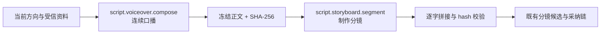

# T-824：连续口播与制作分镜分责

> 日期：2026-08-13
> 状态：待独立评审
> 上游诊断：[标准版文稿与动效“迭代后无明显效果”诊断](../../research/2026-08-13-standard-package-writing-motion-no-effect-diagnosis.md)

## 1. 用户结果

用户仍只执行一次“写稿”，最终仍得到现有可编辑、可采纳的分镜脚本；系统内部先完成一篇能连续
讲通的口播，再把已经冻结的口播切成制作分镜。写作阶段不再同时承担画面、字幕、时长和素材引用，
分镜阶段也不能改写口播观点。

本任务只替换 `script.draft` 的内部生成链，不新增页面、按钮、数据库或公开 API，不改变候选卡、
用户采纳和稿件版本语义。

## 2. 两个可配置 Skill

### 2.1 `script.voiceover.compose`

- 消费现有 `script.draft` 已装配的当前明确方向、完整受信资料、项目定位、当前 Brief、论点、内容
  合同、结构方案、知识与真实素材。
- 本轮明确方向和完整受信资料继续高于旧 Brief、定位措辞、历史策划和旧对话。
- 论点、合同和结构方案用于限定必须覆盖的信息、事实和目标，不再强制成为成稿目录或段落顺序。
- 只输出中心主张、观众旧判断和一篇完整连续口播，不输出镜头、画面、字幕、时长或素材 ID。
- 连续口播必须先在开头建立值得继续听的判断或冲突，后文持续推进同一主张；不得把核心价值判断
  拖到内容末尾，也不得把 README、产品说明或资料目录逐项复述成正文骨架。

### 2.2 `script.storyboard.segment`

- 只消费冻结后的连续口播、目标时长、画幅和当前项目真实素材清单；不再消费 Brief、论点树、结构
  方案或历史对话，避免第二次重新决定观点。
- 只负责把连续口播切成 `shots[]`，补充 `role / 画面 / 字幕 / 时长 / visual`。
- `shots[].口播` 必须是冻结口播的连续逐字切片，按顺序无分隔拼接后与冻结正文完全相同；不得增删、
  改写、概括、纠错或交换句子。
- 画面与素材匹配仍由 Skill 做语义选择；代码只校验真实 assetId、枚举、范围、顺序与文字完整性。

## 3. 执行与数据边界

0. ai-worker 只通过 Pi 执行两阶段模型调用并返回结构化候选结果，不打开 PG、Drizzle 或 repository。
   Backend service 按可信 RequestContext 独占 execution task、server-only runtimeData、checkpoint、候选、
   采纳投影和任务结算的读写；Worker 与 Backend 只经受控 service port 交换请求、检查点和候选结果。
1. `script.draft` 任务创建时冻结 `script.voiceover.compose`、`script.storyboard.segment` 和兼容用的
   `script.draft` 三份 effective Skill 快照，重试不得读取任务开始后的新配置。runner 对任务输入、
   已装配创作上下文和三份 Skill 快照计算 `inputFingerprint`；只有指纹一致的恢复任务可复用断点。
2. 第一阶段成功后，runner 对规范化后的连续口播计算 SHA-256，并在调用第二阶段前通过既有 AI task
   server-only `runtimeData` 原子保存 `schemaVersion / inputFingerprint / stage=voiceover_complete /
   voiceover / charCount / sha256 / voiceoverSkillVersion / storyboardAttemptCount`。该断点不进入公开
   task DTO、transport、前端或模型日志；日志和步骤只记录字符数、hash、Skill 版本、token 使用量和
   耗时，不记录口播正文。断点保存失败时不得调用第二阶段或产生候选。
3. 初次执行只在本任务没有任何断点时调用第一阶段。进程重领同一任务，或显式 `retryOfTaskId` 指向
   前次任务时，先按当前 RequestContext 读取 server-only 断点：`voiceover_complete` 且正文字符数、
   hash、inputFingerprint 与冻结 Skill 版本全部一致时，直接复用口播并进入第二阶段；已存在但残缺、
   非法或指纹不一致的断点一律失败关闭，不得重新调用第一阶段。来源任务明确停在第一阶段失败且没有
   `voiceover_complete` 断点时，新的显式重试才可重新执行第一阶段。
4. 每次调用第二阶段前先原子递增并保存 `storyboardAttemptCount`；进程崩溃后按持久计数继续，不以
   重启清零。第二阶段返回后，代码执行确定性逐字拼接与 hash 校验。该校验只做协议完整性，不判断创作质量：
   `SEMANTIC_BOUNDARY_ALLOW: storyboard voiceover integrity only`。
   两阶段调用、断点提交和 `recordCandidate` 都使用 Backend 注入的
   `taskId + operationId + attempt + fence`：同一 operationId 重放返回既有结算，旧 fence 的迟到结果
   不得写 checkpoint、候选或终态，也不得重复计费；成功候选与任务结算共用稳定幂等键。
5. 首次拼接不一致时，只允许带明确“逐字切分失败”原因重做一次分镜阶段；不得重跑已成功的连续
   口播，也不得用代码猜测缺句或自动改稿。第二次仍不一致则任务失败，不记录半成品候选。
6. 两阶段均使用已有有界模型超时、文本 JSON 兼容和 schema 校验。口播增删改、断点损坏或不存在安全
   输出路径时进入真实失败终态；单个可选 assetId 删除、越界或归属失效时，Backend 先移除该素材绑定，
   保留 Skill 生成的画面描述并走既有无素材/基础视觉路径，记录降级而不阻断完整口播和其余合法 shots。
   只有两阶段、文字完整性及当前真值校验通过后，才调用既有 `recordCandidate`。
7. 最终候选继续使用现有 `artifact_version`、`sections` 和 `contentData.sections`；只增加内部
   `generationPipeline` 与 `voiceoverSha256` 诊断元数据，不改变采纳接口。
8. 调用第二阶段前和 `recordCandidate` 前，Backend service port 必须按当前 RequestContext 重读项目、
   候选根实体及全部 assetId，校验 user/account/project、版本、存在性和归属。能唯一重绑时使用当前资源；
   否则明确冲突或按第 6 条降级，禁止把已删除、旧版本或跨项目素材写入候选。

## 4. 账号自定义兼容

- 官方无覆盖账号默认使用新的两阶段链；当前用户最近可核查的 `script.draft` 为
  `overlayVersion=null`，升级后直接进入新链。
- 若任务快照中的旧 `script.draft` 存在账号覆盖，继续执行旧单阶段 Skill，确保升级不把已有自定义
  方法、schema 或完整性策略静默改义。步骤必须标记 `legacy_overlay_compat`，不能伪称已使用新链。
- 两个新 Skill 均进入既有“设置 → 技能”目录，可独立配置和回滚。用户清除旧 `script.draft` 覆盖后，
  后续新任务才切换到两阶段链；正在运行和历史任务不受影响。
- 本任务不自动迁移或删除任何账号覆盖，也不新增迁移表。

## 5. 等待、成本与恢复

- 每次写稿由一次文本模型调用变为两次；用户已于 2026-08-13 明确要求完成该未完成事项并打本地
  验收包，视为确认这项额外调用成本与等待时间。
- 两阶段分别记录 token 与耗时，最终步骤汇总总量；不能把两次调用伪装成一次。
- 第二阶段协议或 hash 失败时，恢复预算和重做计数都保存在 server-only 断点中，只用于同一冻结
  口播的分镜重做；刷新、进程重领和显式重试都不得让已完成连续口播重复计费。
- 应用刷新或重进页面后仍沿用现有 AI 任务卡显示真实成功/失败，不新增同步阻塞页面。

## 6. 非目标

- 不做 T-820 的选题到项目/文稿数据血缘重构。
- 不做 T-814 的跨页面统一 AI 会话。
- 不自动生成、采纳或覆盖用户稿件；AI 仍只产候选。
- 不以关键词、字符串相似度或写死当前 DeepSeek 项目内容来判断创作质量。
- 不修改视频动效、主视觉或 SRT 切换；这些继续由已实现的 T-794/T-802/T-803/T-823 负责。

## 7. 验收

1. 无旧覆盖的 `script.draft` 任务只按顺序调用 `script.voiceover.compose` 和
   `script.storyboard.segment`，两份 Skill 的 effective 版本均来自任务冻结快照。
2. 第一阶段 schema 只含连续口播语义字段；第二阶段 schema 保留现有分镜字段。第二阶段收到的口播、
   字符数和 SHA-256 与第一阶段冻结值一致。
3. 正常结果逐字拼接 hash 一致后才产生既有分镜候选；采纳、刷新和后续视频制作与旧候选兼容。
4. 首次口播被第二阶段增删改时只重做第二阶段一次；第二次仍错则任务失败，候选数为 0，错误明确
   指向“制作分镜未能保留完整口播”。
5. 第一阶段失败不调用第二阶段；第一阶段完成后必须先持久化 `voiceover_complete` 断点。第二阶段
   provider 失败、超时、进程重领或显式重试只从合法断点恢复，不重跑第一阶段；残缺/篡改/指纹不符
   断点失败关闭，任何失败都不留下可采纳半成品。
   故障注入同时覆盖并发重领、断点保存后崩溃、候选写入后崩溃和旧调用迟到；同键只结算一次，旧 fence
   不能写入或重复计费。
6. 旧 `script.draft` 有账号覆盖时执行兼容单阶段，覆盖内容与 schema 不被新 Skill 偷换；清除覆盖后
   新任务才切换两阶段。
7. 聚焦单测覆盖 registry、snapshot 映射、两阶段顺序、hash、server-only 断点写读、同任务重领、
   `retryOfTaskId`、持久重做预算、残缺/错指纹失败关闭、legacy overlay、候选结构和 token/步骤元数据；
   backend、ai-worker 类型检查与物理/语义边界 Gate 通过；真实 service-port 测试证明 Worker 不打开库，
   checkpoint、候选和采纳投影只由 Backend 写入。素材删除、换版本、跨项目引用和单项视觉降级均覆盖。
8. 本地验收包通过正式 `script.draft` 公共链路，用真实 DeepSeek Harness 主题和至少一个不同关系主题
   产生真实 task 与候选，核对冻结口播 hash 与 shots 拼接一致，完成采纳、刷新，并生成至少一个可查看的
   视频短预览或等价真实下游产物。证据记录 taskId、candidateId、artifact version、真实素材引用和预览
   产物；用户再对完整口播做主观验收并确认核心判断是否前置。未得到用户确认前，T-824 保持“待验”，
   不把自动化绿冒充文稿质量 PASS。
