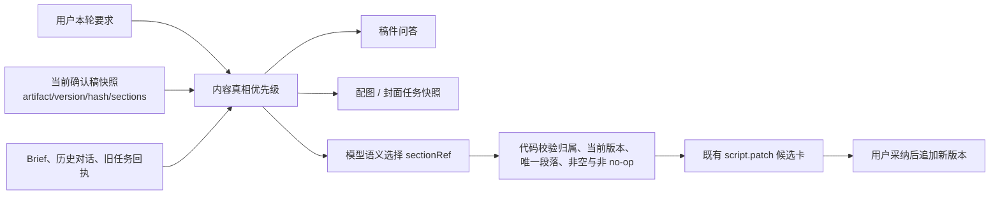

# T-816 / T-819：当前确认稿真相与自然语言单段改写

> 日期：2026-08-13
> 状态：待独立评审
> 关联：T-815、T-817、T-818 诊断；T-716 / T-732 局部补丁链

## 1. 用户问题

同一项目里，稿面已经是最新确认稿，但编导仍可能被旧 Brief、旧对话或旧任务回执带偏：判断错当前稿件时长与结构，生成配图/封面时没有使用最终文案，图片任务已经完成却仍说“还在排队”。与此同时，用户在普通对话里说“改第 7 段”或“把项目对照那段缩短”，系统因为没有按钮产生的技术锚点，根本不提供局部补丁工具。

## 2. 大白话方案

系统先把“现在稿面上正在使用的那一版”读成一份带版本、内容指纹和稳定段落引用的快照。编导做稿件问答、配图、封面和单段改写时，都先以这份快照为内容真相；Brief 只能补背景，不能把当前稿改回旧方向。自然语言改稿由模型理解用户指的是哪一段，代码只接受模型从当前快照中选出的唯一段落引用，再交给现有候选卡让用户确认。

## 3. 内容真相优先级

在事实、安全、版权、权限与外部发布边界内，按以下顺序解释“这条内容现在到底在说什么”：

1. 用户本轮明确要求；
2. 当前项目 `output_script` 的 `currentVersionId` 所指确认稿；
3. 用户点名的当前段落/分镜；
4. 联网原文、项目素材与研究结果，作为事实证据；
5. 项目 Brief、定位、历史对话与旧候选，只负责补充背景和消歧。

旧 Brief 与当前确认稿冲突时，必须以当前确认稿为准并可说明冲突；不能继续把 Brief 称为覆盖当前稿的“硬约束”。没有当前稿时，Brief 仍是首次创作的基线。

## 4. 当前确认稿快照

`context.artifact.text` 在既有全文窗口之外增加以下只读字段：

- `projectId`、`artifactId`、`currentVersionId`、`versionNumber`、`updatedAt`；
- `contentHash`：对当前版本规范正文计算的 SHA-256；
- `snapshotRef`：由服务端/运行时签发的受信引用，绑定 artifactId、currentVersionId、contentHash、
  sectionRef 集合与原段指纹；只供同一工具回合核对，模型不能自报或改写；
- `sections[]`：`sectionRef`、顺序、标题、类型、时间范围、当前正文；
- `truthPriority=current_confirmed_script`。

规范正文以稿面实际显示的 `contentData.sections` 为第一来源；无结构段落时才回退 `transcript`、`contentText`、`body` 或结构化行。`context.artifacts` 的“当前版本号”必须跟随 `currentVersionId`，不得取最大版本号冒充当前版本（历史恢复后最大版本并不一定是当前版本）。

`sectionRef` 的权威来源就是当前版本规范化后的段落 `id`。已有且唯一的持久 ID 原样使用；历史版本缺 ID 或 ID 重复时，复用既有 `canonicalizeScriptSectionRecords` 规则，对该版本按“有可见内容的段落顺序”确定性派生 `script-saved-N`，不得生成随机 UUID。同一个 `currentVersionId` 的快照读取、工具执行重读和稿面投影必须调用同一规范化函数，得到顺序和引用完全相同的段落数组；第一次成功写出新版本时继续沿用现有写入边界把这些 ID 持久化，但不回写不可变历史版本。

所有新增字段都是既有内部工具结果的加法字段，不新增数据库表，不允许 AI 写库。

## 5. 自然语言单段改写

### 5.1 语义定位

普通项目对话中，`context.artifact.text` 与一个“按当前快照产局部候选”的 `script.patch` 工具同时可用。模型先读结构化当前稿，再根据用户自然语言理解目标段，例如序号、段落语义或引用原句，选择工具返回的 `sectionRef`。

代码禁止使用业务关键词正则、字符串相似度或标题词表猜目标段。代码只做：

- 当前账号和项目归属；
- `sectionRef` 必须来自执行当下重读的当前版本；
- 目标只能唯一命中一个段落；
- 替换内容非空，且与当前段原文规范化后不同；
- 候选携带执行时的 artifact/version/section/originalText，采纳时继续走既有三重并发校验。
- `script.patch` 执行时还必须从可信调用上下文取得本轮读取的 `snapshotRef`，重读并核对版本、hash 和
  原段指纹；模型读取后、候选创建前已换版时立即冲突，不能把旧 replacementText 重绑到新版本。

模型判断零段或多段都可能匹配时，只澄清用户语义，不向用户索要 artifactId、versionId、sectionId、hash 等技术字段。

### 5.2 按钮兼容

“AI 改写本段”按钮仍是最快的确定路径：按钮已绑定可信段落时，`script.patch` 保持只有 `replacementText` 的最小参数。普通对话没有按钮锚点时，工具才要求模型提交服务端刚读到的 `sectionRef`。两条入口最终返回同一种候选卡并共用同一采纳服务。

### 5.3 no-op 与并发

工具封装、前端候选卡和后端 `applyScriptPatch` 三层均不得把“改后与原文相同”展示或写成成功。当前稿换版后，旧候选采纳必须冲突关闭；重新读当前稿后才可再产候选。整稿改写意图不得被历史段落引用劫持。

## 6. 配图、封面与任务结果

- 项目内 `material.generate` 生成内容配图时必须绑定当前稿快照；服务具体段落时还必须绑定 `sectionRef` 和视觉任务（证据、机制、对比、后果、情绪或类比）。执行端重读并冻结当前 artifact/version/hash/段落正文到任务 `inputData`，不能只存一段脱离稿件的 prompt。
- 封面继续走 `cover.generate`，但任务同样冻结当前稿快照；封面方案的内容主张先读当前确认稿，Brief 只补充受众、视觉语气与缺失背景。
- 价格表、流程图、架构图等要求精确文字/数字/节点关系的信息卡不走自由文生图；没有确定性信息卡渲染器时应诚实提示，不能让生图模型伪造可读文字与数字。真实网页/公告/GitHub 数据优先截图或确定性图表。
- 每轮系统注入的任务真值按 taskId 覆盖历史消息和旧工具回执。任务已完成、失败、取消或等待采纳时，编导不得继续复述旧的 queued/running 状态。
- `material.generate` 与 `cover.generate` 完成后只经 backend service 保存统一候选封套，至少包含受信
  `userId / accountId / projectId / taskId / sourceArtifactId / sourceVersionId / sourceHash`，段落配图还绑定
  `sectionRef`；Worker 不更新正式素材绑定或当前封面。
- 用户采用配图或封面时，backend 按当前 RequestContext 重读项目和当前稿并校验归属、版本、hash、
  状态与幂等。跨账号、项目已删除或当前稿已换版时明确冲突；只有校验通过的候选才能写正式素材绑定
  或当前封面，生成完成本身不得改变这些正式实体。

## 7. 安全与物理边界

- AI 只做语义定位、改写与视觉取舍，只产候选；用户采纳后由 backend artifact service 写版本。
- 浏览器与 frontend 组件只通过 contract client / RPC 请求后端，不直接依赖 backend service port。当前稿快照的规范化与归属读取落在 backend artifact service 及其 RPC/运行时适配层；AI runtime 只调用注入的公开只读端口，不直连数据库。
- `sectionRef` 是不可信输入，不代表授权；必须在执行当下按 RequestContext 和 currentVersion 重读校验。
- 快照正文、图片字节和联网原文不得进入普通日志；日志只记 taskId、版本是否匹配、hash 前缀和匹配策略。
- 不新增表、不改数据归属，不修改 T-820 的选题补卡数据血缘范围，也不合并 T-814 的统一聊天入口范围。

## 8. 验收

1. 历史恢复到较低版本号后，工具返回的版本号、正文、段落和 hash 都对应 `currentVersionId`，不是最大版本。
2. 当前稿为 8 段、82 秒时，即使 Brief 仍写 4–6 分钟，编导读取后必须按 8 段/82 秒判断；不能把旧 Brief 当最新稿。
3. 用户直接说“改第 7 段”“把项目对照那段缩短”或引用当前稿一句话，模型可从当前结构稿选出唯一 `sectionRef` 并返回局部候选，不要求用户提供技术 ID。
4. 零段/多段命中时澄清；整稿请求不触发单段补丁；按钮入口继续可用。
5. no-op 在工具、卡片和后端任一入口都不能写入新版本；换版后的旧候选不能覆盖新稿。
6. 内容配图任务保存当前 artifact/version/hash、目标段落与视觉任务；封面任务保存当前稿快照。精确文字/数字信息卡不会误走自由文生图。
   生成完成但未采用时正式素材绑定和当前封面不变；验收覆盖采用成功、跨账号拒绝和换版后旧候选拒绝。
7. 三张素材图已从 queued 变为完成时，下一轮读取同 taskId 的真值后不得再说“还在后台跑”。
8. 相关单测、路由测试、服务测试、类型检查、边界 Gate 与 reconcile 通过；边界检查必须证明 frontend 没有新增对 backend service/repository 的直接依赖。至少完成一次真实项目回归：读取当前稿 → 自然语言单段候选 → 用户采纳 → 刷新只改一段；并覆盖同一 `currentVersionId` 连续两次读取产生完全一致的 `sectionRef[]`。

## 9. 非范围

- T-820：选题补卡、项目 Brief 与写稿的数据血缘；
- T-814：全局统一对话入口；
- 新建任意画布/信息卡编辑器；
- 自动采纳、自动覆盖稿面或自动发布。
