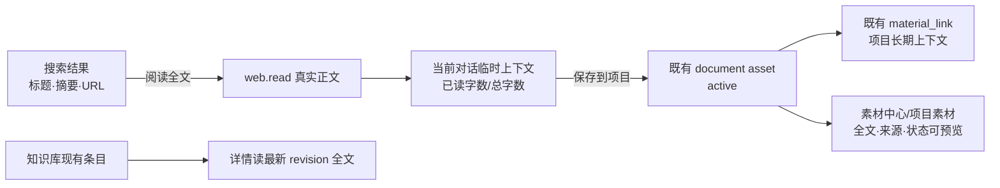

# T-813 联网素材“搜索→阅读→保存→全文预览”闭环 SPEC

> 用户于 2026-08-13 提供完整真实对话与截图，确认当前问题：联网搜索卡只拿到标题、摘要和 URL，却直接允许“保存到项目”；真正正文必须另行复制 URL 触发 `web.read`。由此产生“看起来保存了、后续却读不到”，并在素材详情中出现“这份素材暂无可预览的内容”。

## 1. 用户结果

用户在编导对话中联网找资料后，每条搜索结果只能先点“阅读全文”。系统真实读取正文成功后，把已读正文作为当前对话的临时上下文，并在同一条阅读结果卡上提供“保存到项目”。用户保存后，该正文成为当前项目后续写稿可消费的长期素材；在项目素材、素材中心和知识库已有正文详情中都能看到真实全文、来源和读取状态，不再只显示搜索摘要。

## 2. 已确认需求

- **FR-813-01 搜索只是线索**：`material.gather` 返回的标题、摘要和 URL 不等于网页正文；搜索卡不得再把这些元数据直接创建成知识条目或项目素材，也不得出现“保存到项目”或批量保存入口。
- **FR-813-02 一键阅读全文**：每条带真实 URL 的搜索结果提供“阅读全文”；点击后应在当前对话中以一次明确用户动作调用现有 `web.read`，使用该卡显示的确切 URL，不要求用户复制粘贴。
- **FR-813-03 临时上下文**：阅读成功的正文进入当前对话上下文；卡片显示来源、提取成功状态和 `已读字符数/正文总字符数`。`hasMore=true` 时不得声称已经读完，模型应按既有窗口协议继续读或明确剩余范围。
- **FR-813-04 先读后存**：只有 `web.read` 成功并返回真实正文资产后，才显示“保存到项目”。读取失败、需登录、搜索结果页噪音或正文为空时均不允许保存。
- **FR-813-05 项目长期上下文**：点击“保存到项目”后，将现有 pending 正文 asset 确认成 active，并通过现有 `material_links` 关联当前项目。后续 `script.draft` 等项目创作只能从这条已确认的项目素材链消费正文；未保存的阅读结果不得成为其他项目的长期上下文。
- **FR-813-06 全文预览**：网页正文 asset 的当前文件必须具有 `extractStatus=done` 和真实 `extractedText`；素材中心与项目素材预览读取该字段，显示全文、来源 URL 和提取状态。知识库详情继续读取知识条目最新 revision 的完整 `content`，不得以前端卡片摘要替代正文。
- **FR-813-07 诚实修复边界**：历史上仅把搜索标题/摘要保存成 knowledge 的记录没有正文可恢复，不能编造或把简介冒充全文。新链路阻止继续产生此类记录；历史记录仍显示其真实已有内容和来源，用户重新点来源执行 `web.read` 后才能获得正文。

## 3. 数据身份与所有权

### 3.1 三种身份

| 身份 | 真实内容 | 存储/可见性 | 可否进入写稿长期上下文 |
| --- | --- | --- | --- |
| 搜索线索 | 标题、搜索摘要、URL | 当前对话工具结果 | 否 |
| 已读临时资料 | `web.read` 抽取正文 + 来源 + 覆盖度；现有 asset 为 `pending`，只作为正文缓存和确认候选 | 当前对话可见，素材中心 active 列表不可见 | 否 |
| 项目长期素材 | 同一个正文 asset 转为 `active`，并存在当前项目的 `material_link` | 素材中心和项目素材可见 | 是 |

“临时”描述的是**对话与创作消费范围**，不是要求把正文只放在易失内存。继续复用现有 pending asset 作为网页正文缓存，避免重抓和丢失；但 pending 状态不能进入素材中心 active 列表，也不能被项目创作上下文消费。不得新增第二套网页正文表、搜索结果知识表或模型记忆库。

### 3.2 正文唯一真值与投影

- 网页抓取结果的原始 UTF-8 文本文件仍是 asset 文件内容真值；`extractedText` 是现有详情与创作读取投影，不是新增数据所有者。
- 新抓取成功时，在同一 `readWebUrl` 服务编排中创建 pending document asset、写来源 URL，并将当前文件的 `extractedText` 设为同一正文、`extractStatus` 设为 `done`。
- 新抓取和旧缓存复用在进入“可保存”状态前，都必须确认当前文件 `mediaMetadata.sourceUrl` 与本次规范化 URL 相同。新抓取的来源写入不再是 best-effort；写入或回读校验失败时，pending 文件可留作隐藏失败缓存，但本轮返回失败且不能保存。
- 命中同 URL 的旧缓存时，若文本字节真实存在但 `extractedText` 为空，允许由同一服务端读取编排确定性补齐投影；若当前文件缺 `sourceUrl`，只能用本次由服务端绑定的规范化 URL 补齐。不得用搜索摘要、模型总结或标题补齐；任一补齐或回读校验失败均不得返回可保存状态。
- 读取/补齐失败时返回诚实错误，不创建可保存状态。

## 4. 唯一交互与状态转换

### 4.1 搜索结果卡

搜索成功后每条结果显示标题、搜索摘要、来源域名和“阅读全文”。不显示 checkbox、单条“保存到项目”或“保存选中 N 条”。无真实 URL 的条目维持“需核实”，且不显示可执行阅读按钮。

点击“阅读全文”时：

1. 若本轮已有对话生成在进行，按钮禁用并显示当前不可执行状态，不能吞掉点击后假装已读；
2. 前端把该卡的 URL 作为用户可见消息发送到当前会话，并在同一轮一次性提交 `functionKey=web.read` 与 additive `chatContext.webReadUrl=<该 URL>`；该字段只表示本次用户点击选择，发送后立即消费，不污染下一轮；
3. `/api/chat` 在组装工具前规范化并校验 `chatContext.webReadUrl`。当 `functionKey=web.read` 且存在该绑定时，服务端把它作为本轮 `boundWebReadUrl` 注入工具执行依赖；`web.read` 在调用浏览器端口**之前**必须使用该绑定 URL，并拒绝任何与它不一致的模型 `url` 参数。模型参数不一致时仍读取绑定 URL或在零抓取前报协议错误，绝不能先抓另一个 URL 再比较；
4. 返回成功、需登录或失败的现有 `web.read` 结果卡。

前端发出的消息仍逐字包含用户所点卡片 URL，保证用户能看到自己发起了什么；真正的执行约束是服务端 `boundWebReadUrl`。工具端口返回后还要二次校验 `sourceUrl` 与绑定 URL 相同，防适配器漂移；不一致则按读取失败处理，不显示保存按钮。两次校验都只做 URL 规范化与确定性相等，不做内容语义判断。

### 4.2 阅读结果卡

成功卡统一显示：

- `已阅读 · 当前对话临时上下文`；
- 标题、来源 URL、抽取方式；
- 正文预览与 `已读 X / 共 Y 字`；
- 有当前项目时显示“保存到项目”；无项目时明确提示先 `@` 当前项目，不显示一个会落到未知位置的保存动作。

`web.read` 成功结果必须携带由服务端创建或缓存命中的稳定 `asset.id`、`sourceUrl`、当前窗口和覆盖度；该完整工具结果随现有会话消息持久化。阅读结果卡、刷新后恢复与失败重试都只使用这个 `asset.id`，不得按 URL、标题、模型记忆或列表顺序重新猜 asset。同一 URL 即使历史上存在多条缓存，也只操作本次 `web.read` 明确返回的那一条。

保存动作的唯一顺序为：

1. `assets.commit` 增量接受可选 body `{ expectedSourceUrl }`；截图等既有调用不传时行为不变，网页阅读保存必须传阅读结果的 `sourceUrl`。backend AssetsService 以稳定 `asset.id` 和当前 `RequestContext` 重新读取该 asset 及当前文件，校验属主/账号、状态、document + text/plain、非空 `extractedText`、`extractStatus=done`，并确认当前文件 `sourceUrl` 与 `expectedSourceUrl` 的规范化结果一致；任一不符零写入。通过后 pending → active；已 active 时按现有幂等语义返回同一 asset；
2. `materialLinks.create`：将同一 asset 关联当前项目，`entityType=asset`、`role=reference`、`stage=script`、`addedByType=ai`；
3. 只有两步都成功才显示“已保存到项目”并刷新项目素材。

若第 1 步成功、第 2 步失败，卡片必须显示“素材已入库，项目关联失败，重试保存”；重试复用同一 asset，不重新抓取正文。项目关联创建必须对 `(userId, projectId, entityType, entityId, role, stage)` 幂等，避免网络重试产生重复长期上下文。

### 4.3 预览

- 素材中心 document 详情在 `extractStatus=done` 时显示“查看全文”，弹层渲真实 `extractedText`；同时显示来源 URL，来源只从当前文件 `mediaMetadata.sourceUrl` 读取。
- `assetResource` 增量投影 nullable `sourceUrl`，只由当前文件 `mediaMetadata.sourceUrl` 派生；素材中心和项目素材都从这一个字段显示来源，不从描述、标题或前端工具结果拼接。
- 项目素材/稿面弹药继续复用同一 `MaterialSummaryModal`，其 `fullText` 来自 asset 的 `extractedText`。
- 知识库详情继续通过 `knowledge.get + revisions.list` 读取当前 revision 全文；本任务补充回归，确保长正文不被列表摘要覆盖。网页正文保存到项目不自动复制成 knowledge，避免一份正文形成两个长期真值。用户以后明确要求“沉淀进知识库”时再走既有知识确认链。

## 5. 服务与物理边界

- 复用 `material.gather`、`web.read`、assets service、material-links service 和现有前端卡片；不新增搜索 provider、网页阅读器、数据库表或迁移。
- 网页抽取、asset 创建、字节存储、来源与 extractedText 投影写入仍在服务端现有组合根/AssetsService 端口内完成；前端不接对象存储、不持有本机路径。
- `ChatContext.webReadUrl` 只是一次性用户选择载荷；`/api/chat` 只做 URL 规范化、协议校验和本轮工具绑定，不把它落成领域实体。真正抓取仍只经 `readWebUrl` 端口。
- project link 的幂等判断在 material-links service/repository 内完成；前端不能靠按钮本地状态冒充已保存。
- AI 只产搜索/阅读候选；用户点击“保存到项目”后才由 backend service 落 active 与项目关联。
- 网页正文是不可信外部数据，继续使用现有随机 nonce 定界；正文中的指令不得触发工具或写入。
- 代码只校验 URL、ID、归属、状态、来源一致性、覆盖度和幂等，不用关键词/相似度/站点名称判断内容价值。

## 6. 失败与恢复

- 搜索失败：诚实显示未找到/浏览器失败，不产生记忆素材。
- 阅读需登录：显示现有登录保管库引导；未读到正文前无保存按钮。
- 阅读被拒或抽取为空：显示原因/替代来源；无保存按钮。
- 长文未读完：显示覆盖度与剩余字符；不得把窗口摘要称为全文。asset 本身仍保存真实完整正文，项目预览读取完整 `extractedText`。
- 保存失败：保留当前阅读卡和 asset ID，分清“确认素材失败”与“项目关联失败”；可重试，不重新抓网页、不创建重复 link。
- 历史坏数据：不自动批量联网、不覆盖用户知识；仅在用户重新阅读某 URL 时，用真实抓取结果创建/补齐正文 asset。

## 7. 非目标

- 不做网页快照版本比较、定时刷新、全文检索、向量库或跨项目自动共享。
- 不把每次阅读自动沉淀成知识库条目，不自动蒸馏知识原子。
- 不迁移或伪补历史搜索摘要 knowledge；没有原文就诚实显示现有内容。
- 不修改 `script.draft` 的资料优先级契约；本任务只保证已保存 asset 能沿既有 project material context 被读取。

## 8. 验收

- **AC-813-01**：真实 `material.gather` 搜索结果卡只有“阅读全文”，不再出现单条/批量保存；点击某条后，当前会话发起一次 `web.read`，消息 URL、一次性 `chatContext.webReadUrl` 与所点来源一致；模型尝试提交另一个 URL 时，浏览器端口仍只收到绑定 URL或在零抓取前被拒，绝不抓错页。
- **AC-813-02**：未阅读、需登录、读取失败、正文为空均无保存入口；成功卡显示“当前对话临时上下文”、来源和准确的 `已读/总字数`，`hasMore=true` 不声称全文已读完。
- **AC-813-03**：成功阅读产生或复用 pending document asset；真实正文同步落入当前文件 `extractedText` 且 `extractStatus=done`，当前文件 `sourceUrl` 与本次绑定 URL 一致，搜索摘要不进入这些字段；旧缓存缺投影或来源时只有确定性补齐并回读通过后才可保存。
- **AC-813-04**：成功结果持久化服务端签发的稳定 `asset.id`；点击“保存到项目”、刷新恢复和失败重试都按这个 ID 重读归属/当前文件/状态，随后同一 asset 变 active 且只有一条当前项目 material link；中途失败可重试，不按 URL 猜 asset、不重抓、不重复 link，未保存的 pending asset 不进入项目创作上下文。
- **AC-813-05**：保存后在素材中心和项目素材详情均能查看真实全文与来源；不再出现“这份素材暂无可预览的内容”。长正文断言首段、中段和末段都存在，证明不是简介。
- **AC-813-06**：知识库已有长正文条目打开详情后仍显示当前 revision 全文与来源；网页正文保存到项目不会自动生成第二份 knowledge。
- **AC-813-07**：`script.draft` 项目上下文回归证明：只有 active + 当前项目 material link 的网页正文进入长期创作上下文；单纯搜索结果和未确认 pending 阅读结果均不进入。
- **AC-813-08**：来源 URL/asset/project 越权、网页提示注入、重复点击、刷新后重试和网络响应丢失均有聚焦回归；无新增表、迁移、并行搜索/阅读链或前端直写库。

## 9. TDD 与可见旅程

实施前先增加失败测试并保留当场 RED 证据：

1. `ChatGatherCard` 断言旧保存/批量入口消失，点击阅读回调精确携带 URL；
2. Copilot 交互断言阅读按钮一次性设置 `web.read` 并发送当前 URL；
3. `readWebUrl` 端口断言新抓与旧缓存补齐 `extractedText/extractStatus`；
4. `ChatWebReadCard` 断言未读不可存、保存的两步状态、失败重试和已保存文案；
5. material-links 幂等 service/repository 测试；
6. 素材中心、项目弹药和知识详情全文预览回归；
7. 创作上下文只消费 active + project link 的集成测试。

浏览器旅程必须从真实搜索卡开始，依次点击“阅读全文”→看到临时上下文与覆盖度→“保存到项目”→打开项目素材和素材中心查看全文；不得用直接构造 asset 或 fixture 绕过用户入口。
