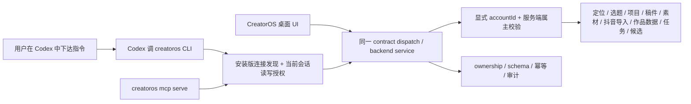

# CreatorOS 全能力 CLI 与 Codex 操作闭环 SPEC

- **任务**：T-843
- **日期**：2026-08-15
- **阶段**：DEFINE / PLAN（待独立复审）
- **用户确认**：2026-08-15，用户明确要求把 CreatorOS 现有 Tool/contract 的全部业务读写能力通过 CLI 暴露给 Codex；拒绝“CLI 只读、写操作返回桌面端逐项审批”的方案。
- **替代范围**：本 SPEC 整体替代同日“只读 + Agent Action 确认卡”方案；旧评审回执只保留审计历史，不再授权实现。

## 1. 一句话结论

新增随 CreatorOS 桌面安装包交付的 `creatoros` CLI。它不是第二套 CreatorOS，而是现有
`@creatoros/contract` 全部注册 operation 的命令行投影：Codex 能通过同一后端、同一账号、同一真实
ID，读取和操作定位、选题、项目、稿件、素材、作品数据、任务、候选、复盘和发布登记等现有能力。

CLI 获得当前本机用户主动开启的一次完整读写授权后，所有已注册业务 operation 都可调用；每条命令
可显式绑定一个已验证属主的抖音账号，因此 Codex 能同时操作 3 个账号而不依赖共享“当前账号”。写操作
在命令行用 `--apply` 表明本次确实执行，删除、对外发送等高影响操作再用 `--confirm-impact` 明确目标。
这些是命令调用语义，不是要求用户返回 CreatorOS 点第二次确认。CreatorOS UI 保持原样，也与 CLI
立即看到彼此写入的同一份数据。



## 2. 用户问题与产品取舍

### 2.1 用户真正要解决的问题

CreatorOS 已经有较完整的业务能力，但主要入口是桌面 UI 和应用内 Tool。Codex 无法稳定发现安装版
随机端口，也没有一个可枚举、可组合、可脚本化的正式命令面。用户希望直接告诉 Codex“读取当前定位、
补一批选题、找这条作品的数据、更新稿件、生成素材、采纳结果”，由 Codex 串联已有能力，而不是每次
都手工点页面。

### 2.2 已确认取舍

1. **完整投影，不做能力阉割**：当前 `ENDPOINTS` 注册的全部 operation 都能发现并调用；不因调用方是
   CLI/MCP 就把写操作隐藏。
2. **一次授权，不逐项回 UI 审批**：当前用户在 CreatorOS 设置中开启本次启动的“CLI 完整读写访问”
   后，CLI 可执行用户名下全部已验证账号的 contract operation；每次实际业务调用仍只绑定一个明确
   账号；应用退出或用户关闭授权后立即失效。
3. **用户指令就是委托**：Codex 根据本轮用户指令调用写、采纳、删除等 operation。已有“AI 先产候选、
   确认后落库”业务链不改；Codex 可在用户明确要求采纳时直接调用现有 confirm/adopt operation。
4. **同一服务，不复制业务**：CLI 只做连接、schema、序列化、调用、等待和展示；业务判断、归属和写入
   仍由 backend service 完成。
5. **不等于裸库或万能本机权限**：完整能力指“全部正式业务 contract”，不包括 SQL、应用私有文件、
   密钥、Cookie、任意 shell/文件系统或尚未进入 contract 的内部 route。

## 3. 现状证据

1. 仓库已有 `mcp-server/`，能从 `@creatoros/contract` 的 `ENDPOINTS` 生成 MCP tools，并通过
   `/api/v1/dispatch` 调用业务 operation。
2. 当前静态注册共 **248 个 operation**：101 个 GET，147 个 POST/PATCH/PUT/DELETE；仅靠 HTTP method
   不能表达“异步任务、幂等、删除、出网”等真实调用语义。
3. 现有 MCP 固定使用 `http://localhost:3000`，不能自动找到正式桌面端随机端口，也不会携带桌面启动
   handshake；对正在运行的安装版直接访问 dispatch 会返回 403。
4. `mcp-server` 在 pnpm workspace 与 CI 中，但没有随 macOS/Windows 桌面 runtime 交付，因此不能把
   开发态能列工具当成用户已获得 CLI。

## 4. 范围与需求

### FR-CLI-01 — 全量业务读写投影

`creatoros operations list` 必须列出当前 `@creatoros/contract` 注册的全部 operation；
`creatoros call <operation>` 必须能够调用每一个 operation，包括读取、创建、修改、确认、采纳、取消、
删除和已存在的对外操作。当前基线必须达到 248/248；未来新增 contract operation 自动进入 CLI，不能
靠手工维护第二张能力表。

完整投影至少覆盖：

- 账号与定位的读取、生成候选、版本和当前定位更新；
- 抖音账号列表、扫码绑定、CLI 账号切换/显式选择、登录态和账号归档；
- 选题来源、候选池、筛选、补全、淘汰、采纳与立项；
- 项目、Brief、论点、脚本版本、审核、预测与发布包；
- 文档、知识、素材、截图、录屏、图片/视频素材和素材引用；
- 视频决策、渲染与其他长任务的创建、查询、等待、取消、确认；
- publication、内容日历、作品指标、评论、复盘和 learning；
- 抖音本人作品/指标刷新导入，以及抖音分享链接素材导入；
- 设置中本来就允许用户操作且已进入正式 contract 的其他能力。

### FR-CLI-02 — 自动发现与自描述

CLI 从唯一 contract 生成 operation 名称、输入/输出 schema 和说明，并为每个 operation 补齐机器可读
执行元数据：

```ts
type CliEffect = "read" | "write" | "destructive" | "external";
type CliConfirmation = "none" | "apply" | "confirm_impact";

interface CliOperationPolicy {
  effect: CliEffect;
  confirmation: CliConfirmation;
  asyncTask: boolean;
  idempotency: "not_applicable" | "native" | "gateway";
}
```

这里没有 `hidden`：所有正式 contract operation 都可见、可调用。新增 operation 若缺元数据，contract
穷尽测试失败，不能用 method、URL、名称或描述临时猜测。

### FR-CLI-03 — 正式安装版连接

运行中的 CreatorOS 为当前 OS 用户写入一份严格权限的启动级连接描述，至少包含随机 loopback 端口、
协议版本、产品/包身份、进程 ID、启动 nonce、过期时间和不可打印的短期访问凭据引用。该授权属于
当前用户，不把桌面 UI 此刻选中的账号固化进 descriptor。CLI 必须验证：

- 描述文件属于当前 OS 用户且权限/ACL 正确；
- CreatorOS 进程、启动 nonce、包身份和协议版本匹配；
- loopback 服务仍在运行，激活和当前账号上下文有效；
- 访问凭据不出现在命令参数、普通 stdout/stderr、日志或诊断 JSON 中。

开发服务器只允许通过显式开发参数连接，不能静默回退 `localhost:3000`。同机存在多个 CreatorOS 包时
必须按 descriptor 的产品/包身份确定目标，歧义时失败并列出不含凭据的候选。

### FR-CLI-04 — 完整读写授权与执行语义

CreatorOS 设置增加最小“CLI 完整访问”控制：显示未启用/本次启动已启用、当前连接和撤销入口。用户
开启后，授予当前 CreatorOS 启动生命周期内、当前 user 及其全部已验证 active account 的 contract
读写能力；每次调用的 accountId 必须单独带入并由服务端重新验属主；不对每条命令再生成桌面确认卡。

- 读取命令直接执行。
- `write` 命令必须带 `--apply`，缺少时只返回结构化 `confirmation_required`，不写入。
- `destructive` / `external` 命令必须同时带 `--apply --confirm-impact <target-or-reference>`；服务端
  根据真实 schema/当前实体校验目标，不信任客户端自报 effect、userId、accountId 或 ownership。
- confirm/adopt/reject/cancel/delete/publish 等现有 operation 本身就是完整调用面的一部分；CLI 不阻断，
  也不要求回 UI 点击。
- Codex 只有在用户指令覆盖该动作时才应带执行标志；CreatorOS 记录这是 delegated CLI invocation。

该授权改变的是入口，不改变领域规则。语义生成仍走现有 AI 任务并先产候选；用户在 Codex 对话里明确
要求“采纳/确认”后，Codex 调现有 adopt/confirm operation，由 backend service 带 ownership 守卫落库。

### FR-CLI-05 — 长任务可恢复等待

任何现有异步 operation 返回真实 task/run/action ID。CLI 提供 `tasks get` 与 `tasks wait`：

- wait 只轮询/订阅同一 ID，不因超时、断线、Ctrl-C 或应用重启自动重提任务；
- Ctrl-C 只停止本地等待，不取消后台任务；取消必须显式调用现有 cancel operation；
- 输出真实步骤、进度、待确认、成功、失败、取消等状态；不能把“已提交”显示成“已完成”；
- 失败返回脱敏的现有错误和 request/task ID，不编造候选或成功结果。

### FR-CLI-06 — 权限、幂等与审计

所有调用仍经现有激活、当前 user/account、真实 ID、schema 和 backend ownership 守卫；CLI/MCP 不直连
数据库，不可提交或覆盖服务端 RequestContext。

所有写操作必须带幂等键。原 operation 已有原生幂等时透传；没有时由 Gateway 记录 invocation：

- 幂等作用域是 `userId + accountId/user-scope + operation + key`；同一 key + 同一规范化 input hash
  命中同一 invocation，绝不重新执行；同一个 key 可在不同账号独立使用；
- 同一 key + 不同 hash 返回 conflict；
- Gateway 在执行前持久记录 operation、input hash、目标 refs、request ID 与状态；
- 成功后把已经通过真实 contract response schema 校验和脱敏的 response envelope 用应用主密钥加密，
  作为独立的短期幂等结果缓存保存 24 小时；它不进入普通审计、日志、descriptor 或诊断包；
- 24 小时内的同 key+hash 重试解密返回原 response，并标记 `duplicate: true`；缓存过期后只返回稳定的
  duplicate receipt（原 requestId、终态、taskId/targetRefs 和 `result_expired`），不重放业务写入；
- 正在执行的重复请求返回原 invocation 的 running receipt；已失败返回同一失败终态，不自动重试；
- 若进程崩溃导致结果无法判断，返回 `outcome_unknown/manual_reconcile_required`，禁止自动重放；
- 加密结果缓存到期必须删除；任何时候都不得缓存 contract 本来禁止返回的 API Key、Cookie、handshake
  或内部秘密。正文/素材等合法业务响应仅可存在于该加密短期缓存，不进入审计明文字段。

CLI 的“完整读写”不能弱化既有响应脱敏。contract 当前不返回的密钥/内部字段，CLI 也不得返回。

### FR-CLI-07 — CLI 与 MCP 同源交付

随 macOS 和 Windows 正式安装包交付可直接运行的 `creatoros`，用户不需要安装 Node、pnpm 或 tsx。
现有 MCP 改为复用同一连接发现、operation registry、Gateway client、错误和 JSON 协议；
`creatoros mcp serve` 暴露同样的全部 operation，不保留第二份调用逻辑或不同能力范围。

### FR-CLI-08 — 多账号显式上下文与抖音导入

CLI 必须把“当前账号”从浏览器 localStorage 的隐式状态提升为可脚本化上下文：

- `accounts list` 列出当前用户名下的真实 active/archived 平台账号和真实 ID；
- `accounts use <accountId>` 可为人工连续使用设置 CLI 本地默认账号，但不改变桌面 UI 当前选中账号；
- 所有账号级 `call` 支持 `--account <accountId>`，其优先级高于本地默认账号；Codex 自动化和并行调用
  必须显式使用该参数，禁止靠执行 `accounts use` 抢一个进程共享的全局选择器；
- Gateway 把 `--account` 转为 RequestContext 的候选账号，再按真实 userId 查询 `platform_accounts`
  验证 active、属主和平台；不存在、不属主、已归档时同貌拒绝，绝不降级到默认号或全账号；
- invocation、idempotency hash、task、候选和领域结果都必须携带同一账号上下文，同一幂等键在不同
  账号不碰撞，回调/重启恢复也不能串号；
- 至少支持 3 个账号同时发起互不依赖的 read/write/task/wait 调用。允许复用现有抖音限流保护，但限流
  只影响执行节奏，不能把账号 A 的登录态、任务或结果写到账号 B。

抖音导入使用现有真实能力而不是另造抓取器：

1. `ingestion.douyin.login` + `forceNew` 打开真实扫码窗口，绑定/复用稳定抖音身份并建立账号专属登录态；
2. `ingestion.douyin.status` 按账号检查真实登录和采集源状态；
3. `ingestion.douyin.refresh` 按账号导入本人作品、publication、指标和系统现有后续处理；
4. `intelligence.items.importDouyinShare` 按账号导入用户提供的抖音分享链接并返回真实任务 ID。

若盘点发现桌面 UI 的某项“抖音导入”仍只走内部 route/service、未进入 `ENDPOINTS`，本任务必须先把
该现有能力提升为正式 contract operation，补 schema、ownership、effect 和幂等，再由 CLI 自动获得；
不能用“当前不在 contract”删掉用户已明确要求的现有功能。

## 5. 用户流程

### FLOW-CLI-001 — 发现、读取与直接修改

1. 用户在 CreatorOS 设置中开启“本次启动允许 CLI 完整读写”。
2. Codex 执行 `creatoros status --json`，验证安装版、账号、协议和授权状态。
3. Codex 用 `operations list/describe` 找到定位、选题、作品数据或项目 operation。
4. 读取命令直接返回同 UI 一致的真实 ID 和数据。
5. 用户要求修改后，Codex 以幂等键和 `--apply` 调写 operation。
6. UI 无需刷新数据模型即可读取同一写入；CLI 也能读回用户随后在 UI 做的变更。

### FLOW-CLI-002 — 生成任务与等待

1. Codex 调现有生成/采集/分析 operation，获得 task ID。
2. `creatoros tasks wait <taskId>` 只等待该任务并输出步骤。
3. 若任务产出候选，CLI 返回候选真实 ID，不自动冒充 active 数据。
4. 用户要求采纳后，Codex 直接调用 contract 中对应 confirm/adopt operation。
5. CLI 读回正式结果，CreatorOS UI 同步可见。

### FLOW-CLI-003 — 删除、取消或对外动作

1. Codex 先读取目标当前真值和版本。
2. 用户明确要求执行后，Codex 调对应 operation，携带 `--apply`、幂等键和
   `--confirm-impact <真实目标引用>`。
3. Gateway 重新校验当前 user/account、目标、版本和 effect，调用现有 backend service。
4. 返回真实终态和审计 request ID；不要求用户再回 CreatorOS 点确认卡。

### FLOW-CLI-004 — 三账号并行与抖音作品导入

1. Codex 用 `accounts list` 获取账号 A/B/C 的真实 ID，不按昵称猜账号。
2. 三条并行命令分别显式携带 `--account A|B|C`，各自获得独立 request/task ID。
3. 对需要重新绑定的账号调用 `ingestion.douyin.login`；CLI 返回“等待用户扫码”的真实交互状态，
   用户完成扫码后再按同一账号查询 status，不能冒充自动登录成功。
4. 分别调用 `ingestion.douyin.refresh` 导入各号本人作品/指标，或调用
   `intelligence.items.importDouyinShare` 导入指定分享链接。
5. 三个 wait 独立恢复；读回时校验每条 publication、metric、candidate/task 的 accountId，任何缺号、
   串号或回退全局都判失败。

## 6. 命令与稳定协议

### API-CLI-001 — operation 目录

```bash
creatoros operations list --json
creatoros operations describe <operation> --json
```

输出至少含 `operation`、method、path、description、input/output JSON Schema、effect、confirmation、
asyncTask、idempotency 和 contract version。排序稳定；未知字段向前兼容。

### API-CLI-002 — 通用调用 Gateway

```bash
creatoros call <operation> --input '<json>' --json
creatoros call <operation> --input @payload.json --json
creatoros call <operation> --input - --json
creatoros call <operation> --account <accountId> --input @payload.json --json
creatoros call <write-op> --input @payload.json \
  --idempotency-key <key> --apply --json
creatoros call <destructive-or-external-op> --input @payload.json \
  --idempotency-key <key> --apply --confirm-impact <target-ref> --json
```

统一 envelope：

```json
{
  "ok": true,
  "operation": "projects.update",
  "requestId": "req-...",
  "data": {},
  "error": null
}
```

失败也输出可解析 JSON；退出码区分输入错误、未连接/未授权、冲突、业务拒绝、任务失败和内部错误。

### API-CLI-003 — CLI 授权状态

```bash
creatoros access status --json
creatoros access revoke --json
```

开启操作从 CreatorOS 设置执行，避免后台程序静默扩大权限；status/revoke 不输出访问凭据。撤销后已有
命令立刻失败，后台已提交任务按既有生命周期继续，除非显式取消。

### API-CLI-004 — 任务投影

```bash
creatoros tasks get <taskId> --json
creatoros tasks wait <taskId> --json
```

只是常用 task contract 的便利别名，不创建第二套任务 API 或状态机。

### API-CLI-005 — 安装版连接描述

由桌面原生壳/sidecar 在每次启动创建，退出时撤销；只供当前 OS 用户读取。CLI 从标准平台路径发现，
不要求用户复制端口或 token，也不把 descriptor 当长期登录凭据。

### API-CLI-006 — 账号上下文

```bash
creatoros accounts list --json
creatoros accounts current --json
creatoros accounts use <accountId> --json
creatoros call <operation> --account <accountId> --input @payload.json --json
```

`accounts use` 只更新当前 OS 用户的 CLI 本地默认上下文，原子写入且不进入业务数据库；它不修改桌面
UI 的 localStorage/cookie，也不适用于并发协调。自动化必须给每条账号级调用显式传 `--account`。
账号创建、扫码登录这类尚无 accountId 的 user-scope operation 可以不传；一旦返回真实账号 ID，后续
调用必须使用该 ID。

## 7. 数据与归属

### ENT-CLI-001 — CLI Invocation Audit

只新增最小调用审计/幂等元数据，不新增项目、素材、候选或任务副本：

| 字段 | 说明 |
| --- | --- |
| `invocationId` | 服务端真实 ID |
| `userId/accountId` | userId 从授权上下文得到；CLI 只选择 accountId，服务端验属主后写入 |
| `clientId` | 当前 CLI/MCP 启动实例 |
| `operation` | contract operation ID |
| `effect` | 服务端 registry 分类 |
| `idempotencyKey/inputHash` | 写调用去重；不保存完整正文 |
| `targetRefs` | 可审计的真实实体引用 |
| `requestId/taskId` | 关联现有执行真值 |
| `status` | received/running/succeeded/failed/outcome_unknown |
| `createdAt/finishedAt` | 服务端时间 |

幂等结果缓存与审计实体物理/逻辑分离，只保存 `invocationId`、response schema version、密文、nonce/tag
和 `expiresAt`。密文只能在同 user/account/operation/key/hash 命中且授权仍有效时解密；删除、撤销授权
或到期后不得为了返回旧 payload 绕过当前权限。缓存丢失不等于允许重放：仍按 invocation 终态返回
`result_expired` 或 `outcome_unknown`。

数据归属继续由原业务实体决定。CLI 不新增跨账号总览，不把 `accountId=null` 当“全部账号”。
`--account` 只是请求选择，必须经过与桌面 dispatch 同源的 `verifyAccountSelection`；业务 input/header
不能覆盖验证结果。

## 8. 设置界面

### UI-CLI-001 — CLI 完整访问

在现有设置中增加一个小区域：

- “CLI 完整读写访问：未开启 / 本次启动已开启”；
- 用大白话说明 Codex/本机命令可读取和修改当前账号中的全部 CreatorOS 业务数据；
- “本次启动开启”与“立即撤销”按钮；按钮必须真实生效；
- 显示 CLI 是否已安装、当前连接数和最后一次调用时间，不展示 token、端口、input 或内容正文；
- 不增加逐 operation 白名单、审批收件箱或每次写入确认卡。
- 授权说明明确覆盖当前用户名下全部账号，但任何一次调用只作用于命令显式选择的一个账号。

## 9. 安全边界与明确非目标

### 9.1 完整开放的是正式业务 contract

以下内容不属于 CLI 能力面：

- 原始 PGlite/Postgres/SQLite SQL 与 repository 直连；
- CreatorOS app-data 私有文件、数据库文件、加密安全日志、Keychain/Credential Manager；
- 模型 API Key、session cookie、handshake、master key、激活秘密；
- 任意本机文件系统、shell、浏览器 Cookie；
- 未提升为 contract operation 的 `/api/v1/local/*` 等内部 route；
- 绕过激活/license、用户或账号 ownership；
- 在 CLI/MCP 中复制领域业务逻辑或直接 import repository。

“全部 operation”不等于“全部内部实现”。若未来确实要让 Codex 使用某项内部能力，应先把它定义成
正式 contract operation，补 schema、ownership、effect、幂等和测试，再自动进入 CLI。

### 9.2 用户确认与 AI 候选边界

P-01 不要求确认动作只能发生在桌面 UI。CLI 场景中：

- 用户在 Codex 对话里发出明确操作指令；Codex 作为受委托操作者调用 CLI；
- `--apply` / `--confirm-impact` 使实际执行与只读探查可区分并进入审计；
- AI 创作、排序和语义选择继续使用现有 Skill/模型，只产候选；
- 只有用户明确要求采纳时，Codex 才调用现有 adopt/confirm operation；真正写库仍由 backend service
  执行，AI runtime、CLI 与 MCP 都不直连数据库。

本设计不支持无人值守地无确认批量发布内容；若用户未给出对应指令，Codex 不应自行调用高影响写操作。

## 10. 验收标准

### AC-CLI-01 / TEST-CLI-001 — 248/248 穷尽

- 当前 contract 248 个 operation 全部在 list/describe 中，名称、schema 与 contract 一致。
- 每个 operation 都有 effect/confirmation/asyncTask/idempotency；漏一个测试即失败。
- 新增 operation 后无需改 CLI/MCP 手工清单即可出现。

### AC-CLI-02 / TEST-CLI-002 — 真实全域读写

在隔离测试账号至少完成：定位读取与更新、选题候选读取与立项、项目/Brief/脚本修改、素材创建与引用、
publication/作品指标读取与允许的修改、候选任务创建/等待/采纳。每一步使用真实 ID，CLI 写后 UI 可见，
UI 写后 CLI 可读。

### AC-CLI-03 / TEST-CLI-003 — 授权与 ownership

- 未开启、已撤销、过期、PID/nonce/协议/包身份不匹配均 fail-closed。
- 即使持有合法启动授权，跨 user/account、伪造 ID、旧版本或 schema 错误仍被 backend 拒绝。
- CLI 不能提交 userId/accountId/risk/effect 覆盖服务端上下文。

### AC-CLI-04 / TEST-CLI-004 — 安装版和秘密

- macOS/Windows 安装后无需 Node 即可运行；卸载/PATH 行为明确。
- stdout/stderr、descriptor、普通日志、审计和错误不出现 Key、Cookie、handshake、master key 或完整敏感
  payload；现有 contract 脱敏不因 CLI 失效。
- CLI 未开启时现有桌面 UI、任务、数据和启动行为零回归。

### AC-CLI-05 / TEST-CLI-005 — 长任务恢复

`create → wait → Ctrl-C → get/wait → terminal result` 始终绑定同一 task ID，无自动重提；应用重启后按
既有持久任务真值恢复。失败、取消、待确认和成功状态不混淆。

### AC-CLI-06 / TEST-CLI-006 — 写入与破坏性操作

- write 缺 `--apply`、destructive/external 缺目标确认时零领域写入并返回结构化要求。
- 在隔离数据上通过 CLI 真正完成 confirm/adopt/cancel/delete；不弹 CreatorOS 二次确认卡。
- 同 key+同 hash 在 24 小时内跨进程重启返回原 schema-valid response，过期后返回稳定
  `result_expired` duplicate receipt 且不重复写；同 key+不同 hash 冲突；执行中崩溃造成结果不明时
  不自动重放。
- 覆盖同步成功、异步 task 成功、含合法敏感业务内容的加密响应、缓存到期、权限撤销、同 key 异 hash、
  A/B/C 三账号同 key 隔离和执行中崩溃；普通审计与日志不得出现 response payload。

### AC-CLI-07 / TEST-CLI-007 — CLI/MCP 一致和双平台闭环

CLI 与 `creatoros mcp serve` 对相同 operation 使用相同 schema、effect、连接、错误和结果。macOS 与
Windows 正式安装版各完成：

```text
status → operations list → 读取定位 → 创建/更新业务数据 → 创建候选任务
→ wait → 通过 CLI confirm/adopt → CLI 与 UI 双向读回 → 隔离数据 destructive 操作
```

开发服务器、单元测试或只列出工具不能替代该真安装 E2E。

### AC-CLI-08 / TEST-CLI-008 — 三账号并行、切换与抖音导入

- 绑定或准备 3 个隔离验收账号，`accounts list` 返回三个真实且可区分的账号 ID；CLI 默认账号切换不
  改桌面 UI，显式 `--account` 始终覆盖默认。
- 同时对 A/B/C 发起定位读取、项目/选题写入和长任务，三个任务可并行等待且所有结果严格按号隔离；
  伪造、归档或不属主 accountId 同貌失败，不回退其他号。
- 在真实安装版用账号专属登录态完成 `status → refresh → publication/metric read-back`；各号只出现
  自己的抖音作品和指标。分享链接导入返回真实 task/item，落在命令指定账号。
- 对至少一个全新绑定流程验证 `forceNew → 用户扫码 → 稳定账号 ID → 专属 authDir`；扫码未完成、
  登录过期、平台限流和部分账号失败必须逐号诚实显示，不拖成“全部成功”或互相污染。

## 11. 实现边界与依赖方向

1. `contract/` 仍是唯一 operation/schema/policy 真相，不 import CLI、frontend 或 backend。
2. CLI/MCP 只依赖 contract 与共享 Gateway client，不 import backend repository。
3. Gateway transport 位于 backend/desktop 边界，调用现有 dispatch/service port；不建立第二套领域 API。
4. frontend 只增加 UI-CLI-001 设置控件；不承载 CLI 业务模块或 Agent SDK。
5. worker/ai-runtime 的候选语义与现有任务链不迁入 CLI。
6. desktop packaging 负责双平台可执行文件、标准路径、连接 descriptor、启动/退出撤销和卸载契约。
7. 多账号请求复用既有 `x-account-id → verifyAccountSelection → RequestContext` 咽喉；CLI 不新建一套
   account session，不从 endpoint body 直接相信 accountId。

## 12. 实现前 Gate 与完成证据

本任务改变授权入口和安装包，需要：

1. 本 SPEC 独立复审 PASS，旧限制版回执标记失效；
2. 用户确认的“全部 contract 读写 + 无逐项 UI 审批”写入 DEC-CLI-001；
3. contract 穷尽、Gateway、ownership、幂等、安全、CLI/MCP、设置控件测试通过；
4. boundary/orphan/trace/reconcile 运行并诚实记录既有范围外失败；
5. macOS 和 Windows 正式安装包完成 TEST-CLI-007，并以 3 个隔离账号完成 TEST-CLI-008；
6. 未发生的历史证据不得补拍，未完成双平台安装验收不得宣称 CLI 已正式交付。

## 13. 明确不改

- 不删除、替换或重设计 CreatorOS 现有页面与业务流程；
- 不新建另一份项目/定位/选题/素材/作品数据；
- 不让 CLI 直接写数据库，不让 MCP 自建业务服务；
- 不增加多人团队、云同步、远程公网控制或无确认自动批量发布；
- 不把内部密钥、激活、日志或原始文件访问包装成“完整能力”；
- 不在本任务内修复与 T-843 无关的既有 reconcile 欠债。
