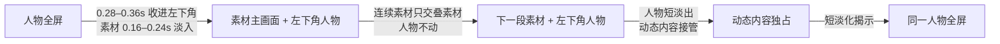

# T-859 SPEC：竖屏素材段左下角人物与无白闪交接

> **2026-08-19 纠偏**：本规格中“动态内容卡独占并隐藏人物”及素材可选择 `hidden` 的竖屏默认已被
> 用户真实成片验收否定，由 [T-902 SPEC](2026-08-19-portrait-presenter-first-face-persistent.md) 与
> DEC-VIDEO-056 取代。保留同一人物节点、固定左下几何、连续素材不弹跳、预加载和无白闪规则。

**状态**：待独立评审
**用户确认**：2026-08-16，用户在 T-858 v5 真实短样片上明确反馈：“素材出来人物可以到左下角去，竖屏的话；然后尽量少一些这种切换时的白屏，切换更丝滑一下。”
**承接**：T-858 已实现整片编导方向、单一主视觉、统一舞台、动态内容与字幕重点词；本规格仅取代其竖屏素材段人物退出和硬切交接策略。

## 1. 问题与结果

T-858 v5 在人物、两段浅色录屏、深色动态内容和人物之间使用帧边界硬切。画面没有真正的空文件，
但浅色素材整画布突然出现，加上素材节点在边界才显示，视觉上形成“白屏一下”的亮度跳变；人物在素材
窗完全消失，也失去了用户此轮确认的陪伴感。

本次结果是：竖屏 B-roll 素材仍占据主舞台，人物在同一时间窗平滑收进左下角成为辅助 PiP；相邻素材
连续播放时人物保持原位，不反复缩放。素材、动态内容和人物之间以短交叠淡化完成交接，媒体提前加载，
不暴露空白占位帧。动态内容卡默认仍独占舞台，避免把人物长期贴在所有信息画面上。



## 2. 已确认需求

### FR-859-1：竖屏素材段使用左下角人物 PiP

- `orientation=portrait` 且主视觉为 B-roll 素材时，素材保持完整 `contain` 并占主舞台；人物作为辅助层
  收进左下角，不再居中缩小。
- 人物 PiP 使用固定 9:16 几何，距左边和字幕安全区留出明确边距，不遮挡字幕；圆角与轻阴影只用于
  分离层级，不添加厚边框、卡片底或第二路动态背景。
- 人物从全屏到 PiP、PiP 到全屏均使用同一原视频节点做几何 tween，不重启人物媒体，不改变人物
  时间轴，也不出现跳帧或回到错误位置。
- 相邻 B-roll 时间窗连续且都需要 PiP 时，人物保持同一左下角几何；只交接素材，不执行
  `全屏 → PiP → 全屏 → PiP` 的弹跳。
- 动态内容卡不是 B-roll 素材，默认继续独占主舞台；进入卡片时 PiP 短淡出，回到人物时在隐藏状态
  恢复全屏几何后再淡入。

### FR-859-2：素材人物模式可追溯

素材匹配 AI 的结构化候选增加可选 `speakerMode: "hidden" | "pip_bottom_left"`。AI 可依据素材用途和
导演上下文选择人物是否保留；组装器只透传合法选择。为落实本轮用户已确认的产品默认，旧模型或旧
候选未返回该字段时，竖屏主 B-roll 确定性降级为 `pip_bottom_left`，横屏仍为 `hidden`。这条降级只
落实用户明确画幅偏好，不根据文件名、关键词或内容类别猜创作语义。

### FR-859-3：无空白占位帧的平滑交接

- 所有视频 B-roll 节点设置媒体预加载；显示前保持可解码节点存在，不能等到边界才创建媒体。
- 人物→素材、素材→素材、素材→动态内容、动态内容→人物使用 0.12–0.36 秒的短交叠淡化或几何缓动；
  交叠仅是转场过程，不改变 beat 的语义时间窗。
- 不再以 `autoAlpha: 1` 的单帧硬开关显示完整浅色素材。素材前景、静态承接层和舞台容器使用同一
  受控淡入；退出后明确归零，不能在后续 beat 残留。
- 转场期间必须始终有已解码的人物、上一素材、下一素材或静态承接层之一覆盖画布；禁止纯白/纯黑
  空白占位、浏览器默认背景、未加载视频首帧或无主视觉帧。
- 浅色 UI 本身允许为白色；验收判断的是是否出现无内容空帧、单帧亮度突变或媒体加载闪烁，不把
  用户素材的真实白底误判为错误。

### FR-859-4：保留 T-858 的内容与字幕能力

本次不改 motion thesis、beat graph 的唯一主视觉语义、卡内 Scene Graph、字幕文本、双语排版或
重点词来源。素材是主视觉，左下角人物是用户明确批准的辅助层，不成为第二个 beat；代码仍只执行
真实引用、时间、画幅、安全区和已确认偏好。

## 3. 契约与执行

### 3.1 素材决策

`VideoBrollPick` 与素材匹配结构化结果增加：

```ts
speakerMode?: "hidden" | "pip_bottom_left";
```

该字段随已有 B-roll pick、checkpoint、局部补充素材和 render props 保留。非枚举值按现有结构化
结果校验失败；旧候选字段缺失可读，不伪造 AI 理由。

### 3.2 组装器

- 明确值优先：`broll.speakerMode` 原样透传。
- 字段缺失时仅按用户确认的输出画幅降级：portrait 主 B-roll 为 `pip_bottom_left`，landscape 为
  `hidden`；`overlay` 不借此升级为主视觉。
- 组装器不检查文件名、素材类别、画面颜色或文案关键词。

### 3.3 渲染器状态机

渲染器从已校验 direction 和 B-roll `speakerMode` 得到每个主 beat 的人物显示状态：

- `talking_head → full`
- `broll + pip_bottom_left → pip`
- `broll + hidden → hidden`
- `card → hidden`

状态变化只控制同一 `#th` 节点的几何、透明度和层级。portrait PiP 位于左下角字幕安全区上方；PiP
层高于主素材、低于字幕。连续同状态不重复生成 tween。素材舞台节点以可复核的淡入/退出 helper
执行，不与旧场景人物布局 tween 并发争用同一属性。

## 4. 边界与兼容

- 不新增数据库、页面、视频引擎、模型供应商或第二条渲染链。
- 不做人脸识别、自动取景、颜色语义判断或关键词创作分支。
- 不修改原始人物视频、素材文件、SRT 或确认稿；只生成新候选与预览。
- 横屏维持人物隐藏的主视觉切走；旧候选没有 direction 时继续走原安全兼容，不因历史
  `pip_bottom_left` 字段自动生成未审镜头语法。
- 本次仅生成真实时间线代表性短样片；用户确认前不重渲整片、不出安装包、不发布。

## 5. 失败与恢复

- `speakerMode` 无效：该次结构化结果失败并按现有有限重试/明确降级处理，不能猜值。
- direction 引用不到 B-roll：沿用 T-858 fail-closed；不凭时间近似绑定素材。
- 媒体首帧未解码：保持上一有效视觉或静态承接层，不露浏览器默认背景；渲染任务记录可定位错误。
- PiP 与字幕安全区冲突：渲染前布局校验失败，不输出遮挡字幕的候选。
- 样片出现人物弹跳、居中缩小、素材窗人物时间轴重启、空白闪帧、单帧硬开浅色素材或回到人物时
  几何漂移，验收失败并继续修复。

## 6. 验收标准

### AC-859-1：左下角人物稳定

1080×1920 真实短样片中，人物从全屏平滑收进左下角，两段连续素材期间始终保持同一位置和时间轴；
进入动态内容时淡出，结束后回到同一全屏基底。关键帧证明 PiP 不居中、不挡字幕、无弹跳。

### AC-859-2：切换无白闪

围绕每个边界按 2–4 帧间隔密集抽帧。人物→浅色素材、浅色素材互切、浅色素材→深色动态内容、
动态内容→人物均无纯白/纯黑空帧、默认背景或未加载视频帧；素材内容和人物移动有连续中间状态。

### AC-859-3：契约与兼容

红测覆盖 `speakerMode` 的 schema/runner 保留、portrait/landscape 组装默认、direction 状态机、连续 PiP
不重复 tween、卡片隐藏人物、素材预加载和平滑舞台 helper；旧候选与横屏回归通过。

### AC-859-4：真实生产预览

复用 T-858 的真实人物、两段真实录屏、真实动态内容和字幕生成新的 14 秒 MP4、标准接触表及转场密集
接触表。样片由独立 reviewer 对照本 SPEC 审看；用户预览确认后才允许应用到整片。

## 7. 预期改动面

- `ai-worker/src/prompt/templates/material-match.ts` 及测试
- `backend/src/modules/ai-runtime/video-decisions-runner.ts` 及测试
- `contract/src/resources/video-render.ts` 及测试
- `frontend/src/features/production/assemble-video-render-props.ts` 及测试
- `backend/src/modules/execution/video-render/template.ts` 及测试
- `orchestrator/process/verify-t858-unified-stage-preview.mjs`
- `orchestrator/evidence/T-859/`

不新增跨层直连；AI 仍只产候选，backend runner 仍做唯一安全收口，renderer 只消费契约与用户已确认
画幅偏好。
