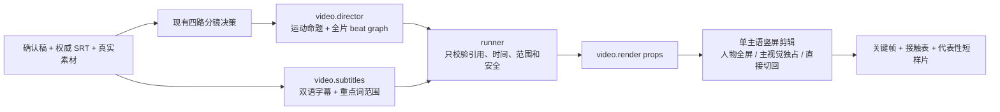

# T-858 SPEC：真实剪辑编导、竖屏统一舞台与字幕重点词

**状态**：方向修订后待重新独立评审
**用户确认**：2026-08-16，用户明确要求“要解决剪辑的问题，不光是更新 Skill”；随后明确否定“素材出现时人物自动居中缩小、结束后回位”的策略，要求解决镜头语法本身
**承接**：T-802 可组合 Scene Graph、T-823 主视觉、T-839 内容动效与空舞台、T-841 静态氛围底
**研究输入**：[外部视频制作 Skill 学习结论](../../research/2026-08-16-video-production-skills-method-study.md)

> **当前适用性（2026-10-25 对账更正）**：下文保留 2026-08-16 原规格作为历史。用户随后已在
> [T-902](2026-08-19-portrait-presenter-first-face-persistent.md) §2、§4 与
> [DEC-VIDEO-056](../../../orchestrator/archive/DECISION_LOG-archive.md) 确认新的竖屏人物规则。
> 本文流程图、FR-858-3、§3.1/§3.3、§5 和 AC-858-2 中的“人物隐藏／禁止 PiP／硬切回人物”及
> 对应通过或失败断言已被该决定取代，不得继续作为当前竖屏验收标准。存在真实口播输入时，
> talking-head 保持全幅基底，card 或非 overlay B-roll 期间人物平滑进入固定左下角并持续位于
> 内容层之上，相邻辅助画面不反复缩放，结束后回同一全幅几何；素材安全区域不得靠隐藏人物达成。
> 横屏仍按 T-902 保留原 hidden/PiP 策略；`visualOnly=true` 不生成真人，缺失或损坏的真人输入
> 仍按既有结构校验失败。其余方向、字幕重点词、引用、非重叠时间与恢复约束继续适用。
> 本条只标明既定后继决定的优先级，不改产品行为、不宣称原或本轮真实成片验收已经通过。

## 1. 问题与本次结果

当前正式链路已经分别拥有卡片 Scene Graph、B-roll `presentation` 和总导演审片，但三者没有一份
整片级运动方向。真实竖屏成片因此仍可能出现：横版素材像一张上方卡片、人物孤立在右下、两者之间
是黑洞；关系卡虽然“有动画”，但只是同权元素和箭头依次淡入；中英文字幕字号偏小，也没有 AI
选出的重点词。

本次不再增加一套视频引擎，也不以修改全局 Skill 冒充产品交付。唯一结果是：让正式
`video.decisions → video.render` 链具有可执行的整片编导方向，渲染成一套连续舞台，并用真实短样片
证明画面状态在推进。



## 2. 已确认需求

### FR-858-1：整片编导方向来自 AI

`video.director` 在读取完整候选时间线后，除审片结论外必须输出：

- 一句 `motionThesis`，说明整条片用什么视觉运动帮助理解；
- 按时间排序的 `beatGraph`，每拍只有一个主视觉主体；
- 每拍声明真实引用、起止时间、起止状态、运动动词、舞台形态、进出转场和是否回到同一人物几何。

代码不得根据关键词、卡片 kind、文件名或 relation 自己选择编导语义。现有卡片 Scene Graph 仍负责
卡内对象状态变化；新 beat graph 只负责整片主视觉交接，二者不互相复制。

### FR-858-2：重点词来自真实字幕语义

`video.subtitles` 可为每行中文字幕选择 0–2 个重点片段，并输出原文片段、Unicode 字符起止范围及
该行内的真实起止秒。runner 只接受能逐字对应最终 `zh`、字符范围合法、时间落在该行区间内的片段；
无效片段单独丢弃，不能重写字幕，也不能用词表重新猜重点。单行允许没有重点，但一条包含非空字幕的
T-858 的代表性验收候选全片至少要保留 1 个合法重点片段；首轮全部为空或全部被校验丢弃时，使用同一
`video.subtitles` Skill 对首个非空字幕批次做至多 1 次“必须选择真实重点”的结构化重试。重试后仍为
空时记录“重点词未产出”，保留真实字幕并使用无强调的安全基础样式，仍允许候选和短预览继续；该样例不能
作为 AC-858-3 的通过证据，也不能由代码补猜重点。

### FR-858-3：竖屏是一套连续舞台

- 人物口播 beat 占满竖屏；横版素材或动态内容画面成为主视觉时，由该画面独占视觉舞台，人物完全退出。
- 禁止“主视觉出现 → 人物自动缩成居中/角落 PiP → 结束再放大”的默认策略。PiP 不进入本次新候选的
  导演合同；旧候选中的 `speakerMode=pip_bottom_left` 仅为可读兼容，正式组装不再产出。
- `full_frame` 与现有 `large_stage` 都表示素材尺寸策略，不再决定人物是否保留。横版内容完整
  `contain`，竖屏承接层覆盖完整画布；结束时在明确帧边界直接切回进入前的全画布人物基底。
- 动态内容画面同样独占画布，不能在上方播放关系卡、同时把人物缩在下方；人物上的短重点词或指示
  可以作为附着信息，但不得成为第二主视觉。
- 氛围承接只能使用 CSS 静态渐变/纹理，不复制第二路视频、不执行动态大模糊，不裁切或拉伸用户素材。
- `overlay` 只用于 AI 明确选择的辅助叠层，并遵守人物与字幕安全区。

### FR-858-4：内容动效必须发生状态变化

现有 Scene Graph 的 `from → to` 仍是卡内动效单一真值。正式验收不把 relation、motion 枚举、整卡
淡入、同权圆角框和 PPT 连线计为内容动效；代表性样例必须至少出现一种可见对象的位移、数量、尺度、
显隐接管或路径进度变化。生产中结构不合法时按 T-802 既有契约只降级该卡，不中断整片；验收样例一旦
降级则判失败，不能拿兜底卡冒充通过。

### FR-858-5：字幕可读且强调可见

竖屏中文主字幕、英文副字幕分别使用适合 1080×1920 的独立字号、行高、描边/阴影和最大宽度；英文
不能附着在主字幕卡外成为 19px 小字。重点词用明确的字重与强调色/底色展示，但不闪烁、不改变原文、
不遮挡人物和主视觉。横屏同步提高可读性，但不破坏既有安全区。

## 3. 契约

### 3.1 AI 输出（内部候选）

`videoDirectorReviewSchema` 增加下列必需字段；模型调用失败时允许沿用现有确定性安全降级，但该次
候选明确没有 `direction`，不能在验收或运行记录中声称已完成内容编导：

```ts
type VideoDirection = {
  motionThesis: string;
  beatGraph: Array<{
    id: string;
    sceneIdx: number;
    startSec: number;
    endSec: number;
    subject: {
      kind: "talking_head" | "card" | "broll";
      ref: string; // talking_head | card:<sceneIdx>:<ordinal> | broll:<assetId>
    };
    startState: "base" | "off_canvas" | "takeover";
    endState: "base" | "off_canvas" | "takeover";
    motionVerb: "hold" | "cut" | "enter" | "exit" | "move" | "grow" | "shrink" | "replace" | "reveal" | "focus";
    stageMode: "base" | "takeover";
    transitionIn: "cut" | "fade" | "slide" | "scale";
    transitionOut: "cut" | "fade" | "slide" | "scale";
    returnGeometry: "same_base" | "not_applicable";
  }>;
};
```

`beatGraph` 的每一项都表示**唯一主视觉**，没有隐式“辅助 beat”。时间窗按
`previous.endSec <= next.startSec` 非重叠；相等表示在同一帧边界完成交接。`takeover` 期间人物不可见，
不存在隐式 PiP 支撑层。
模型需要新的主语时必须先结束上一拍；runner 对任何重叠直接拒绝整份 direction，不按数组顺序覆盖、
截短或猜谁是辅助。没有显式 beat 的间隙由人物 `base` 承接，不虚构新的 AI 决策。

`videoSubtitleLineSchema` 增加：

```ts
type SubtitleEmphasis = {
  text: string;
  startChar: number; // 按 Unicode code point，从 0 起，endChar 不含
  endChar: number;
  startSec: number;
  endSec: number;
};
```

每行 `emphasis` 默认空数组、最多 2 项。ai-worker 只产生结构化方向/字幕候选并通过受控执行端口返回；
backend service 是 checkpoint、候选、采纳投影与 render 请求的唯一持久化所有者，Worker 不打开数据库、
不保存第二份业务状态。原有模型配置和业务落盘通道不变。

### 3.2 runner 校验

- director facet 为每张卡和 B-roll 提供稳定真实 ref；beat 只能引用卡片与非 `overlay` B-roll 的主视觉集合。
- ref 绑定不可变候选版本与真实资源 ID。方向落盘、短预览组装及 `video.render` 真正执行前，backend
  service port 都必须按当前 RequestContext 重读根实体，核对 user/account/project、候选版本、资源
  存在性、有效时间窗与归属；可唯一重绑时使用当前真实值，否则返回明确冲突，禁止消费已删除、旧版本
  或跨项目资源。
- beat 时间必须位于所属场景与被引用对象的真实有效窗内，`startSec < endSec`，按时间排序；每项都是
  主视觉且相邻时间窗必须满足 `previous.endSec <= next.startSec`。任一重叠使整份 direction 无效并进入
  既有有限重试/明确降级记录，代码不截短、不按数组顺序覆盖，也不替 AI 新造主体或运动。
- talking head 只能是 `base`；卡片和非 `overlay` B-roll 主视觉只能是 `takeover`。AI 明确选择的
  辅助 `overlay` 不进入主视觉 beatGraph 的精确引用计数，只能附着在人物基底且不得驱动人物退出、缩放
  或回位；若把 `overlay` ref 写成 takeover beat，整份 direction 失败。非 overlay 主视觉拍必须声明
  `same_base`，表示结束后直接切回同一人物基底。
- emphasis 以校正后的 `zh` 做 Unicode code point 精确切片，`text` 必须逐字相等，时间必须在该 SRT
  行内。无效 emphasis 丢弃；中文、英文、SRT 时钟保持现有保真规则。全片合法 emphasis 数量为 0
  时执行 FR-858-2 的单次定向重试；仍为 0 时保留真实字幕和安全基础样式，记录增强未完成，不阻断候选或预览。
- `VideoDecisions.direction` 和字幕 emphasis 都随 checkpoint、候选、局部补充选材保留；旧候选字段
  缺失时可读，不能伪造补齐。
- director、subtitles、候选提交与 render 请求共享 backend 注入的 `taskId + operationId + attempt + fence`。
  相同 operationId 重放返回既有结算结果；定向重试只增加 attempt，旧 fence 的迟到结果不得写 checkpoint、
  候选或 render 请求，也不得重复计费。

### 3.3 render props 与模板

- `videoRenderProps` 增加可选 `direction`；`videoRenderCaption` 增加可选 `emphasis`。组装器只透传已
  校验值，不推导创作语义。
- 模板以 beat graph 的时间窗和舞台形态执行主视觉交接；字段缺失的旧候选走安全兼容布局。
- talking-head 基底几何只有一份；模板不再生成任何随素材窗缩小或放大人物的 tween。
- portrait `large_stage` 改为独占 cutaway：全画布静态氛围承接、无边框的完整素材前景，素材层与
  承接层整体盖过人物；移除人物 PiP、只清上半屏的黑色 clear 层和同源动态模糊媒体副本。
- 竖屏动态卡使用同一独占 cutaway 规则；卡片结束即揭示底下未变形的全画布人物，不执行几何回位动画。
- 字幕渲染按 code point 切成普通/强调 span；强调只在声明的 emphasis 时间窗内可见。

## 4. 边界与兼容

- 不新增数据库表、页面、视频引擎、模型供应商或第二套剪辑任务。
- 不改变用户素材、SRT、确认稿、采纳门与 `video.render` 的唯一编码流程。
- 不把 Motion Thesis 变成新的设置项；它是每次真实成片的 AI 候选产物。
- 不用代码做人脸识别、内容匹配或关键词打分。安全区只执行画幅、引用、时间、范围和不裁切约束。
- 旧候选继续可预览/渲染，但不会被标记为含 T-858 编导方向；新候选必须通过新增 schema。
- 用户预览确认前只生成代表性短样片，不重渲 157 秒整片、不出安装包、不发布。

## 5. 失败与恢复

- director 模型输出不合 schema：沿用现有有限重试与确定性安全降级，运行记录明确 `direction` 缺失。
- beat 排序或时间窗重叠会拒绝整份 direction，并进入既有有限重试；仍失败时明确记录无 direction，使用
  不含编导增强的安全基础时间线继续。只有单个 ref 不存在或范围越界、且移除它不需要代码选择主视觉也
  不破坏其余时间线语义时，才可丢弃该 beat 并记录原因；代码不得在重叠项之间替 AI 选择保留对象。
- 单个 emphasis 无效：只丢强调，保留该行真实字幕与翻译；若全片因此没有任何合法 emphasis，执行
  一次同 Skill 定向重试，仍为空则使用无强调基础样式继续，并把该增强标为未完成。
- 布局冲突先按确定顺序降级并记录：移除辅助 overlay → 切换安全基础布局 → 跳过单个问题素材或降级
  单卡 → 回到人物基底。只有输入损坏、权限/归属错误或所有安全输出路径都不存在时才允许整单失败；
  任何路径都不得输出有裁切、遮挡或人物回位漂移的成片。发生降级的样例不能作为 T-858 验收通过证据。
- 代表性样例发生 Scene Graph 降级、人物自动缩成 PiP、主视觉期间仍露人物、纯黑断层、第二路动态
  背景、字幕无强调或切回后人物几何漂移：验收失败，继续修复。

## 6. 验收标准

### AC-858-1：AI 决策可追溯

用真实确认稿/SRT/素材运行正式决策链，候选含非空 `motionThesis` 与按时间排序的 beat graph；抽查每拍
ref、场景、时间、stage 和回位均能指向当前 backend service port 重读的真实候选对象，代码中没有
关键词/文件名创作分支。补充候选换版本、资源删除、卡片重排和跨项目 ref 的拒绝或唯一重绑定用例。

### AC-858-2：竖屏统一舞台

1080×1920 代表性短样片同时含人物、横版主视觉、动态内容画面和切回人物。关键帧证明：素材完整
contain；主视觉接管期间人物完全不可见，模板没有人物缩放/位移 tween，也没有第二路动态视频背景；
切回后的人物 left/top/width/height 与进入前完全一致。

### AC-858-3：字幕与重点词

真实字幕至少一行含合法 AI emphasis。关键帧能清楚读出中英文，强调片段只在声明时间窗内高亮；字符
前后内容、SRT 行数、序号和时间不变。无效范围测试只丢强调、不改字幕。

### AC-858-4：不是动态 PPT

接触表至少覆盖三个连续状态，能看见同一认知对象的真实状态推进；等权框 + 箭头/整卡淡入反例测试
不能计入成功。样例 Scene Graph 未降级，主视觉交接时同一时刻只有一个主语。

### AC-858-5：工程与真实旅程

先红后绿覆盖 prompt/schema、runner、组装器、模板几何、字幕切片和旧候选兼容；通过 contract 与
frontend 类型检查、聚焦单测、boundary、semantic、diff-check，以及前端“生成分镜 → 确认 → 生成
短预览”的真实生产旅程。故障注入覆盖相同 operationId 重放、崩溃续跑、旧 fence 迟到完成、无 emphasis
安全预览、布局逐级降级和 Worker 无数据库依赖。输出实际关键帧、接触表和短 MP4，等待用户确认后才允许重渲整片。

## 7. 预期改动面

- `ai-worker/src/prompt/templates/video-decisions.ts` 及测试
- `backend/src/modules/ai-runtime/video-decisions-runner.ts` 及测试
- `contract/src/resources/video-render.ts` 及测试
- `frontend/src/features/production/assemble-video-render-props.ts` 及测试
- `backend/src/modules/execution/video-render/template.ts` 及测试
- 既有真实时间线预览脚本与 `orchestrator/evidence/T-858/` 验收产物

不新增跨层直连；AI 仍只产候选，backend service 仍是唯一持久化与安全收口，renderer 仍只消费契约。
