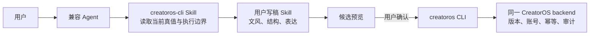

# CreatorOS 公开 CLI 编排 Skill SPEC

- 任务：T-872
- 日期：2026-08-17
- 用户确认：用户认可“CreatorOS Skill 管上下文与落地，用户写稿 Skill 管内容”的分工，并明确要求兼容不同 macOS 用户主目录及 Windows 安装路径。
- 上游：复用 T-843 已通过评审的 CLI/MCP、授权、operation registry、账号隔离、候选确认、幂等与审计契约；本任务不新增业务 API、数据库、页面或权限。

## 1. 目标

给 CreatorOS 外部用户一份可安装的标准 Agent Skill。用户安装后，可以让 Codex、Claude Code 或其他兼容 Agent：

1. 找到当前电脑随 CreatorOS 安装的 `creatoros` CLI；
2. 动态发现正式 operation 与 schema，不靠静态命令清单；
3. 在明确账号、项目和当前最新稿件上工作；
4. 把用户自己的写稿 Skill 当成可插拔写作模块；
5. 先展示整稿或局部改稿候选，用户确认后才通过 CLI 保存；
6. 保存后回读真实版本，不把任务提交或候选生成冒充落稿成功。



## 2. 公开 Skill 边界

公开 Skill 只负责编排和说明：

- 不直连数据库、私有 route、连接描述文件、凭据文件、Keychain/Credential Manager 或浏览器 Cookie；
- 不保存模型 Key、CLI 短期凭据、稿件正文缓存或用户目录；
- 不复制当前 operation 数量或完整 schema；调用前使用 `operations list/describe`；
- 不包含开发者姓名、本机绝对路径、固定 Windows 用户目录或内部专属写稿 Skill；
- 不让写稿 Skill 直接写 CreatorOS。写稿 Skill 只返回内容候选，CreatorOS Skill 在用户确认后调用 CLI；
- 不改变 T-843 的 `--apply`、幂等键、`--confirm-impact`、显式 `accountId`、异步任务与候选确认规则。

## 3. 跨平台 CLI 发现

每次新 Agent 会话只为当前会话解析一次命令，按以下顺序：

1. 使用当前进程的系统命令发现能力查找 `creatoros`：POSIX 使用 PATH 查找，PowerShell 使用 `Get-Command creatoros`；
2. PATH 未命中时，只检查当前登录用户对应的正式安装位置：
   - macOS：`<current-user-home>/.local/bin/creatoros`；主目录必须从运行时用户环境解析，禁止写成 `/Users/<某人>/...`；
   - Windows：`%LOCALAPPDATA%\CreatorOS\bin\creatoros.cmd`；禁止写成 `C:\Users\<某人>\...`；
3. 找到候选后运行 `--version` 和 `help`，只有两次输出均为 `ok=true` 的 JSON 且 usage 以 `creatoros ` 开头才接受；
4. 不递归搜索磁盘、不猜应用目录、不读取连接/凭据文件来绕过命令发现；
5. 仍未找到时，提示用户启动 CreatorOS、在“设置 → Codex 与 CLI 完整访问”点击“本次启动开启”，Windows 重新打开终端或 Agent 后再试；不得静默改 PATH 或复制 launcher。

Skill 安装位置与 CLI 安装位置必须分开说明。Skill 可放在 Agent 自己的用户级或项目级 Skill 目录；CLI 位置由 CreatorOS 安装器与当前 OS 用户决定。

## 4. 写稿 Skill 组合协议

### 4.1 职责

| 责任方 | 负责 | 不负责 |
| --- | --- | --- |
| CreatorOS Skill | 读取账号、项目、定位、素材、当前稿、版本；动态 describe operation；生成候选流程；确认后写入；写后回读 | 决定用户文风、替用户写作、猜项目/版本 |
| 用户写稿 Skill | 根据冻结上下文完成选题表达、结构、文风、整稿或局部改写；标注不确定事实 | 调 CLI、选择账号、落库、覆盖版本、自动采纳 |
| CLI/backend | schema、权限、账号属主、版本、幂等、任务、候选、审计和真实写入 | 内容创作判断 |

### 4.2 交给写稿 Skill 的最小上下文

CreatorOS Skill 先从当前服务读取并冻结：

```text
run = {
  accountId,
  projectId,
  outputId,
  artifactId,
  baseVersionId,
  positioning,
  currentScript,
  relevantSources,
  userRequest
}
```

这些 ID 不要求用户手填，也不能从旧聊天历史猜测。上下文只能按下面的规则收敛：

1. Agent 通过正式 list/get operation 读取当前授权用户可见的账号和项目；
2. 只有命中唯一账号、唯一项目，或用户本轮已经明确指定可辨识的账号/项目时，才继续；
3. 若存在多个合理候选，必须展示名称等可辨识信息让用户选择，禁止按列表首项、最近使用、旧对话或名称相似度自动决定；
4. 选定的 `accountId/projectId` 必须绑定本轮全部读取、候选、写入和回读，任何返回归属不一致都停止；
5. 真正写入前必须重新读取当前版本；若已发生并发修改，只有满足下面局部改稿的确定性重绑规则才可继续，否则停止并说明冲突。

### 4.3 写稿 Skill 返回

写稿 Skill 返回 Agent 内部候选，不是 CreatorOS API：

```text
draft = {
  mode: full | patch,
  content,
  target?: {
    kind: stable_block | exact_text,
    blockId?,
    beforeText,
  },
  changeSummary,
  factualUncertainties?,
  sourceNeeds?
}
```

CreatorOS Skill 必须先向用户展示候选。只有用户明确要求“采纳、写入、保存”后，才按动态 schema 调正式 write/confirm operation，并回读 `currentVersionId`、版本号、账号和项目归属。

`patch` 必须绑定 `baseVersionId` 和一个可验证目标：优先使用读取结果提供的稳定段落/区块 ID，并同时保留该区块的修改前原文；没有稳定 ID 时，只允许使用在基线稿中唯一出现的完整 `beforeText`。禁止凭段落序号、模糊描述、字符串相似度或旧光标位置落稿。写前重读后：

- `currentVersionId === baseVersionId` 时可按已确认目标写入；
- 版本已变化时，只有稳定 ID 仍指向同一归属且其原文完全未变，或 `beforeText` 在新稿中仍唯一且完全未变，才允许确定性重绑；
- 目标消失、原文变化、重复命中或归属变化时必须停止，向用户展示冲突并要求重新生成候选，禁止降级成整稿覆盖。

## 5. 授权、异步任务与制作链闭环

### 5.1 未授权与连接恢复

Skill 首次运行先执行 `creatoros status` 和 `creatoros access status`。命令存在但返回未授权、授权过期或桌面应用未运行时，必须停止业务调用，并引导用户启动 CreatorOS、在“设置 → Codex 与 CLI 完整访问”点击“本次启动开启”。只有用户完成操作后才重新检查；不得读取连接文件、注入开发环境变量或改用私有地址绕过授权。

连接中断时，先保留已获得的 `requestId/taskId/idempotencyKey/accountId/projectId`，恢复后查询原对象。已经拿到 `taskId` 或写请求已返回 `requestId` 时，禁止通过创建新任务或换幂等键来“重试”。无法判定原写请求结果时先按同一幂等键回放或回读目标版本，仍不能确定就停止并报告，不做第二次写入。

### 5.2 异步任务

创建类 operation 返回异步任务时，Skill 必须记录返回的真实 `taskId`、`requestId` 和绑定账号，并使用：

```text
creatoros tasks get <taskId> --account <accountId>
creatoros tasks wait <taskId> --account <accountId>
```

等待超时、终端关闭或 Agent 中断只代表本地停止等待，不代表后台任务取消；下次必须用同一 `taskId` 续接，禁止自动重提。只有明确成功终态且所需结果可回读时才能说“完成”。失败、取消或未知终态必须展示真实状态和 `requestId/taskId`；需要用户确认的候选必须先展示候选，用户确认后再按动态 describe 得到的 confirm operation 操作，不能把任务提交、排队或候选生成冒充采纳成功。

### 5.3 素材与后续制作链

本 Skill 的最小制作链职责是“保留关联、交代现状、显式交接”，不是在改稿后自动生图或渲染：

1. 改稿前连同 `relevantSources` 读取并冻结当前素材/来源引用及已有制作任务真实 ID；
2. 保存稿件时不得因为换版本而静默解除来源、素材或制作任务关联，也不得跨账号重绑；
3. 写后回读除稿件版本外，还要核对账号、项目、输出/稿件 ID，以及读取结果能够提供的来源/素材关联；
4. 向用户说明哪些关联被保留、当前制作状态和可继续的下一步。只有用户另行明确要求后，才动态发现并 describe 对应素材/制作 operation，继续走“任务 → 等待 → 候选 → 确认 → 回读”；
5. 若当前 contract 没有某项关联的读取字段，诚实说明“当前 CLI 无法核验”，不得编造已保留，也不得直接读库补证。

## 6. 交付结构

```text
creatoros-cli/
├── SKILL.md
├── agents/
│   └── openai.yaml
└── references/
    ├── cli.md
    └── writing-skill-bridge.md
```

- `SKILL.md`：触发描述、上下文锁定、动态 operation、候选确认、异步任务与恢复；
- `agents/openai.yaml`：公开名称、简述和默认示例；不声明必须安装 MCP，因为正式 CLI 是默认兜底；
- `references/cli.md`：用户安装位置、CLI 发现、授权、常用命令和错误处理；
- `references/writing-skill-bridge.md`：任意写稿 Skill 的组合输入、输出和整稿/局改流程；
- ZIP 顶层只能有一个 `creatoros-cli/` 目录，不夹带源码仓库、日志、用户内容或绝对路径。

## 7. 验收

1. Skill Creator `quick_validate.py` 通过；`SKILL.md` 小于 500 行，frontmatter 只有 `name/description`；
2. 全目录扫描不得出现 `/Users/`、`C:\Users\`、开发者姓名、固定 CLI token/端口或连接文件读取指令；
3. 路径夹具覆盖至少两个不同 macOS home、一个 Windows `LOCALAPPDATA` 和 PATH 直接命中；
4. CLI 说明明确区分 Skill 安装目录与 CLI 安装目录，且 Mac/Windows 引导均可执行；
5. 写稿组合样例覆盖整稿与局部改稿：最新稿优先、先候选后确认、写前重读、写后回读；局改另覆盖稳定 ID、唯一原文、重复原文、目标已变更和安全重绑失败；
6. `creatoros` 当前 `--version`、`help` 和公开 Skill 引用的命令面一致；
7. 生成可下载 ZIP，解包后重新运行同一校验；
8. 本任务不修改用户项目、不运行真实写操作、不发布 ZIP 到公网；公开上传另需用户授权。
9. 多账号/多项目夹具验证唯一命中可继续、多候选必须选择，且同一轮读取、写入、回读始终绑定同一 `accountId/projectId`。
10. 未授权、等待中断、超时、失败、取消和待确认夹具证明：复用同一 `taskId/requestId/idempotencyKey`，不自动重提，不把提交/排队/候选误报为完成。
11. 整稿与局改样例均回读来源/素材关联和制作状态；无法由公开 contract 核验的字段显示未知，后续生图、分镜或渲染必须由用户另行明确触发。
