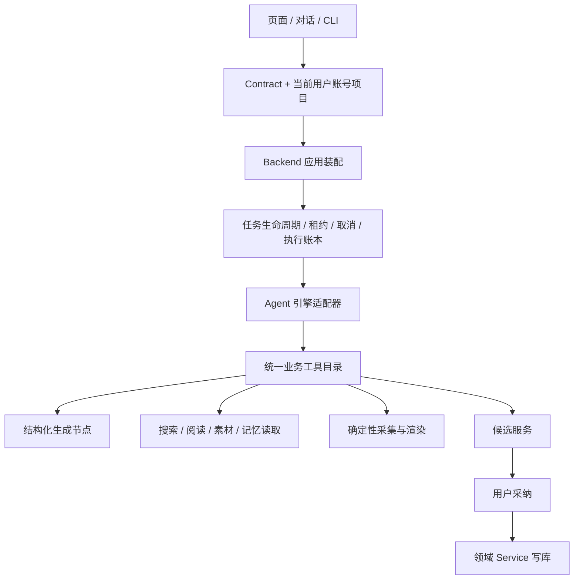

# SPEC 草案：CreatorOS 业务工具、应用装配与 Agent 执行统一重构

任务：T-915。日期：2026-09-04。状态：待范围确认与独立评审，禁止据此直接进入实现。

输入：[T-914 审计](../../research/2026-09-04-architecture-agent-audit.md)、2026-07-12 受控自主运行时 SPEC、2026-07-14 Pi 全产品集成 SPEC；承接 T-256/T-313/T-314/T-340/T-315–319/T-324，不复制它们的历史验收结论。

## 用户意图与待确认项

用户要求全面审查架构与脏/无效代码，认为重构应优先，并要求盘点、考虑启动之前的 Agent 执行引擎需求。已授权审查与需求盘点。

用户本轮进一步明确的核心问题：系统庞大；AI 功能卡、慢、经常失败且不会主动重试；联网搜索与浏览器自动化失败后缺少自我循环。目标是根治这些问题并选择更合理架构。这是 T-915 的首要验收目标。记忆进化、任意脚本自修改等旧设想尚未被本轮确认，不作为本轮可靠性目标的前置依赖。

以下是可评审提案，尚非用户已确认的实现范围：是否让编导对话也交由 Agent 主导；是否开放隔离环境中的 bash/fs 脚本自纠；记忆和 skill 进化此次是否整体纳入。旧“对话不动”的 DEC 若变化，必须在正式 DECISION_LOG 记录替代关系。第三方引擎选择保留 Pi 既有投入，不默认升级版本。

## 目标与用户可见行为

用户交代“调研选题并找项目素材”后，Agent 能调用真实业务工具，阅读返回证据，决定下一步，产出有来源、可采纳的结果；遇到可恢复故障能在预算内调整；取消、暂停或应用重启后状态真实，不重复写入或扣费。

现有保存、生成、渲染、手工登记发布与旧项目保持可用。用户可理解当前是在执行、等待确认、需要配置、已暂停、部分完成或失败；不能把诊断 JSON 当完成结果。

## 拟定职责

Agent 负责理解与选择；工具提供真实事实和能力；任务层保管进度；领域 service 做权限与写入。桌面宿主只提供路径、浏览器、密钥访问和子进程适配。继续模块化单体，进程拆分仅在取消/隔离需求有证据时另行裁决。

## 针对卡顿、失败与缺少循环的架构建议（本轮收敛）

推荐目标：**模块化单体 + 独立执行 Worker + 统一工具层，Pi 承担自适应任务循环**。这是待评审架构建议，尚未改变现有进程拓扑。

- 一套仓库、业务模型和本地数据库；backend 是领域数据唯一写入者。Worker 经带当前上下文的 service port/受控 IPC 读写，不直连 PGlite/PG，不并发打开同一本地数据库目录。
- 页面与服务请求不承担长任务、浏览器操作和模型循环的执行寿命。执行 Worker 可独立停止、重启，受主程序监督；必须经桌面包验证进程树清理和资源占用。
- 复用现有持久任务表和租约，实现一个队列调度/取消/重试/执行账本；合并 ai_tasks 与 execution_tasks 的职责定义或建立明确主从映射，禁止两套任务状态各自判定完成。
- 同一工具目录被对话、任务、CLI 与 Pi adapter 复用；模型配置和凭据解析同源。业务模块不 import 具体 Agent SDK。
- 普通文本/结构化生成采用短路径；明确输入的任务不先额外调用“规划模型”。模型主动调用工具的工作才进入 Pi 循环。AI SDK 保留其模型适配和结构化输出职责。
- Pi 是基于已有接入与本次需求的推荐候选，不宣称已证明优于其他引擎。用同一模型、工具与故障任务验证成功率、调用次数、恢复和包体；版本变更单独验证。

### 两种恢复各有属主

| 触发 | 责任层 | 应有行为 |
|---|---|---|
| 网络瞬断、明确可重试的 429/5xx | 任务/调用策略层 | 按 Retry-After 或有抖动的退避做有限重试；全任务统一次数和截止时间；适配器声明已有重试，避免层层相乘 |
| 生成 JSON 结构不符、部分字段损坏 | 生成工具 | 同 schema 的有界局部修复，保留正确部分；不把整条任务盲目从头重跑 |
| 搜索结果不足、网页结构变化、定位器失效 | Pi | 读真实错误与新页面状态，修改查询、选别的来源或重新定位控件；下一步后检查实际目标是否达成 |
| 登录过期、验证码、权限不足、余额不足 | 任务层与界面 | 等待用户完成真实恢复动作；保留进度，不循环撞同一阻断，不让 Agent 绕过限制 |
| 提交后响应未知，可能已产生写入或扣费 | 工具与 service | 按同一幂等键查询/恢复；不支持幂等或状态查询时停在结果未知状态，禁止换键重放 |

“自动重试”解决瞬态执行失败，“自我循环”解决下一步策略。任务层保管总预算、停止状态和已完成事实，Agent 无权重置这些值。

### 浏览器循环需要能观察和验证

保留可靠的现有采集操作作为优先工具，并为失败恢复提供受控浏览器能力：获取当前 URL/DOM 或可访问性快照、必要时截图、导航、定位点击/填写、等待明确状态、提取正文。模型依据新观察选择动作，动作完成后必须观察结果。

示例：搜索无结果 → 改查询 → 打开来源 → 点击失败 → 重新观察页面 → 选择新定位目标 → 提取正文 → 验证是否拿到所需证据。禁止每次重试继续使用已经失效的元素引用。实际浏览器动作由 Playwright 等适配器执行，账号登录态由现有保管库管理，同一会话/页面的写动作串行；不同任务仅在资源与归属隔离后并发。

Agent 不能伪造“已完成”，需要工具返回的 URL、正文、实际页面状态或领域回读作为完成证据。模型拿不到证据的桥接缺陷 A-03 是接线前必须修复的项。访问受限时尊重权限与站点限制。

### 性能治理与验收

先记录每条公共旅程的排队、上下文装配、首个可见输出、模型生成、工具、重试和持久化耗时，比较冷启动/热启动及并发场景。已有“慢”的反馈不能未经测量就全部归因于大文件或 SDK。

实施措施：按需加载能力；只传当前任务需要的上下文和工具；缓存可安全复用的静态资源/模型客户端与有版本的上下文，权限和当前实体状态仍执行前重查；独立只读请求有界并发；普通生成流式返回；长任务提交立即返回 taskId 和真实状态。任务成功后再更新可见数据，不等整个后台系统初始化完才响应界面。

验收指标：端到端成功率、自动恢复成功率、排队/首输出/总耗时的 P50/P95、每任务模型调用次数/token、重复副作用数、取消后的新增调用数、重启后的完成率。性能目标在测得同任务基线后确定，不能提前保证换引擎就提速。故障注入用例必须全部符合预先定义的恢复/等待/失败语义；重复副作用数和取消生效后的新增动作目标为零。

推进依赖：建立可复现业务与故障基线 → 提取统一工具/任务层与 Worker → 接通 Pi 搜索/浏览器循环 → 将现有 AI 入口迁入同一恢复机制 → 删除被替代的旧路径 → 同范围双平台验收。T-916 只修本次必要的门卫/证据链和验收环境，不把所有历史文档漂移清零设成性能修复的先决条件，也不隐藏其余失败。

选型资料：[Pi SDK](https://github.com/earendil-works/pi/blob/main/packages/coding-agent/docs/sdk.md) 提供嵌入式会话与事件能力；[Playwright auto-waiting](https://playwright.dev/docs/actionability) 负责单次动作的可操作性等待。后者不能代替业务级重新观察与策略循环。本轮在线核对，安装版本能力仍需本地验证。

## 完整拟定工作范围

1. 将 persistence-client 的数据库/服务/任务/Agent 装配提取到 backend 应用层，宿主依赖注入，禁止 backend 反向 import frontend。
2. 统一 chat 与 agentic 的业务工具定义、真实 ID、归属、输入 schema、模型可见输出和错误；引擎只保留格式桥接。
3. research/collect/material 七端口全部接真实 service；生成节点作为有 schema 的工具复用；未就绪能力在调模型之前可诊断。
4. 搜索结果、来源、正文与分页信息确实进入下一轮模型请求；按内容预算截断并允许继续读取，禁止只有“已搜到 N 条”。
5. 调用前校验权限、停止状态、预算与幂等；调用后结算真实 usage。明确缓存 token 与单次预算超额上界；不以事后统计冒充执行前拦截。
6. 统一 completed/partial/failed/cancelled/awaiting_confirmation 等终态映射，记录实际引擎和 fallback 原因。部分可用产物保留，诊断不冒充候选。
7. 复用持久任务基础设施，为 Agent 加服务端检查点、消息续接、工具账本与恢复规则；项目/账号隔离，禁止用户输入重置已消费预算。
8. 将正式模拟发布、mock transport 兜底、canonical 身份默认值退出正式装配，保留隔离测试 fixtures 和真实手工发布登记。
9. 清理编译器证明未使用的符号、无消费者兼容出口、无用依赖；旧 route/skill/对话入口须有消费者与迁移说明后退役。
10. 拆分 chat-tools/chat-runner 与超大页面的职责，保留取消、流式卡片、采纳、选区修改与跨账号语义。
11. 记忆读取、会话续和 skill 提案如果纳入，复用已有数据与 override/回滚服务；AI 只提交 diff 候选，tools/schema 不被 prompt 修改。
12. 脚本自纠如果纳入，先补 OS 级文件/网络/资源边界的专项契约；当前 resource loader 隔离不宣称为 OS 沙箱。不得编辑运行中的应用源码。

## 契约与数据变更约束

- 不删除旧业务实体，不重写历史数据；新增执行字段必须有默认值、迁移和回读兼容测试。
- 当前 RequestContext、真实项目/素材 ID、内容版本在每次执行前经 service 重读。模型历史不是写入真相。
- 工具执行幂等键与尝试编号分离；响应未知不能换幂等键盲目重放。
- SDK 专属消息协议不进入领域服务；前端流式协议可用 adapter 保持兼容。
- 正式发布状态需要真实外部结果或用户明确的手工登记事实；模拟发布器不能绑定正式服务。
- actualEngine、stopReason、usage、checkpointRef 与结果完整性应作为显式契约字段；精确 schema 在 CONTRACT 评审时提交。

## 验收与迁移

测试必须先展示当前失败再实现修复，红测发生时间据实记录。至少包括工具 evidence 进入 provider 请求、预算耗尽前拒绝新动作、多工具一轮、取消期间、重启、响应未知重试、跨账号和已删除目标。

执行真实公共旅程：调研多轮搜读至候选、采纳回读；素材语义选择至制作；手工发布登记；旧对话入口兼容；受管/自配的 anthropic、openai_chat、openai_responses 模型。测试模型和真实上游结果分别留证，禁止 faux 循环冒充真验收。

macOS/Windows 分发包须证明实际引擎被加载、工具可用、停止有效、重启恢复；构建时不能静默跳过 Pi 后仍宣称 Agent 能力可用。缺引擎走明确的可用降级，保留原有效任务。

灰度/默认切换与回滚标准在实施前形成发布 DEC；本草案不授权推送、部署或改用户数据。

## 决策前证据

同一任务、同一模型、同一业务工具比较 Pi 与现有 runtime：是否完成、是否读到来源、工具调用数、tokens、耗时、取消/恢复、跨平台包体与维护代码量。若考虑 AI SDK ToolLoopAgent，也沿同契约做比较。不要将“换掉 Vercel”当成唯一成功指标。

当前推荐优先级由风险与依赖决定：先消除伪成功和身份默认值，提取统一工具，再兑现 Agent 自主与恢复能力；整个确认范围统一验收，不另建多版本计划。
