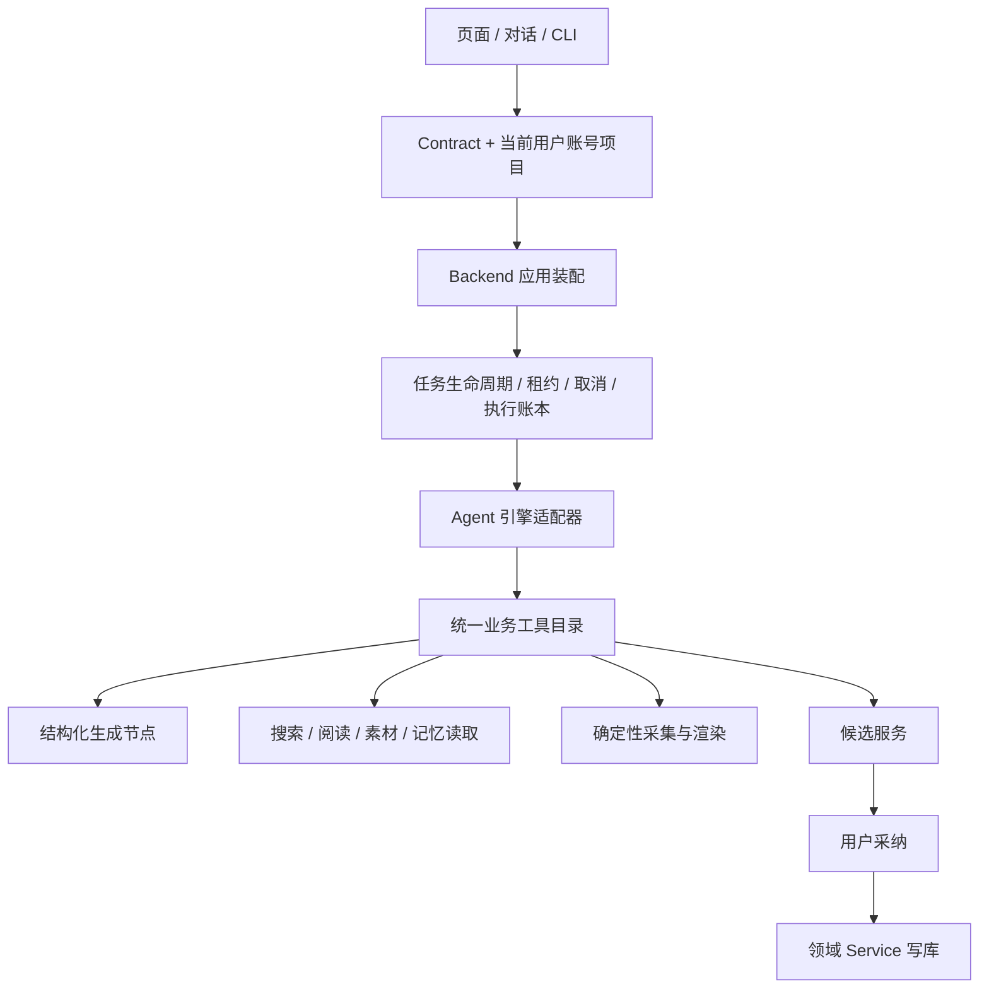
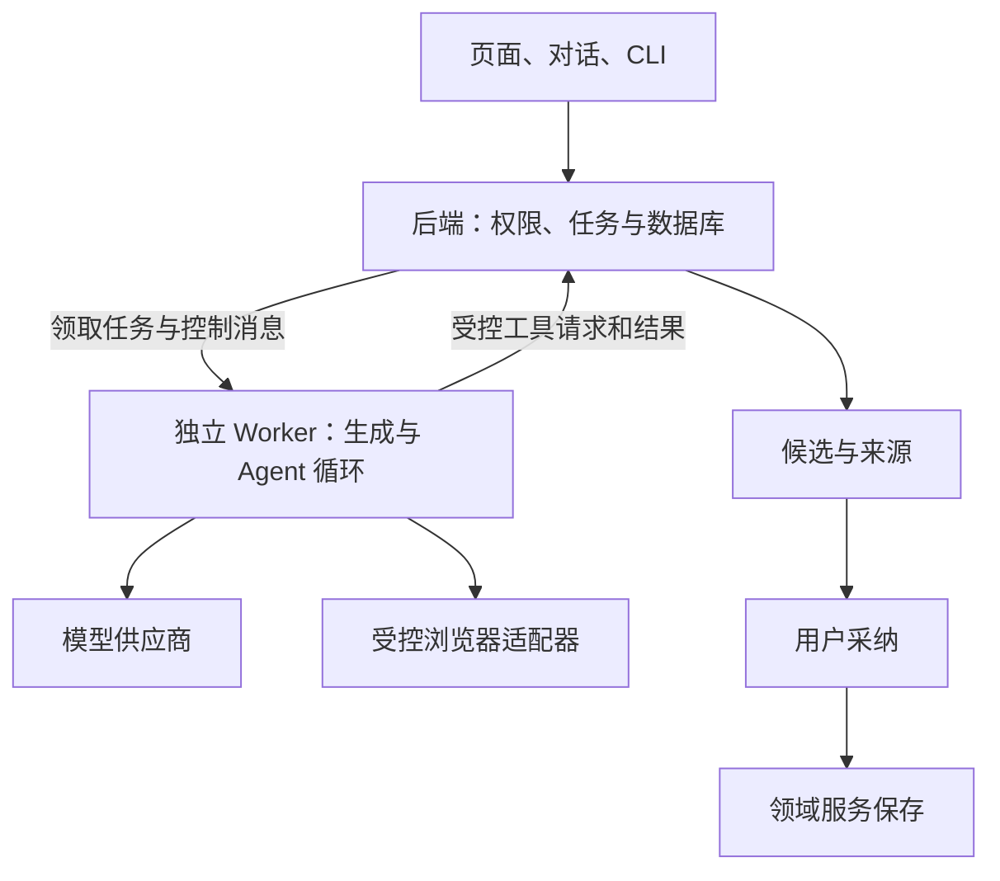

# SPEC：CreatorOS 业务工具、应用装配与 Agent 执行统一重构

任务：T-915。日期：2026-09-04。状态：用户已确认架构方向与本轮范围；具体契约评审结论以相邻 review 的有效回执为准，通过前不改产品运行代码。

输入：[T-914 审计](../../research/2026-09-04-architecture-agent-audit.md)、2026-07-12 受控自主运行时 SPEC、2026-07-14 Pi 全产品集成 SPEC；承接 T-256/T-313/T-314/T-340/T-315–319/T-324，不复制它们的历史验收结论。

## 用户意图与确认边界

用户要求全面审查架构与脏/无效代码，认为重构应优先，并要求盘点、考虑启动之前的 Agent 执行引擎需求。已完成审查与需求盘点。用户在本轮架构建议后回复“认可”，授权按本 SPEC 的可靠性与架构收敛方向推进。

用户本轮进一步明确的核心问题：系统庞大；AI 功能卡、慢、经常失败且不会主动重试；联网搜索与浏览器自动化失败后缺少自我循环。目标是根治这些问题并选择更合理架构。这是 T-915 的首要验收目标。记忆进化、任意脚本自修改等旧设想尚未被本轮确认，不作为本轮可靠性目标的前置依赖。

本轮不新增以下产品能力：把所有编导对话改成 Agent 主导、开放 bash/fs 任意脚本自纠、记忆和 skill 自我进化。原对话仍保留工具与流式体验，执行接同一恢复机制。旧“对话不动”的 DEC 若变化，必须在正式 DECISION_LOG 记录替代关系。第三方引擎选择保留 Pi 既有投入，不默认升级版本。

## 目标与用户可见行为

用户交代“调研选题并找项目素材”后，Agent 能调用真实业务工具，阅读返回证据，决定下一步，产出有来源、可采纳的结果；遇到可恢复故障能在预算内调整；取消、暂停或应用重启后状态真实，不重复写入或扣费。

现有保存、生成、渲染、手工登记发布与旧项目保持可用。用户可理解当前是在执行、等待确认、需要配置、已暂停、部分完成或失败；不能把诊断 JSON 当完成结果。

## 拟定职责

Agent 负责理解与选择；工具提供真实事实和能力；任务层保管进度；领域 service 做权限与写入。桌面宿主只提供路径、浏览器、密钥访问和子进程适配。继续模块化单体；用户确认以独立执行 Worker 隔离长任务寿命，数据库仍由 backend 单一进程打开。

## 针对卡顿、失败与缺少循环的架构建议（本轮收敛）

推荐目标：**模块化单体 + 独立执行 Worker + 统一工具层，Pi 承担自适应任务循环**。用户已确认该方向；本 SPEC 细化其实施约束，当前尚未改变现有进程拓扑。

- 一套仓库、业务模型和本地数据库；backend 是领域数据唯一写入者。Worker 经带当前上下文的 service port/受控 IPC 读写，不直连 PGlite/PG，不并发打开同一本地数据库目录。
- 页面与服务请求不承担长任务、浏览器操作和模型循环的执行寿命。执行 Worker 可独立停止、重启，受主程序监督；必须经桌面包验证进程树清理和资源占用。
- 复用现有持久任务表和租约，实现一个队列调度/取消/重试/执行账本；合并 ai_tasks 与 execution_tasks 的职责定义或建立明确主从映射，禁止两套任务状态各自判定完成。
- 同一工具目录被对话、任务、CLI 与 Pi adapter 复用；模型配置和凭据解析同源。业务模块不 import 具体 Agent SDK。
- 普通文本/结构化生成采用短路径；明确输入的任务不先额外调用“规划模型”。模型主动调用工具的工作才进入 Pi 循环。AI SDK 保留其模型适配和结构化输出职责。
- Pi 是基于已有接入与本次需求的推荐候选，不宣称已证明优于其他引擎。用同一模型、工具与故障任务验证成功率、调用次数、恢复和包体；版本变更单独验证。

### 两种恢复各有属主

| 触发 | 责任层 | 应有行为 |
|---|---|---|
| 网络瞬断、明确可重试的 429/5xx | 任务/调用策略层 | 按 Retry-After 或有抖动的退避做有限重试；全任务统一次数和截止时间；适配器声明已有重试，避免层层相乘 |
| 生成 JSON 结构不符、部分字段损坏 | 生成工具 | 同 schema 的有界局部修复，保留正确部分；不把整条任务盲目从头重跑 |
| 搜索结果不足、网页结构变化、定位器失效 | Pi | 读真实错误与新页面状态，修改查询、选别的来源或重新定位控件；下一步后检查实际目标是否达成 |
| 登录过期、验证码、权限不足、余额不足 | 任务层与界面 | 等待用户完成真实恢复动作；保留进度，不循环撞同一阻断，不让 Agent 绕过限制 |
| 提交后响应未知，可能已产生写入或扣费 | 工具与 service | 按同一幂等键查询/恢复；不支持幂等或状态查询时停在结果未知状态，禁止换键重放 |

“自动重试”解决瞬态执行失败，“自我循环”解决下一步策略。任务层保管总预算、停止状态和已完成事实，Agent 无权重置这些值。

### 浏览器循环需要能观察和验证

保留可靠的现有采集操作作为优先工具，并为失败恢复提供受控浏览器能力：获取当前 URL/DOM 或可访问性快照、必要时截图、导航、定位点击/填写、等待明确状态、提取正文。模型依据新观察选择动作，动作完成后必须观察结果。

示例：搜索无结果 → 改查询 → 打开来源 → 点击失败 → 重新观察页面 → 选择新定位目标 → 提取正文 → 验证是否拿到所需证据。禁止每次重试继续使用已经失效的元素引用。实际浏览器动作由 Playwright 等适配器执行，账号登录态由现有保管库管理，同一会话/页面的写动作串行；不同任务仅在资源与归属隔离后并发。

Agent 不能伪造“已完成”，需要工具返回的 URL、正文、实际页面状态或领域回读作为完成证据。模型拿不到证据的桥接缺陷 A-03 是接线前必须修复的项。访问受限时尊重权限与站点限制。

### 性能治理与验收

先记录每条公共旅程的排队、上下文装配、首个可见输出、模型生成、工具、重试和持久化耗时，比较冷启动/热启动及并发场景。已有“慢”的反馈不能未经测量就全部归因于大文件或 SDK。

实施措施：按需加载能力；只传当前任务需要的上下文和工具；缓存可安全复用的静态资源/模型客户端与有版本的上下文，权限和当前实体状态仍执行前重查；独立只读请求有界并发；普通生成流式返回；长任务提交立即返回 taskId 和真实状态。任务成功后再更新可见数据，不等整个后台系统初始化完才响应界面。

验收指标：端到端成功率、自动恢复成功率、排队/首输出/总耗时的 P50/P95、每任务模型调用次数/token、重复副作用数、取消后的新增调用数、重启后的完成率。性能目标在测得同任务基线后确定，不能提前保证换引擎就提速。故障注入用例必须全部符合预先定义的恢复/等待/失败语义；重复副作用数和取消生效后的新增动作目标为零。

推进依赖：建立可复现业务与故障基线 → 提取统一工具/任务层与 Worker → 接通 Pi 搜索/浏览器循环 → 将现有 AI 入口迁入同一恢复机制 → 删除被替代的旧路径 → 同范围双平台验收。T-916 只修本次必要的门卫/证据链和验收环境，不把所有历史文档漂移清零设成性能修复的先决条件，也不隐藏其余失败。

选型资料：[Pi SDK](https://github.com/earendil-works/pi/blob/main/packages/coding-agent/docs/sdk.md) 提供嵌入式会话与事件能力；[Playwright auto-waiting](https://playwright.dev/docs/actionability) 负责单次动作的可操作性等待。后者不能代替业务级重新观察与策略循环。本轮在线核对，安装版本能力仍需本地验证。

## 完整工作范围

1. 将 persistence-client 的数据库/服务/任务/Agent 装配提取到 backend 应用层，宿主依赖注入，禁止 backend 反向 import frontend。
2. 统一 chat 与 agentic 的业务工具定义、真实 ID、归属、输入 schema、模型可见输出和错误；引擎只保留格式桥接。
3. research/collect/material 七端口全部接真实 service；生成节点作为有 schema 的工具复用；未就绪能力在调模型之前可诊断。
4. 搜索结果、来源、正文与分页信息确实进入下一轮模型请求；按内容预算截断并允许继续读取，禁止只有“已搜到 N 条”。
5. 调用前校验权限、停止状态、预算与幂等；调用后结算真实 usage。明确缓存 token 与单次预算超额上界；不以事后统计冒充执行前拦截。
6. 统一 completed/partial/failed/cancelled/awaiting_confirmation 等终态映射，记录实际引擎和 fallback 原因。部分可用产物保留，诊断不冒充候选。
7. 复用持久任务基础设施，为 Agent 加服务端检查点、消息续接、工具账本与恢复规则；项目/账号隔离，禁止用户输入重置已消费预算。
8. 将正式模拟发布、mock transport 兜底、canonical 身份默认值退出正式装配，保留隔离测试 fixtures 和真实手工发布登记。
9. 清理编译器证明未使用的符号、无消费者兼容出口、无用依赖；旧 route/skill/对话入口须有消费者与迁移说明后退役。
10. 拆分 chat-tools/chat-runner 与超大页面的职责，保留取消、流式卡片、采纳、选区修改与跨账号语义。
11. 记忆读取、会话续和 skill 提案如果纳入，复用已有数据与 override/回滚服务；AI 只提交 diff 候选，tools/schema 不被 prompt 修改。
12. 脚本自纠如果纳入，先补 OS 级文件/网络/资源边界的专项契约；当前 resource loader 隔离不宣称为 OS 沙箱。不得编辑运行中的应用源码。

## 契约与数据变更约束

- 不删除旧业务实体，不重写历史数据；新增执行字段必须有默认值、迁移和回读兼容测试。
- 当前 RequestContext、真实项目/素材 ID、内容版本在每次执行前经 service 重读。模型历史不是写入真相。
- 工具执行幂等键与尝试编号分离；响应未知不能换幂等键盲目重放。
- SDK 专属消息协议不进入领域服务；前端流式协议可用 adapter 保持兼容。
- 正式发布状态需要真实外部结果或用户明确的手工登记事实；模拟发布器不能绑定正式服务。
- actualEngine、stopReason、usage、checkpointRef 与结果完整性应作为显式契约字段；精确 schema 在 CONTRACT 评审时提交。

## 验收与迁移

测试必须先展示当前失败再实现修复，红测发生时间据实记录。至少包括工具 evidence 进入 provider 请求、预算耗尽前拒绝新动作、多工具一轮、取消期间、重启、响应未知重试、跨账号和已删除目标。

执行真实公共旅程：调研多轮搜读至候选、采纳回读；素材语义选择至制作；手工发布登记；旧对话入口兼容；受管/自配的 anthropic、openai_chat、openai_responses 模型。测试模型和真实上游结果分别留证，禁止 faux 循环冒充真验收。

macOS/Windows 分发包须证明实际引擎被加载、工具可用、停止有效、重启恢复；构建时不能静默跳过 Pi 后仍宣称 Agent 能力可用。缺引擎走明确的可用降级，保留原有效任务。

灰度/默认切换与回滚标准在实施前形成发布 DEC；本 SPEC 不授权推送、部署或改用户数据。

## 决策前证据

同一任务、同一模型、同一业务工具比较 Pi 与现有 runtime：是否完成、是否读到来源、工具调用数、tokens、耗时、取消/恢复、跨平台包体与维护代码量。若考虑 AI SDK ToolLoopAgent，也沿同契约做比较。不要将“换掉 Vercel”当成唯一成功指标。

当前推荐优先级由风险与依赖决定：先消除伪成功和身份默认值，提取统一工具，再兑现 Agent 自主与恢复能力；整个确认范围统一验收，不另建多版本计划。

## 可实施契约（T-915，用户方向确认后的设计）

### R-01 执行权与数据归属

`execution_tasks` 是唯一执行权：保存状态、attempt、workerId、fenceToken、leaseExpiresAt、deadlineAt、retryAt、checkpointRevision、累计预算及控制命令。`ai_tasks` 保留公开 taskId、业务输入、步骤、候选和采纳状态，新增可空 `executionTaskId` 唯一映射；旧任务字段可回读。一个执行可有子任务，但每个子任务有自己的执行 ID，父任务等待不等于重领子任务。

映射后的新任务不得再调用旧 ai_tasks claim；`job_runs` 只投影调度业务状态。`execution succeeded` 与 `ai awaiting_confirmation` 可同时成立，前者表示计算完成，后者表示等待采纳。恢复不把未采纳候选当执行失败。

任务状态为 queued、running、retry_wait、waiting_user、unknown_result、succeeded、partial、failed、cancelled。暂停用控制状态 pause_requested/paused，保留恢复位置。pause_requested 禁止新 admission，在途调用允许幂等结算或记未知，确认停止后进入 paused；暂停期间重启仍保持暂停。resume 取得新租约，保留累计预算、已确认回执、稳定 operationKey 和原任务 deadline，浏览器重新观察。调度 attempt 是 fencing 版本，模型/工具重试额度单独累计，暂停恢复不重置额度，也不把一次暂停算供应商失败重试。后端保管状态机：queued/retry_wait 到期后可领；running 只能在当前租约下续租、保存、结算；waiting_user 在实际配置/登录恢复后显式恢复；unknown_result 只允许查询对账或用户结束，禁止直接重提。终态不可被迟到结果覆盖。内部新状态经 adapter 投影到旧公共状态，界面增加真实原因与恢复动作，旧消费者仍能解析。

迁移新增字段和执行记录，不删除旧 ai_tasks、results、业务实体。启动先恢复映射任务，再对未映射在途任务按已有 provider/checkpoint 对账：可安全恢复才创建映射，已完成不重排；提交状态未知保留 unknown_result。迁移带 schema version、事务及重复运行保护。旧 sweep 不再判死已映射任务；历史终态保持原值。

### R-02 Worker 与后端端口

`ai-worker` 增加真实独立入口和构建产物。父后端持有数据库、scheduler、supervisor；Worker 持有模型调用、runner、Pi 和浏览器执行寿命。父进程端口不得把长模型/浏览器动作重新送回 Next 执行。桌面宿主提供运行路径、受控浏览器资源及凭据取得适配，不承载业务选择。

私有父子 IPC 使用 version、requestId、执行引用 `{executionTaskId, attempt, fenceToken}`。父进程按数据库任务恢复 RequestContext，不能信任 Worker 自报 userId/accountId。只开放命名且带 schema 的端口：readTaskContext、readDomainResource、resolveModelCredential、reserveCall、settleCall、saveCheckpoint(expectedRevision)、commitResult、heartbeat、acknowledgeControl、候选与既有确定性业务操作。禁止通用 SQL/eval/任意 service 方法调用。领域写入始终在 backend。

父进程每个端口检查租约、当前控制状态、归属和输入；已执行动作的结算/回执在取消后仍允许幂等记账，但不能启动新动作或覆盖 cancelled。消息去重以 requestId/callId；业务副作用用稳定 operationKey，attempt 变化不换键。写入、检查点、提交结果都必须拒绝旧 fenceToken。AsyncLocalStorage 不跨进程：原租约上下文改成显式执行引用，在后端适配层校验后进入领域服务。

Worker ready 返回协议版本和真实 capabilities；父进程有限并发调度，设置队列与模型/浏览器独立并发上限。退出或失联时回收租约和浏览器子树。取消先写控制命令，再发 abort，禁止新 admission；等待实际停止后确认 cancelled，超出宽限期终止 Worker 子树，其余受影响任务进入恢复。父程序退出同样清理子树。私有凭据不进事件、检查点、模型工具结果或日志。

### R-03 共享恢复、预算与观测

复用已有 retry-policy 的错误分类、Retry-After 与退避；所有 adapter 明确自身重试次数，统一 deadline 与 attempt accounting，禁止 SDK、工具、调度层分别重试三次。只读请求遇已确认瞬态失败可重试；可能产生计费/写入且提交响应未知时，先按相同 operationKey 查询或使用已验证的供应商幂等恢复。供应商不支持时进入 unknown_result，界面说明结果待核对并提供现有诊断/结束动作，不换键重放。

每个任务持久化模型/工具调用账本：callId、operationKey、类型、输入摘要、reserved/started/settled/unknown、providerJobId（如有）、实际 usage、结果引用与错误分类。模型或工具调用开始前校验 cancel、deadline、剩余步数及预算；多工具一轮逐个 admission，不能 turn_end 后才截断。模型调用先预留输入估计及最大输出；供应商支持时设置输出上限。估算与供应商计量差异允许一次已发请求的有界超额并显式记账，不能承诺无法保证的硬 token 精度。cache read/write tokens 依 provider 不重叠语义计入规范账本，未知 usage 记 unknown，不能算 0。

检查点保存规范消息、已确认工具回执、未完成调用、产物引用及预算版本；SDK 协议经适配器重建，不进入领域实体。预算以服务端账本为准。恢复先对账 started/unknown 调用，再恢复模型上下文；只恢复已确认事实。浏览器会话和元素引用不持久复用，必须重新建页观察。候选与业务状态投影事务提交；跨事务宿主产物通过 outbox/幂等结果记录恢复，测试中断窗口。

埋点从公共提交开始，记录 queue/context/firstOutput/model/tool/retry/persist 与总耗时、attempt、actualEngine/stopReason；不含原始敏感正文或凭据。基准固定同模型配置、同输入、同工具响应、冷/热及并发数量，至少 30 次可重复本地样本，报告 P50/P95；真实上游样本独立标注。普通生成禁止增加规划调用；本地同输入基准的首输出与总耗时 P95 不得劣化超过 10%，超出先定位修复，不能擅改阈值。联网耗时只报告观测值，不伪造稳定时延保证。

### R-03a 聊天逐调用可信身份、安全用量与历史恢复（本补丁候选）

以下新增约束适用于本次聊天用量和显式新请求恢复；不替换既有预算、lease/fence、停止、unknown 同键核对或性能指标。

采用完整现 `executionModelIdentitySchema` 内部schema，不手抄删字段：workerModelSpec去token/baseUrl，保model/apiFormat/authStyle/displayModelKey/structuredOutputs与schemaVersion/capability/baseUrlDigest/customEndpoint。新增 `execution_calls.model_identity JSONB NULL`，仅宿主写，Worker/client/settlement不能自报或改。它是内部authority，不能直接序列化到任何公开DTO。

| 真实model调用 | 唯一宿主绑定证据 | 首次写窗及恢复 |
|---|---|---|
| chat根 `<modelInput.operationKey>/model/<正整数>` | execution-generation-ports现严格operation校验、无parentCallId、task.payload.modelIdentity且capability与原chatInput一致 | 同reserve/admission事务首次写call identity；start前再核同原绑定；同reserve/retryOfCallId恢复不得换身份 |
| 已登记文本/结构化子模型 | 真实parentCallId；binding.forCall核toolName/execution/inputDigest/capability；nodePreparations该parent的nodeVersion/inputDigest与node冻结operation；chatModelIdentities[parentCallId]的inputDigest/identity | 专用节点reserve同原父tool及精确operation（text节点现`<prepared.operationKey>/model/1`）写入；child不能继承root猜身份；start重验parent/claim/原请求 |
| fallback `<原root operation>/fallback/model/1` | execution-chat-fallback现chatFallbackParent/isChatModelOperation；原root无parent、明确rejected且CHAT_MODEL_RETRYABLE_REJECTION；原task已冻结chatFallbackModelIdentity | 该fallback reserve同事务锁原rejectedcall并核已冻结identity；原主call仍原identity，unknown禁止fallback |
| model.generate/model.structured等其它已登记模型路径 | 各现专用operation/inputDigest/admission核验与原payload.modelIdentity | 能唯一对应才写；没有唯一宿主证据则null并记未覆盖，不拿当前配置或provider标签猜 |

逐调用内部identity与原owner/workspace、callId/operationKey/parentCallId/inputDigest构成不可变绑定。newcall首次reserve之前必先宿主pin；已有call的null不补填，即使task后来有identity。settle只写已有usage事实，不根据Worker报告model改身份；重复reserve/start/settle读取原call identity并核等价，不改变字段、预算或调用数。受管身份来自resolveModelSpec→resolveLlmConfig的settings/channel resolver实际受信配置，BYOK来自settingsService.getModelConfig，fallback来自已登记dedicated resolver；聊天文本/客户端modelKey/供应商模型标签都不是authority。

#### 内部与公开身份分层、精确 allowlist

公开 `modelUsageV1` 仅：`{schemaVersion:1,calls:[{callId,displayIdentity:null|{kind:"byok",modelKey:string}|{kind:"channel-managed",modelKey:"channel-managed"},inputTokens:number|null,outputTokens:number|null,cachedTokens:number|null}]}`。callId是当前owner/workspace可见的真实调用引用，按call sequence稳定排序。此allowlist外字段拒绝；未知内部identity公开displayIdentity=null，不从当前配置补名。

managed仅公开channel-managed，不含真实model、provider路由/渠道配置、apiFormat/authStyle/structuredOutputs、rawendpoint、baseUrlDigest/customEndpoint、token或其它内部身份字段。BYOK可公开该call宿主冻结实际model作为modelKey；端点、认证、内部配置仍不公开。顶层AIMessage.modelKey使用同一安全投影：所有必要confirmed model身份确定且display一致才给其显示值；混合显示或任一必要身份未知则null，不假称主模型覆盖整轮。

ai_messages.modelMetadata、finish.messageMetadata、conversation_reply.resultData使用同一已冻结**公开**对象，不附内部model_identity。公开execution/tasks DTO也须逐一核既有payload投影，不能因原payload已有modelIdentity就照搬新列。测试遍历message.list/get、finish/SSE、resultData及所有公开execution DTO，断言managed实际model/端点摘要/内部属性/秘密均不存在（包括nested）。旧metadata原样；安全扩展不是以顶层遮挡掩盖nested泄漏。

#### 历史回执、迁移与用量集合

候选迁移 `backend/drizzle/0123_chat_submission_and_model_identity.sql`（实施前若编号已被占用必须规范再确认准确顺序，不直接覆盖），配套meta journal与backend/src/schema/ai.ts、intelligence.ts：加request映射表与可空identity列。单事务前向、备份→副本迁移/重跑→关键行逐行相等→实际候选迁移；旧call全部null，无旧消息/finish/resultData重写。新表外键/unique冲突如实失败，不删重复历史来过门。旧schema无新列/表时显式关闭本项新能力且保旧读/原task恢复；不得把DB异常吞成成功或自动再调用。

新completion第一次提交时固定公开modelUsageV1并标记其schemaVersion=1，同一事务保存assistant metadata/resultData/finish。existing成功replay先读已保存结果：无modelUsageV1的历史按当前旧metadata/resultData/finish精确比较与恢复，不增加字段/不重算usage；有v1按已保存v1对象精确验证与回读，禁止补当前call身份。已有成功finish不得再次追加或替换。rollback只回到保留新增列/表的兼容读取版本，保存新事实；不DROP列、不清非null、不改原receipt。若旧二进制无法读v1原成功深比较，则不是允许的回退版本，必须停在兼容恢复构建或另获具体breaking确认。

集合按真实callId去重：model而非tool；每model使用自己持久providerResult.usage。完成消息集合沿现confirmed=status非rejected且全部settled的完成门，主/子/fallback各自列项；父tool不得再加子token。input total已包含cache，cachedTokens只显示cacheRead，不再加cacheRead/write到input total。某项必要用量缺失则该项聚合null。rejected仅在现明确拒绝证据允许无费用时不进完成汇总；unknown不能填0/不能凑成功completion。取消没有assistant成功消息时，使用真实既有 `ai.tasks.get`（GET `/ai/tasks/:taskId`，传业务 aiTaskId，不能传 executionTaskId）：`ai.transport.ts` → `AiService.getTask` → `repoFor(ctx,"ai.getTask").requireTask` 的 userId + workspaceFilter 属主门 → `projectExecutionTasks` 的同 owner/workspace 执行映射校验。拟在 `contract/src/resources/ai.ts:aiTaskResource` 新增可选安全字段 `modelUsageV1`，既有 `contract/src/operations/ai.ts:getTask.response` 继续引用该资源；没有新 endpoint、没有绕过 `executionService.requireExecTask`。对应 `backend/src/modules/ai/execution-task-projection.ts` 加受控 DTO 投影：只沿原业务行 executionTaskId 查执行行，核 `kind=ai_task`、`ownerType=ai_task`、`ownerId=aiTask.id`、payload.aiTaskId、当前 owner/workspace；聊天还核 taskType=copilot.assist/inputData.kind=chat.run、原 source/conversation 与已冻结 modelInput/摘要绑定后，才查此 executionTaskId 的 model 账本并按上述 allowlist 输出。任一映射不符保持 ConflictError，不容许客户任意指定执行引用、跨 scope 查 call；无 executionTaskId 的旧业务行保持字段缺省。listTasks 与 findTaskByAttempt 已共享该投影，必须同样使用安全 allowlist，不在这些公开 DTO 附内部 identity。取消/非终态的现 AI task owner 可通过同一 getTask 回读此字段；前端消息绑定的 chatTaskId 是准确业务引用。现入口已能回读 copilot.assist/chat.run 的任务状态，但尚无 modelUsageV1，不能声称现已实现。`execution.tasks.get` 仍限 exec.*；PersistentTaskService.get 仍是内部受控服务，不冒称其为这个公开路由。非终态/取消回读包括原model call，unknown/started无确认usage的数字为null，身份仅其已冻结值；完成消息的集合仍按confirmed完成规则，两类集合不得相互缓存覆盖；不制造答案、finish、调用或费用。

### R-04 统一工具与浏览器闭环

规范结果 `ToolOutcome` 包含 status(ok/partial/blocked/error)、evidence（来源 URL、标题、正文窗口、真实实体 ID/版本）、error(code/retryable/recovery)、continuation(evidenceRef,nextOffset,totalChars)、sideEffect(none/proposal/committed/unknown)。模型 content 必须包含预算内真实 evidence 与续读方法；details 仅用于诊断，不作为模型已读证据。错误分 transient、stale_observation、no_evidence、needs_login、captcha、permission、unknown_commit、cancelled、deadline。

七端口每任务绑定当前上下文，不使用默认用户：web.search 复用现有搜索；web.read 复用阅读并分离隐式保存；knowledge.write 产出知识候选；collect.plan 投影当前账号的真实采集目标 `{kind,id,accountId}`；collect.run 复用已有 ingestion run；material.search 读取完整可分页素材及摘要，语义选择交模型；material.organize 产出素材标签建议候选。候选携带来源、目标 ID、预期版本及稳定 proposalId，复用 ai results 的候选保存与采纳入口；新增候选类型只有 backend 采纳服务可写 knowledge/taxonomy/assets，采纳时重查归属与版本。冲突返回可解释状态，不用模型历史覆盖当前数据。

`web.read` 保留 needLogin、blocked、alternates；正文通过 evidenceRef/offset/maxChars 继续读，用户/账号/任务归属校验与有效期由服务端控制。搜索、浏览器池排队、fallback 搜索、导航和读取全部传 signal/deadline，复用局部恢复但共享总预算。被取消的 checkout 必须从队列删除，不能之后拿到资源再执行。

浏览器接口：observe(sessionId) 返回 observationId、URL、标题、文本窗口与可操作元素引用；act(sessionId,observationId,action,targetRef,value) 仅支持导航/点击/填写/等待明确状态/提取，返回新 observation 与事实结果。过期观察返回 stale_observation 和新观察，不继续旧目标。每次动作后重新观察；模型判断是否达成业务目标。DOM 等外部内容作为不可信证据，不能改变工具权限。副作用动作沿用用户已有授权和工具 effect，未知提交先核实，不能自动重复提交表单。

现有登录保管库真实归属是 user+domain，本次保持该数据归属，不宣称按 account 加密隔离。浏览器执行 session 绑定 task/user/account，上下文切换不得挪用任务页面；同一底层登录 profile 的动作串行。登录/captcha 等待用户并提供现有登录入口，恢复后新建观察，不能循环尝试绕过。重启后关闭遗留页并重新取得受控租约。

### R-05 结果与兼容路径

运行输出显式携带 actualEngine、stopReason、usageRef、checkpointRef、completeness 和类型化候选。正常完成为 succeeded；仍有可用业务候选但预算/外部来源不足为 partial；只有诊断且无业务结果时，不可恢复错误映射 failed，配置/登录阻断映射 waiting_user，未知提交映射 unknown_result，不制造 agentic-result.json 候选。blocked 只保留为工具结果与旧公共状态，不是新执行终态。历史 blocked 记录保持回读；仅依据持久化错误码与实际恢复动作映射，缺原因时保留原记录并要求诊断，禁止猜成可重试。partial 候选保留来源与未完成说明，支持安全采纳已有结果。确定性回退不得额外调用 LLM 后忽略其决定；缺 Pi 时仅回退到已验证的既有功能，能力不足在调模型前说明，不伪报 Agent 已完成。

所有生产入口纳入同一 scheduler/恢复：ai.tasks.create 的各 runner、execution.tasks.create、旧 conversation.messages.create、新 /api/chat、source/transcript/share-import/topic-preview/script-candidate、automation scheduled_collection、reviewGate dispatchScriptReview，以及采集后的归因/蒸馏模型调用。流式 HTTP 保持现有卡片协议，通过 Worker 事件适配；断开订阅不自动取消持久任务，显式取消才生效。每一迁移项列出新 owner、消费者与旧出口删除证据，不能只迁一个 dispatch 闭包。

正式装配删除 createMockPublisher、未注册操作 mock 兜底与 canonical 默认身份；测试 fixtures 独立。已授权手工发布登记仍可用，真实自动发布未实现则给真实能力状态，不造 published。超大文件按服务装配、模型运行、宿主适配、UI 区域抽出清晰 owner；用调用者与类型检查证明无用再删，不按文件名或行数判断死代码。

### R-05a 聊天显式新用户请求、原任务恢复与新 source 幂等（本补丁候选）

母 R-05 增补：`regenerate-message` 是原意图恢复，原 source 永久绑定原 task。`submit-message` 的最后 user UIMessage.id 是受核请求定位符，不是可信持久 source ID。有效定位符为 `[A-Za-z0-9_-]{1,128}`；它必须与请求中最后 user 行一致，不能引用已有其它 conversation/source 或采用 URL。服务器生成真实消息 ID。相同定位符只对应一个原输入；新定位符表示用户显式新消息，即使文本/附件相同也不能按字符串偷偷复用旧意图。

| 对象 | old → new 候选 | 兼容 |
|---|---|---|
| POST /api/chat `trigger/messages[].id/messageId` | 现 UI id 忽略、同文兜底涵盖全部非regenerate → 显式submit校验最后user id并作为replay locator；regenerate仍查当前真实最后user、核精确文本附件，保原source | 无trigger或缺合法UI id的旧客户端保旧原输入恢复，不凭空有稳定跨响应幂等；公开如实列旧协议限度 |
| 新内部表 `chat_submission_requests` | 无 → `user_id/client_message_id` 联合主键；`conversation_id` FK、`workspace_kind`（group/legacy-account）、`workspace_id`、`conversation_scope`、`source_message_id` FK unique、`input_digest`、`schema_version=1`、`created_at` | 仅新显式submit使用；旧消息不回填定位符、不重锚 |
| `ai_messages.model_metadata` user行 | 原对象 → 新user追加 `requestLocatorV1:{schemaVersion:1,clientMessageId}` | 安全公开随机定位符，不含权限、模型、凭据；旧metadata不改 |
| durable.submit / source绑定 / AI与execution幂等键 | 不变：`chat:<服务器sourceId>` | 不增generation key，不从客户端id直接造task/operation；原source重放只原task |

backend 新事务服务负责 lazy conversation 创建、request映射、source创建，路由不得查库或跨模块repo。按既有 owner/workspace 验证 conversation 并持行锁；首轮无conversation时同定位符在事务中只有一个winner，冲突winner回读其canonical conversation，不另建会话。对 request 映射加行锁，先核 `userId + 当前workspace + scope + conversation` 与请求声明精确相符，再比较规范化输入摘要。摘要固定服务器解析的正文、按现合同顺序的attachmentIds、functionKey、selection（artifact/version/section锚）、project/surface/scope及可选再生成来源引用；不含时间戳、原码或凭据。相同locator异文本/附件/功能上下文或不同owner/workspace/conversation均409、零新source/task。事务内同时落source与mapping，失败整单回滚；事务后durable.submit失败仍可按同mapping恢复原source，不能重造user行。

旧无trigger兜底与regenerate的现S6核属主/最新user精确文本附件保留。普通明确submit新locator不走同文兜底。这是明确可评审的旧→新行为差异，不能仍写“若需再审”。先以新增合法SDK请求路径部署，旧客户端不强制新字段。输入摘要一经绑定不可被新的当前稿件/配置重写；同请求恢复使用已有冻结执行，只有尚未建立执行时才按当前公开守卫完成准备。

客户端在第一次显式发送时，把此次定位符对应的正文/附件/functionKey/selection/来源引用冻结为pending请求封套；请求重试复用该封套，不能再次消费one-shot而丢functionKey。用户编辑后明确发送使用新locator。返回/刷新走已有owner/scope会话列表→messages（含安全定位符）→既有任务状态和SSE恢复原source/task；无HTTP回执的首轮也能在该scope最近会话找到已落库source，不自动重发。后台无映射且无source时不宣称已提交；用户可取消或明确重新发送。

#### 明确再次请求的 admission 与正常操作

不把已成功请求交给regenerate。UI独立「再次生成」先明确展示“本轮已结束，但没有所需候选。再次发送会新调用模型，可能产生费用”，预填原文本/attachmentIds/functionKey/selection；用户可编辑、取消或退出，预填不新建source/task。新发送复用上述submit路径，并在请求添加可选 `newRequestFromMessageId`（原assistant持久ID）。这是新增**定位语义**的加法wire，须母规范正式批准；不是generation key，不隐瞒字段增量。普通新消息不带此字段，既有合法并发/自由对话不受该专项限制。

服务器在创建映射/source之前，按稳定锁顺序先读取并锁原execution→AI task→conversation（与现完成端口保持顺序），再重验该assistant属本owner/workspace/conversation/project，源user、原task及conversation_reply相互绑定，原execution/business均succeeded，完成receipt/finish/source映射真实一致。旧task缺完整证据、queued/running/waiting_user/unknown_result/result_unconfirmed/partial等不得新生成：409且返回原公开task/execution/source引用，零新source/task/调用；用户沿原任务核对/恢复。不能信任客户端status。

只有原冻结hostContext.chatContext.functionKey属于当前已批准“必需候选”入口（本缺口script.patch），并由现结果投影核实没有该工具的成功候选/patch回执，才允许这个专项引用。不由用户字符串或文本语义猜“无候选”。已存在成功候选、其它入口、缺旧冻结functionKey均不能绕专项guard；保普通用户新消息入口。锁内核验失败不写mapping，重复已成功绑定的新locator优先回原source/task，不因原task后续历史变化重复收费。

编辑后的新输入仍按当前属主/group/project、附件公开服务、selection当前artifact/version正常验证，不能继承旧私有权限或旧失效锚。局部改稿必须保script.patch入口；明确编辑改变功能则取消专项引用并按普通新消息明确发送。unknown原任务不能借这个UI动作生成新attempt；不新增终态恢复协议。新消息有自己的现行连续预算，原预算/调用不重置；新提交未知时只续原新source/task，禁止自动换locator。两轮结果与失败均在会话历史可回读，操作者可取消预填结束失败循环。

#### 既有 S5 责任与兼容

保留 `docs/superpowers/specs/2026-07-11-director-agent-hardening-design.md` S5/T-239e 全部责任：usage 落库、价格可配、会话成本角标。上面的可信身份/tokens仅解决其一部分，不能删去价格配置、收费显示与角标验收或宣称整个S5通过。本补丁不修改S5原条款；有确认计量但无价格配置时不能凭空造货币成本。正式评审不代表实现、真实模型或安装版已验收。

### 验收 AC（完整范围统一交付）

| ID | 公开路径或故障 | 必须证明 |
|---|---|---|
| AC-01 | 搜索→读网页→模型下一轮→调研候选→采纳回读 | provider 实际请求包含 URL/正文；长文可续读；真实来源保留；采纳前无领域写入；重复采纳不重复写 |
| AC-02 | 素材检索→语义选择→制作与标签候选 | 超过 100 条仍可分页；真实 ID 与归属；跨账号/已删/版本冲突拒绝；既有制作成功例继续可完成 |
| AC-03 | 瞬断、429、格式错误、登录、未知提交 | transient 有界恢复；局部结构修复；登录进入 waiting_user；未知提交同键对账，无第二次不可幂等副作用 |
| AC-04 | 多工具一轮、预算已耗尽、取消后迟到 Worker | 调用前拦截；预算不可重置；旧 fence 不能启动动作、写候选或覆盖终态；已执行调用仍可结算；每 root/child/fallback model call 宿主冻结身份与原operation/inputDigest/parent绑定，Worker/client不可自报；unknown计量null且禁止fallback/新尝试；内部managed身份不进入任何公开nested出口 |
| AC-05 | 杀 Worker/父进程、检查点与提交窗口中断 | 恢复消息/预算/工具事实；无重复候选；ai/execution 投影一致；浏览器重新观察；旧 sweep 不判死新任务；暂停中无新 admission，在途调用可结算；暂停后重启不自启，恢复保持预算/重试额度/deadline/operationKey；相同显式locator并发、首轮响应丢失/返回刷新仅一canonical conversation/source/task，异输入或scope409；旧成功metadata/resultData/finish深比较与无v1原形保留，新v1只按持久回读；取消无assistant经ai.tasks.get业务taskId回读安全usage，跨owner/group拒绝 |
| AC-06 | 浏览器过期定位、排队取消、登录阻断 | 新观察后改目标；取消排队不启动；搜索取消不启动后续 fallback；动作后回读证据；登录不反复撞墙 |
| AC-07 | Pi 异常/缺失、partial、纯诊断 | actualEngine 真实；可用部分保留；诊断不冒充成功；有效旧路径安全降级 |
| AC-08 | 所有 R-05 入口及旧数据 | 每入口路由至唯一执行权；正常生成无额外规划模型；流式卡片、采纳、取消与选区改稿兼容；迁移可重跑；submit新locator属明示新意图，regenerate仍原source恢复；再次请求原assistant引用必须server核succeeded无候选，预填/取消零调用，unknown在途零新任务；新可选wire不强制旧客户端，request映射/可空identity迁移前向重跑不改旧行，兼容回退不DROP新增事实；S5价格配置和成本角标仍须原验收 |
| AC-09 | 性能基线与故障样本 | R-03 同条件 P50/P95 和模型调用数；全部故障分类符合预期；重复副作用为 0，取消生效后的新 admission 为 0 |
| AC-10 | 正式装配、边界与旧路径退役 | 无生产 mock 发布/transport 和默认身份；backend 不 import frontend；SDK 只在 worker/runtime；Worker 不打开 DB；手工登记回归 |
| AC-11 | macOS/Windows 分发包与供应商兼容 | Worker 真启动、Pi 能力真实、退出无残留、停止与重启恢复；anthropic/openai_chat/openai_responses 同源配置；真实验证与 fixture 明确分列 |

独立 SPEC 评审检查上述约束与实现可行性；之后按契约、状态机/故障注入、公共旅程、边界/orphan、构建及真机证据验收。尚未发生的测试保持待验，不以设计评审替代 BUILD PASS。T-916 已有全局对账失败单列保留；本任务引入的漂移必须修复。发布默认切换、安装替换或推送另有具体可审阅候选后按已授权范围处理。

### 2026-09-07 正式入口交付记录（用户暂缓测试）

- 用户要求优先业务落地、自主规划及失败恢复，暂不执行自动测试，由用户实测；本记录不构成验收 PASS。
- 正式 `/api/chat` 已改为持久 Worker 提交与事件订阅；接入 `research.autonomous` Pi 子任务、选题/复盘/知识蒸馏 Worker 节点、截图/采集/转写工具入口。截图与采集资源的物理迁移不因此视为完成。
- 封面正式任务接入当前稿上下文、文案方案、图片生成/参考图编辑、候选投影与原调用明确拒绝重试；旧生产封面 runner 分支已移除。
- 保留原 30MiB 图片附件输入范围；图片传输编码与视觉预算预留分开，视觉预留为策略估值，实际用量以供应商回执结算。
- 代码主线截至 `2568ec31`；运行 `node ai-worker/scripts/build.mjs` 成功生成本地 Worker 文件。未运行测试、类型检查、全局 reconcile，未打包、发布或验证真实供应商。
- 仍待推进：聊天备用模型切换、完整转写生产流程迁移、剩余旧执行路径退役与架构收敛。性能、真实浏览器循环及桌面生命周期效果待实测；T915 继续执行中。

### 2026-09-07 破坏式重构与消融进展

用户明确授权删除旧代码、按高内聚低耦合拆分并执行局部消融。正式聊天旧流执行器、宿主三种Agent装配与旧整批转写循环已退役；Worker来源故障有界恢复、采集状态与取消生命周期已接线。对照实验及剩余边界见 [消融记录](../../research/2026-09-07-runtime-ablation.md)。本轮只执行运行文件/依赖构建与静态消融，不记业务验收 PASS；备用模型切换、登录资源物理迁移及其它R-05入口继续推进。

2026-09-07 持续落地：聊天主调用在明确可重试 HTTP 拒绝且未出流时，可沿原任务切到专配 `chat.fallback`。备用调用独立记账、冻结无秘密身份、使用原检查点恢复；未知提交不切换，备用失败沿原预算恢复。Worker 运行文件构建完成，未执行供应商/业务测试，真实切换效果待用户验证。

2026-09-07 继续推进（截至 `88476871` 的正式接线）：

- `video.decisions` 完整多阶段决策已迁入 Worker，保留分块、检查点、材料模式及已有降级；原宿主执行分支删除。
- `asset.classify`、`material.extract`、`reconstruct.project` 已接原 AI 任务与 execution_tasks 映射，产物经各领域完成事务落地；图片/文档旧模型循环删除。
- 情报选题预览、项目稿件生成用各自原 claim 监督 Worker；明确拒绝进入原任务重试，未知结果保留，旧 runner 不再覆盖恢复状态。
- 转写登录来源在 Worker 使用真实抖音账号目录；宿主抖音/热点宝及 staging 搬移共用物理目录租约。仅代码接线，未启动浏览器验证。
- 用户淘汰选题后的 `topic.preference` 改为真实持久任务，已删除无任务的宿主提炼；过时原因快照不覆盖新偏好。
- 修复封面/转写已有私有端口未登记的问题；协议清单核对不存在未登记输入 schema。正式存储不再回退模拟成功，隔离测试仍保留内存适配器。
- 聊天备用模型局部消融见 [模拟记录](../../research/evidence/t915/chat-fallback-ablation.json)：明确拒绝后启用备用可输出；回放不增加模拟供应商调用；未知提交不切换。该记录不代表真实数据库、供应商或业务验收。

仍在本任务完整范围内继续：情报转写、采集后的归因/对标/收藏提炼、编辑稿采纳相似度、embedding 等剩余入口及装配收敛。未运行全量测试/全局 reconcile，未做真实供应商、浏览器、双平台包验收；不据构建标记 T915 完成。

2026-09-07 后续实现记录（尚未整体验收）：

- 编辑稿采纳相似度使用真实 `script.source_similarity` 子任务；已采纳的版本先回读原结果，不重复调用模型。
- 情报逐字稿接原 `transcribe` claim 的 ASR Worker；读取来源与音频提取仍是受取消约束的宿主资源端口，未宣称整条浏览器链物理迁移完成。
- 对标拆解、自有作品归因、收藏判库与知识分块的模型阶段已实现同原定时任务账本的 Worker 端口；单条对标转写已实现专用 `benchmark.transcribe`，只投影对标作品。生产装配正在整合，不能只凭工厂存在记为全入口完成。
- 交互 embedding 已实现复用 IO Worker，最多两条实际在途请求，共用截止时间，未知请求不重发；知识搜索装配抽到 backend service，原关键词降级保留。
- 静态消费者盘点证明旧 `trend.extract` 装配闭包已无实际调用方，按消费者证据删除；真实 Worker 出题和聊天读取链保留。不是根据功能名称裁剪业务。

剩余工作包括上述最后入口的生产接线、设置连接探针隔离、旧路径清理、应用装配进一步收敛及用户实测。任务继续保持执行中，构建与局部模拟均不替代运行验收。

2026-09-07 生产接线与页面收敛（截至 `7d5380ba`）：四类定时采集后的模型阶段、收藏 ASR、单条对标转写、embedding 与模型连接探针均已接入实际装配；旧宿主转写函数及无消费者热点提取链删除。Metrics/WorkListExport/SearchVideos 已增加取消信号和浏览器关闭等待，并接到定时任务信号。知识搜索装配及 30 类公开服务分发已移至 backend 应用/service 层；未知操作仍在初始化数据库之前拒绝。情报工作台按来源表单、运行观察、选题任务、候选编辑等职责拆分，透传原任务 runtimeStatus，隔离账号与旧请求回显。只完成静态依赖构建和代码提交，没有实际启动应用或运行真实模型验收。

继续处理的明确兼容缺口：旧素材任务的供应商 checkpoint 仍需安全迁移，页面恢复/取消操作仍在核对具体可达入口；整个数据库/宿主装配尚未完全从 persistence-client 提取。不能写成“全项目重构完成”或“AI SDK 已卸载”。

### 2026-09-07 原任务恢复与旧出口退役（截至 `9dfdb507`）

以下为实际代码接线，均未作真实供应商或桌面运行验收：

| 功能 | 当前实现与旧路径处理 |
|---|---|
| 素材生成历史任务 | 原供应商 job、输入指纹与归属可证明时，由 Worker 只查询原 job；证据不足保持 unknown_result，禁止通用恢复重新提交。旧宿主素材生成 runner 删除。 |
| 恢复与取消页面 | Copilot、情报选题、制作页读取真实 executionTaskId/runtimeStatus，操作原任务；等待用户、暂停、未知结果均有真实状态，未知结果不盲目重建任务。 |
| 到期重试 | backend application recovery-wake 持续唤醒 script_candidate、topic_preview、transcribe、source_sync、share_import、benchmark、flywheel 七类原队列，每类单飞且有限批量；新请求/用户恢复即时唤醒。原启动一次的 drain 与两套独立 timer 删除。 |
| 应用停止 | 先中断唤醒器，拒绝后续领取，再等待队列与模型监督器停止；来源同步区分宿主退出与用户取消，分享导入的 fetch/浏览器收到真实停止信号。 |
| 短结构化生成旧出口 | 删除无生产消费者的 planning contract/thesis、platform adapt、review analyze、script review 五个旧 runner，保留 Worker 上下文、候选契约和仍使用的纯函数。 |
| 应用与页面拆分 | 论点采纳事务、知识与搜索装配、搜索索引重建、公开 transport 路由迁入 backend application；情报、设置、制作页面按状态和职责拆分。 |

静态接线核对修复了定时模型解析初始化次序、对标转写读取 claim DTO 不含 payload、种子维护仍访问旧仓储变量、残留旧素材入口等问题。本次 Worker 构建成功，production 装配、唤醒器及对标转写三个文件的定向语义检查为 0 条诊断；这不是全库类型或业务验收 PASS。

仍需推进：知识查询不应等待整库存量 embedding；分享导入的运行中控制与失败恢复需进一步收口；完整数据库/宿主装配和部分浏览器资源物理边界仍未拆完。性能对照、真实搜索/浏览器循环、所有公共旅程与双平台包仍待用户实测。AI SDK 保留在短模型/流协议适配用途，不能宣称依赖已卸载；T915 继续执行中。

2026-09-07 查询延迟与重复分发收口（截至 `1915fd64`）：

- 移除知识搜索等待全部缺失向量的旧路径；每次只计算当前查询向量，8 秒信号截止后降级关键词。知识保存先同步完成关键词索引，向量由后台每批最多 8 条、全局单飞、账号隔离补算；没有无限补算循环，失败留待后续触发。
- 后台向量仅在原 id、归属、内容与索引版本仍一致且向量为空时填入；采用条件更新，不以旧快照 upsert 复活已删文档。停止时拒绝新工作，取消模型并等待在途操作。
- `ai.tasks.create` 幂等命中非 queued 状态时仅回读，避免重新执行或取消原结果；定时任务由对应 owner 领取一次，移除外层旧快照包装造成的嵌套领取。未注册执行类型明确失败，替代领取后空转。
- 新生产装配及搜索相关五个文件定向语义检查为 0 条诊断。没有实测延迟，8 秒是查询向量策略期限，不是整条请求的性能测量值。未运行自动测试或真实模型。

2026-09-07 分享导入恢复与旧模型工厂退役（截至 `2335d164`）：

- 分享导入 runner 从 frontend 迁入 backend intelligence；HTTP 408/429/5xx、明确网络故障、冷却和档案占用沿原任务有界重试，登录/验证码转 waiting_user。恢复门要求当前 worker、attempt、fence、活租约且无模型调用账本，沿用原预算和截止时间。
- 分享导入增加运行中控制检查及心跳；暂停/取消传到真实 fetch 与浏览器，关闭完成后才确认控制。关闭未确认时向上保留停止失败；应用退出不伪装成用户取消。
- 消费者检索确认旧 `createLlmCompleter` 仅剩无消费者装配，已删除该闭包、旧 Anthropic 工厂、两种占位协议出口及专属测试；保留仍使用的配置/类型/解析。backend/frontend 的直接 `@anthropic-ai/sdk` 依赖及对应 lock importer 删除，Worker 的供应商依赖和 AI SDK 短路径继续保留。
- 正式聊天入口静态打包完成；装配、浏览器来源、分享 runner、任务服务等六个本轮文件定向语义检查为 0 条诊断。未运行测试、真实浏览器/模型或桌面包；分享导入页面的原任务恢复入口继续接线。

2026-09-07 分享导入可达恢复入口（截至 `66923056`）：页面提交后保留原执行任务，独立观察 hook 与状态卡展示自动重试、等待用户、未知结果；继续/取消使用原任务与稳定命令幂等标识。重开或重启后通过现有 execution.list 的 kind+account 分页恢复记录，读取更早记录有真实入口；不使用仅支持旧资源的 execution.get。未知提交冻结原请求并复用 key，关闭弹窗不取消，账号切换重新挂载隔离。任务列表的 legacy status 查询已对齐 runtime 状态投影，旧状态响应不覆盖更新后的原任务。

此轮定向检查覆盖生产装配、任务服务和五个分享页面文件，修复发现的两项列表类型诊断后，改动文件检查无剩余诊断；未执行自动测试、打开页面或调用供应商。代码交付已增加实际恢复入口，但完整应用装配、部分浏览器物理边界与全功能运行验收仍未结束，T915 不标完成。
