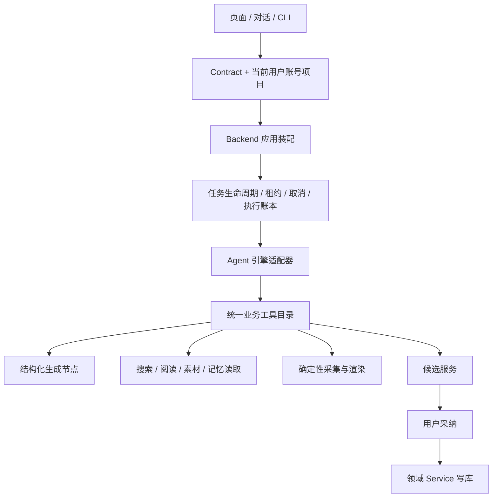

# SPEC 草案：CreatorOS 业务工具、应用装配与 Agent 执行统一重构

任务：T-915。日期：2026-09-04。状态：待范围确认与独立评审，禁止据此直接进入实现。

输入：[T-914 审计](../../research/2026-09-04-architecture-agent-audit.md)、2026-07-12 受控自主运行时 SPEC、2026-07-14 Pi 全产品集成 SPEC；承接 T-256/T-313/T-314/T-340/T-315–319/T-324，不复制它们的历史验收结论。

## 用户意图与待确认项

用户要求全面审查架构与脏/无效代码，认为重构应优先，并要求盘点、考虑启动之前的 Agent 执行引擎需求。已授权审查与需求盘点。

以下是可评审提案，尚非用户已确认的实现范围：是否让编导对话也交由 Agent 主导；是否开放隔离环境中的 bash/fs 脚本自纠；记忆和 skill 进化此次是否整体纳入。旧“对话不动”的 DEC 若变化，必须在正式 DECISION_LOG 记录替代关系。第三方引擎选择保留 Pi 既有投入，不默认升级版本。

## 目标与用户可见行为

用户交代“调研选题并找项目素材”后，Agent 能调用真实业务工具，阅读返回证据，决定下一步，产出有来源、可采纳的结果；遇到可恢复故障能在预算内调整；取消、暂停或应用重启后状态真实，不重复写入或扣费。

现有保存、生成、渲染、手工登记发布与旧项目保持可用。用户可理解当前是在执行、等待确认、需要配置、已暂停、部分完成或失败；不能把诊断 JSON 当完成结果。

## 拟定职责

Agent 负责理解与选择；工具提供真实事实和能力；任务层保管进度；领域 service 做权限与写入。桌面宿主只提供路径、浏览器、密钥访问和子进程适配。继续模块化单体，进程拆分仅在取消/隔离需求有证据时另行裁决。

## 完整拟定工作范围

1. 将 persistence-client 的数据库/服务/任务/Agent 装配提取到 backend 应用层，宿主依赖注入，禁止 backend 反向 import frontend。
2. 统一 chat 与 agentic 的业务工具定义、真实 ID、归属、输入 schema、模型可见输出和错误；引擎只保留格式桥接。
3. research/collect/material 七端口全部接真实 service；生成节点作为有 schema 的工具复用；未就绪能力在调模型之前可诊断。
4. 搜索结果、来源、正文与分页信息确实进入下一轮模型请求；按内容预算截断并允许继续读取，禁止只有“已搜到 N 条”。
5. 调用前校验权限、停止状态、预算与幂等；调用后结算真实 usage。明确缓存 token 与单次预算超额上界；不以事后统计冒充执行前拦截。
6. 统一 completed/partial/failed/cancelled/awaiting_confirmation 等终态映射，记录实际引擎和 fallback 原因。部分可用产物保留，诊断不冒充候选。
7. 复用持久任务基础设施，为 Agent 加服务端检查点、消息续接、工具账本与恢复规则；项目/账号隔离，禁止用户输入重置已消费预算。
8. 将正式模拟发布、mock transport 兜底、canonical 身份默认值退出正式装配，保留隔离测试 fixtures 和真实手工发布登记。
9. 清理编译器证明未使用的符号、无消费者兼容出口、无用依赖；旧 route/skill/对话入口须有消费者与迁移说明后退役。
10. 拆分 chat-tools/chat-runner 与超大页面的职责，保留取消、流式卡片、采纳、选区修改与跨账号语义。
11. 记忆读取、会话续和 skill 提案如果纳入，复用已有数据与 override/回滚服务；AI 只提交 diff 候选，tools/schema 不被 prompt 修改。
12. 脚本自纠如果纳入，先补 OS 级文件/网络/资源边界的专项契约；当前 resource loader 隔离不宣称为 OS 沙箱。不得编辑运行中的应用源码。

## 契约与数据变更约束

- 不删除旧业务实体，不重写历史数据；新增执行字段必须有默认值、迁移和回读兼容测试。
- 当前 RequestContext、真实项目/素材 ID、内容版本在每次执行前经 service 重读。模型历史不是写入真相。
- 工具执行幂等键与尝试编号分离；响应未知不能换幂等键盲目重放。
- SDK 专属消息协议不进入领域服务；前端流式协议可用 adapter 保持兼容。
- 正式发布状态需要真实外部结果或用户明确的手工登记事实；模拟发布器不能绑定正式服务。
- actualEngine、stopReason、usage、checkpointRef 与结果完整性应作为显式契约字段；精确 schema 在 CONTRACT 评审时提交。

## 验收与迁移

测试必须先展示当前失败再实现修复，红测发生时间据实记录。至少包括工具 evidence 进入 provider 请求、预算耗尽前拒绝新动作、多工具一轮、取消期间、重启、响应未知重试、跨账号和已删除目标。

执行真实公共旅程：调研多轮搜读至候选、采纳回读；素材语义选择至制作；手工发布登记；旧对话入口兼容；受管/自配的 anthropic、openai_chat、openai_responses 模型。测试模型和真实上游结果分别留证，禁止 faux 循环冒充真验收。

macOS/Windows 分发包须证明实际引擎被加载、工具可用、停止有效、重启恢复；构建时不能静默跳过 Pi 后仍宣称 Agent 能力可用。缺引擎走明确的可用降级，保留原有效任务。

灰度/默认切换与回滚标准在实施前形成发布 DEC；本草案不授权推送、部署或改用户数据。

## 决策前证据

同一任务、同一模型、同一业务工具比较 Pi 与现有 runtime：是否完成、是否读到来源、工具调用数、tokens、耗时、取消/恢复、跨平台包体与维护代码量。若考虑 AI SDK ToolLoopAgent，也沿同契约做比较。不要将“换掉 Vercel”当成唯一成功指标。

当前推荐优先级由风险与依赖决定：先消除伪成功和身份默认值，提取统一工具，再兑现 Agent 自主与恢复能力；整个确认范围统一验收，不另建多版本计划。
