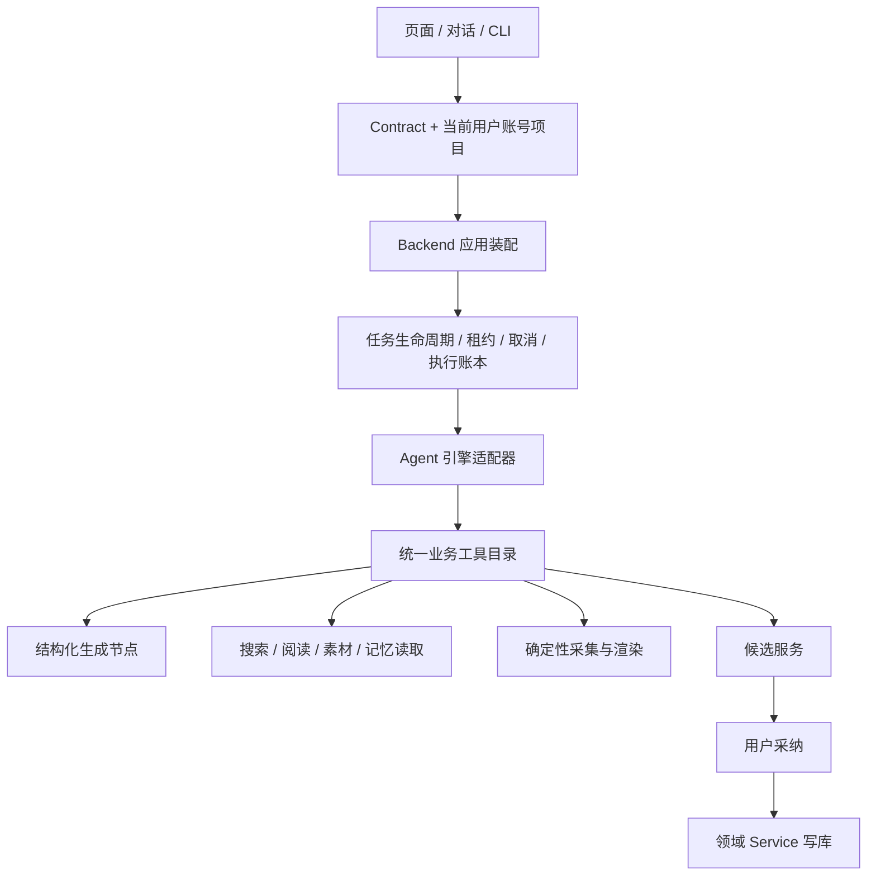
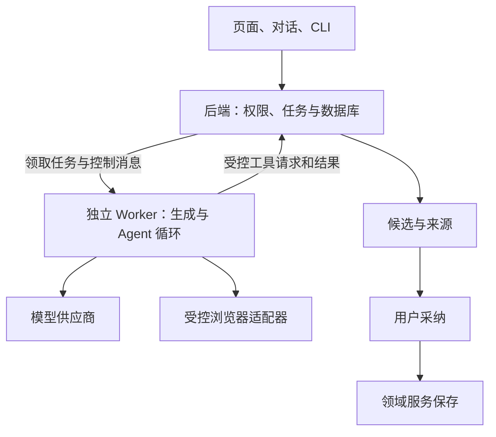

# SPEC：CreatorOS 业务工具、应用装配与 Agent 执行统一重构

任务：T-915。日期：2026-09-04。状态：用户已确认架构方向与本轮范围；具体契约评审结论以相邻 review 的有效回执为准，通过前不改产品运行代码。

输入：[T-914 审计](../../research/2026-09-04-architecture-agent-audit.md)、2026-07-12 受控自主运行时 SPEC、2026-07-14 Pi 全产品集成 SPEC；承接 T-256/T-313/T-314/T-340/T-315–319/T-324，不复制它们的历史验收结论。

## 用户意图与确认边界

用户要求全面审查架构与脏/无效代码，认为重构应优先，并要求盘点、考虑启动之前的 Agent 执行引擎需求。已完成审查与需求盘点。用户在本轮架构建议后回复“认可”，授权按本 SPEC 的可靠性与架构收敛方向推进。

用户本轮进一步明确的核心问题：系统庞大；AI 功能卡、慢、经常失败且不会主动重试；联网搜索与浏览器自动化失败后缺少自我循环。目标是根治这些问题并选择更合理架构。这是 T-915 的首要验收目标。记忆进化、任意脚本自修改等旧设想尚未被本轮确认，不作为本轮可靠性目标的前置依赖。

本轮不新增以下产品能力：把所有编导对话改成 Agent 主导、开放 bash/fs 任意脚本自纠、记忆和 skill 自我进化。原对话仍保留工具与流式体验，执行接同一恢复机制。旧“对话不动”的 DEC 若变化，必须在正式 DECISION_LOG 记录替代关系。第三方引擎选择保留 Pi 既有投入，不默认升级版本。

## 目标与用户可见行为

用户交代“调研选题并找项目素材”后，Agent 能调用真实业务工具，阅读返回证据，决定下一步，产出有来源、可采纳的结果；遇到可恢复故障能在预算内调整；取消、暂停或应用重启后状态真实，不重复写入或扣费。

现有保存、生成、渲染、手工登记发布与旧项目保持可用。用户可理解当前是在执行、等待确认、需要配置、已暂停、部分完成或失败；不能把诊断 JSON 当完成结果。

## 拟定职责

Agent 负责理解与选择；工具提供真实事实和能力；任务层保管进度；领域 service 做权限与写入。桌面宿主只提供路径、浏览器、密钥访问和子进程适配。继续模块化单体；用户确认以独立执行 Worker 隔离长任务寿命，数据库仍由 backend 单一进程打开。

## 针对卡顿、失败与缺少循环的架构建议（本轮收敛）

推荐目标：**模块化单体 + 独立执行 Worker + 统一工具层，Pi 承担自适应任务循环**。用户已确认该方向；本 SPEC 细化其实施约束，当前尚未改变现有进程拓扑。

- 一套仓库、业务模型和本地数据库；backend 是领域数据唯一写入者。Worker 经带当前上下文的 service port/受控 IPC 读写，不直连 PGlite/PG，不并发打开同一本地数据库目录。
- 页面与服务请求不承担长任务、浏览器操作和模型循环的执行寿命。执行 Worker 可独立停止、重启，受主程序监督；必须经桌面包验证进程树清理和资源占用。
- 复用现有持久任务表和租约，实现一个队列调度/取消/重试/执行账本；合并 ai_tasks 与 execution_tasks 的职责定义或建立明确主从映射，禁止两套任务状态各自判定完成。
- 同一工具目录被对话、任务、CLI 与 Pi adapter 复用；模型配置和凭据解析同源。业务模块不 import 具体 Agent SDK。
- 普通文本/结构化生成采用短路径；明确输入的任务不先额外调用“规划模型”。模型主动调用工具的工作才进入 Pi 循环。AI SDK 保留其模型适配和结构化输出职责。
- Pi 是基于已有接入与本次需求的推荐候选，不宣称已证明优于其他引擎。用同一模型、工具与故障任务验证成功率、调用次数、恢复和包体；版本变更单独验证。

### 两种恢复各有属主

| 触发 | 责任层 | 应有行为 |
|---|---|---|
| 网络瞬断、明确可重试的 429/5xx | 任务/调用策略层 | 按 Retry-After 或有抖动的退避做有限重试；全任务统一次数和截止时间；适配器声明已有重试，避免层层相乘 |
| 生成 JSON 结构不符、部分字段损坏 | 生成工具 | 同 schema 的有界局部修复，保留正确部分；不把整条任务盲目从头重跑 |
| 搜索结果不足、网页结构变化、定位器失效 | Pi | 读真实错误与新页面状态，修改查询、选别的来源或重新定位控件；下一步后检查实际目标是否达成 |
| 登录过期、验证码、权限不足、余额不足 | 任务层与界面 | 等待用户完成真实恢复动作；保留进度，不循环撞同一阻断，不让 Agent 绕过限制 |
| 提交后响应未知，可能已产生写入或扣费 | 工具与 service | 按同一幂等键查询/恢复；不支持幂等或状态查询时停在结果未知状态，禁止换键重放 |

“自动重试”解决瞬态执行失败，“自我循环”解决下一步策略。任务层保管总预算、停止状态和已完成事实，Agent 无权重置这些值。

### 浏览器循环需要能观察和验证

保留可靠的现有采集操作作为优先工具，并为失败恢复提供受控浏览器能力：获取当前 URL/DOM 或可访问性快照、必要时截图、导航、定位点击/填写、等待明确状态、提取正文。模型依据新观察选择动作，动作完成后必须观察结果。

示例：搜索无结果 → 改查询 → 打开来源 → 点击失败 → 重新观察页面 → 选择新定位目标 → 提取正文 → 验证是否拿到所需证据。禁止每次重试继续使用已经失效的元素引用。实际浏览器动作由 Playwright 等适配器执行，账号登录态由现有保管库管理，同一会话/页面的写动作串行；不同任务仅在资源与归属隔离后并发。

Agent 不能伪造“已完成”，需要工具返回的 URL、正文、实际页面状态或领域回读作为完成证据。模型拿不到证据的桥接缺陷 A-03 是接线前必须修复的项。访问受限时尊重权限与站点限制。

### 性能治理与验收

先记录每条公共旅程的排队、上下文装配、首个可见输出、模型生成、工具、重试和持久化耗时，比较冷启动/热启动及并发场景。已有“慢”的反馈不能未经测量就全部归因于大文件或 SDK。

实施措施：按需加载能力；只传当前任务需要的上下文和工具；缓存可安全复用的静态资源/模型客户端与有版本的上下文，权限和当前实体状态仍执行前重查；独立只读请求有界并发；普通生成流式返回；长任务提交立即返回 taskId 和真实状态。任务成功后再更新可见数据，不等整个后台系统初始化完才响应界面。

验收指标：端到端成功率、自动恢复成功率、排队/首输出/总耗时的 P50/P95、每任务模型调用次数/token、重复副作用数、取消后的新增调用数、重启后的完成率。性能目标在测得同任务基线后确定，不能提前保证换引擎就提速。故障注入用例必须全部符合预先定义的恢复/等待/失败语义；重复副作用数和取消生效后的新增动作目标为零。

推进依赖：建立可复现业务与故障基线 → 提取统一工具/任务层与 Worker → 接通 Pi 搜索/浏览器循环 → 将现有 AI 入口迁入同一恢复机制 → 删除被替代的旧路径 → 同范围双平台验收。T-916 只修本次必要的门卫/证据链和验收环境，不把所有历史文档漂移清零设成性能修复的先决条件，也不隐藏其余失败。

选型资料：[Pi SDK](https://github.com/earendil-works/pi/blob/main/packages/coding-agent/docs/sdk.md) 提供嵌入式会话与事件能力；[Playwright auto-waiting](https://playwright.dev/docs/actionability) 负责单次动作的可操作性等待。后者不能代替业务级重新观察与策略循环。本轮在线核对，安装版本能力仍需本地验证。

## 完整工作范围

1. 将 persistence-client 的数据库/服务/任务/Agent 装配提取到 backend 应用层，宿主依赖注入，禁止 backend 反向 import frontend。
2. 统一 chat 与 agentic 的业务工具定义、真实 ID、归属、输入 schema、模型可见输出和错误；引擎只保留格式桥接。
3. research/collect/material 七端口全部接真实 service；生成节点作为有 schema 的工具复用；未就绪能力在调模型之前可诊断。
4. 搜索结果、来源、正文与分页信息确实进入下一轮模型请求；按内容预算截断并允许继续读取，禁止只有“已搜到 N 条”。
5. 调用前校验权限、停止状态、预算与幂等；调用后结算真实 usage。明确缓存 token 与单次预算超额上界；不以事后统计冒充执行前拦截。
6. 统一 completed/partial/failed/cancelled/awaiting_confirmation 等终态映射，记录实际引擎和 fallback 原因。部分可用产物保留，诊断不冒充候选。
7. 复用持久任务基础设施，为 Agent 加服务端检查点、消息续接、工具账本与恢复规则；项目/账号隔离，禁止用户输入重置已消费预算。
8. 将正式模拟发布、mock transport 兜底、canonical 身份默认值退出正式装配，保留隔离测试 fixtures 和真实手工发布登记。
9. 清理编译器证明未使用的符号、无消费者兼容出口、无用依赖；旧 route/skill/对话入口须有消费者与迁移说明后退役。
10. 拆分 chat-tools/chat-runner 与超大页面的职责，保留取消、流式卡片、采纳、选区修改与跨账号语义。
11. 记忆读取、会话续和 skill 提案如果纳入，复用已有数据与 override/回滚服务；AI 只提交 diff 候选，tools/schema 不被 prompt 修改。
12. 脚本自纠如果纳入，先补 OS 级文件/网络/资源边界的专项契约；当前 resource loader 隔离不宣称为 OS 沙箱。不得编辑运行中的应用源码。

## 契约与数据变更约束

- 不删除旧业务实体，不重写历史数据；新增执行字段必须有默认值、迁移和回读兼容测试。
- 当前 RequestContext、真实项目/素材 ID、内容版本在每次执行前经 service 重读。模型历史不是写入真相。
- 工具执行幂等键与尝试编号分离；响应未知不能换幂等键盲目重放。
- SDK 专属消息协议不进入领域服务；前端流式协议可用 adapter 保持兼容。
- 正式发布状态需要真实外部结果或用户明确的手工登记事实；模拟发布器不能绑定正式服务。
- actualEngine、stopReason、usage、checkpointRef 与结果完整性应作为显式契约字段；精确 schema 在 CONTRACT 评审时提交。

## 验收与迁移

测试必须先展示当前失败再实现修复，红测发生时间据实记录。至少包括工具 evidence 进入 provider 请求、预算耗尽前拒绝新动作、多工具一轮、取消期间、重启、响应未知重试、跨账号和已删除目标。

执行真实公共旅程：调研多轮搜读至候选、采纳回读；素材语义选择至制作；手工发布登记；旧对话入口兼容；受管/自配的 anthropic、openai_chat、openai_responses 模型。测试模型和真实上游结果分别留证，禁止 faux 循环冒充真验收。

macOS/Windows 分发包须证明实际引擎被加载、工具可用、停止有效、重启恢复；构建时不能静默跳过 Pi 后仍宣称 Agent 能力可用。缺引擎走明确的可用降级，保留原有效任务。

灰度/默认切换与回滚标准在实施前形成发布 DEC；本 SPEC 不授权推送、部署或改用户数据。

## 决策前证据

同一任务、同一模型、同一业务工具比较 Pi 与现有 runtime：是否完成、是否读到来源、工具调用数、tokens、耗时、取消/恢复、跨平台包体与维护代码量。若考虑 AI SDK ToolLoopAgent，也沿同契约做比较。不要将“换掉 Vercel”当成唯一成功指标。

当前推荐优先级由风险与依赖决定：先消除伪成功和身份默认值，提取统一工具，再兑现 Agent 自主与恢复能力；整个确认范围统一验收，不另建多版本计划。

## 可实施契约（T-915，用户方向确认后的设计）

### R-01 执行权与数据归属

`execution_tasks` 是唯一执行权：保存状态、attempt、workerId、fenceToken、leaseExpiresAt、deadlineAt、retryAt、checkpointRevision、累计预算及控制命令。`ai_tasks` 保留公开 taskId、业务输入、步骤、候选和采纳状态，新增可空 `executionTaskId` 唯一映射；旧任务字段可回读。一个执行可有子任务，但每个子任务有自己的执行 ID，父任务等待不等于重领子任务。

映射后的新任务不得再调用旧 ai_tasks claim；`job_runs` 只投影调度业务状态。`execution succeeded` 与 `ai awaiting_confirmation` 可同时成立，前者表示计算完成，后者表示等待采纳。恢复不把未采纳候选当执行失败。

任务状态为 queued、running、retry_wait、waiting_user、unknown_result、succeeded、partial、failed、cancelled。暂停用控制状态 pause_requested/paused，保留恢复位置。pause_requested 禁止新 admission，在途调用允许幂等结算或记未知，确认停止后进入 paused；暂停期间重启仍保持暂停。resume 取得新租约，保留累计预算、已确认回执、稳定 operationKey 和原任务 deadline，浏览器重新观察。调度 attempt 是 fencing 版本，模型/工具重试额度单独累计，暂停恢复不重置额度，也不把一次暂停算供应商失败重试。后端保管状态机：queued/retry_wait 到期后可领；running 只能在当前租约下续租、保存、结算；waiting_user 在实际配置/登录恢复后显式恢复；unknown_result 只允许查询对账或用户结束，禁止直接重提。终态不可被迟到结果覆盖。内部新状态经 adapter 投影到旧公共状态，界面增加真实原因与恢复动作，旧消费者仍能解析。

迁移新增字段和执行记录，不删除旧 ai_tasks、results、业务实体。启动先恢复映射任务，再对未映射在途任务按已有 provider/checkpoint 对账：可安全恢复才创建映射，已完成不重排；提交状态未知保留 unknown_result。迁移带 schema version、事务及重复运行保护。旧 sweep 不再判死已映射任务；历史终态保持原值。

### R-02 Worker 与后端端口

`ai-worker` 增加真实独立入口和构建产物。父后端持有数据库、scheduler、supervisor；Worker 持有模型调用、runner、Pi 和浏览器执行寿命。父进程端口不得把长模型/浏览器动作重新送回 Next 执行。桌面宿主提供运行路径、受控浏览器资源及凭据取得适配，不承载业务选择。

私有父子 IPC 使用 version、requestId、执行引用 `{executionTaskId, attempt, fenceToken}`。父进程按数据库任务恢复 RequestContext，不能信任 Worker 自报 userId/accountId。只开放命名且带 schema 的端口：readTaskContext、readDomainResource、resolveModelCredential、reserveCall、settleCall、saveCheckpoint(expectedRevision)、commitResult、heartbeat、acknowledgeControl、候选与既有确定性业务操作。禁止通用 SQL/eval/任意 service 方法调用。领域写入始终在 backend。

父进程每个端口检查租约、当前控制状态、归属和输入；已执行动作的结算/回执在取消后仍允许幂等记账，但不能启动新动作或覆盖 cancelled。消息去重以 requestId/callId；业务副作用用稳定 operationKey，attempt 变化不换键。写入、检查点、提交结果都必须拒绝旧 fenceToken。AsyncLocalStorage 不跨进程：原租约上下文改成显式执行引用，在后端适配层校验后进入领域服务。

Worker ready 返回协议版本和真实 capabilities；父进程有限并发调度，设置队列与模型/浏览器独立并发上限。退出或失联时回收租约和浏览器子树。取消先写控制命令，再发 abort，禁止新 admission；等待实际停止后确认 cancelled，超出宽限期终止 Worker 子树，其余受影响任务进入恢复。父程序退出同样清理子树。私有凭据不进事件、检查点、模型工具结果或日志。

### R-03 共享恢复、预算与观测

复用已有 retry-policy 的错误分类、Retry-After 与退避；所有 adapter 明确自身重试次数，统一 deadline 与 attempt accounting，禁止 SDK、工具、调度层分别重试三次。只读请求遇已确认瞬态失败可重试；可能产生计费/写入且提交响应未知时，先按相同 operationKey 查询或使用已验证的供应商幂等恢复。供应商不支持时进入 unknown_result，界面说明结果待核对并提供现有诊断/结束动作，不换键重放。

每个任务持久化模型/工具调用账本：callId、operationKey、类型、输入摘要、reserved/started/settled/unknown、providerJobId（如有）、实际 usage、结果引用与错误分类。模型或工具调用开始前校验 cancel、deadline、剩余步数及预算；多工具一轮逐个 admission，不能 turn_end 后才截断。模型调用先预留输入估计及最大输出；供应商支持时设置输出上限。估算与供应商计量差异允许一次已发请求的有界超额并显式记账，不能承诺无法保证的硬 token 精度。cache read/write tokens 依 provider 不重叠语义计入规范账本，未知 usage 记 unknown，不能算 0。

检查点保存规范消息、已确认工具回执、未完成调用、产物引用及预算版本；SDK 协议经适配器重建，不进入领域实体。预算以服务端账本为准。恢复先对账 started/unknown 调用，再恢复模型上下文；只恢复已确认事实。浏览器会话和元素引用不持久复用，必须重新建页观察。候选与业务状态投影事务提交；跨事务宿主产物通过 outbox/幂等结果记录恢复，测试中断窗口。

埋点从公共提交开始，记录 queue/context/firstOutput/model/tool/retry/persist 与总耗时、attempt、actualEngine/stopReason；不含原始敏感正文或凭据。基准固定同模型配置、同输入、同工具响应、冷/热及并发数量，至少 30 次可重复本地样本，报告 P50/P95；真实上游样本独立标注。普通生成禁止增加规划调用；本地同输入基准的首输出与总耗时 P95 不得劣化超过 10%，超出先定位修复，不能擅改阈值。联网耗时只报告观测值，不伪造稳定时延保证。

### R-04 统一工具与浏览器闭环

规范结果 `ToolOutcome` 包含 status(ok/partial/blocked/error)、evidence（来源 URL、标题、正文窗口、真实实体 ID/版本）、error(code/retryable/recovery)、continuation(evidenceRef,nextOffset,totalChars)、sideEffect(none/proposal/committed/unknown)。模型 content 必须包含预算内真实 evidence 与续读方法；details 仅用于诊断，不作为模型已读证据。错误分 transient、stale_observation、no_evidence、needs_login、captcha、permission、unknown_commit、cancelled、deadline。

七端口每任务绑定当前上下文，不使用默认用户：web.search 复用现有搜索；web.read 复用阅读并分离隐式保存；knowledge.write 产出知识候选；collect.plan 投影当前账号的真实采集目标 `{kind,id,accountId}`；collect.run 复用已有 ingestion run；material.search 读取完整可分页素材及摘要，语义选择交模型；material.organize 产出素材标签建议候选。候选携带来源、目标 ID、预期版本及稳定 proposalId，复用 ai results 的候选保存与采纳入口；新增候选类型只有 backend 采纳服务可写 knowledge/taxonomy/assets，采纳时重查归属与版本。冲突返回可解释状态，不用模型历史覆盖当前数据。

`web.read` 保留 needLogin、blocked、alternates；正文通过 evidenceRef/offset/maxChars 继续读，用户/账号/任务归属校验与有效期由服务端控制。搜索、浏览器池排队、fallback 搜索、导航和读取全部传 signal/deadline，复用局部恢复但共享总预算。被取消的 checkout 必须从队列删除，不能之后拿到资源再执行。

浏览器接口：observe(sessionId) 返回 observationId、URL、标题、文本窗口与可操作元素引用；act(sessionId,observationId,action,targetRef,value) 仅支持导航/点击/填写/等待明确状态/提取，返回新 observation 与事实结果。过期观察返回 stale_observation 和新观察，不继续旧目标。每次动作后重新观察；模型判断是否达成业务目标。DOM 等外部内容作为不可信证据，不能改变工具权限。副作用动作沿用用户已有授权和工具 effect，未知提交先核实，不能自动重复提交表单。

现有登录保管库真实归属是 user+domain，本次保持该数据归属，不宣称按 account 加密隔离。浏览器执行 session 绑定 task/user/account，上下文切换不得挪用任务页面；同一底层登录 profile 的动作串行。登录/captcha 等待用户并提供现有登录入口，恢复后新建观察，不能循环尝试绕过。重启后关闭遗留页并重新取得受控租约。

### R-05 结果与兼容路径

运行输出显式携带 actualEngine、stopReason、usageRef、checkpointRef、completeness 和类型化候选。正常完成为 succeeded；仍有可用业务候选但预算/外部来源不足为 partial；只有诊断且无业务结果时，不可恢复错误映射 failed，配置/登录阻断映射 waiting_user，未知提交映射 unknown_result，不制造 agentic-result.json 候选。blocked 只保留为工具结果与旧公共状态，不是新执行终态。历史 blocked 记录保持回读；仅依据持久化错误码与实际恢复动作映射，缺原因时保留原记录并要求诊断，禁止猜成可重试。partial 候选保留来源与未完成说明，支持安全采纳已有结果。确定性回退不得额外调用 LLM 后忽略其决定；缺 Pi 时仅回退到已验证的既有功能，能力不足在调模型前说明，不伪报 Agent 已完成。

所有生产入口纳入同一 scheduler/恢复：ai.tasks.create 的各 runner、execution.tasks.create、旧 conversation.messages.create、新 /api/chat、source/transcript/share-import/topic-preview/script-candidate、automation scheduled_collection、reviewGate dispatchScriptReview，以及采集后的归因/蒸馏模型调用。流式 HTTP 保持现有卡片协议，通过 Worker 事件适配；断开订阅不自动取消持久任务，显式取消才生效。每一迁移项列出新 owner、消费者与旧出口删除证据，不能只迁一个 dispatch 闭包。

正式装配删除 createMockPublisher、未注册操作 mock 兜底与 canonical 默认身份；测试 fixtures 独立。已授权手工发布登记仍可用，真实自动发布未实现则给真实能力状态，不造 published。超大文件按服务装配、模型运行、宿主适配、UI 区域抽出清晰 owner；用调用者与类型检查证明无用再删，不按文件名或行数判断死代码。

### 验收 AC（完整范围统一交付）

| ID | 公开路径或故障 | 必须证明 |
|---|---|---|
| AC-01 | 搜索→读网页→模型下一轮→调研候选→采纳回读 | provider 实际请求包含 URL/正文；长文可续读；真实来源保留；采纳前无领域写入；重复采纳不重复写 |
| AC-02 | 素材检索→语义选择→制作与标签候选 | 超过 100 条仍可分页；真实 ID 与归属；跨账号/已删/版本冲突拒绝；既有制作成功例继续可完成 |
| AC-03 | 瞬断、429、格式错误、登录、未知提交 | transient 有界恢复；局部结构修复；登录进入 waiting_user；未知提交同键对账，无第二次不可幂等副作用 |
| AC-04 | 多工具一轮、预算已耗尽、取消后迟到 Worker | 调用前拦截；预算不可重置；旧 fence 不能启动动作、写候选或覆盖终态；已执行调用仍可结算 |
| AC-05 | 杀 Worker/父进程、检查点与提交窗口中断 | 恢复消息/预算/工具事实；无重复候选；ai/execution 投影一致；浏览器重新观察；旧 sweep 不判死新任务；暂停中无新 admission，在途调用可结算；暂停后重启不自启，恢复保持预算/重试额度/deadline/operationKey |
| AC-06 | 浏览器过期定位、排队取消、登录阻断 | 新观察后改目标；取消排队不启动；搜索取消不启动后续 fallback；动作后回读证据；登录不反复撞墙 |
| AC-07 | Pi 异常/缺失、partial、纯诊断 | actualEngine 真实；可用部分保留；诊断不冒充成功；有效旧路径安全降级 |
| AC-08 | 所有 R-05 入口及旧数据 | 每入口路由至唯一执行权；正常生成无额外规划模型；流式卡片、采纳、取消与选区改稿兼容；迁移可重跑 |
| AC-09 | 性能基线与故障样本 | R-03 同条件 P50/P95 和模型调用数；全部故障分类符合预期；重复副作用为 0，取消生效后的新 admission 为 0 |
| AC-10 | 正式装配、边界与旧路径退役 | 无生产 mock 发布/transport 和默认身份；backend 不 import frontend；SDK 只在 worker/runtime；Worker 不打开 DB；手工登记回归 |
| AC-11 | macOS/Windows 分发包与供应商兼容 | Worker 真启动、Pi 能力真实、退出无残留、停止与重启恢复；anthropic/openai_chat/openai_responses 同源配置；真实验证与 fixture 明确分列 |

独立 SPEC 评审检查上述约束与实现可行性；之后按契约、状态机/故障注入、公共旅程、边界/orphan、构建及真机证据验收。尚未发生的测试保持待验，不以设计评审替代 BUILD PASS。T-916 已有全局对账失败单列保留；本任务引入的漂移必须修复。发布默认切换、安装替换或推送另有具体可审阅候选后按已授权范围处理。

### 2026-09-07 正式入口交付记录（用户暂缓测试）

- 用户要求优先业务落地、自主规划及失败恢复，暂不执行自动测试，由用户实测；本记录不构成验收 PASS。
- 正式 `/api/chat` 已改为持久 Worker 提交与事件订阅；接入 `research.autonomous` Pi 子任务、选题/复盘/知识蒸馏 Worker 节点、截图/采集/转写工具入口。截图与采集资源的物理迁移不因此视为完成。
- 封面正式任务接入当前稿上下文、文案方案、图片生成/参考图编辑、候选投影与原调用明确拒绝重试；旧生产封面 runner 分支已移除。
- 保留原 30MiB 图片附件输入范围；图片传输编码与视觉预算预留分开，视觉预留为策略估值，实际用量以供应商回执结算。
- 代码主线截至 `2568ec31`；运行 `node ai-worker/scripts/build.mjs` 成功生成本地 Worker 文件。未运行测试、类型检查、全局 reconcile，未打包、发布或验证真实供应商。
- 仍待推进：聊天备用模型切换、完整转写生产流程迁移、剩余旧执行路径退役与架构收敛。性能、真实浏览器循环及桌面生命周期效果待实测；T915 继续执行中。

### 2026-09-07 破坏式重构与消融进展

用户明确授权删除旧代码、按高内聚低耦合拆分并执行局部消融。正式聊天旧流执行器、宿主三种Agent装配与旧整批转写循环已退役；Worker来源故障有界恢复、采集状态与取消生命周期已接线。对照实验及剩余边界见 [消融记录](../../research/2026-09-07-runtime-ablation.md)。本轮只执行运行文件/依赖构建与静态消融，不记业务验收 PASS；备用模型切换、登录资源物理迁移及其它R-05入口继续推进。

2026-09-07 持续落地：聊天主调用在明确可重试 HTTP 拒绝且未出流时，可沿原任务切到专配 `chat.fallback`。备用调用独立记账、冻结无秘密身份、使用原检查点恢复；未知提交不切换，备用失败沿原预算恢复。Worker 运行文件构建完成，未执行供应商/业务测试，真实切换效果待用户验证。

2026-09-07 继续推进（截至 `88476871` 的正式接线）：

- `video.decisions` 完整多阶段决策已迁入 Worker，保留分块、检查点、材料模式及已有降级；原宿主执行分支删除。
- `asset.classify`、`material.extract`、`reconstruct.project` 已接原 AI 任务与 execution_tasks 映射，产物经各领域完成事务落地；图片/文档旧模型循环删除。
- 情报选题预览、项目稿件生成用各自原 claim 监督 Worker；明确拒绝进入原任务重试，未知结果保留，旧 runner 不再覆盖恢复状态。
- 转写登录来源在 Worker 使用真实抖音账号目录；宿主抖音/热点宝及 staging 搬移共用物理目录租约。仅代码接线，未启动浏览器验证。
- 用户淘汰选题后的 `topic.preference` 改为真实持久任务，已删除无任务的宿主提炼；过时原因快照不覆盖新偏好。
- 修复封面/转写已有私有端口未登记的问题；协议清单核对不存在未登记输入 schema。正式存储不再回退模拟成功，隔离测试仍保留内存适配器。
- 聊天备用模型局部消融见 [模拟记录](../../research/evidence/t915/chat-fallback-ablation.json)：明确拒绝后启用备用可输出；回放不增加模拟供应商调用；未知提交不切换。该记录不代表真实数据库、供应商或业务验收。

仍在本任务完整范围内继续：情报转写、采集后的归因/对标/收藏提炼、编辑稿采纳相似度、embedding 等剩余入口及装配收敛。未运行全量测试/全局 reconcile，未做真实供应商、浏览器、双平台包验收；不据构建标记 T915 完成。

2026-09-07 后续实现记录（尚未整体验收）：

- 编辑稿采纳相似度使用真实 `script.source_similarity` 子任务；已采纳的版本先回读原结果，不重复调用模型。
- 情报逐字稿接原 `transcribe` claim 的 ASR Worker；读取来源与音频提取仍是受取消约束的宿主资源端口，未宣称整条浏览器链物理迁移完成。
- 对标拆解、自有作品归因、收藏判库与知识分块的模型阶段已实现同原定时任务账本的 Worker 端口；单条对标转写已实现专用 `benchmark.transcribe`，只投影对标作品。生产装配正在整合，不能只凭工厂存在记为全入口完成。
- 交互 embedding 已实现复用 IO Worker，最多两条实际在途请求，共用截止时间，未知请求不重发；知识搜索装配抽到 backend service，原关键词降级保留。
- 静态消费者盘点证明旧 `trend.extract` 装配闭包已无实际调用方，按消费者证据删除；真实 Worker 出题和聊天读取链保留。不是根据功能名称裁剪业务。

剩余工作包括上述最后入口的生产接线、设置连接探针隔离、旧路径清理、应用装配进一步收敛及用户实测。任务继续保持执行中，构建与局部模拟均不替代运行验收。

2026-09-07 生产接线与页面收敛（截至 `7d5380ba`）：四类定时采集后的模型阶段、收藏 ASR、单条对标转写、embedding 与模型连接探针均已接入实际装配；旧宿主转写函数及无消费者热点提取链删除。Metrics/WorkListExport/SearchVideos 已增加取消信号和浏览器关闭等待，并接到定时任务信号。知识搜索装配及 30 类公开服务分发已移至 backend 应用/service 层；未知操作仍在初始化数据库之前拒绝。情报工作台按来源表单、运行观察、选题任务、候选编辑等职责拆分，透传原任务 runtimeStatus，隔离账号与旧请求回显。只完成静态依赖构建和代码提交，没有实际启动应用或运行真实模型验收。

继续处理的明确兼容缺口：旧素材任务的供应商 checkpoint 仍需安全迁移，页面恢复/取消操作仍在核对具体可达入口；整个数据库/宿主装配尚未完全从 persistence-client 提取。不能写成“全项目重构完成”或“AI SDK 已卸载”。
