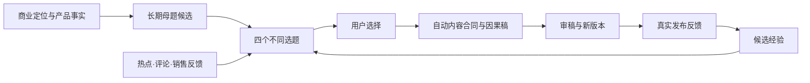

# T-929 商业定位、母题与因果文案适配设计

用户提供完整方法并指向Hkm-Ip-agent的PRODUCT_SPEC.md:654与prompt-catalog.mjs，要求结合CreatorOS分析如何落地。先只读核对参考与现有定位、Skill、候选采纳、稿件版本、雷达和学习端口，形成可评审设计。未把“看看如何落地”擅自升级为重造产品架构。

设计必须复用现有Skill管理，语义判断交模型，代码只守账号、真实ID、类型、版本与采纳；信息缺失可出候选、降低断言，不编事实或新增必填门槛。不得把六种职责机械拆成六个串行模型任务。用户选择后再采纳，改稿产新版本，反馈先候选经验。参考工程中的严格保存质量门只作研究材料，不能盖过本项目可用性契约。

## 适配结论

采用这条生产链，复用现有 Skill 管理、候选采纳和稿件版本，不另建一套编导系统。六种职责是可组合的方法，不是六个必须串行运行的 Agent。用户直接要求成稿时，主写作调用内部完成内容合同、因果组织和自审；只有缺少真实资料时才调用资料工具。

## 如何落在现有产品

| 能力 | 已有落点 | 建议变化 |
|---|---|---|
| 商业定位 | contract/resources/positioning；business-methods | 复用已确认定位，补充产品承接、能力边界、事实与假设，不另造人物档案 |
| 长期母题 | 当前 contentScope 不是独立母题资产 | 设计账号归属的母题候选：服务人群、反复问题、核心矛盾、稳定判断、依据、产品承接。用户采纳后可复用；不要求先建母题才能创作 |
| 具体选题 | candidate 已有受众、痛点、冲突、素材、风险、产品锚点 | 增加可选母题关联、用户任务、预期认知/行动变化、事实/推演/探索证据状态。默认四条有实质区别的候选，不做维度笛卡尔积 |
| 隐形内容合同 | planning-contract；creative-context 已消费 content_contract | 补充说话者、认知阶段、任务场景、当前做法、阻力、证据、产品边界和单一行动。自动推断，不增加必填表单或独立调用前置门 |
| 主因果稿 | script-voiceover-storyboard；script-draft | 以场景→旧方法→阻力→原因→新判断→证据→价值→行动组织；不是固定八段模板。统一旧模板要求按策划顺序和新写手自由组织的冲突 |
| 审稿改稿 | artifacts.service.createVersion；edit_delta | 沿因果、证据、口语感、产品承接审稿；改稿创建新版本，保留父版本、用户修改意图、方法版本和审稿摘要。仅审稿请求不偷偷改正文 |
| 反馈学习 | learnings 候选/验证/废弃及应用记录 | 反馈关联实际稿件版本、数据来源和待验证判断；单次爆款或低播放不自动改全局 Skill |

## Skill 管理的单一入口

六个职责归入现有管理入口：选题总编、选题审查、内容策划、结构编导、口播写手、审稿改稿。复用 prompt registry 与 effective-skill-snapshot：有效方法在运行开始时冻结，用户随后改 Skill 不改变已运行任务。不要同时维护一份隐藏硬编码提示词与一份界面可编辑但无效的 Skill。

对标只提取段落功能、因果推进和转折方式；正文使用当前 IP 的事实、观点、产品和表达。原文的案例、数字、故事和结论不能当成本账号事实。四个一是创作约束，不是阻止保存的代码质量门。

母题、维度和匹配判断都由 Skill/模型完成，禁止关键词打分选题。代码只落实归属、真实 ID、版本、幂等与明确采纳。所有新增信息默认可选，证据不足降低断言并标明待补充，仍交付可用候选。

## 一次用户体验

用户说“按我的业务给四个选题”，系统读取定位、已有稿件与可用反馈，给四个方向，每条讲清受众、矛盾、观看后的变化和依据。用户选一个后直接得到可读稿件；内容合同和段落功能可展开查看，不要求再填表。用户说“第二段太虚”，生成新版本并保持其他段落修改范围。复盘只把真实反馈形成候选经验。

## 参考与验收边界

参考 Hkm-Ip-agent/PRODUCT_SPEC.md:654–717 与 prompt-catalog.mjs。既有代码依据：ai-worker/src/prompt/business-methods.ts、templates/planning-contract.ts、templates/script-voiceover-storyboard.ts、templates/script-draft.ts、backend/src/modules/ai-runtime/creative-context.ts、effective-skill-snapshot.ts、backend/src/modules/artifacts/artifacts.service.ts、contract/src/resources/candidate.ts 与 learnings.ts。

本任务交付适配设计，不宣称方法已进入当前安装包。母题数据归属和可选契约变更需完成独立设计评审后实施。验收关注：缺资料仍出候选、直接写稿不强制多轮、选题真正不同、修改不覆盖原稿、单次反馈不自动变正式规则、管理入口修改能在下一任务生效。业务测试由用户后续验证，不伪记历史 PASS。

独立设计评审（2026-09-08，chat_pi_execution）：通过，无阻断项。实施须保持未知产品能力、案例、效果为未知，不能把自动推断保存成已确认事实。本记录只代表设计评审，不代表实现或业务验证通过。
