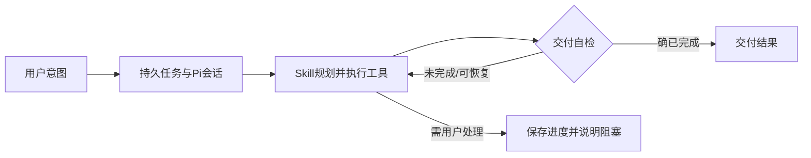

# T-923 持续任务循环与恢复

用户已明确认可 T-922 对照方案并要求开始。承接 T-915，继续使用 product-to-code-orchestrator 流程；执行 Worker + 后端端口 + execution_tasks 单一执行权不变。用户持续授权快速落地、暂缓业务自动测试及全局 reconcile，模型实测由用户完成。

## 目标与执行契约

主聊天由 Pi 决定工具行动与会话推进，保留当前 UIMessage 流协议、服务端工具授权与逐调用账本；不再用第6步/同参调用强制禁工具，不把强制文字收尾当交付。纯结构化生成作为业务工具继续复用，AI SDK 可保留协议适配和短节点，不保留第二个聊天规划引擎。

任务基于原始意图与已完成结果推进；技能明确只有真正完成、用户主动停止或外部必要阻塞才结束。模型长度截断自动在同会话继续；可恢复工具错误作为观察结果交回模型调整，未知写入回执和用户拒绝仍守边界。不得通过关键词/字符串相似度判定意图完成。

Pi 上下文压缩/恢复必须与宿主账本兼容，所有模型调用（包括压缩、修复）仍经预算/回执端口；不能直接打开会绕过记账的 SDK 路径。明确暂态拒绝自动退避，失败不是永久的整项完成。至少完整保留 nomifun 的长度续跑能力，并对普通任务意图提供可配置交付自检。

## 持续执行与边界

普通交互AI任务不再以短小的固定总次数/10分钟任务截止终止。采用明确的持续执行预算策略（仅后端创建新任务可授权），单次请求仍有卡死/取消机制，保持计量和并发限制。旧任务冻结预算不被无声放大；用户显式指定的限制仍生效。连续恢复不能复制已有副作用，不改变账号归属、采纳、未知提交对账。

实现时统一预算声明/校验，持续任务仍记录累计消费；不把null当无限后遗漏类型守卫。截止与次数的具体表示须在本SPEC追加实现契约，包含supervisor、ledger、claim/recovery和重试结果投影调用链。不能只改内部常量制造第二个隐藏上限。

## 任务与界面状态

保留同一任务/对话/检查点，不新增重复任务。成功通知对应交付而非一次底层agent_end。恢复期间仍显示进行中或等待重试；登录、额度、用户取消及未知副作用回执给出真实阻塞。

## 验证与范围

独立SPEC/代码审查，类型编译和必要构建检查；不运行真实用户数据测试。暂缓业务自动测试不得标PASS。本轮不打包、不安装、不发布、不改nomifun参考工程。尚未接通的入口必须如实列出，不将T-915整体标为完成。

## 实现契约补充（独立评审 continuous_budget PASS）

统一executionBudgetSchema：旧budget形状维持有限策略；新任务显式policy:continuous，maxCalls/maxTokens/deadlineMs可null，null表示没有该整项上限，仍记录实际用量。有限数值保留用户明确限制。execution的deadlineAt和worker运行deadlineAt允许null，不创建总任务取消定时器；单次调用卡死/取消与并发仍保留。普通有限任务maxAttempts仍有效，continuous只有显式maxAttempts才限制恢复。新建聊天和雷达任务在enqueue冻结策略，新自主任务在prepare冻结；旧有执行任务不迁移预算。

新聊天冻结executionEngine:pi，无字段的旧任务仅继续旧协议回放，避免变更请求摘要。新agentic冻结runtimeVersion:intent-v1，只有新版启用length续跑和可由宿主重建的历史窗口；旧任务维持原请求。Skill承载普通回合的交付自检，不用关键词或审美评分拦截最终输出。

agentic长上下文采用按完整工具回合保留近期窗口、保留原始目标的确定性传输缩减，完整调用事实在账本保留；不是另外请求模型生成摘要，避免Pi内建compaction绕过现有模型记账。文本压缩质量及真正模型摘要仍不能据静态接通宣称验证。

## 最终实现补充与范围

新雷达 topic_preview 在冻结输入写入 continuousRecovery：拆解/选题节点对已确认的格式错误携带原响应与 schema 持续修复，空改写稿持续补该阶段。旧输入不改变重放请求。检查点只接受当前重放序号对应的已结算根模型，允许它早于最新调用；最终结果仍只认最新已结算调用。检查点合并保留其后已完成阶段。

script_candidate 的普通生成节点仍沿用原格式恢复策略；持续任务预算不等于所有短节点均无限修复。未知供应商提交、过滤、权限/凭据等真实阻塞仍可停止。普通 stop 的完成判断由 Skill 自检，并未添加独立语义验收模型。上下文窗口是确定性缩减，不是模型摘要，特别大的单条用户输入仍可能超过模型容量。以上限制不得在交付中省略为“全项目已根治”。
