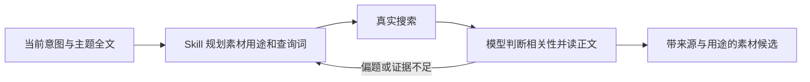

# T-931 主题驱动素材检索

用户反馈独立开发者收款合规搜索返回词典与水管工，并明确要求搜索前通过 Skill 根据主题推断关键词。先用公开CLI读真实查询和回执，核实传输和实际页面，不能凭结果猜测引擎无资料。

沿用现有 Skill 管理、Pi 与任务账本：当前主题、已有稿件、最新意图形成证据需求与少量不同查询；显式查询原样传递，不由代码追加资料词改变语义。相关性和策略由 Skill/模型判断，代码守URL、授权、参数、真实来源和取消边界。结果偏题要重规划或切真实来源、阅读全文后整理案例/数据/引语；两轮失败不是自动完成条件。公开资料和本人经历凭证分开，缺本人截图不得阻断公开调研；用户授权仍由工具宿主处理。

按既有授权暂缓业务套件与真实付费生成；可用公开CLI和无业务副作用的诊断。未验证不记完成，变更先独立评审。

## 真实诊断与收敛决定

CLI读取已完成 Pi 会话的两个 material.gather 输入，均为几十个主题词拼成单一长查询；host 的 prepareChatResearchQuery 还会追加 userMaterialQueryTerms。本轮改为保留显式查询语义，旧字段只留作快照兼容；worker.research 实现修订升 v2，避免把改变后的搜索准备伪装成旧实现。卡片仅称“检索线索”，模型按真实正文判断相关性，不用业务关键词过滤器。

新增独立方法型 research.plan，管理页中文“素材检索规划”，system/template可配置，新聊天冻结与注入；旧冻结任务缺此新Skill不借当前配置补入、不报错。素材快捷入口允许先读主题和规划，其他按钮强制工具语义保持。无额外模型或第二套Agent循环。

公开浏览器对照：当前网络的 Bing 响应原文对完整且正确回显的查询返回随机无关主题；重复 Stripe 限站查询得到炒饭、系统设置、测速。不能判断是源站、网络链路还是反爬；URL/输入框检查无法修复这种语义错误。相同 Chromium 中百度与 DuckDuckGo 对“微信支付 商户号 驳回原因”返回相关页面，因此将异常 Bing 移出自动默认链，保留显式自配使用，单适配器默认 DuckDuckGo；应用自动检索顺序为百度 → DuckDuckGo。不能据当前诊断宣称 Bing 在所有环境都异常。

新增真实 DuckDuckGo HTML 解析及跳转链接解码；已知搜索协议核对完整查询，百度只在各自结果块内提取标题摘要，自定义引擎仅核对明确查询载体，不因跟踪参数或地区跳转阻断。语义偏题仍交给检索规划Skill继续找来源、读正文，两个结果批次失败不是完成条件。独立评审 continuous_budget、chat_pi_execution 已完成并指出/修正自定义URL过严问题。

## 本轮核验与边界

- 真实公开 CLI 会话 `ai-conv-3302704d-525` / 任务 `ai-task-4fff7100-063c-44e6-be80-4ab39b3f6683` 确认由 Pi 执行，原两条长查询均未阅读全文。本轮只读诊断，无修改业务记录。
- 新冻结快照方法注入、旧快照缺项兼容、冻结自定义 system/template 生效、素材入口不再强制抢先调用搜索：无 IO 装配探针通过，不调用模型或数据库。
- 实际公共浏览器入口：`微信支付 商户号 驳回原因` 经百度约 6.3 秒返回 5 条线索，含微信支付合作伙伴文档、企业微信帮助中心、微信开放社区；DDG 单适配器也返回相关线索。
- `site:support.stripe.com payouts paused` 经百度遇到验证页后自动切 DDG，后者真实返回空。此时应由 Skill 继续改查询/读已知官方来源，不能断言全网不存在资料。未执行付费模型，尚未证明模型完整遵循新方法。
- frontend typecheck、ai-worker build 与 diff --check 通过；新无 IO 测试文件已补但按用户授权未跑套件。独立源码审查通过，不冒充业务验证或真实模型评估。
- 保留既有取消/权限边界；不新增业务词表、可信度打分、额外 Agent 或模型调用；自定义不透明查询模板无法核验的载体不推测。
