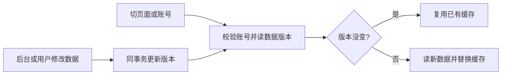

# T-925 数据变化驱动页面缓存

用户明确否决 15 秒数据缓存，要求数据没变持续复用、变化后更新，并打本地包。该授权覆盖以下缓存契约替换；完成提交后单独进入 T-926 冻结打包。

## 契约

保留 T-924 的账号隔离、白名单页面客户端、容量淘汰与错误不缓存；已完成缓存不再有时间 TTL。在途请求仍设置有限复用窗口，避免挂起 Promise 永久占位，该窗口不是数据有效期。

新增 backend 数据库迁移：单行 page_read_revision 和语句级触发器，projects/candidates/content_outputs/publications/publication_revisions/metric_snapshots/metric_values/retention_points 的 INSERT/UPDATE/DELETE/TRUNCATE 在同一事务递增修订号。版本随事务提交可见，回滚不改变。它是缓存失效元数据，不改变业务归属。版本全库共享，某账号变更可能让其他账号额外重读，但绝不共享缓存内容。单次轻量标量查询替代重读完整列表。

backend application 只暴露版本读取 closure，由 composition 注入展示缓存。每次使用缓存先读当前已提交版本；版本相同复用，不同重读。填充完成前再核对版本，读取中发生变更则不保留旧结果。公共写前/后失效仍保留，AI及后台真实数据读取不缓存。失败读取版本时退回实时 transport，不让缓存元数据失败阻断页面。

选题总览涉及定位/采集等跨域数据，本轮移出持久缓存，保留并行实时读；项目排期继续实时读。没有用时间轮询替代变更检测，下一次页面读取可观察后台/跨进程变更。没有承诺页面停留时服务端自动推送。

## 验证与授权

独立 SPEC/代码复核、类型检查、必要构建。用户暂缓业务自动测试与全局 reconcile 的指令仍有效，迁移不在当前真实用户库试跑，不宣称 SQL/模型/界面实测 PASS。打包不安装、不发布，不修改用户业务数据。

独立评审指出 guardrail 排序依赖偏好及当前时间衰减，故此排序保持实时读，不纳入无TTL缓存。全库版本行会串行化相关写事务，保守换取一致失效，不能宣称对写性能无影响。
