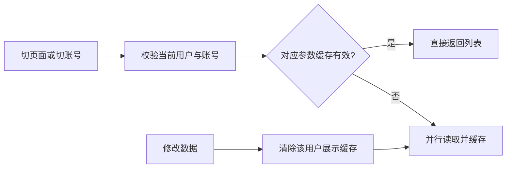

# T-924 页面切换读取缓存

用户明确要求解决选题、项目及切号数据多导致的卡顿，并要求加 cache。沿用 T-919/T-912 导航与账号归属契约，不改变路由或数据库归属，继续暂缓业务测试和全局 reconcile，由用户实测。

## 设计

只为两个页面显式启用服务端进程内展示缓存，不影响 AI/工具/写入的当下真值读取。入口仍每次 resolveSession 并验证当前账号；key 为 userId+accountId+source+endpoint+完整参数（不包含每次变化的 requestId）。未选号、非 user 来源及非白名单 GET 不缓存。白名单为项目/候选列表、选题总览及项目列表封面/指标所需读取。

缓存有效 15 秒，过期在下一次读取时重取；并发同 key 复用请求；异常不缓存；返回独立数据副本。最多 128 条、总 16 MiB、单条 2 MiB，LRU 淘汰，进程重启丢弃。共享 globalThis 实例让同进程 RSC/API chunk 使用同一失效源。公共 transport 的写操作开始及结束均使当前用户全部展示缓存失效，旧在途响应不能重新灌回缓存。后台直接服务写与跨进程写依赖短 TTL 收敛，不宣称强一致或后台自动推送。

选题页候选池、今日、来源过滤及总览独立读取一次并行；项目每屏现有 10 条保持，未引入更多 DOM。账号切回已访问页面可命中对应账号数据，不用整页持久化或全局 Router cache 绕过 cookie 权限检查。排期继续实时读。

## 验证

独立 SPEC/代码复核、类型检查、diff 检查。业务测试/真实大数据时延和安装包本轮未授权新增执行，沿用用户暂缓自动测试要求。不将缓存机制落地宣称卡顿根治；若剩余瓶颈为渲染/数据库冷读，需要真实运行证据继续定位。

独立 SPEC 评审：continuous_budget PASS。实现补充：成功 envelope 验证通过才缓存，坏响应不保留；内存限制以序列化载荷估算，不代表进程 RSS 硬限制。
