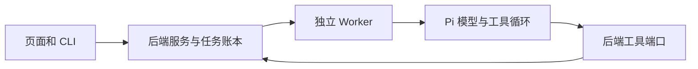

# T-930 统一 Pi 模型运行时与退役旧装配

用户于 2026-09-08 明确要求清理旧任务兼容执行器、AI SDK 模型适配和大型组装文件，全部迁至 Pi。承接 T-915/T-923 和 T-928 的消费者审计；本次授权包含旧代码退役及必要契约调整，不包含删除业务数据或重新发起用户生成任务。

## 实施边界

Pi 负责模型协议与工具策略循环，Worker 保有执行进程；backend service 继续持有归属、持久任务、模型调用账本与工具回执。旧任务保留 ID、冻结上下文、预算、调用回执和历史结果，不保留第二套 SDK Loop。不迁移已执行副作用为新任务。当前本机没有旧聊天在途，具体升级边界见下文。

模型适配使用现有 pi-ai 的供应商协议，保留自配/受管模型、baseURL、密钥内存注入、取消、用量与明确拒绝/未知回执区分。短生成可直接调用 Pi 模型，不为每次 JSON 提取额外启动工具规划。对外 UI 消息与持久回执格式可以暂保协议兼容类型，但不可残留 AI SDK 网络执行。供应商包应移除；请求编译/消息类型依赖的明确保留范围见下文，不把它们误称为新的模型网络入口。

大型 persistence-client 按能力工厂拆出组合与依赖，不把所有内容简单搬到另一个大文件。后端业务与持久化下沉 backend，frontend 只保留入口接线；循环依赖、模块间 repository 穿透禁止新增。保留渲染等非模型执行器，不将它们误删为旧 Agent。

## 交付与证据

先独立评审迁移约束，再按真实消费者实施；不以依赖改名当迁移完成。更新构建配置、依赖锁和 CodeGraph。用户暂缓业务自动测试及全局 reconcile；仅执行必要类型/构建检查，不运行真实模型或接触用户媒体、数据库。未安装新包不能宣称运行问题已解决。CLI 已获本次启动访问授权，用公开只读操作继续定位 T-928，业务写入不在诊断范围。

## 旧冻结任务与账本身份（CLI 实证后的收敛）

公开 CLI 在唯一账号 acct-ae1a8346-9 上查询 copilot.assist，total=7 且全部 succeeded（req-3302704d-581）。用户授权破坏式更新、移除旧兼容；本轮为本地源码交付，不假设其它安装端也已无旧任务。

保留终态任务、结果及所有账本可读，不改 operationKey、inputDigest、reservedTokens 或预算。已有 executionEngine=pi 的冻结任务继续原协议恢复。缺 Pi 标记的旧非终态一律在模型或工具调用前明确提示版本升级恢复受阻，不重新发请求、不重置预算、不删除或伪记成功；即使空账本也不引入隐式升级，避免后续恢复身份漂移。用户可基于保留的结果明确发起新任务。

据当前任务存量，不新增永久迁移协议、兼容执行器或半接线的无网络编译器。独立评审 continuous_budget 已同意该收敛方案；首次方案中的全旧任务自动续接撤回，未宣称实现。将来若发布到有旧在途任务的机器，须明确这一升级边界，不能宣称无损自动迁移。

## 已确认的协议边界

模型网络迁移后，`ai` 与 `@ai-sdk/provider` 的消息类型、请求规范化、结构化校验和账本流编解码暂保留；这不等于彻底卸载所有 SDK 包。去掉这些协议依赖必须有等价旧摘要编译证据，不能在本轮把协议重写伪装成无风险清理。供应商直接依赖及多步策略引擎已退役，短节点调用由 Pi provider 执行。UI 的 `@ai-sdk/react` 不属于模型供应商或任务执行引擎。

## 当前交付证据与明确保留项

- 独立架构与旧任务升级边界评审：continuous_budget；Pi 适配、错误提示白名单和窄查询复核：chat_pi_execution。复核属于源码审查，不等同真机验收。
- 已移除旧 deterministic/agentic executor、SDK 聊天多步流、无消费者的 runAgentNode/runTemplatedNode/tool-registry，以及旧供应商研究探针；删除只覆盖这些退役路径的测试，未声称等价 Pi 业务覆盖已建立。
- 模型供应商依赖移除 anthropic、deepseek、openai、openai-compatible 和未使用的 Claude Agent SDK；Pi 支持三种文本/工具协议，向量走独立 HTTP。请求账本与 UI 协议依赖按上文明确保留。
- 公开 CLI 仅只读查看任务与对话，没有重提生成、取消任务、改账号或读写私有数据库。截图聊天故障仍归 T-928，当前只收敛到任务提交前，新增阶段与机器码诊断；真实工具参数族均可编译。
- 主仓 frontend 类型检查与 ai-worker 构建通过。未运行真实模型、业务测试套件、媒体操作或全局 reconcile；本轮没有重新打包、安装、推送或发布。
- 过程工具的历史欠债：progress done 被已有 T-923 write_set 的 docs/verification/t923-* 拒绝（只允许完整路径或末尾 /**），尚未进入本任务转换。归 T-916 既有配置漂移范围；不绕过门卫、不伪记全局全绿，任务源码交付与此过程队列失败分别记录。

### 合并后的源码交付（2026-09-08）

最终装配提交 de5479b4；persistence-client.ts 从 11,157 行降到 5,998 行，backend/src/application 现有 43 个职责模块。根入口仍保留领域服务构造、宿主资源/凭据、端口绑定及原启动生命周期，不声称根入口已经很小。独立复核确认窄查询、账号归属、聊天提交及 automation 延迟接线保留；原驱动无 stop API，本次没有新增或伪造关闭句柄。

最终集成 frontend tsc、ai-worker build、git diff --check 均退出 0；CodeGraph index 与 status 成功，2,677 文件、33,077 节点、77,765 边。业务自动测试、真实模型、安装验收与全局 reconcile 仍按用户授权暂缓，列作 accepted-risk，不能复用旧 SDK 测试声称 Pi 验收通过。Git 提交输出提示本机 lefthook 不在 PATH，本次没有伪记 hook 检查成功。T-930 按源码范围交付，T-928 聊天失败的安装现场诊断仍未闭环；T-915 全项目重构也不因此自动完成。
