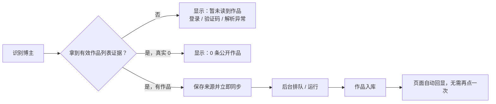

# T-484 BACKLOG 语义压缩迁移记录

> 这是 2026-07-23 压缩前活动任务行的逐字快照，用于保留诊断、实现锚、历史证据与验收细节。
> 当前状态与执行顺序仍以仓库根 `BACKLOG.md` 为唯一真相；本文件不参与状态流转。
> 压缩前 BACKLOG SHA-256：`9499000e6809ee7113361bf65f7b8a5aa8445e1b06df49f479fdad7cb8ed3192`；迁移任务数：131。

## T-526

承接 T-501 收尾时定向 ESLint 暴露的存量工程债务：

- `settings-interactive-region.tsx`：清理同步 effect 更新 state、render 中调用 `Date.now()`、
  未使用 import 等错误，保持设置页行为不变；
- `persistence-client.ts`：清理可收紧为 `const` 的组合根声明及本批可见的无效 lint 抑制；
- 以首次定向 ESLint 的 `14 errors` 作为红证据；
- 完成后定向 ESLint 必须 0 error，并回归设置页单测、前端类型检查与 orchestrator reconcile；
- 不扩展 T-501 产品范围，不修改公开契约，不运行付费模型调用。

## T-525

承接 T-519 经用户确认后显式移出的两项可选兼容能力，不阻塞 T-519 的 PDF 文本层、DOCX、
Markdown、URL/文本导入和四视图完整交付：

- 用至少 20 份来源可说明的旧二进制 `.doc` 语料验证解析覆盖、恶意 OLE/宏/损坏文件边界；
- 用文本层 PDF、扫描 PDF、混合 PDF 验证 OCR 识别率、隐私、费用和失败语义；
- 比较纯 Node parser、可选本地组件与外部 service adapter，禁止依赖用户自行安装 Office、
  LibreOffice 或系统命令；
- Windows/macOS 必须量化下载体积、安装/缓存路径、校验、升级和卸载残留；
- 只有 RAT 与独立规格评审通过、用户再次确认后，才可把当前 `unsupported/no_text` 改成可执行动作。

2026-07-26 RAT 结论见
[`docs/research/2026-07-26-legacy-doc-scanned-pdf-optional-parsing-rat.md`](../research/2026-07-26-legacy-doc-scanned-pdf-optional-parsing-rat.md)：

- LibreOffice 真机可转换旧 `.doc`，但本机程序体积约 410 MiB；不能作为主包或依赖用户自行安装，
  因而旧 `.doc` 继续 `unsupported`，引导用户转成 DOCX/PDF；
- 扫描 PDF 的 PDFium + Tesseract 最小本地组合具备可行性，但只允许做成用户明确安装、逐文件确认、
  无网络的签名可选组件；当前不进入 BUILD；
- 已定义双平台包体、安全、真实语料、性能和诚实失败 Gate。未通过独立规格评审与用户再次确认前，
  不改变生产行为，也不创建新实现任务。

## T-524

把 CreatorOS 教程从“启动时读取开发者个人 `~/.claude/skills/win-video-tutor`”改成可信的
可选下载课程包。任务必须先确认课程内容授权与发布源，再定义：

- 版本化 manifest、内容 checksum/签名、CreatorOS 兼容范围和防降级；
- 用户主动下载、暂停/重试、校验、安装、更新和卸载；
- 本地缓存目录遵循桌面平台目录，不写开发者 home 约定，不进入主安装包；
- 下载失败/未安装时知识库保持真实空态，不伪造 22 节课程；
- 课程包与用户知识数据分离，删除课程包不得删除用户自己的笔记、引用或二次创作。

T-522 只负责删除当前默认 home 目录依赖并把“未安装”变成正常状态；T-524 对可选包的产品、
安全、发布和内容授权负责。两者不能用一份未授权的本机副本冒充发布资产。

## T-522

承接 T-511 已取证的生产稳定性问题，不重做日志诊断。第一批 BUILD 必须以测试先锁定：

1. 系统级僵尸任务清理按联合账号归属运行，不再因为缺 `accountId` 周期性失败，也不跨账号清理；
2. 长对话压缩保留可验证的关键证据/上下文清单，不能在仍有充分预算时机械删除旧工具结果；
3. 真实用户课程或内置引导不依赖 `~/.claude/skills` 等开发者个人目录；
4. 同一回合昂贵只读工具同参调用可复用且不复用跨账号、过期或副作用结果；
5. 异步 AI 工具日志能关联 taskId、runner 终态、finishReason、usage 与候选数量。

macOS 签名 `valid=false` 只进入发布物实物复验；没有签名产物和系统校验证据时不得写成已修复。

第一批实现与复验证据（2026-07-25）：

- system sweep 已从任务行恢复真实 `accountId` 后再写终态；双账号用例证明不会复用无号 daemon context；
- 仅当上下文超过窗口 80% 才清理旧工具正文；预算充足时不再按轮龄机械删除证据；
- `material.gather` 同一回合按规范化 query 复用 Promise，跨回合不复用，副作用工具不缓存；
- dispatch 日志携带 `taskId`，runner 终态日志补状态、`finishReason`、脱敏 usage、候选/结果数；
- 主 Agent 独立复跑相关 backend 9 文件 407/407；backend/frontend/ai-worker typecheck 曾在本批完成后全绿，
  后续并发任务出现的临时类型错误不归入本任务证据；boundary 和目标 diff-check 通过；
- **仍未闭合**：22 节课程实物只存在开发者个人 `~/.claude/skills/win-video-tutor`，仓库/发布资源没有
  获授权的课程副本；不得擅自复制或用改路径冒充已随包。2026-07-20 macOS 发布物仅 ad-hoc 签名且
  `codesign --verify --strict --deep`、`spctl` 失败，无 notarization ticket；本任务只记录实物审计，
  未宣称签名修复。

2026-07-25 用户确认课程不再作为安装包内置 seed，而改为独立可选下载包（T-524）。T-522
由此恢复执行，只关闭生产启动对 `~/.claude/skills/win-video-tutor` 的默认读取：未安装课程包
必须是正常的 0 条/未安装状态，不写假课程、不报启动失败。T-524 未落地前不得新增下载按钮或
未接线入口；macOS 签名仍保留为发布物实物风险，不混入本次运行时代码完成证据。

最终闭合证据（2026-07-25）：

- 生产代码提交为 `702000d5`；与 T-520/T-521/T-523 合并并恢复原工作区后，相关主工作区
  聚焦回归与四包 typecheck 再次通过。
- `frontend/src/server/seeds/win-video-tutor.ts` 删除 `os.homedir()` 与生产缺省
  `~/.claude/skills/win-video-tutor`；只有显式 `skillPath` 或
  `CREATOROS_WIN_VIDEO_TUTOR_SKILL_PATH` 才读取课程，未配置/值为 `0` 直接返回真实 `0`。
- 新增回归测试用 `fs.readdir` spy 证明默认路径在任何目录读取前返回；既有显式路径用例仍证明
  22 节课程可导入，存量 fixup 不变。
- 主 Agent 与独立复核 Agent 均运行
  `pnpm --dir frontend exec vitest run src/server/seeds/win-video-tutor.test.ts
  src/server/__module_integration__/knowledge.persistence-client.test.ts`：2 文件 11/11 通过；
  `pnpm --dir frontend exec tsc --noEmit`、目标 `git diff --check` 均通过。
- 负向搜索确认生产文件无 `os.homedir`/`homedir()` 和默认个人课程目录调用。完整可选课程包、
  签名 manifest、下载/校验/卸载与授权由 T-524 承接；本任务未触发构建，也未宣称签名修复。

## T-521

承接 T-515 诊断直接修复，不改变 T-516 的上下文健康产品范围。修复边界：

- `listRecentProjects` 从 canonical project/publication 真实投影 `source` 与 `publishedAt`；
- `review` 只表达生命周期“复盘”，不得翻译成“待审核/未发布”；
- 已被 canonical 数据证伪的 `creator_profiles.facets.statusNote` 动态计数不得继续注入；
- 数据修复必须账号隔离、幂等、可审计，不能用新的静态计数覆盖旧静态计数；
- 用“80 条 imported 且已发布、旧 statusNote 写 49 条”的 fixture 做回归。

实现与复验证据（2026-07-25）：

- 生产代码提交为 `4349ea4c`；该提交独立于同工作区其他未完成任务，未把脏改动一并提交。
- `context.projects` 与定位生成共用 canonical `source/publishedAt` 投影；`review` 只翻译为“复盘”，
  发布事实只认 Publishing 记录，不从 project lifecycle 猜测；
- 原实现的 80 项逐项目/逐发布 N+1 已在主 Agent 复验时否决，现改为 Projects 批量
  `project→output` 窄读 + Publishing 批量 publication 窄读；一页 80 项只调用两个批量端口；
- `statusNote` 不再进入 AI 上下文或新定位候选；旧值清理使用联合账号归属、CAS、SHA-256 hash
  审计，并把判据收窄到明确 `review/待审核/未发布/压在` 等故障文案，保留
  “每月发布 4 条视频”等用户规划；
- 主 Agent 独立复跑 backend 9 文件 407/407、三项批量/清理集成 42/42、frontend 投影 3/3、
  ai-worker 7/7；T-523 合并后再次独立复跑 backend/frontend/ai-worker 三包 typecheck，全部通过。
- 未启动真实桌面或付费模型；真实账号 80 条投影、首次清理 hash 日志和新 Copilot 回合仍待现场观察。

## T-520

承接 T-503 诊断直接修复，沿 T-482 已确认 SPEC/Contract，不新增产品方向：

- 内容雷达全部使用主题 token，暗色/亮色均不得出现硬编码亮白断层；
- 三栏和空态在桌面窄宽度自适应；添加来源弹窗不再固定五等分；关键同步操作不依赖 hover 才可见；
- 收藏接口非零业务 `status_code` 必须解析为结构化错误，真 0 与登录失效严格区分；
- frontend 不再 `catch {}` 抹平账号错配、上游登录失效、浏览器锁、验证码、网络和服务异常；
- adapter/request 日志只记录脱敏错误类别、request/trace 与账号内部 ID，不记录 Cookie/token；
- 补暗色视觉回归和结构化错误单测；没有真实账号条件时诚实保留真机六状态待验。

实现与复验证据（2026-07-25）：

- 生产代码提交为 `38739370`；浏览器样式用例已经落库，但仍按下述真实环境限制保留未执行项。
- 内容雷达工作区已切换为主题 token，并按 1280/1536 桌面宽度分别呈现双栏/三栏；关键同步按钮常显，来源弹窗可换行滚动；
- 收藏夹读取已区分会话失效、账号错配、浏览器档案锁、验证码、网络、上游业务码、服务异常与接口确认的真实 0；
- 收藏适配器和组合根日志只记录结构化类别及内部关联 ID，不记录 Cookie、token 或上游响应正文；
- 主 Agent 独立复跑 Vitest 2 文件 101/101、聚焦 ESLint（0 error，9 条既有 warning）、Playwright `--list` 2 条、boundary-scan 无新增违规、目标文件 `git diff --check` 通过；
- 未启动真实抖音账号和桌面构建，因此“六类异常真机表现”和截图基线仍为待验，不补拍 PASS。

## T-519

新增知识库工作区重构任务。产品目标是把“聊天框 URL”从默认入口降为一种导入方式，并新增
PDF、DOC/DOCX、Markdown 文件导入；同一账号知识真相默认以逻辑文件夹树呈现，可切换
“关系图 / 观点地图 / 全部”。进入 BUILD 前必须完成 PRODUCT SPEC、独立评审和 SERVICE
CONTRACT，明确：

- 文件夹是持久逻辑层级还是智能集合；
- 原文件与提取文本的本地/云端归属、容量、删除和同步语义；
- 文件解析失败、重复文件、版本替换和异步导入状态；
- 关系图与观点地图的不同语义，避免只是同一张图换名字；
- 检索、included、cited 三态与 Context Manifest，AI 只产候选，用户采纳后服务落库。

2026-07-25 用户确认：原文件默认只在 CreatorOS 本地 storage root；文件夹是真实持久逻辑层级，
“全部/最近/未归档”为虚拟节点；T-519 的文件格式范围为 PDF 文本层、DOCX、Markdown，
旧 `.doc` 和扫描 PDF OCR 显式转 T-525。当前任务仍须对旧 `.doc` 返回 `unsupported`、扫描
PDF 返回 `no_text`，不得把未解析文件显示成已读成功。

PLAN 收口记录（2026-07-25）：最小 PDF/DOCX/Markdown 抽取与 runner RAT 已有真实证据；
独立规格评审走满三轮，最终 `CONCERNS`（0 blocker/3 major/1 minor）。Round 3 指出的
task/revision 状态冲突、experience/project 选择类型遗漏、历史锚与“等价迁移”矛盾、folder
验收缺口均已修入规格，但按评审 STOP 规则不追加第四轮、不补写 PASS。T-519 保持 PLAN Gate
未通过，等待人的 Gate 裁决或明确授权后的复评重开，当前禁止进入 CONTRACT/BUILD。

Human Gate 更新（2026-07-25）：用户通过 `DEC-BATCH-20260725-004` 明确接受上述三轮后
未追加第四轮独立 PASS 的流程风险。PLAN 诚实记为 `accepted-risk`，T-519 已由 `taskctl`
恢复执行并进入 CONTRACT 编写；独立 CONTRACT 评审与确认②前仍禁止 BUILD，T-525 范围不变。

2026-07-26 统一纠偏：上述大 CONTRACT 与第一次瘦身均停止作为实现输入，现以
[最小 Replacement PLAN](../superpowers/specs/2026-07-26-knowledge-workspace-lean.md) 为准。
保留多文件及 URL/文本导入、默认多级文件夹、虚拟节点、四视图、local-only 和采纳门；施工顺序
改为先修 Assets upload 的账号归属、stable assetId 与 complete 幂等，再补 Knowledge 逻辑层。

## T-518

新增一键问题反馈任务。候选入口为主侧边栏底部的常驻小按钮，避免占据核心业务导航；
点击后弹出反馈对话框，支持问题描述、多个截图、自动发现的运行日志摘要，以及“上传反馈”
和“仅导出反馈包”两个真实动作。进入 BUILD 前必须完成 PRODUCT SPEC、独立评审和
SERVICE CONTRACT，明确服务端归属、上传授权、日志脱敏、附件大小、断点/重试、留存/删除、
工单状态与账号联合归属。默认禁止收集 Cookie、API Key、激活码、完整请求正文和未预览的
个人文件；上传前必须给用户可理解的范围预览，失败时本地导出仍可用。

2026-07-25 用户确认：support 放在 Thirdspace-growth 的独立 `server/modules/support/` 领域，
不进入 activity/license、Commerce/Payment 或 CreatorOS Web frontend；resolved/closed 后
30 天删除附件，未关闭最长 90 天。CreatorOS WebView 只走 Tauri/backend typed RPC，日志保持
`.enc` 密文，用户可逐项取消附件。

PLAN 收口记录（2026-07-25）：本地反馈包与 storage fail-closed 协议 RAT 已有真实证据；
独立规格评审走满三轮，最终 `CONCERNS`（0 blocker/2 major）。Round 3 指出的“仅导出仍可能
读取 server policy”与“append-only reason 可能永久留自由文本”都已修入规格，但按评审
STOP 规则不追加第四轮、不补写 PASS。T-518 保持 PLAN Gate 未通过，等待人的 Gate 裁决或
明确授权后的复评重开，当前禁止进入 CONTRACT/BUILD。

Human Gate 更新（2026-07-25）：用户通过 `DEC-BATCH-20260725-004` 明确接受上述三轮后
未追加第四轮独立 PASS 的流程风险。PLAN 诚实记为 `accepted-risk`，T-518 已由 `taskctl`
恢复执行并进入 CONTRACT 编写；独立 CONTRACT 评审与确认②前仍禁止 BUILD。

2026-07-26 统一纠偏：撤销应用内上传、Growth support module、对象存储和工单；现以
[问题反馈直达入口](../superpowers/specs/2026-07-26-bug-feedback-inbox.md) 为准。CreatorOS 只在
本地整理/复制内容，打开签名配置的 `supportUrl` 和加密日志目录；外部渠道是否提交成功由外部
渠道负责，应用不显示假成功。

## T-516

~~~~markdown
| T-516 | 建立 Copilot 上下文健康与事实新鲜度机制：静态定位不存动态状态、每轮账实校验、定时巡检兜底【产品+架构·上下文可信度·用户 2026-07-24】 | ⏸️ **PLAN passed；CONTRACT 三轮评审最终 FAIL，已由 taskctl 阻塞，生产代码未改**。见 [完整 SPEC](../superpowers/specs/2026-07-24-copilot-context-health-and-freshness.md)、[PLAN 评审](../superpowers/specs/2026-07-24-copilot-context-health-and-freshness.review.md)、[失败契约](../superpowers/specs/2026-07-24-copilot-context-health-and-freshness.contract.md) 与 [契约评审](../superpowers/specs/2026-07-24-copilot-context-health-and-freshness.contract.review.md)。最终 blocker 是 repair patch 不具备真正可逆代数；调度部分又被 DEC-AUTO-001 替换为 T-517 Automation Kernel，不再直接泛化旧 `scheduled_job`。 | 已确认产品边界保持：① “AI 对我的理解”内嵌账号设置；② 默认每周、可调频/关闭/立即检查；③ 客观事实确定性生成，AI 推断展示证据；④ 根因化操作入口；⑤ AI 只产候选，用户确认后服务落库并可撤销；⑥ 每轮校验为主、周检兜底、自动扫描 0 LLM；⑦ 所有持久资源联合账号归属。恢复条件：T-517 replacement Kernel 通过并落地；repair 契约重构为可逆 set/unset/restore-previous 命令；重新通过 CONTRACT Gate 和确认②。 |
~~~~

2026-07-25 replacement 收口状态：已改用
[Replacement PLAN](../superpowers/specs/2026-07-25-copilot-context-health-and-freshness-replacement.md)
与 [Replacement CONTRACT](../superpowers/specs/2026-07-25-copilot-context-health-and-freshness-replacement.contract.md)。
Round 2 将 PLAN 收敛到 `CONCERNS（0 blocker/3 major）`，但 CONTRACT 仍 `FAIL`：内部 blocker 是
Copilot 定位采纳仍存在 `upsertProfile → createStatement` 两次 RPC/两事务写者路径，另有
T-517 外部 blocker 与 4 个 major。T-521 已清理的旧值明确为不可恢复历史，只对未来事件承诺撤销；
cleanup fence、writer migration、Context 实现和真实账号验证均未落地，禁止写成已修。

2026-07-26 统一纠偏：现以
[轻量 Replacement PLAN](../superpowers/specs/2026-07-26-copilot-context-health-minimal.md) 为准。
保留设置入口、默认周检/调频/关闭/立即检查，以及“AI 起草修改、用户确认或调整后保存”；自动扫描
只做确定性规则，AI 起草复用现有定位编辑/保存/版本历史，不再建设 candidate/event/undo Saga。

## T-515

~~~~markdown
| T-515 | 诊断选题编导反复声称“49 条稿子压在 review 没发”：厘清 review 状态来源与真实性【bug+诊断·Copilot 上下文·用户 2026-07-24】 | ✅ **已诊断，不改实现**。`review` 是项目生命周期的“复盘”，不是待审核；当前账号真实为 80 条 imported 已发布历史作品，80 条均有 `platform_ref.publishedAt` 与 publication。错误句已静态保存在定位母版 `facets.statusNote`，ChatBox 每轮注入，因此反复复读旧的 49。 | 根因：`listRecentProjects` 投影丢 `source` 且把 `publishedAt` 写死 null → `formatWorksBrief` 把 imported 已发布作品标成英文 `review` → 定位模型误解为未发布待审核并写入 statusNote → 每轮 system prompt 重放。证据与修复建议见 [诊断报告](../research/2026-07-24-chat-review-status-diagnosis.md)。 |
~~~~

## T-513

~~~~markdown
| T-513 | 修复不同抖音账号共用同一份 Skill 覆盖：账号增量覆盖、并发安全解析与不可变任务快照【数据归属+架构·用户 2026-07-24】 | 🔨 **Replacement PLAN 已完成；CONTRACT 独立评审 Round 4 `P0=0/P1=0`，Gate PASS，进入 BUILD/TDD**。用户裁决不考虑旧全局配置；采用“共享只读官方基座 + `(userId, accountId, skillId)` 增量覆盖”。旧 `skill_config_overrides` 只供离线人工取证，设置/API/fallback/恢复/运行时永不读取。见 [Replacement SPEC](../superpowers/specs/2026-07-24-account-skill-overlay-replacement.md)、[PLAN 独立评审](../superpowers/specs/2026-07-24-account-skill-overlay-replacement.review.md)、[SERVICE CONTRACT](../superpowers/specs/2026-07-24-account-skill-overlay-contract.md) 与 [CONTRACT 独立评审](../superpowers/specs/2026-07-24-account-skill-overlay-contract.review.md)；旧三轮 FAIL 工件保留作失败证据。 | BUILD 闭合：① list/get/put/history/rollback 联合归属与 `rowRevision` CAS；② official-only `contextRequirements`/adapter、不可覆盖 platform policy、账号 method/tools/schema/completionPolicy 增量；③ `requiredSkillIdsForTask` 闭包和 ≤256 KiB server-only immutable snapshot；④ attemptId+fingerprint 幂等与原子 claim/begin/renew lease，未知副作用禁止自动重试；⑤ 基座升级每次重验；⑥ 设置页切号清缓存、冲突/不兼容可见；⑦ T-512 只在该账号级载体上增加完整性策略。 |
~~~~

BUILD 证据（2026-07-24）：账号增量表/历史表与 `0053` 迁移、任务 snapshot/attempt/lease 与
`0054` 迁移、设置页切号隔离、Chat/同步知识入口/内容雷达/定时采集的账号快照作用域均已接通。
重置工作区只迁回 `account_skill_overlays*`，归档库里的旧全局覆盖明确不回灌。定向门禁：
backend 账号覆盖/设置/任务租约/Chat 共 188 项通过，frontend 设置/路由 119 项通过，
ai-worker 全量 283 项通过，contract 全量 130 项通过，四包 typecheck 与 boundary 通过。
backend 全量并发跑受仓库既有 PGlite 慢测影响出现多模块 8–15 秒超时；同一 T-513 定向集串行通过，
不得把全量并发超时记为全绿。

## T-512

~~~~markdown
| T-512 | 根治整稿候选只有 1 段仍被判成功：skill 可覆盖的完整性契约、自动修复、采纳门与终态日志【bug·脚本生成·用户 2026-07-24】 | ✅ **已实现**。内置 `script.draft` v6 以 Skill 自有策略声明 6–10 段及 `hook→body→cta`，账号增量可覆盖成单段独白、多段无 CTA 等结构；通用内核不识别这些业务角色，只执行当前冻结策略。 | 沿 T-513 的 `(userId, accountId, skillId)` 增量覆盖与不可变任务快照实现；旧全局覆盖和旧候选均不迁移。策略不满足时把具体原因和上次结构化输出直接追加到真实模型 prompt 自动修复，预算耗尽取消任务且不落候选；runner 透传 `extraBrief`，候选和步骤日志记录采纳门、账号/Skill/策略、原始与最终段数、repair、真实 finishReason/usage。 | 前端只读取 `validationStatus/validationErrors/canAdopt`，旧候选或矛盾字段 fail-closed；设置页只在用户实际编辑策略时保存账号增量，支持 `{completionPolicy:null}` 恢复官方策略。红绿证据：ai-worker 290/290、backend 定向 49/49、contract 133/133、frontend 定向 32/32；四包 typecheck、boundary、diff-check 通过。 |
~~~~

BUILD 证据（2026-07-24）：默认单段拒绝、自定义单段通过、自定义无 CTA 通过、repair
成功/耗尽、双账号并发隔离、在途快照不受后续修改污染、旧候选禁止采纳均有自动测试。
`completionPolicy` 只在用户实际修改时写入账号 overlay，编辑其它 Skill 字段不会复制并冻结
官方默认值。

## T-523

~~~~markdown
| T-523 | 落实 T-508：修复 Copilot 图生图与抖音分享链接转写编排【bug+媒体工具·用户 2026-07-25】 | ✅ **完成**。历史 T-508 只有诊断；本任务已把确认边界落实为生产代码、持久父子任务状态卡和自动回归。 | 沿 [T-508 专项诊断](../research/2026-07-24-copilot-media-tool-routing-diagnosis.md) 和既有 `cover.generate`、内容雷达分享建档、持久 ASR service port 实施；不直连仓储，不自动转写所有粘贴链接，不触发付费模型或桌面构建。 | 验收：①唯一可用参考图时直接调用 `cover.generate(referenceAssetId)`，0/多条才澄清；结果可辨识参考图是否实际使用；②普通抖音分享链接只建档，明确“转写/ASR/提取文字”才构成授权并执行“建档→幂等 enqueue”；③抖音链接不误走 `web.read`；④复用 intelligence service port、持久任务与现有登录/验证码/转写失败态；⑤覆盖路由、幂等、错误态和跨账号归属测试。 |
~~~~

实现与复验证据（2026-07-25）：

- 生产代码提交为 `2f3d4e76`，否定意图优先的小修提交为 `5c7bbd7b`；“不要转写 /
  不用转录 / 别生成字幕”和“不要参考图”均不会被关键词误升级为授权。
- host 只从最新一轮用户原文判定抖音与明确转写意图；普通分享强制
  `intelligence.douyin.share(action=archive)`，明确转写才带授权位，模型参数不能自行升级；
- 抖音分享进入持久 `share_import` 任务，领域 service 建档成功后、父任务终态前幂等
  `enqueueTranscripts`；live dispatch 失败仍可由启动 drain 恢复，继续沿用登录/验证码/导入失败态；
- 抖音路由从工具白名单移除 `web.read`。主 Agent 额外发现并修复
  `functionKey=web.read` 可把它重新加回的深链漏洞，并补了对应回归；
- 参考封面仅在素材库恰有一张可用图片时自动选择，0/多张返回结构化澄清；最终
  `generated_asset.resultData.referenceImage` 记录 `used/not_used/not_requested`，界面只按真实结果表述；
- 主 Agent 独立复跑 backend 专项 5 文件 294/294、frontend 路由/导入/结果卡 3 文件
  43/43、深链补丁回归 96/96，以及 backend/frontend/ai-worker 三包 typecheck，全部通过；
  未调用付费模型、未运行桌面构建，真实抖音登录态与真实图生图供应商仍保留现场验收。

## T-511

~~~~markdown
| T-511 | 审计高频用户整份 sidecar 日志中的其他潜在稳定性与数据一致性问题【生产诊断·全链路·用户 2026-07-24】 | ✅ **已定位，未改实现**。2 小时 16 分钟内 21 回合有 20 completed、1 aborted，无 4xx/5xx/429/硬截窗/sidecar crash；但确认 3 个僵尸 AI 任务每 30 分钟因系统 ctx 缺 `accountId` 清理失败、长对话在仅约 9.4K token 时已清掉 5 个旧工具结果、真实用户课程 seed 仍依赖 `~/.claude/skills`。同回合连续两次 `material.gather` 把响应拉到 69 秒，因日志无 query hash 只能列为高概率重复风险；macOS `已签名 valid=false team_id=<none>` 列为发布物待复验，不冒充业务根因。 | 现有 BUILD/生产运行链只读诊断；不改变产品方向、服务契约、数据归属或发布范围，无需新 SPEC。 | [专项审计](../research/2026-07-24-heavy-user-sidecar-health-audit.md)。另确认异步 `script.draft/planning.thesis/review.script` 的 `chat-tool ok` 只表示 dispatch 成功，当前日志缺 taskId→runner terminal→finishReason/usage/结果数关联。修复边界：账号安全的 system sweep、关键证据显式 context manifest/写稿前重读、课程随包或退役、昂贵工具同参去重、异步任务终态日志、发布物签名实物审计。 |
~~~~

## T-509

~~~~markdown
| T-509 | 用户生成的起草整稿脚本只到第 1 段，成稿明显不完整【bug+诊断·脚本生成·用户 2026-07-24】 | ✅ **已定位，未改实现**。候选真实只有 1 段，不是前端折叠或样式裁切：卡片只在 `sections.length > 3` 时提供“展开全部”，截图无展开入口；runner 又把全部 `shots` 原样写入 `resultData.sections/contentData.sections`。主因是“整稿完整性”只写在提示词软要求中（“6-10 镜为宜”），真正的 Zod 输出契约却仅 `shots.min(1)`，node/runner 也都只拒绝 0 镜，因此模型只返回一段长镜头时仍会通过校验、记录候选并显示“整稿分镜脚本”。 | 沿既有 script.draft → ai_task → artifact/output_script → Copilot 卡片链路取证；不改变产品、契约或数据归属，无需新 SPEC。本轮只诊断，不把“可能是模型截断”写成已证实：用户日志三次 `script.draft` 分派前的 chat context 均 `truncated=0`，可排除对话上下文被截断；但该打包日志没有 script runner 的真实 finishReason、usage、最终镜数，无法进一步判定供应商是否因输出 token 提前停流。 | 旁支缺口：分派层把 `extraBrief` 存进 task input，runner 调 `runScriptNode` 时没有继续传入，用户在对话中交代的真实细节/结构要求会丢，但它不是“只剩 1 段”的直接原因；日志反复出现旧僵尸任务清理时 `ctx.accountId missing`，与本次已形成候选的任务无因果关系。测试现状只锁定 0 段失败与 3 段成功，另有单段 schema 输入成功的覆盖，恰好漏掉“1 段整稿必须拒绝/重试”。后续修复边界：把完整性写进输出契约与 runner 二次门（至少满足既定镜数/结构覆盖），不完整时自动重试且禁止采纳；透传 `extraBrief`；记录真实 finishReason、usage、最终镜数，并补 1 段回归测试与卡片失败态。 |
~~~~

2026-07-25 收口：上述“未改实现”仅是 T-509 当时的诊断快照，实际修复已由
[T-512](#t-512) 完成。内置 `script.draft` 现在以 Skill 策略要求 6–10 段及
`hook→body→cta`，单段/结构不完整会进入自动修复，耗尽后禁止落候选；`extraBrief`、终止原因、
usage 和最终段数也已贯穿。后续不得再把 T-509 作为未实现任务重新派发。

## T-508

~~~~markdown
| T-508 | Copilot 找到封面素材后拒绝图生图，抖音分享链接误走网页正文且不能发起逐字稿【bug+诊断·媒体工具编排·用户 2026-07-24】 | **已定位，未改生产代码**。封面并非拿不到图：`context.materials` 只给语言模型 id/title/kind，但 `cover.generate(referenceAssetId)` 会由 host 按用户权限读取真实 asset 字节，OpenAI-compatible 走 `/images/edits`，MiniMax 走参考图字段；runner 12/12、两 adapter 17/17 通过，历史 sidecar 也记录 `cover.generate` 真调用。当前缺口是模型未确定性直调、多问 A/B，以及配置测试没有区分纯文生图和 reference-image 能力。抖音链则是“领域能力在、Copilot 桥不在”：内容雷达已有分享建档和用户显式 enqueue 的持久 ASR，30 秒测试口径 3/3 通过；聊天工具只有 `web.read` 与已有项目的 `project.transcribe`，没有任意分享链接建档+转写组合工具，故视频页被错当 HTML 正文读。 | [专项诊断](../research/2026-07-24-copilot-media-tool-routing-diagnosis.md)。本轮只读，不改生产代码；不得自动转写所有粘贴链接。正确口径是：只粘链接仅建档；用户明确说转写/ASR即构成手动授权，持久任务先建档得到 itemId，再幂等 enqueue 转写并回任务卡。 | 实现边界：封面唯一匹配时直接 `cover.generate`，0/多条才询问；任务结果显式标参考图是否真正使用；T-501 增 `image.edit/referenceImage` 能力探针；Copilot 新增抖音分享链接组合工具并排除 `web.read` 误路由，复用 intelligence service port/持久队列/登录与 ASR 错误态，不直连库。 |
~~~~

## T-507

~~~~markdown
| T-507 | 收口全局测试完整性欠债与 Next.js 开发页错误层阻断【工程治理+开发体验·用户 2026-07-24】 | 📋 **待办**。当前 `test-integrity.mjs` 相对基线报 59 条错误，包含旧测试删除/迁移、断言或用例下降、类型与 lint 抑制增加；本地 `next dev` 又因 `RootLayout` 直接渲染 `<script dangerouslySetInnerHTML>` 出现错误覆盖层，导致 `/projects` 无法完成真实浏览器验收。 | 不新增产品功能，不改变数据归属或公开 service contract；按工程治理 BUILD 任务处理。禁止直接更新 test-integrity 基线掩盖问题：每条必须归为真实回归、合法迁移/替代或经明确审计的误报，并保留可追溯证据。 | 验收：① 59 条逐项有归因，真实删测/弱化恢复或以等价/更强测试替代；② 无理由的 suppressions 清除，合法抑制有窄范围说明；③ `test-integrity.mjs` 0 error；④ `next dev` 打开 `/projects` 无 script-tag 错误覆盖层，主题与握手脚本仍在 hydration 前生效；⑤ typecheck、production build、相关测试、boundary、真实浏览器刷新走查与 reconcile 通过。 |
~~~~

## T-505

~~~~markdown
| T-505 | 已有逐字稿的已发布项目仍显示“立即抓取”，刷新页面会重复提交转写任务【bug+幂等·稿面·用户 2026-07-24】 | **已实现并由 taskctl 收口**。稿面 VM 按 `output_script` 当前版本的 `contentData.awemeId` 与 `ai_tasks` 恢复持久状态：done 隐藏入口，queued/running 刷新后保持置灰，failed 只允许显式重试。`projects.transcribe` 写前再次检查真稿，任务带 `projectId` 与 `project-transcribe:{projectId}:{awemeId}` 稳定键；重复 POST 由 AI service 唯一键收敛。 | 沿 [T-482 SPEC](../superpowers/specs/2026-07-23-content-radar-restructure-design.md) 的 `DEC-CR-007`、`FR-CR-007`、`NFR-CR-012` 与 [Contract](../superpowers/specs/2026-07-23-content-radar-service-contract.md) 的 `API-CR-017` 修复；不改变产品方向、数据归属或架构，无需新 SPEC | 证据：前端定向 22/22、AI 幂等 acceptance 10/10、frontend typecheck、production build、boundary 与 orphan gate 通过；test-integrity 全局失败来自工作区既有 59 条删测/断言下降/抑制增加，与本任务新增测试均被 gate 识别为 net-new allowed。真页目测被既有 `RootLayout` script-tag Next.js 错误覆盖层阻断，未伪报通过。 |
~~~~

## T-504

~~~~markdown
| T-504 | 网站登录保管库每次打开都逐站探测，站点列表过长撑大设置页【bug+体验·网页登录态·用户 2026-07-24】 | ✅ **已实现**。组件挂载只读取 list 与本机缓存，不再自动逐站调用 status；最近一次 `loggedIn + checkedAt` 存入 localStorage，缓存损坏或不可用时诚实显示“未检查”。用户点“刷新状态”才串行检查全部站点，单站失败保留旧结果；确认登录只更新目标域，移除站点同步删缓存。 | 沿 T-217/T-370 既有 Web Session Vault 与 `browser_sessions` 数据边界修正；未改 Cookie 密文、登录态归属、安全或外传口径，无需新 SPEC | UI 默认折叠，摘要显示网站总数/已登录/需重登/未检查；展开后 `max-h-[26rem]` 内部滚动，行在窄宽度下自适应换行。红测 3/3、设置模块 60/60、定向 ESLint、frontend typecheck、boundary 无新增违规均通过。实际 3000 端口设置页受既有数据加载空白阻塞，未伪报全页视觉截图通过。 |
~~~~

## T-503

~~~~markdown
| T-503 | 内容雷达暗色 UI 断裂，读取“我的收藏”误报登录失败【bug+诊断·内容雷达·用户 2026-07-24】 | ✅ **已定位，未改实现**。UI 直接根因是工作台左栏硬编码 `bg-[#fbfafc]`，在全局暗色主题下仍强制亮白；三栏又固定为 `260px + minmax(360px,1fr) + 392px`，空数据时三个占位区铺满整屏。添加来源弹窗固定五等分，窄弹窗中三组标签被挤成多行；来源同步按钮默认 `opacity-0`，用户不悬停几乎看不到。T-482 提交新增 1,812 行单组件与 257 行功能测试，却没有内容雷达视觉用例、参考图或暗色截图；SPEC 只定义三栏 IA，发布时未执行视觉 Gate，因此功能测试全绿仍漏过明显样式回归。收藏链为三层故障：① WebView 的当前账号 localStorage 与 cookie 均为“月明水清深”，生产库绑定及独立 authDir 存在，`sessionid/sessionid_ss` 也在且未到本地过期；② 真机只读复测中，抖音收藏接口对该号返回 HTTP 200 + `status_code=8/status_msg=用户未登录/collects_list=null`，说明本地 Cookie 存在不等于上游会话仍认可；另一已绑定号返回 `status_code=0/total_number=0/collects_list=null`，是真 0 个收藏夹；③ `fetchDouyinCollectsFolders` 不检查非零 `status_code`，会把前者解析成 0 条，而弹窗 `catch {}` 又丢弃真实异常类型，把账号错配、浏览器锁、验证码、网络、上游拒绝全部统一写成“请先绑定并登录”。 | 沿 [T-482 SPEC](../superpowers/specs/2026-07-23-content-radar-restructure-design.md) 与 [Contract](../superpowers/specs/2026-07-23-content-radar-service-contract.md) 诊断；不改变产品方向、数据归属或架构，无需新 SPEC | 证据：`0e41aca5` 变更统计与视觉文件反查；`intelligence-workbench.tsx:654/843/1276/1458` 样式与错误分支；打包日志 `sidecar.log.enc` 同时无收藏错误细节，印证 catch/日志缺口；生产账号选择与 Cookie 元数据只读核对；两个账号对 `collects/list` 的脱敏实机响应。后续修复必须一次覆盖主题 token/响应式空态/弹窗布局、按错误码区分上游登录失效与真 0、为请求/adapter 写脱敏日志，并补暗色视觉回归与六状态真机验收；不能只换一句报错文案。 |
~~~~

## T-502

~~~~markdown
| T-502 | T-496 退回 PLAN 重做：收藏来源自由选择任一已绑定账号 + 双账号只读 RAT【产品+验证·用户授权 2026-07-24】 | ⏸️ **RAT 阻塞，未进入 Contract/Build**。用户明确授权执行只读双账号 RAT，并补充关键口径：新增“我的收藏”来源时，采集账号必须是一个可切换选择器，允许选择任一已绑定账号；“大号/小号”只是用户当次选择，不是产品固定规则。实测第二 active 账号登录态不可识别，当前没有两份不同且可用的账号身份。 | 上游为 [T-496 FAIL SPEC](../superpowers/specs/2026-07-24-favorites-collector-account-selector-design.md) 与 [三轮评审](../superpowers/specs/2026-07-24-favorites-collector-account-selector-design.review.md)；[只读 RAT](../research/2026-07-24-favorites-dual-account-readonly-rat.md) 通过后创建 replacement PLAN SPEC，不能继续原地磨第三轮失败工件 | RAT 只读取账号状态、登录 profile 与收藏夹列表，不点赞、不收藏、不发布；证据脱敏。新 SPEC 必须定义 `ownerAccountId=当前工作区`、`collectorAccountId=用户当次所选任一账号`，默认当前账号但可切换，绝不按“大号/小号”标签硬编码。 |
~~~~

只读 RAT 记录：[docs/research/2026-07-24-favorites-dual-account-readonly-rat.md](../research/2026-07-24-favorites-dual-account-readonly-rat.md)。
本机账号管理页有 2 个 active 账号记录，但 active `A4` 能读回稳定身份、active `A5`
无法读回稳定身份；其他可读历史 profile 与 `A4` 是同一身份，所有 profile 收藏夹结果均为 0。
因此当前不具备“两份不同且可用登录态”，RAT 诚实判定为 `BLOCKED`。恢复条件是用户重新连接
第二个 active 账号，两个 active profile 读回不同稳定身份后再复测；在此之前禁止进入
Contract/Build。

## T-501

用户于 2026-07-26 明确收缩范围：CreatorOS 的设置页已经成型，本任务不再实施模型平台、
八槽总览、配置向导、费用与付费能力探测。旧 PRODUCT SPEC / CONTRACT / PAGE SPEC 仅保留为
历史，不是当前 BUILD 清单。

当前唯一实施依据是
[轻量替代范围](../superpowers/specs/2026-07-26-model-configuration-lightweight-optimization.md)：

- 主路径只保留供应商预设、模型 ID、API Key，高级字段默认收起；
- “保存并测试”先保存当前表单，再复用正式 `modelFor + streamText` 流式通路；
- 收到网页 `200`、空流或空文本均判失败；
- 拆开 Kimi 开放平台和 Kimi Code，并补 New API / 中转站教程；
- 不改公开契约，不增加页面，不调用付费图片/视频探测。

历史审计仍可用于解释根因：T-499/T-500 已证明旧探针只看 `res.ok`，会把营销网页和空流误判
为成功；T-498 已证明单一 Kimi 预设混淆两套平台。当前任务直接修这三项，不再继续历史大方案。

## T-500

~~~~markdown
| T-500 | 中转站切换 OpenAI Chat 仍空回复：Base URL 缺 `/v1` 时营销页 200 被连接测试误判成功【bug·模型中转兼容·用户 2026-07-24】 | ✅ **已定位，未改实现**。生产库确认 `openai_chat` 已生效；无 `/v1` 时 Chat/Responses 均命中营销页 `text/html` 200，被只看 `res.ok` 的测试误判。用户补上 `/v1` 后，打包 APP 已进入真实 API，Chat/Responses 均明确返回 `503 model_not_found`：分组 `3.2 (distributor)` 没有模型 `-claude-haiku-4-5-20251001` 的可用渠道。 | [T-499 专项诊断](../research/2026-07-24-relay-test-pass-chat-empty-diagnosis.md)；无新 SPEC（本轮只诊断） | Base URL 问题已解决；当前须从中转站可用模型列表选择精确 ID，优先核对模型名前导 `-`。协议切换不能解决 `model_not_found`。后续实现须校验 Content-Type、真实文本 delta并原样显示上游错误。 |
~~~~

## T-499

~~~~markdown
| T-499 | 中转站模型“测试连接成功”，但打包版 APP 编导完成后不显示回复【bug·模型中转兼容·用户 2026-07-24】 | ✅ **已定位，未改实现**。打包 APP 日志显示真实编导轮在 4371ms 后被记为 `completed`；生产库同轮却只有 CreatorOS 自写的 104 字“AI 未返回任何内容”提示，模型文本/parts/model_key/token 用量全空。设置页探针仅以非流式 1-token 请求的 HTTP `res.ok` 判成功，不验证正文；真实编导走流式 Responses、约 5700 tokens 上下文和工具定义，中转站返回 2xx 空流。现有 T-464 兜底只在流结束后落库，不进入当前 SSE，所以用户当下仍看不到。 | [专项诊断](../research/2026-07-24-relay-test-pass-chat-empty-diagnosis.md)；无新 SPEC（本轮只诊断） | 当前默认配置为 `https://api.jiucaihezi.studio` + `openai_responses` + `-claude-haiku-4-5-20251001`（未读取 Key）；模型 ID 前导 `-` 需向中转站核对。后续若实施：测试改为同 SDK 流式探针并验证 text delta/tool calling；空流提示必须在当前响应即时回显。 |
~~~~

## T-498

~~~~markdown
| T-498 | 打包版 APP 配置 Kimi 时只有 OpenAI Chat 可连接，协议/平台/地址组合难以判断【bug+配置体验·模型接入·用户 2026-07-24】 | ✅ **已定位，未改实现**。用户明确要求只看 `/Applications/CreatorOS.app`。打包 APP 的加密 sidecar 日志显示：Anthropic 测试实际请求 `/v1/v1/messages` 并 404，OpenAI Responses 请求 `/v1/responses` 并 404；随后 OpenAI Chat 的真实对话在 2291ms 内完成。根因是把同一个以 `/v1` 结尾的 Kimi 地址直接切换给三种协议，且当前单一 Kimi 预设混淆了 Kimi 开放平台与 Kimi Code 两套 Key/Base URL/模型体系。 | [专项诊断](../research/2026-07-24-kimi-app-model-config-diagnosis.md)；无新 SPEC（本轮只诊断） | 当前可执行口径：开放平台用 `https://api.moonshot.cn/v1` + OpenAI Chat + 开放平台 Key；Kimi Code 用 `https://api.kimi.com/coding/v1` + OpenAI Chat + Code Key；Kimi 不选 Responses。后续若实施，应拆成两个预设、自动锁定协议/地址并把高级字段收起。 |
~~~~

## T-497

~~~~markdown
| T-497 | 用户知识库受控检索与脚本引用设计：大语料、质量差异、权威资料支配风险【产品设计·用户 2026-07-24】 | ⏸️ **PLAN Gate 阻塞，未实现**。已形成受控检索方案并完成三轮独立评审；第三轮仍发现 blocker：存量法律资料若默认 normal 会绕过 high-stakes 采纳门，且“默认自动受控”尚未由用户拍板。按三轮上限退回 PLAN。 | [SPEC](../superpowers/specs/2026-07-24-controlled-knowledge-retrieval-design.md) · [REVIEW](../superpowers/specs/2026-07-24-controlled-knowledge-retrieval-design.review.md) | 推荐骨架保留：检索≠注入≠引用；多维角色而非质量总分；8k token/12 chunks/单源 30%；零命中不 dump；Context Manifest；法律候选人工确认。恢复条件：用户确认默认模式，并定义模型调用前可确定的法律/监管资料风险下限。 |
~~~~

## T-496

~~~~markdown
| T-496 | 新增“我的收藏”来源时可指定采集抖音号，仅放开收藏夹跨号凭据【范围拍板·用户 2026-07-24】 | ⏸️ **PLAN Gate 阻塞，未实现**。用户范围已确认，owner/collector 双 tuple、v2 config、状态与迁移方案已写；第三轮独立评审仍有 blocker：缺一组真实双账号“小号登录读取→大号归属”RAT。按三轮上限退回 PLAN。 | [SPEC](../superpowers/specs/2026-07-24-favorites-collector-account-selector-design.md) · [REVIEW](../superpowers/specs/2026-07-24-favorites-collector-account-selector-design.review.md) | 只开放 `favorites_folder` 的边界保留；不开放通用跨号桥。恢复条件：在用户授权的双账号环境完成脱敏真机 RAT，再据真实表关系与账号删除语义重写迁移/CAS 契约。 |
~~~~

## T-495

~~~~markdown
| T-495 | 收藏夹采集支持指定已绑定抖音账号，兼容“大号创作、小号观察收藏”【产品反馈·多账号·用户 2026-07-24】 | ✅ **现状与产品缺口已定位，未改实现**。CreatorOS 已支持扫码绑定多个抖音号和切换工作区；内容雷达“我的收藏”读取当前选中账号的独立登录目录，source、run、task、item 均按该 `account_id` 隔离。当前没有的是“小号登录采集、结果进入大号创作空间”：UI 没有采集账号选择，数据模型也把采集凭据账号与内容归属账号合成了一个字段。 | 优先复用 [multi-account-persona](../superpowers/specs/2026-07-05-multi-account-persona-design.md)、[account-full-isolation](../superpowers/specs/2026-07-15-account-full-isolation-spec.md) 与 T-136R，不另造账号体系；该受控跨号桥接改变既有数据归属，实施前必须补 SPEC 并独立评审 | 推荐把 `collectorAccountId`（用哪个号的登录态读收藏）与既有 `accountId`（内容进入哪个创作工作区）显式分开；两者都须验属主，任务用前者选 authDir、用后者落 source/run/item，UI 明示“用 @小号采集 → 供 @大号创作”，其他定位、项目、发布数据继续隔离。当前双号真机闭环仍属 T-136R 未验项，发布前必须完成双号绑定、定时/手动采集、切号不可串读的真机 E2E。定向测试：账号切换/收藏适配器 15 项通过，内容雷达领域 7 项在放宽当前 Node 22 的慢机超时后通过。 |
~~~~

## T-494

~~~~markdown
| T-494 | 脚本生成优先调用用户知识库/素材并展示引用来源与影响【产品反馈·知识可信度·用户 2026-07-24】 | ✅ **现状与产品缺口已定位，未改实现**。脚本生成并非完全没用知识：会按选题/定位检索知识原子，并把项目内可读的高优先级用户文档全文/摘要作为“必须遵守”上下文；普通资料仅作参考。缺口是知识原子目前主要只有标题/类型/来源备注，没有完整文件内容和稳定来源 ID；读取异常会静默退化为空；脚本契约与结果卡也不保存或展示引用，因此用户无法验证“检索了什么、发给模型什么、成稿依据什么”。 | 复用既有 [context-layer-redesign](../superpowers/specs/2026-07-03-context-layer-redesign.md) 与 [skill-driven creative agent](../superpowers/specs/2026-07-10-skill-driven-creative-agent-design.md)，补充“上下文来源清单/引用证据/失败可见性/外部 provider 边界”契约后独立评审 | 推荐统一产出 context manifest：区分“已检索”“已发送给模型”“模型声明引用”，保留 sourceId、文件名、知识点、片段、优先级、裁剪/失败原因；脚本结果展示“本稿参考”，但不得把“送进 prompt”冒充“模型一定采用”。Skill、专业数据库和个人文件都接同一只读 context provider/provenance 接口。隐私口径必须改为：资料默认本地、按账号保存，CreatorOS 不拿去训练；但生成时被选中的必要片段会发送给用户配置的模型服务商，除非使用本地模型，服务商是否留存/训练取决于其政策。定向测试：creative-context 58 项、script-node 13 项、脚本卡 4 项通过。 |
~~~~

## T-493

~~~~markdown
| T-493 | Windows 安装包首次启动仍长时间白屏，重新定位启动关键路径并调研业界处理方式【bug·桌面首启·Windows·用户 2026-07-24】 | ✅ **诊断与业界方案已收敛**。最新包仍在 Tauri setup 同步路径整包校验并展开 406 MiB → 约 1.2 GiB / 44,082 文件；“只搬解压”的注释与实际同步调用漂移。`about:blank + WebView2 initialization_script` 同时承担 splash，不能在 UI 线程被磁盘任务占用时提供可靠首帧。 | [专项复盘](../research/2026-07-24-windows-first-launch-white-screen.md) · [桌面打包/首启 SPEC](../superpowers/specs/2026-07-23-desktop-packaging-first-launch-design.md) | 官方口径一致：长磁盘任务移出应用启动；Windows 简单首屏不使用 WebView2；runtime 应由 NSIS hook/custom template 在安装期按真实进度物化。短期静态 splash 只止血，最终验收仍是首启完整解压 0 次、白屏 >1 秒 0 次、P95 ≤5 秒。 |
~~~~

## T-492

~~~~markdown
| T-492 | 桌面打包流水线的用户下载产物只上传安装包【发布体验·用户 2026-07-24】 | ✅ **已实现并本地验证**。新增平台化安装包收集器，严格要求 macOS 恰好一个 DMG、Windows 恰好一个 `-setup.exe`，输出目录非空或安装包数量异常都会硬失败；artifact 与 tag draft Release 均不再上传 updater tar/zip、签名或 `latest.json`。 | 无新 SPEC（既有发布收集规则收窄） | Node 红绿测试 4/4 通过；workflow 仍保留 release.mjs 内部 updater 生成/验签 gate，但用户下载只含可双击安装文件。待下一次 Actions 构建做实物 artifact 审计。 |
~~~~

## T-491

~~~~markdown
| T-491 | 旧视频逐字稿抓取中 ffmpeg 启动后约 1 秒退出且真稿未入库【bug·转写·macOS·用户 2026-07-24】 | ✅ **已定位，未改实现**。音频抽取设计为 ffmpeg `pipe:1` 内存输出，本来就不会生成 WAV/MP3 临时文件；同一生产库旧视频任务的步骤证据显示 ffmpeg `code=1`，主要命中两类输入故障：详情回退把完整 CDN/MP3 URL 塞入 `aweme/v1/play?video_id=` 后被当前代码原样转交，报 `Invalid data found when processing input`；另有抖音源站 TLS 协商失败/403。抽取失败发生在 Whisper 前，因此无真稿入库、后续分析拒绝符合当前控制流。 | 无新 SPEC（既有 D2/T-230/T-349 转写链路生产故障） | 根因在媒体 URL 解析/规范化与鉴权下载层，不在 ffmpeg 安装、架构或输出目录。当前 `parseAwemeDetail` 盲取 `play_addr.url_list[0]`，测试只覆盖理想假 URL，未覆盖嵌套 URL、TLS/403、重定向与响应类型。用户给出的 `ai-task-5f0d6213-45`、`ai-task-229358b1-67` 未在当前 `ai_tasks` 或全库文本中命中，不能伪造一对一关联；结论来自同一运行时加密日志解密结果及 2026-07-23 同链路任务步骤。另发现部分旧视频回退命中 `page.evaluate: Passed function is not well-serializable!`，属于次要独立故障。编号初建为 T-490，发现与归档旧任务碰撞后保留 taskctl block 审计并改为 T-491。 |
~~~~

## T-489

~~~~markdown
| T-489 | Windows updater `latest.json` 下载 URL 混入 runner 绝对路径【bug·桌面发布·CI 2026-07-23】 | ✅ **已修复并完成实物审计**。`release.mjs` 统一按 `/` 与 `\` 提取纯文件名，并在单平台生成、双平台合并两处校验 HTTPS URL、签名与反斜杠污染。 | 无 SPEC（既有桌面发布脚本跨平台路径 bug） | 红测覆盖 Windows/POSIX 路径与污染 URL；桌面发布 [run 30065803419](https://github.com/zzyong24/Thirdspace-creator/actions/runs/30065803419) 三个 job 全绿。下载 `latest-json-merged` 审计确认 macOS URL 为 `CreatorOS.app.tar.gz`、Windows URL 为 `CreatorOS_0.1.0_x64-setup.exe`，双端签名非空。Actions 安装包可供测试；仓库尚无 `v0.1.0` Release，正式 updater 地址待发布流程创建 Release 后生效，不在本 bug 的路径归一化范围内。 |
~~~~

## T-487

~~~~markdown
| T-487 | 合并 T-454 等桌面打包欠债：借鉴 skills-manager/Tauri 官方实践，统一跨平台构建、包体去重与零白屏首启【体验·桌面·macOS/Windows·用户 2026-07-23】 | 🔨 **免费实现与本地门禁已完成，等待原生 Windows 付费验收**。用户 2026-07-24 确认按“Runtime 分层缓存 + Windows 安装期物化到 `$INSTDIR` + 首启零解压”方向优化；正式付费构建仍需单次确认。RAT-01 本地 cheap gate 已过：文件数 -40.05%、重复字节 -88.46%，HyperFrames/Playwright/Xenova+ONNX 局部真加载通过；RAT-04 已接 exact Runtime cache；RAT-02 的 NSIS hook、Rust 安装期物化、首启直读和原生 workflow 冒烟已实现但尚未实际触发，不能由 mac 静态测试冒充。 | [总调研](docs/research/2026-07-23-desktop-packaging-skills-manager-reference.md) · [Tauri Windows](docs/research/2026-07-23-tauri-windows-packaging-official-practices.md) · [SPEC](docs/superpowers/specs/2026-07-23-desktop-packaging-first-launch-design.md) · [本轮证据](docs/research/2026-07-24-t487-runtime-dedup-and-cache-evidence.md) · [审核](docs/superpowers/specs/2026-07-23-desktop-packaging-first-launch-design.review.md) | 本地证据：桌面 Vitest 96/96、Node 安装包收集 4/4、Rust lib 112/112、workflow YAML 与三份脚本语法通过。已补阶段计时、inventory/重复报告、锁定真实 Node/V8 ABI 与公钥的 exact Runtime cache、安装期同盘 staging/current 指针、失败保留 tar 的首启修复，以及“最终变换后只压一次 tar”；不出正式包、不跑付费 Actions。无效的跨版本 previous 已移除，签名 last-good 仍是 SPEC 未关闭 Gate。下一门槛是首次 Windows workflow 的真实 setup.exe 安装/卸载冒烟；通过前不宣称零白屏已完成。 |
~~~~

## T-484

~~~~markdown
| T-484 | 语义压缩活动 BACKLOG 至 60KB 硬限内【流程欠债·reconcile 2026-07-23】 | 🔨 待办 | 待产任务说明 | 机械归档已无可迁项；须把超长历史过程迁入 docs/tasks 或 Git 历史，同时保留任务状态与验收语义。 |
~~~~

## T-488

~~~~markdown
| T-488 | 抖音已在“网站登录保管库”登录，Copilot 读取视频仍返回 `needLogin`【bug·网页登录态·用户 2026-07-23】 | ✅ **已完成**。红测确认两处根因：`v.douyin.com` / `iesdouyin.com` 与 `douyin.com` 分别建会话键，以及隐藏登录弹窗文案被误判为可见登录墙。现统一归一为 `douyin.com`，存量短链 state 惰性回填到 canonical key，登录墙检测先剔除明确隐藏节点；保管库仍使用隔离 Chromium profile，不读取用户日常 Chrome Cookie。 | 无 SPEC（既有网页登录态链路 bug） | `web-session` / `web-capture` / `web-reader` / browser pool / persistence 共 106 测试通过，frontend typecheck 通过；taskctl 完成事件 `2026-07-24T02:12:43.597Z`。 |
~~~~

## T-482

~~~~markdown
| T-482 | 将现有「信号源」重构为定位→内容雷达(对标监控)→选题的内容情报工作区【产品方向·用户 2026-07-23】 | ✅ **已完成并通过用户 UI 验收**。侧栏新增定位与选题之间的「内容雷达」；分类/博主/作品、原视频链接与公开指标、分享链接单条建档、来源同步、手动异步转写、逐字稿结构拆解、选题确认、Project 来源证据透传及 Project 内稿件候选已贯通。旧选题页「信号源」组件和交互测试已删除；旧 benchmark/favorites/trend 数据幂等迁入新域并留下计数、抽样与 orphan 账本，迁移进入 `retired` 后旧对标/收藏夹采集器受写栅栏短路，不再写旧表或直接创建选题；旧表只读保留用于恢复。 | [SPEC](docs/superpowers/specs/2026-07-23-content-radar-restructure-design.md) · [CONTRACT](docs/superpowers/specs/2026-07-23-content-radar-service-contract.md) · [GATE](orchestrator/GATE-T482-CONTRACT.md) | 用户 2026-07-23 确认 UI 无明显问题并同意移除旧信号源模块。验证：全仓五包单测全绿（backend 2440、frontend 2381、ai-worker 271、contract 130、mcp 21，另有设计性 skip/todo）、全仓 typecheck、生产 build、boundary、reconcile 与 diff-check 通过；内容雷达迁移/写栅栏 7 测试通过。 |
~~~~

## T-481

~~~~markdown
| T-481 | Windows 10「定位规则无法手动修改」【bug·定位·用户 2026-07-23】 | ✅ **已实现并验证**。规则卡与空态入口可直接打开“内容规则”页签；画像和规则保存都以最近一次成功持久化档案为基线，只合并当前页签字段，不再让隐藏表单的旧快照覆盖另一页签的新值。 | 无 SPEC(bug·UX) | `positioning-center.test.tsx` 与 `positioning-interactive-region.test.tsx` 覆盖直达规则、跨页签连续保存和失败后不污染持久基线。 |
~~~~

## T-480

~~~~markdown
| T-480 | 盲预测建议无法一键修改原稿,且综合分默认 0/无值【bug+体验·校准·用户 2026-07-23】 | ✅ **已实现并验证**。综合分优先读取 `predictedConversion.dimensions[]` 的 1–5 分并按既有权重计算，旧扁平字段仅作兼容；诊断建议可生成修订候选，用户先预览，只有明确采纳后才写回原稿。 | 无 SPEC(bug+体验) | `calibration.service/contract.test.ts` 覆盖嵌套维度计分；`blind-predict-row.test.tsx` 覆盖生成→预览→采纳前零写入→采纳写回。 |
~~~~

## T-479

~~~~markdown
| T-479 | 项目制作页「口播稿(提词用)」无法用 Ctrl+A 只全选稿件【体验·Windows·用户 2026-07-23】 | 🔗 **并入 T-475**。用户确认不需要改成可编辑文本框；在制作阶段增加“一键复制纯口播稿”即可，同时给出明确成功/失败反馈。 | 无 SPEC(体验) | 与 T-475 共用同一个制作阶段入口和纯口播投影，避免重复按钮。 |
~~~~

## T-478

~~~~markdown
| T-478 | 选题池丢弃的选题仍留在左侧统计、今日新选题与首页热门选题【bug·读模型·用户 2026-07-23】 | ✅ **已实现并验证**。当前池统计、今日新选题、手动灵感计数和首页热门选题统一只读 `status=pool`；`dropped` 只保留历史语义，不再进入当前选题投影。 | 无 SPEC(bug·数据一致性) | `topics-interactions/supply.test.tsx`、`dashboard-page.test.tsx`、`candidate.service.test.ts` 与 persistence 集成测试覆盖淘汰后各投影消失。 |
~~~~

## T-477

~~~~markdown
| T-477 | MiniMax M2.5 发布物料长时间停在后台生成,且结果只有标题/标签没有简介【bug·发布物料·用户 2026-07-23】 | ✅ **已实现并验证**。发布简介 `body` 已改为非空必填，MiniMax 缺失/空串会触发结构化重试并拒绝假成功；运行卡持续显示最新任务步骤，失败时展示脱敏后的真实原因。 | 无 SPEC(bug·跨模型) | `platform-adapt.test.ts`、`platform-adapt-runner.test.ts` 与 `chat-publish-package-card.test.tsx` 覆盖缺简介、运行进度和失败原因。 |
~~~~

## T-476

~~~~markdown
| T-476 | Windows 10「导出诊断日志」显示打开失败【bug·桌面·用户 2026-07-23】 | ✅ **代码已修复，本地验证通过；Windows 真机仍待验**。日志目录统一为 canonical appData `logs`；Windows 使用 `explorer.exe <dir>`，以成功 spawn 为完成而不等待 Explorer 退出；启动失败响应保留真实目录，设置页可显示给用户手动前往。 | 无 SPEC(bug·Windows) | `reveal-logs/plan.test.ts`、`launcher.test.ts` 与设置交互测试覆盖路径、spawn 语义和失败兜底；当前 macOS 环境没有 Windows Explorer，不能伪造真机打开证据。 |
~~~~

## T-473

~~~~markdown
| T-473 | MiniMax M2.5 补全选题卡在后续对话轮次重复调用【bug·Copilot·用户 2026-07-23】 | ✅ **已实现并验证**。深链/嵌入的 `functionKey` 被消费为一次性命令，后续普通对话不再携带；同一回合相同 `topic.enrich + candidateId` 由工具层幂等复用。 | 无 SPEC(bug) | `ai-copilot-interactions.test.tsx` 覆盖跨轮 one-shot；`chat-tools.test.ts` 覆盖同回合重复调用只执行一次。 |
~~~~

## T-472

~~~~markdown
| T-472 | MiniMax M2.5 每日自动出题的标题混入 JSON/代码正文【bug·AI 输出·用户 2026-07-23】 | ✅ **已实现并验证**。选题 schema 对标题增加长度和 JSON/代码字段污染守卫，使结构化调用自动重试；Candidate 领域落库再执行同一不变量，任何旁路也不能写入污染标题。 | 无 SPEC(bug·跨模型) | `topic-node.test.ts` 覆盖污染与超长重试；`candidate.service.test.ts` 覆盖落库拒绝。 |
~~~~

## T-470

~~~~markdown
| T-470 | 「语音转文字」未配云端模型时,示例地址/模型 ID 像已填值 + 测试连接返回绿色勾,误导用户以为云端语音模型已配置【bug·设置·用户 2026-07-23】 | ✅ **已实现并验证**。未配置云端 ASR 时真实输入值保持空，placeholder 明确标“示例”；连接测试返回中性本地回退状态，不再渲染绿色连通勾。只有存在云端配置时才执行远端模型探测。 | 无 SPEC(bug·UX) | `settings-model-test-wrap.test.ts` 与 `settings-interactive-region.test.tsx` 覆盖空值、示例文案、中性回退和已配置探测。 |
~~~~

## T-469

~~~~markdown
| T-469 | 扫码绑定新抖音号首失败:`HttpTransport 400 for ingestion.douyin.login: Cannot find module as expression is too dynamic`【bug·真机·阻断·用户 2026-07-23】 | 📋 **根因已定位·待开工**。`frontend/src/server/ingestion/douyin-cdp.ts:781` 里 `require.resolve(["play","wright/package.json"].join(""))` —— 字符串拼接绕 Turbopack 静态解析,打包混淆 runtime 遇运行时字符串**直抛 too-dynamic**。老坑(pitfalls §打包/bundle 上下文的模块解析 T-281/T-289 已写死正解:「运行时定位 node_modules 里的文件一律用确定性 fs 扫描,别用 require.resolve」),这里未迁移。前置 `ensureChromiumInstalled` 有短路——`chromium.executablePath()` 有缓存 return,故往常不炸;本次触发=用户机 Chromium 缓存不存在或 PLAYWRIGHT_BROWSERS_PATH 里的随包 Chromium 定位失败,落到 else 跑 `playwright install chromium` 才踩雷。**改法**:line 771-802 的 spawn playwright CLI 改成 fs 扫描(扫 `process.cwd()` 及父级的 `node_modules/playwright/cli.js` + `node_modules/.pnpm/playwright@*/node_modules/playwright/cli.js`),找到就 spawn(process.execPath,[cli,"install","chromium"])。**测锚**:模拟 fs 里存在/不存在两条路径,不再走 require.resolve。 | 无 SPEC(bug) | 短路让本坑潜伏很久,首启没缓存的机器一定炸。pitfall 已写正解,只需迁 douyin-cdp.ts:781。 |
~~~~

## T-456

~~~~markdown
| T-456 | T-439 尾巴修:system prompt 里的工具名字面量引用也统一 sanitize(用户 sidecar.log(4) 07-21 17:32~19:45 `AI_NoSuchToolError: Model tried to call unavailable tool 'context.projects'` 连环报错 → chat 全 aborted)【bug·真机·阻断·用户 2026-07-21】 | 📋 **根因已定位·待开工**。T-439 只 sanitize 了 `tools` 定义的 key(点号→下划线,provider 400 root 已修),但**system prompt 里到处是 `context.projects`/`context.metrics`/`context.artifact.text` 带点字面引用**(chat-runner.ts 8+ 处 + `assembly.system` 上游 SPEC/skill 里更多)—— 模型按 prompt 字面吐 tool_call 带点名,tools 侧 sanitize 后只认下划线名 → SDK `AI_NoSuchToolError` → chat 直接崩。改点:新增 `sanitizeSystemToolReferences(system, tools)` 函数:扫 tools 原始名 list,把 system prompt 里每个点号名字面量替换成下划线版;chat-runner streamText 入参 `system` 那行套一层。**不改 prompt 源码**(T-439 已论证装配层改会打红 36 个既有用例)。测锚:5-10 个手写用例 + backend/tests 全量回归。 | 无 SPEC(bug·紧急) | 用户 log(4) 证据:`toolName: 'context.metrics'` + `availableTools:['context_projects', 'context_metrics', ...]`(全下划线)——模型吐点号,tools 只有下划线。跟 T-439 是同一条链的下半段。 |
~~~~

## T-451

~~~~markdown
| T-451 | 【防逆向优化 D-④·战略层·合并 T-447】把 license verdict 判定+启动 magic 一起搬进 Rust:壳启动跑 verdict → 仅 allowed=true 才 Ed25519 签 verdict-bound handshake token(machineId+expiresAt+port+nonce)→ sidecar 校验通过才 listen【安全·用户 2026-07-21 拍板 D. 全上,方案 B】 | 🔨 **SPEC 已过 gate(CONCERNS 已处置)·待实施**。评审 4 major(F1 web-mode 绕道 / F2 私钥表述矛盾 / F3 activate→licensed 过渡 / F4 离线首启阻塞)+ 4 minor 均内联处置。T-447 合并入本 SPEC(verdict-token 是 magic 严格超集,用户拍板 OQ-1)。 | [SPEC](docs/superpowers/specs/2026-07-21-license-verdict-native-verdict-design.md) · [review](docs/superpowers/specs/2026-07-21-license-verdict-native-verdict-design.review.md) | 现状 activation-gate.server.ts:44 一行 `verdict.allowed===true` 是 JS 判定,bytenode 拦不住 patch;`isDesktopRuntime` web 短路(F1)让攻击者不设 `CREATOROS_DESKTOP=1` 就绕整个门。SPEC 收紧成 `CREATOROS_DEV_MODE=1 && NODE_ENV!=production` 二合一(打包版永不出现该 marker),打包态强制 verdict-token verify 通过。改点 9 处 file:line 见 SPEC §5。**未过 gate 前禁写实现**——现已过审,可开工。 |
~~~~

## T-450

~~~~markdown
| T-450 | 【防逆向优化 D-③】完整性验证从"单文件入口"扩到"清单 hash 抽样"——现在 Windows 只查 `frontend/server.js`,`.jsc`/依赖任意 patch 不拦【安全·用户 2026-07-21 拍板 D. 全上】 | 🔨 **代码完成·待 cargo check + 本地测(本机无 Rust 工具链,靠 CI 或用户机验)**。build.rs 生成 XOR-mask manifest 到 $OUT_DIR/integrity-manifest.bin(magic+count+records{path,hash});lib.rs `integrity_sample_verify` HKDF(SAMPLE_CTX ‖ machine_id ‖ hour_bucket)→ StdRng 抽 N=12 项校验;Windows verify_direct 尾部 + mac/linux 解压后**双路接入**(补现 tar hash 只查解压前的洞)。 | [调研](docs/research/2026-07-21-t450-integrity-manifest-sampling-research.md) · [调研·打包与防逆向](docs/research/2026-07-21-packaging-and-anti-reversing-optimization-research.md) §4.3 | build 期算 `sidecar/frontend/.next/server/chunks/**/*.jsc` + `server.js` + native dylib/dll/.node + instrumentation 的 SHA-256 清单(~700 项/65KB),XOR-mask 存 include_bytes;启动时 machine_id+hour_bucket 派生 seed 抽 12 项,任一不匹配拒 spawn。诚实:攻击者 patch Rust 壳这段仍可绕(ladder §9 边界);hour_bucket 让攻击者每小时得重算样本(不可持续)。冷启开销 66-360ms。**未 hash Rust 壳自身**(鸡蛋问题,独立子系统,调研 §4.3 已列)。 |
~~~~

## T-449

~~~~markdown
| T-449 | ~~【防逆向优化 D-②】Windows 直装 sidecar 目录 ACL 收紧~~ **调研结论=撤销:施工无收益** | ⏸️ **撤销**(2026-07-21 T-449 调研发现:当前 Tauri v2 默认 `installMode=currentUser` → 装到 `%LOCALAPPDATA%\Programs\CreatorOS\`,**其他账号 Windows 默认 ACL 本就读不到**;上位 T-451 SPEC 里"多用户机所有人可读"的假设**是主 agent 的推测,非事实**——BACKLOG 已修正) | [调研归档](docs/research/2026-07-21-t449-windows-acl-hardening-research.md)(重要发现留存,若未来切 `perMachine` 时立即启用) | 结论:currentUser 模式下无事可做。**未来若为企业/多用户场景切 `perMachine` 装到 `C:\Program Files\`,才需要 ACL 收紧**(此时 icacls + WMIC 探测真实交互用户是必需)。归档已列施工点、UAC 陷阱、updater 兼容性。 | |
~~~~

## T-448

~~~~markdown
| T-448 | 【防逆向优化 D-①-b】sidecar 内父进程/magic 自检 | ⏸️ **合并入 T-451**(T-447 已合入 T-451 verdict-token 后,T-448 的软自检定位模糊——verdict-token 硬门已挡"随包 node 裸启"这条最主要旁路;父进程自检对 patch 敏感、纵深价值有限。若后续需要再单开) | [调研·打包与防逆向优化](docs/research/2026-07-21-packaging-and-anti-reversing-optimization-research.md) §4.1 (c) | verdict-token 是硬闸(签名不可伪造),T-448 是软纵深(patch 敏感)。评审 F1 处理已在 sidecar instrumentation 加了 dev-mode marker 校验,已覆盖 T-448 大部分意图。 |
~~~~

## T-442

~~~~markdown
| T-442 | 模型「model not found」被误翻成「要操作的内容已不存在」——人话化缺「模型无效」规则 + 404 规则过宽【bug·体验·用户 2026-07-20 切 DeepSeek】 | 📋 **根因已定位**:`frontend/src/lib/ai-error-humanize.ts` 的 AI 层 **11 条规则全是 MiniMax 系**(内容安全审核/限流/余额配额),**无任何「模型不存在/模型名无效」规则** → DeepSeek 返 `404` / `model not found` 时 AI 层不命中,掉到通用结构化规则 `/\b404\b|not[\s_-]*found/i`(:134)→ 翻成 **「要操作的内容已不存在,可能已被移除或删除。」**,与真实原因(模型名配错)驴唇不对马嘴,**用户完全无法据此定位**。**修法**:①AI 层补规则匹配 `model.*not\s*(found|exist)` / `invalid.*model` / `unknown model` / `model_not_found` → 文案「模型名无效或不存在,请在设置里检查模型名称」+ `suggestSwitchModel:true`(渲染层挂「去设置」深链);②通用 404 规则收窄,别再误吞模型/API 层的 not found;③测锚:DeepSeek 与 OpenAI 风格的 model-not-found 报文各一例命中新规则、不再落 404 规则。 | 无 SPEC(bug) | **待确认底层报文**(需新一份加密日志):上次日志里模型名是 `deepseek-v4-flash`,疑非有效模型名(DeepSeek 官方常见 `deepseek-chat`/`deepseek-reasoner`)。T-439 工具名修复已生效(不再是 400 拒),此为下一层暴露的问题。 |
~~~~

## T-439

~~~~markdown
| T-439 | copilot/编导定位在 DeepSeek·OpenAI·Anthropic 下全废——工具名带点号被模型 API 400 拒【bug·真机·阻断·用户 2026-07-20】 | 🔨 **代码完成+全量回归绿·待真机(2026-07-20)**:改点=**只在 streamText 入参处**合规化,装配层保持原名(原名是内部真值:错误信封登记 `CHAT_TOOL_ERROR_ENVELOPES`/白名单 `toolWhitelist`/深链 `functionKey`/审计日志 `[chat-tool] name=` 全按它;**实测在装配层改会打红 36 个既有用例**,已修正位置)。新增 `sanitizeToolName` + `sanitizeToolNames`(**泛型**:`tools` 与 `toolApproval` 必须走同一套换名,否则 SDK 用合规名回传 tool_call 时授权门查不到判定器 → 该弹确认的工具被直接放行 = HITL 形同虚设)落 `chat-tool-gate.ts`;`chat-runner.ts` 三处接:`tools` / `prepareStep.forcedTool`(`tool_choice.function.name` 同受校验) / `toolApproval`。撞名 **fail-fast 抛错**(静默覆盖=工具凭空消失且无征兆)。**测锚 5 条**:点→下划线、全部 50 个工具名合规且 ≤64、互不撞名、只换 key 不动实例+撞名抛错、**HITL 门键跟随合规名**。**验证**:ai-runtime **950 全绿**、frontend ingestion 330 绿、两端 tsc 净。**待**:重建 sidecar 打包 + 真机 DeepSeek 复测(AI 行为改动,单测过≠live 生效)。〔根因证据:〕**日志时间线证据(解密 sidecar.log.enc,决定性)**:**20:44 那轮成功**(`outcome=completed` 27128ms),5 个**带点工具全部 ok**——`context.projects`/`context.comments`/`context.positioning.detail`(三段点)/`context.metrics`/`positioning.generate`(8954ms);**21:43 起切到 `deepseek-v4-flash`(`https://api.deepseek.com/chat/completions`)后 13 轮全 400**(68~183ms 秒拒,未到模型)。→ **同一份工具名:宽松 provider 全跑通、DeepSeek 全拒** = 纯 provider 校验差异,**工具实现本身零问题**(修法只需改发出去的名字,不动任何工具逻辑)。用户观察「前面有一次能用」= 换模型之前那次。**根因坐实**(解密 `sidecar.log.enc`,`x-ds-trace-id`=DeepSeek):模型返 `400 invalid_request_error` — `Invalid 'tools[0].function.name': string does not match pattern. Expected a string that matches the pattern '^[a-zA-Z0-9_-]+$'` → `[api/chat] stream errored` → 前端「出错了,请重试」。**因** `chat-tools.ts` 几十个工具名用 `xxx.yyy` **点号命名**(`context.projects`/`calibration.diagnose`/`brief.fill`/`cover.generate`/`knowledge.distill`/`learning.capture`/`local.read`…),经 `chat-runner.ts` 的 Vercel AI SDK `streamText` **原样**当 `tools[].function.name` 发出;**DeepSeek/OpenAI/Anthropic 工具名规则均为 `^[a-zA-Z0-9_-]+$`,点号非法** → 凡配这三类 provider 的用户 copilot 全废(仅 MiniMax 等宽松 provider 可用),**与「模型走 model-config 用户可配」定位直接冲突**。**修法**:装配 tools 给 streamText 时对名字 sanitize(`.`→`_`)+ 维护**双向映射表**(原名↔安全名,防原名本含下划线时撞名),模型回 tool_call 后 restore 成原名再路由执行;**内部真值仍用原名**(registry/持久化/HITL `chat-tool-gate` 按名匹配的逻辑不动,restore 要在 gate 之前)。**测锚**:全部注册工具名 sanitize 后匹配 `^[a-zA-Z0-9_-]{1,64}$`、映射双向幂等无撞名、tool_call restore 正确路由、gate 仍按原名生效。 | 无 SPEC(bug) | 用户 2026-07-20 mac 真机配 DeepSeek 用「编导定位」触发。之前没暴露=一直用 MiniMax(宽松)。属 AI 行为改动,**须重启 sidecar + 真机复测**(单测过≠live 生效)。 |
~~~~

## T-438

~~~~markdown
| T-438 | 网页截图在 fake-ip 代理环境全废——SSRF 防护把 198.18.0.0/15 当内网保留地址拦死【bug·真机·用户 2026-07-20】 | 🔨 **代码完成+测锚绿·待真机(2026-07-20)**:抽 `FAKE_IP_BENCH_REASON` 常量,**仅当 DNS 解析结果**命中该段时 `continue` 放行;**直接 IP 字面量仍拦**(`http://198.18.2.1` = 可疑探测)、其余保留段(回环/私网/链路本地/云元数据)与 hostname 层**全部不动**——那才是防内网探测的真防线。**测锚 4 条**:域名解析到 198.18.x.x 放行、IP 字面量仍拦、其余保留段经 DNS 仍拦、多解析结果混真私网仍拦。frontend ingestion **330 绿** + tsc 净。**待**:打包真机验(开着 Clash fake-ip 截网页)。〔根因:〕**根因已定位**:`frontend/src/server/ingestion/url-guard.ts:81` 把 `198.18.0.0/15`(RFC2544 基准测试保留段)列入 `blockedIpReason`,而 **Clash/Surge 等代理的 fake-ip 模式默认池正是 `198.18.0.0/16`** → 用户开代理时所有公网域名(kimi.com/openlm.ai/en.wikipedia.org 实测)DNS 均返回 `198.18.2.23x` 假 IP → `url-guard.ts:240-247` 的 **DNS-resolved IP 检查**逐个拦死 → **凡开 fake-ip 代理的用户网页截图功能全废**(用户 2026-07-20 真机 4 连失败)。**修复方向**:①加代理感知(`HTTP(S)_PROXY`/`ALL_PROXY` env 或系统代理存在)→ **仅跳过 240-247 这层 DNS-resolved IP 检查**(fake-ip 下 DNS 结果不代表实际连接目标,实际连接由代理发起,该层已失去意义);②**必须保留** 218-226(直接 IP 字面量)+ 227-232(hostname `localhost`/`*.local`)——那才是防内网探测的真防线,不可一并放开;③可选:拦截文案提示「检测到代理 fake-ip」+ 设置里给放行开关。**纯 bug 修,不改架构。** | 无 SPEC(bug) | 别把 SSRF 防护整个关掉(内网探测风险);只在代理存在时放开 DNS-resolved 那一层。关联:截图=素材采集/网页截图链路。 |
~~~~

## T-437

~~~~markdown
| T-437 | 新安装包(bytecode 版)另一台 mac 启动很慢 + 弹窗后白屏,回归——同机上个 plain 版能用(仅 deepseek 配置有问题=T-432)【bug·真机·阻断·用户 2026-07-19】 | 🔨 **mac 侧 ✅ 真机通过(用户 2026-07-20 确认那台干净 mac 正常,白屏根治)·B/C/D 待 win 真机**。〔验证与修复:〕**A 已验证闭环(mac 白屏根治)(2026-07-19)**。**A 验证链**:真实打包路径 co-ship 19 dylib + 硬自检过 → tarball `./lib/` 19 dylib 确认进包(含 .dmg 内 sidecar.tar.gz)→ 首启解压后 **sidecar 直跑 1s LISTEN**(不设 DYLD/不靠 homebrew,@rpath 自包含)→ 壳 spawn 起来后 navigate 到主界面(全链路目视确认)。**mac 白屏根治**。**B/C/D 已提交 `62c159f7`**(win `.next/node_modules` Turbopack symlink deref + decoy/legal-stamp is-main 守卫),**待 win 机 pull main 重打真机验**。〔诊断/修复详情:〕**根因确诊+四片修复完成·mac 重打包验证中(2026-07-19)**。**根因**(用户真机 dyld 日志坐实):launcher `creatoros-server` 动态依赖 18 个 `/opt/homebrew/opt/*` dylib(libuv/simdjson/simdutf/brotli/c-ares/nghttp2·3/ngtcp2/sqlite/uvwasi/zstd/openssl@3/icu4c@78),build-sidecar.mjs 旧 co-ship 只拷 libnode 一个(filter 窄化+无递归+单一 nodeLibDir+existsSync 静默跳)→无 Homebrew 用户机「Library not loaded」→launcher 崩→sidecar 不 listen→60s 超时白屏(开发机自带 homebrew·dyld fallback 掩盖至今)。**四片修复**:**A(mac)** 新 `bundleMacDylibs`:BFS 递归 co-ship 全部非系统 dylib(实测 19 个含 brotlicommon/icudata 二级依赖)+install_name_tool 改 @rpath 自包含+adhoc 重签+硬自检(残留 /opt 即炸);**隔离验证过**(不设 DYLD·otool 零 /opt·LISTEN 10.5s)。**B(win·补 T-426)** `derefNextNodeModulesSymlinks`:递归 deref `.next/node_modules/` Turbopack external hash symlink(pg-*/pglite-*/ai-*,实测 13 个)成真身防 win 死链。**C/D** decoy.mjs:230+legal-stamp.mjs:80 脆弱 is-main 守卫(win/含空格中文路径判 false→静默不跑→0 命中却 exit 0)→改健壮 `resolve(argv1)===fileURLToPath(url)`。**待**:mac 重打包验 A 全路径+出 .dmg;win 真机验 B/C/D。〔历史诊断:〕**【2026-07-19 本机诊断·排除 bytecode】** 用户确认那台=Apple Silicon(非 Intel/Rosetta → 推翻跨架构 `.jsc` 失配假设);本机(同架构·同 292 `.jsc` 包)直跑 sidecar `server.app/.../creatoros-server frontend/server.js` **冷启动仅 1s listen**(`▲ Next.js 16.2.9 · ✓ Ready in 0ms`,`require('next')`+292 `.jsc` 加载全正常)→ **bytecode 不慢不崩**。故那台白屏≠bytecode 普遍问题,=**该机特有 sidecar 60s 内未 listen**:「卡很久才弹窗」=`wait_until_ready` 轮询到 60s 超时→兜底 `WebviewUrl::External` 开窗(lib.rs:1142-1149),「白屏」=端口 never listen。**最可能**=那台首启解压 366MB→935M 卡住/不完整(磁盘慢/中断)→ `.jsc` 缺失损坏→sidecar `require` 崩;次疑=该机残留旧 plain runtime/DB/`.master-key` 冲突。**下一步定位**:①那台删 `runtime/` 重启强制重解压 ②不行则那台终端直跑 `server.js` 抓崩溃栈。〔以下初判部分已被本机诊断修正〕~~根因方向锁定 bytecode/混淆层~~:这次 mac 包走完整 obfuscate + bytecode(292 个 `.jsc`,mac-package.log `[bytecode] ✅ 字节码化 292 chunk` + runtime 实测 292 `.jsc` 坐实),上个能用版=plain build(T-408 记「当前装的是干净 plain build 已可用」)。**症状双吻合**:①启动慢=`.jsc` 字节码加载+混淆解析比 plain JS 重;②白屏=某 `.jsc`/混淆 chunk 在那台 mac 加载失败→sidecar 崩→端口不 listen→webview 拒连(同 T-426 Windows 白屏机理)。**关键分叉=那台 mac 芯片**:若 Intel(Rosetta 跑 aarch64 包)→ arm64 编的 bytenode `.jsc`(V8 cachedData 架构+版本绑定)在 x64 V8 下失配崩,plain JS 却能跑 →**完美解释「上版 plain 能用、新版 bytecode 白屏」**;若 Apple Silicon 则需抓 sidecar stderr 定位具体崩点。**待办**:①问用户那台芯片 ②抓那台 sidecar stderr(终端跑内层二进制,同 T-408 排查法)③本机(Apple Silicon 能起)抓启动 stderr 量化慢因 ④决定性验证=给那台出 plain 版看是否恢复。**注意** SKIP_SIDECAR_REBUILD=1 复用混淆产物(mac-package.log:1111)→ 另查本会话 6 修复是否真进此包。 | 无 SPEC(bug) | 阻断:那台 mac 完全用不了。本机(Apple Silicon)同包能起 sidecar → 环境相关。deepseek 配置问题是 T-432(另修),非本条。 |
~~~~

## T-433

~~~~markdown
| T-433 | 多账号采集提速(绑号轻触发+优先级双队列+错峰+排队进度)——**防封已达标不动,优化速度**【性能/体验·用户 2026-07-19】 | 🔨 **S1✅(绑号轻触发)+S3✅(跨账号错峰)已实现落地**(用户「直接实现·不听 gate」2026-07-19,均非改方向/架构/数据归属);S2/S4(持久优先双队列+排队可见)→T-435、S3 既有号再错峰=follow-up、S5 可选。**原 gate 4 轮均 FAIL→按 STOP 停止过门,拆分**([评审记录](docs/superpowers/specs/2026-07-19-multi-account-collection-speedup-design.review.md),4 轮全落盘)。**收敛**:**S1「绑号轻触发」4 轮零 blocker**——只「self.detail 从绑号初始化跑时跳过尾部重活 enqueue」,不加表/不改数据归属/不改架构,**不属改方向/架构/数据归属→本不需重 gate,可直接实现**(解核心痛点:绑号不堆逐条重活、明细先于封面延后)。**错峰**=真跨时区调度子系统(真实时刻冲突/并发分配/容量/DST/属主)→**另立 SPEC**(T-434)。**持久队列+排队可见**=**另立 SPEC**(T-435)。评审 4 轮把非平凡面全拔到生产级严苛,S1 是干净小赢。 |第1轮12条(全接受)v2 已解大半;**第2轮剩 4 blocker+4 major**:①DEC-1 范围裁决需用户拍板(不能自批)②双开=2 仲裁器=并发2 破防封(需 DB 全队列 lease/mutex)③aging 自相矛盾(queued 2h sweep 早于 6h 提升)④重启幂等只覆盖 backfill、self.metrics/detail 缺 checkpoint。评审(对)把「优先级双队列+排队可见+持久恢复」拔到**生产级持久崩溃安全队列子系统**=大工程。**建议缩范围**:先做绑号轻触发+错峰(小/安全/解核心痛点、易过门),持久优先级队列+排队可见另立 SPEC。剩 1 轮(≤3)。核实结论:**防封已双层达标不改**——请求级全局单例 gateway(iesdouyin 9s/creator-center 4s+退避+cooldown)+ job 级 gate-F5 串行闸(并发1);多账号=线性串行叠加(慢),非并发爆发(不封 IP)。**优化三点**:①全面增量采集(只拉新增,评论已 T-177 early-break,作品/明细/逐字稿待增量化)②绑号(T-189a fire-and-forget 拉全量)改「入队不抢跑/按需触发」避免疯狂绑号堆超长队列 ③排队进度可见(T-038c throttleStatus 快照接 UI)。**边界**:gateway 单进程单例,双开实例=2倍速率(测试注意)。**改数据流→写 SPEC 过 gate 再开工(不可跳步)。** **用户设计取向(2026-07-19 拍板)**:绑号仍自动采(入队非手动),但——**(A) 优先级双队列**:作品明细(作品名/标题/明细,用户马上要看)**高优** > 封面(cover 图,重且量大不急)**低优**,明细先采完能用、封面延后;**(B) 定时 job 错峰**:多账号每日采集 job 不能都压同一 cron 时刻(同时爆发=灾难),系统错峰分散 + 多账号时引导用户错峰。SPEC 须含这两点。 | [SPEC](docs/superpowers/specs/2026-07-19-multi-account-collection-speedup-design.md) · [research](docs/research/2026-07-19-douyin-collection-speedup-research.md) | 用户担心的封 IP 已规避;真痛点=多账号串行太慢。优先级队列 + 错峰是核心。**未过 gate 不准写实现。** |
~~~~

## T-433 S2

~~~~markdown
| T-433 S2 | gate-F5 升两级优先串行闸(并发仍=1):明细类(self.metrics/self.detail)高优 > 封面/逐字稿/重建低优;封面等从 self.detail 尾内联拆独立低优 run【T-433 切片·SPEC §2.2】 | 📋 待过 gate | [SPEC §2.2](docs/superpowers/specs/2026-07-19-multi-account-collection-speedup-design.md) | 多账号:所有号明细 done 才跑封面。改点 `enqueueCollectionRun`(persistence-client.ts:1544)加 priority + 两 tail;`douyin-heavy-backfill.ts` 封面标 low。防封不变(只重排顺序不加并发)。 |
~~~~

## T-433 S4

~~~~markdown
| T-433 S4 | 排队进度可见:job_run 加真 `queued` 态(createRun 落 queued,runner markRunning 转 running)+ 任务中心显「排队 N/当前 X/限流剩 Ys」+ 限流横幅按真 channel 归类(iesdouyin 也显)+ sweep 兼容 queued 超时【T-433 切片·SPEC §2.4】 | 📋 待过 gate | [SPEC §2.4](docs/superpowers/specs/2026-07-19-multi-account-collection-speedup-design.md) | 现 createRun 即 running,等闸的也 running→分不清真采 vs 排队。改 `scheduler:186-191`+runner`:234`+前端 RunStatus 枚举+`automations-island.tsx:319-325` channel 口径。 |
~~~~

## T-433 S5

~~~~markdown
| T-433 S5 | (可选)benchmark/darkhorse 加已知 awemeId early-stop 增量(同 self.metrics T-177);**self.detail 不做**(整表 xlsx 单次导出增量收益低)【T-433 切片·SPEC §2.5】 | 📋 可选·待过 gate | [SPEC §2.5](docs/superpowers/specs/2026-07-19-multi-account-collection-speedup-design.md) | 收益中等、独立,不阻塞主线。改 `benchmark-collector.ts`+`douyin-cdp.ts:1146`。 |
~~~~

## T-430

~~~~markdown
| T-430 | copilot 蒸馏长文(41403 字)卡住+出错 = knowledge.distill 静默截断 8000 字、无分块、无进度【bug·AI节点·用户 2026-07-19 真机 copilot 对话】 | 📋 **根因已定位(与 T-429 同类)**:`knowledge-distill-runner.ts:42` `MAX_DISTILL_CONTENT_CHARS=8000` **静默截断**送模内容;chat-tools 入参先 clamp 12000(`clampDistillContent`:2009),工具描述却写「逐字传入·不要截断」→ copilot 被误导以为传了全文、自作聪明「分两批」实则**每批仍截 8000 且工具不跨调用累积→分批无效**;`/knowledge 倾倒场`同 runner 同截断→**全文蒸馏哪条路都做不到**。「正在调用…」挂住=工具跑一次模型调用(runStructuredNode 90s 超时)**无进度反馈**;`出错了`=该次超时/模型拒(MiniMax 内容安全)/解析失败(需日志定具体)。**修=chunk-and-merge**(同 T-429):content 切 ~6-8k 字/窗逐窗 `runKnowledgeDistill` + 合并去重 atoms(title/内容近重去掉);截断改**非静默**(工具结果如实告知 copilot 截了 N/M 字,别再让它假分批);进度反馈并入 T-424 流式。 | — | 与 [T-429] 同根:AI 节点吃不下大输入靠截断/整炸,该分块合并。distill 引擎共用(倾倒场+copilot 都过它)。 |
~~~~

## T-429

~~~~markdown
| T-429 | ④双语字幕 长视频失败「Invalid JSON response」= 单次要模型译全部字幕行→输出超限截断【bug·AI节点·用户 2026-07-19 真机】 | 📋 **根因已定位,待修(分批)**:`decideSubtitles`(video-decisions-runner.ts:494)走 `runStructuredNode`,`buildSubtitlesDecisionSchema`(:175)硬要求 `lines.length===srtLines.length`+序号一一对应 → 模型须**一次吐全部字幕行(zh+en)**。长视频几十上百行→单次输出巨大→端点截断/返非 JSON→**provider 层抛「Invalid JSON response」**;且该错非 `NoObjectGeneratedError`,structured-node.ts:116 文本兜底接不住→原样抛。①②③(场景/卡片/broll)输出有界故只 ④ 挂。**修=分批**:srtLines 切 ~30-40 行/批,逐批 `runStructuredNode`(每批 schema 绑本批行)+全稿作校正基准,merge byIndex;单批失败退回原文该批(优雅降级)。时间轴回填/`SUBTITLE_REWRITE_GUARD` 逻辑不动。**次要**:structured-node.ts 文本兜底也接 provider JSON-parse 错(非仅 NoObjectGenerated)。 | — | 端点没坏(①②③过),是 ④ 单次译全行输出超限。AI SDK ai@7.0.4。 |
~~~~

## T-426

~~~~markdown
| T-426 | Windows 真机装完打开白屏「127.0.0.1 拒绝连接 / ERR_CONNECTION_REFUSED」= sidecar server 未监听端口【bug·真机·阻断·用户 2026-07-19 阿里云无影 Win】 | 🔨 **根因确诊·待修 build-sidecar.mjs**(2026-07-19 真机 PowerShell 手动跑 `frontend/server.js`:`require('next')`→`Error: Cannot find module 'next'` `MODULE_NOT_FOUND`,Node v25.9.0)——**坐实 Windows `tar.exe` 解压 `sidecar.tar.gz` 时 pnpm 相对 symlink 不保真**(`node_modules/next` 链断),server 起不来→端口不 listen→拒连。CI「运行时冒烟」跑在构建机(symlink 完好)未覆盖「打包→tar→干净 Win 解压」真实路径,故 CI 绿但用户机崩(印证 verify-through-real-call-path)。build-sidecar.mjs 已对部分闭包做嵌套实拷零 symlink(line 332,W-diag 2026-07-18)但**未覆盖 next 主链**。**坏点钉到 build-sidecar.mjs:1090** `cpSync(STANDALONE_SRC,SIDECAR_RUNTIME,{verbatimSymlinks:true})`——mac 是相对 symlink 拷完自洽,Win 是绝对 junction 指构建机 `D:\a\` 原样保留=死链。顶层 6 包仅 next/bytenode 走此路坏,playwright/xenova 已各自 bundleXXX win 分支物化。**已实现(未提交,mac 分支逐字节零改动)**:新增 `materializeStandaloneWin()`——从源 .pnpm BFS next+bytenode 闭包(实测 64 entry),每包真身**扁平 hoist** 进 frontend/node_modules(线性 349MB,零链;弃嵌套物化因 next 169MB 沿 64-entry 深图多路径重复→指数爆炸),多版本冲突(实测仅 semver×2)主 hoist+次版本嵌套隔离,构建期硬自检真 `require('next')`。**spike 双验证过**:①扁平结构 node require next/react/react-dom OK ②semver 冲突正确隔离(顶层 6.3.1 / sharp 内嵌 7.8.4)。**待**:commit+推 CI 出 Win 包(自检拦假绿)+用户无影重装验证 app 启动。**pi 同源隐患已一并修**(用户 2026-07-19 选「先修 pi 再一起出包」):`bundlePiEngine` 加 win 分支——嵌套物化整棵 pi 树到 pi-engine `locatePiCoreDir` 找的确切路径(`.pnpm/<rootEntry>/node_modules/PI_PKG`),全真文件零链;`materializeNestedEntryTree` 加 `isCut` 参数剪 provider(xenova 调用不传=默认兼容)。**注**:pi 现有 HARD 自检深导入 sdk.js **在构建机 junction 有效故一直假过**(同 next 根因),物化真文件后才真验。spike 实测嵌套物化 177MB+深导入 sdk.js/model-registry/auth-storage/session-manager 全 PASS。**next+pi 双修已提交**(0f517119+push origin main):build-sidecar.mjs 语法/eslint 净,mac 分支逐字节零改动(platform 守卫)。**CI 出包卡点(非代码)**:dispatch(run 29687042429)5s failure=**GitHub Actions 账户计费阻塞**(「recent account payments have failed or spending limit needs increased」;前一 run 29675379716 5h 前还成功=这几小时额度用满/付款失败)。待用户处理 GitHub Settings→Billing & plans 后重 dispatch `gh workflow run desktop-release.yml -f only=windows`→出包→无影重装验 app 启动(白屏是否消失)。 | [SPEC §10/§12](docs/superpowers/specs/2026-07-17-license-hardening-and-dual-platform-design.md) | Tauri 壳起来了(窗口出),加载 sidecar `http://127.0.0.1:<端口>` 但 server 未监听→拒连。**这是 T-372 W-ci 从未真机验证的 Windows sidecar 启动环节首次暴露**(记录明载「未在 Win 实机验证任何行为」)。最可能:首启把 `sidecar.tar.gz`(366MB)解压到 `%APPDATA%\cloud.aitongban.creatoros\runtime\<ver>\sidecar`(lib.rs:507/542)时 **Windows symlink/junction 断链**(W-ci 整段 junction 地狱)→ `server.js` 起不来;次疑 master key stdin fd 注入(T-391 H-key)Win 行为异常、或解压未完成即加载。诊断三步:①任务管理器看 `creatoros-server.exe` 进程在不在 ②查解压目录是否完整含 server.js/node_modules ③命令行跑 `CreatorOS.exe` 捕获 stderr + 解密 `logs\sidecar.log.enc`。 |
~~~~

## T-425W

~~~~markdown
| T-425 | Windows 安装器 WebView2 离线化:`tauri.windows.conf.json` 加 `bundle.windows.webviewInstallMode = offlineInstaller`(内嵌完整 Runtime ~150MB,全程离线不联网)——修真机安装中止「Downloading WebView2 Failed - Timed out on connecting」【bug·分发·用户 2026-07-19 真机】 | 📋 待开工 | [SPEC §10/§12](docs/superpowers/specs/2026-07-17-license-hardening-and-dual-platform-design.md) | **根因钉死(截图实锤+配置核实)**:全项目无 `webviewInstallMode` 配置 → Tauri 用默认 `downloadBootstrapper`,NSIS 安装器运行时才联网下 bootstrapper→再下 Runtime;此机(旧 Win10 无内置 WebView2)网络连不上微软 CDN(`go.microsoft.com`)→ 超时中止 →「The app can't run without it」。**治本=offlineInstaller**(完整 Runtime 独立安装器嵌进包,离线装)。**embedBootstrapper 不够**(Runtime 仍需联网下)。**代价**:setup.exe 体积 +~150MB(403→~550MB,用户为 Chromium 打包已认过 +170MB 同类取舍)。**即时绕过(给现在卡住的内测者)**:手动预装 WebView2 Evergreen Runtime(microsoft.com/webview2)后重跑 setup.exe，装器检测到已存在即跳过下载;或挂代理/换网络重试。Win11/较新 Win10 内置 Runtime 一般不触发。 | T-424 | copilot **文本生成**异步任务 → **流式**:杜绝「甩 taskId + 轮询 + 回头看」的断裂交互【体验·用户 2026-07-18:实时强交互不该异步,「妈的害死人一定要杜绝」】 | 📋 已探底,待 SPEC/开工 | — | 范围=4 个文本工具:`dispatchScriptDraft`(script.draft)/`dispatchPlanningThesis`(planning.thesis)/`dispatchScriptReview`(review.analyze)/`dispatchPublishPackage`(publish.platform_adapt)。**杠杆点**:全结构化节点走 `runStructuredNode`(`generateObject` 单发→分钟级→同步必超时→只能异步);给它加 `streamObject` 流式变体=**一处使能全部文本节点**,再逐工具接 SSE 端点 + 前端卡消费流(替轮询),**保留采纳/artifact 流**。三层:ai-worker 节点 + backend runner + frontend card。**排除**:生图/转写(asset.generate/cover.generate/transcribe)本质长批处理无 token 可流,保留异步只换「对话内原地进度」替「回头看」,用户已接受,不在本任务。**注意**:退回同步=重蹈超时(整稿只出 hook 那个坑),必须流式非同步。 |
~~~~

## T-413

~~~~markdown
| T-413 | 上线前防逆向/防盗版落地(两新方案文档落地 + 现有 T-391/T-399/T-392 对账去重)【安全·用户 2026-07-18 /goal】 | 🔨 子代理评估中(不出仓) | [defense-ladder](docs/research/2026-07-18-anti-reversing-defense-ladder-design.md) · [t399-deception](docs/research/2026-07-18-t399-ai-targeted-deception-design.md) | **母任务·已评估拆片(子代理本地对账,不出仓)**。核实结论:**防盗版层(机器绑定/在线激活/吊销)已做完(T-372L2/L3+T-408✅),唯一缺 P0-B 白嫖门**;P0-A 做一半(master key 已 v2 混淆+fd 通道,剩去 dev-fallback);L1 prompt/端点仍明文可 grep(主 IP 缺口)。攻击链:链2(`node server.js` fail-open)+链3(绕Rust壳)仍成立。拆 T-415~T-420。 |
~~~~

## T-415

~~~~markdown
| T-415 | P0-B:handshake 打包态 fail-closed(**编译期烘焙常量非 env**,类比 cfg(debug_assertions))+ 全局 middleware 覆盖非公开 route(**allowlist /activate/auth/updater/静态**,防又一个 /activate 白屏)+ 验收裸 `node server.js` 返 403 + 真机四主链&激活页可达 | 🔨 **baked fail-closed 片实施+批次2重建验中**:next.config 对 isDesktopBuild 烘焙 CREATOROS_HANDSHAKE_REQUIRED="1" + loopback-guard 缺token→fail-closed(测14绿·真机零影响因永远有token);**route 扩展留后续**(knowledge/*+/v1/local/* 裸奔,加guard需逐caller补handshakeHeaders,高风险须审计) | [ladder §2/§7.1](docs/research/2026-07-18-anti-reversing-defense-ladder-design.md) | 唯一没堵的白嫖门=防盗版层唯一缺口+T-399硬前提。fail-open 命门 `loopback-guard.server.ts:78`;23route仅6有guard,knowledge/* 裸奔。 |
~~~~

## T-417

~~~~markdown
| T-417 | L1 字符串加密补齐:chunks/ 的 prompt/端点 rc4 stringArray(**turbopack 白名单排除·必真机冒烟**)+ chunk 名哈希 + manifest/CI 绝对路径脱敏 + 热点函数 opaque predicate(吸收旧 T-399c) | 🔨 **突破+sidecar层验证,真机四主链验中**:改 obfuscate.mjs pickPreset——chunks/ 无字面 require(197/294)从 rename-only 升 chunk-stringarray(rc4 加密业务串+reservedStrings 排 turbopack glue)。**推翻旧「chunks 必整体 rename-only」**:业务 chunk 模块 ID/引用是数字(e.i(958148))无 chunk 路径互链串,可精确加密。验证:smoke(GET/→307→200·dispatch 403)+11 路由 0 个 500+stderr 无 ChunkLoadError+obfuscate 测 20 绿。诚实边界:部分加密(模板串/对象键/「你是」不降)+use strict 可能被编码(sloppy 亦跑)。**核心✅提交(0166542d)** + 顺带逮修 .auth 登录session进包隐私泄露(ba22da0d,tar 75→0)。**待用户**:混淆版真机点转录/渲染验(激活已验通)。**余项 defer(评估后)**:路径脱敏(appDir 功能性动了崩+脱敏不全,低价值)/ chunk名哈希(高危漏引用崩)/ opaque predicate(中危)——留后续波次 | [ladder §3 L1](docs/research/2026-07-18-anti-reversing-defense-ladder-design.md) | 建议扩 T-164 P6;prompt IP+端点当前明文可 grep。冒烟不稳即推后。 |
~~~~

## T-418

~~~~markdown
| T-418 | L2 sidecar 加密落盘:tar AES-256-GCM(build 时)+ Rust 运行时解密到 RAM disk 拉起(key 走 keychain 派生绝不落盘) | 📋 后续波次·🟡易碎大工程 | [ladder §4 L2](docs/research/2026-07-18-anti-reversing-defense-ladder-design.md) | 打掉 `tar xzf` 读 JS;sidecar.tar.gz 当前明文 gzip 仅 size 指纹校验。 |
~~~~

## T-419

~~~~markdown
| T-419 | L3 V8 字节码:bytenode 编叶子业务 chunk(锁打包 node v25.9.0,turbopack glue 留 JS);顺序 L1→L3→L2 | 🔨 **突破+sidecar层验证,真机验中**(提交 706073a2):bytecode.mjs 把 L1 后的 292 个 chunks/ 业务 chunk 编 .jsc+stub(bytenode),接入 package.mjs。版本匹配靠本机 node=sidecar node(libnode.127 实证)。turbopack require stub→bytenode 加载 .jsc→真[id,factory]。bytecode 保留 require 故 rename-only chunk 也能编。**L1→L3 组合:chunks/ prompt 明文全归零**(你是/逐字稿/选题/复盘/爆款/口播/钩子/minimax 8~30→0),app/无残留。验:smoke+11路由 0 个500+292编译0失败。CI 走 release.mjs→package.mjs 自动含 L3。 | [ladder §5 L3](docs/research/2026-07-18-anti-reversing-defense-ladder-design.md) | 发字节码不发 JS 文本,JS 应用上限。 |
~~~~

## T-420

~~~~markdown
| T-420 | L4 皇冠函数 napi-rs 原生化(2-3 个;**授权终判已在 Rust 无需重做,半个 L4 已做**) | 📋 选择性·后续·🟢工程量高 | [ladder §6 L4](docs/research/2026-07-18-anti-reversing-defense-ladder-design.md) | 抬到机器码层无源码可还原;剩余纯选择性。 |
~~~~

## T-399

~~~~markdown
| T-399 | 反 AI 破解欺骗层调研+方案【调研·防逆向下一层·用户 2026-07-18 口述】 | 🔨 **调研完(3 路子代理)+ 综合方案已归档 + 用户拍板方向(2026-07-18)**:「引导机制要多加,给 AI 带弯路,设置很复杂的迷宫,反复污染它的上下文」+ 追加拍板「纯假诱饵污染·零功能影响·打包后无真注释(可留假注释)·AI 可见面基本全假·反注入紊乱搞乱其上下文」;**显式排除主动对抗**(投毒/损坏响应/攻对方 agent,防误伤正版)。**SPEC 已写+过审(CONCERNS 已处置,可开工)**([SPEC](docs/superpowers/specs/2026-07-18-anti-ai-deception-maze-design.md) · [.review.md](docs/superpowers/specs/2026-07-18-anti-ai-deception-maze-design.review.md)):codex(gpt-5.6-sol)首轮 FAIL(假门驱动UI违宪/任意patch证不了)→ 重写(诱饵纯静态永不加载执行)→ re-gate CONCERNS → **停外部 gate 改本地对抗自审收尾**(用户拍板:防外部AI的SPEC不能送外部审)。已拆 T-399a/b/c(见下),本行转母任务。核心诚实边界:security-by-obscurity 成本抬升非城墙,Class A 诱饵存活以盲测为准。核心=诱饵门(JS)+真门下沉 Rust 多点复算+符号污染+被动 tripwire→(治本)服务端签名/每版本重生成→(最后强防呆)假成功陷阱。**硬前提=T-392 源码泄露修复落地**(否则 AI 读真源码全归零) | [research](docs/research/2026-07-18-anti-ai-cracking-deception-research.md) | 用户洞察:破解主力转 AI agent。诚实边界:客户端无绝对不可破,唯一治本=服务端信任根;损坏级响应只在密码学确证被 patch 时触发(误伤正版=灾难)。母于 T-391。**欺骗层硬前提=T-415(P0-B)+T-418(L2)+T-419(L3),单独上线=白修;旧 research 期切片已删,由 maze SPEC 新套 T-399a/b/c 取代。** |
~~~~

## T-399a

~~~~markdown
| T-399a | 反破解欺骗片1:R4 真注释断言(源码 AST dev-only 标记→产物层验证不可达,扫 chunk/sourcemap/strings + allowlist)+ D2 Class B 误导化真符号/注释(un-prunable 主力,rename-only 行为保持,复用 obfuscate AST 不变性测试)【安全·SPEC §7 拆片】 | 📋 已过审(CONCERNS 处置·可开工) | [SPEC §3/§4](docs/superpowers/specs/2026-07-18-anti-ai-deception-maze-design.md) | ROI 最高风险最低先做;零功能影响=纯重命名+死代码验不可达。 |
~~~~

## T-399b

~~~~markdown
| T-399b | 反破解欺骗片2:D1 Class A 静态蜜罐门(ed25519 形态假门,零引用永不加载)+ R2/R3 三条静态断言(不可达/零引用/执行计数0)+ 注入管线自审(obfuscate.test AST不变性/计数/双次构建一致)+ SA-3 seed 走 CI secret 每版本轮换【安全·SPEC §7 拆片】 | 📋 已过审(可开工) | [SPEC §2/§6](docs/superpowers/specs/2026-07-18-anti-ai-deception-maze-design.md) | Class A 存活以 T-399c 盲测为准,不过则砍。 |
~~~~

## T-399c

~~~~markdown
| T-399c | 反破解欺骗片3:D3 严格不可达迷宫 + D4 量化污染(诱饵占比≥40%)+ §4.2 性能预算基线(运行时误差内无退化+包体≤+5%)+ §4.3 盲测有效性框架(control/decoy 各≥8轮·真门定位+≥50%·Mann-Whitney p<0.05·必测 chunk 整排除·裁 Class A 存活+校准X/Y)【安全·SPEC §7 拆片】 | 📋 已过审(可开工) | [SPEC §4](docs/superpowers/specs/2026-07-18-anti-ai-deception-maze-design.md) | 盲测是"证有效非自欺"的关键门;不达标该维度淘汰。 |
~~~~

## T-409

~~~~markdown
| T-409 | 创作包只读导出端点(供 ArticleOS 拉取)【跨仓需求·ArticleOS 2026-07-18 立项,用户已签核 DEC-012/020】 | 📋 待 SPEC(契约已由 ArticleOS 侧起草待评审) | 契约:`~/Workbase/Thirdspace-article/docs/specs/2026-07-18-creation-packet-contract-v0.2.md` | 三端点只读幂等:`GET /export/packets?since=<cursor>`(游标列表)/`GET /export/packets/:id`(packet.json v0.2:sourceContent+materials[] 强 schema+contentHash)/`GET /export/packets/:id/assets/<path>`(素材文件+X-Content-SHA256);loopback+token 鉴权;单资产≤50MB;导出即冻结快照。属互通调研 B 档小改,不碰主线;阻塞 ArticleOS SLICE-8(其 CreatorOS 自动进队入口)。fixture 双向测试真值共用 contract/fixtures/packet-v0.2/ |
~~~~

## T-372 W-spike

~~~~markdown
| T-372 W-spike | 双端地基 spike(先行):Win 系统 tar.exe(bsdtar)对 pnpm symlink/junction 打包-解压保真 + cpSync(verbatimSymlinks) junction 行为 + obfuscate isSymlinkEscape junction 判定,出 spike 报告归 docs/research/ | 📋 已过审(gate CONCERNS 已处理·可开工) | [SPEC §11.2](docs/superpowers/specs/2026-07-17-license-hardening-and-dual-platform-design.md) | sidecar 方案在 Win 的地基,两大风险最先探;需 Windows 实机。 |
~~~~

## T-372 W-ci

~~~~markdown
| T-372 W-ci | GitHub Actions matrix(macos-latest+windows-latest)跑 tauri-action `tauri build` 出双端安装包 + updater artifact 双端 latest.json 合并 + 内测不签名如实标 signed:false + Windows 真机四主链(扫码/转录/渲染/更新)回归 + DEC-W 退出后同步宪法 §2.3/§16/§17+R-DESKTOP | 🔨 **双端出包达成!**(2026-07-18,13 轮迭代,run 29642655417):**Windows ✅** CreatorOS_0.1.0_x64-setup.exe(403MB)+ msi(414MB)+ 双 .sig,Artifact 8429299466(817MB);**macOS ✅** 此前已稳定出包。SPEC §15 验收 9 达成。win 逐坑史:sharp allowlist→default-run→pnpm.cmd ENOENT→闭包路径分隔符→junction deref 嵌套物化→T-225 假阴性×2→onnxruntime-node allowlist→异平台剪枝→GNU tar 盘符当主机→ffmpeg 无 .exe→孤儿自检误杀冒烟→findUpdaterArtifact v2 命名,全部真修复落 main。**剩**:①用户云主机四主链回归(扫码/转录/渲染/更新)②下轮 win 构建携带 T-397 修复(本包对 win 用户机行为无差,可直接用于验证)③DEC-W 宪法同步待四主链过。原记录::**macOS ✅** run 29635534662 job success,产 `desktop-darwin-aarch64.zip` 918MB(dmg+app.tar.gz+Chromium+.sig+latest.json,Artifact ID 8427051295)。**Windows ❌ 架构级阻塞**:整个 sidecar 打包地基是 posix**相对 symlink**(build-sidecar.mjs 815/819/824 base 拷 + 343/429 pi/xenova 闭包 + 459 anchor 全 `verbatimSymlinks:true`,作者明注「不能 deref 否则绝对链一搬 dangling」),而 Windows pnpm 用 **junction(绝对路径)**,相对链模型不成立→onnxruntime-node 内部指 onnxruntime-common 的链断→自检崩。硬弄绿(anchor 用 junction)会过 CI 但 junction 指 `D:\a\...` 构建路径,装用户机必断=假绿坏包(违铁律),故不做。**5 个真修复已落**(都对、macOS 也受益):sharp build 脚本 allowlist(032c641)· Cargo default-run 定主 bin(e05fe83)· next build 改 node 直跑绕 pnpm.cmd ENOENT(1d95220)· 闭包遍历归一化路径分隔符 win 只拷 1→81(afbf2c0)· build-sidecar run() 暴露信号死因。**用户已拍板(2026-07-18):继续搞定 Windows(构建机迭代验证,用户租云主机测装机包);加密与此无关已确认(T-391 全 Rust 平台无关)**。下一轮=W-diag 真机诊断(junction 拷贝后链状态 dump+pi 闭包是否静默跳过)拿证据后定策略(hoisted 平铺/嵌套展开);workflow 已加 `only` input 单端迭代省陪跑。原始 workflow 说明:`.github/workflows/desktop-release.yml`——matrix macos-latest(aarch64)+windows-latest(x64),复用 release.mjs 全链(混淆+运行时冒烟不绕过,**未用 tauri-action,偏离 SPEC 已论证**:tauri-action 绕开混淆/冒烟违背真实调用路径)+Chromium 打包硬校验(T-284 防静默跳过)+merge job 合并双端 latest.json+tag 触发建 draft Release;`TAURI_SIGNING_PRIVATE_KEY` 已入 repo secret(**实测私钥无密码,「待私钥密码」阻塞不存在**)。**偏离**:mac x86_64 不出(GitHub Intel runner 已退役,交叉编译产错架构原生依赖),Intel Mac 覆盖列遗留。**待**:首跑绿+产物验证(W-spike 的 tar/junction 保真将在 windows-latest 首跑得到真实证据);Windows 真机四主链回归(用户) | [SPEC §10/§12](docs/superpowers/specs/2026-07-17-license-hardening-and-dual-platform-design.md) | DEC-W:Windows 入正式分发的宪法修正,退出条件达成前对外口径不变;证书公测前采购(遗留项)。**W-ci 前清单(W-core 实现中发现的 Win 功能缺口,非崩溃项)**:①detectTools 探测硬编码 `which`(Win 应 `where`)②素材定位 reveal/route.ts 硬编码 mac `open`(Win 会 ENOENT)。**前置**:repo 领先 origin 120+ commit 未推送,跑 CI 需用户决定推送。 |
~~~~

## T-391 H-log

~~~~markdown
| T-391 H-log | 加密日志(短板 H1,`logging.rs` 独立文件·可先并行):framed hybrid——X25519 ECDH→HKDF-SHA256 包裹会话密钥(HEADER 一次)+ 正文每 flush 一帧 AES-256-GCM(counter 作 nonce,Mutex 串行不复用)+ 封包格式(magic/wrap_block/frame,`.enc` 密文)+ 崩溃留最后几行 + 部分可解密(截断解出前 N 行不 panic)+ 加密前脱敏不放宽 + 降级为不写日志(不悄悄明文)+ 开发者解密 CLI `creatoros-logdec`(尾部截断容错)。新增依赖 `x25519-dalek`+`hkdf`。内嵌开发者 X25519 公钥(用户生成,占位空串诚实全降级)。 | 🔨 **代码完成+集成 main+单测绿+主 agent 复核**(2026-07-17):logging.rs framed hybrid 全实现;lib 78 测(含 10 enc:往返/部分可解密/counter 不复用/脱敏在加密前/降级)+ logdec bin 24 + logdec_cli 集成 3,全绿。**密钥已就位**(主 agent 2026-07-17 代跑,用户授权):keygen 已跑,公钥(key_id `c01bada2`)已嵌 `DEV_LOG_PUBKEYS_B64`,私钥冷备 `~/.creatoros/log-privkey.key`(0600;建议用户再入密码管理器);真钥 CLI E2E 复验(嵌入公钥加密→密文 grep 无明文→冷备私钥完整还原含中文);降级测试锚按「真钥已填」翻转(enc_production_pubkey_embedded_and_downgrade_logic_intact),105 测全绿。**真实二进制 E2E 已验**(2026-07-17,主 agent 亲跑 release 二进制):keygen→公钥加密样本(含中文+机密)→281B 密文头 `CRLOG\x01`+key_id→grep 0 明文→正确私钥完整还原→错误私钥 0 字节。**真机剩**:重打包后验 app 运行时 `.enc` 落盘。✅ 内测硬前提已解除(公钥已嵌,内测有加密诊断日志)。 | [SPEC §3-§5/§15](docs/superpowers/specs/2026-07-17-native-hardening-and-encrypted-logging-design.md) | 用户拍板 framed hybrid(非 age,保崩溃留行);独立文件与 T-372 license.rs 无冲突,内测必上「加密防逆向」最高战略。 |
~~~~

## T-391 H-mac

~~~~markdown
| T-391 H-mac | macOS Hardened Runtime 全开 + entitlements 审计(不含 `disable-library-validation`/`get-task-allow`)+ Rust 运行时自校验自身 code signature(补「首次过 Gatekeeper 后不验签」空档)。内测不签名期配置就绪 `signed:false` 如实标。 | 🔨 **代码完成+集成 main+单测绿**(2026-07-17):`hardenedRuntime:true` + 空 entitlements(刻意不含两危险键,`entitlements_excludes_dangerous_keys` 测锚)+ 运行时 codesign 自校验(未签名如实降级不硬拦,`interpret_codesign_*` 4 测)。**偏离(已论证)**:依赖约束下用系统 `/usr/bin/codesign`(绝对路径防 PATH 劫持)替代 Security.framework crate。**真机待**:证书到位后验 `codesign -d --entitlements` 无危险键 + DYLD 注入对签名+Hardened 构建失效。 | [SPEC §6/§15](docs/superpowers/specs/2026-07-17-native-hardening-and-encrypted-logging-design.md) | 零成本废掉 DYLD/dylib 注入/非特权 task_for_pid,mac 侧最高杠杆;签名主守二次分发+伪装正版(诚实边界)。 |
~~~~

## T-391 H-key

~~~~markdown
| T-391 H-key | master key 传递废 env `CREATOROS_MASTER_KEY` 明文注入改 stdin/命名管道 + `secrecy`/`zeroize`(注入后立即擦)+ `<appDataDir>/.master-key` 明文文件兜底(`lib.rs:71,83`)改受保护存储。 | 🔨 **代码完成+集成 main+单测绿**(2026-07-17):master key 改经 ChildStdin(fd 0)传 sidecar(env 只留非机密 `CREATOROS_MASTER_KEY_FD=0`),`secrecy`+`zeroize` 包裹+写后擦;node 侧 `secret-crypto.ts` 读到换行即停(不依赖 EOF,因 tauri-plugin-shell 不暴露关 stdin);`.master-key` 改机器绑定混淆存储(v2:,存量明文透明迁移)。secret-crypto 19 测 + master_key_file_* 5 测绿,tsc 净。⚠️ **高风险·真机必验(单测不足)**:重打包后 sidecar 真从 stdin 读到 key + 模型 key AES 加解密走通 + `ps eww` 确认进程环境无明文 key。 | [SPEC §9/§15](docs/superpowers/specs/2026-07-17-native-hardening-and-encrypted-logging-design.md) | 消灭 `ps e`/`/proc/<pid>/environ`/崩溃转储捞 master key 明文;对齐 NFR-PRIVACY「不明文出现在日志」。 |
~~~~

## T-391 H-native

~~~~markdown
| T-391 H-native | 放行去单点化(结果参与后续真实计算,patch 掉则功能坏非跳过)+ 多点冗余判定 + 时间随机化 + 反调试自检(`secmem-proc`,mac sysctl P_TRACED/PT_DENY_ATTACH + Win NtQueryInformationProcess,**静默降级不硬崩**)+ 灭靶点(`obfstr` 加密内嵌 Ed25519 公钥/license 字符串 + 公钥拆分运行时重组 + 判定内联去定位字符串)。Windows 分支 `cfg(target_os="windows")` 挂靠 T-372 DEC-W 随 W-cluster 交付,内测只跑 macOS。 | 🔨 **代码完成+集成 main+单测绿+T-372 零回归**(2026-07-17):去单点化(判定证据喂 SHA-256 派生能力值,3 处独立复算,patch 一处另两处强制 false)+ 反调试(sysctl P_TRACED,查询失败保守判未 traced)+ 灭靶点(公钥拆两片+XOR+obfstr+运行时重组+3 处交叉校验,license 字符串全 obfstr)。**T-372 的 27 个 license 测零回归**;`mieba_dian_no_plaintext_locators_in_binary` 真 grep release 二进制 0 靶点;P5 弱验签不变式测锚。**真机待**:反调试静默降级在真 lldb attach 下行为、release `PT_DENY_ATTACH` 实际拦截。诚实:灭靶点只对静态有效,对 Frida 运行时无效。 | [SPEC §7/§8/§15](docs/superpowers/specs/2026-07-17-native-hardening-and-encrypted-logging-design.md) | 去单点化是唯一同时治 Frida 与静态 patch 的设计手段;灭靶点只对静态有效对 Frida 无效(诚实定位)。**与另一 session T-372 同改 license.rs,必须串行**。 |
~~~~

## T-391 H-econ

~~~~markdown
| T-391 H-econ | 破解经济学(短板兜底·**后续波次·依赖 L1s 服务端·非本仓·不阻塞内测**):更新强绑授权(过期/吊销拒发更新→patch 版冻结)+ 服务端异常激活遥测(同码多机/指纹漂移/时钟回拨/心跳缺失)→吊销 + 周期复验降级而非 kill。契约复用 T-372 L1s(SPEC §10.5)。 | 📋 已过审(gate CONCERNS 已处理·**排后,待 L1s 服务端**) | [SPEC §10/§10.5/§15](docs/superpowers/specs/2026-07-17-native-hardening-and-encrypted-logging-design.md) | 对付 native patch 的唯一现实手段(客户端硬防挡不住→服务端看见滥用关掉激活);fail-open 友好不误伤离线用户。 |
~~~~

## T-392

~~~~markdown
| T-392 | sidecar 打包泄露整棵 frontend 源树:`src/` 269 个 .ts 明文 + `docs/` 47MB 设计文档 + specs/SPEC.md/测试产物——Next standalone trace 默认带源树,excludes 只排了 src-tauri【安全·防逆向·用户 2026-07-18 发现】 | 🔨 **代码已落+待 CI 实包抽验**(2026-07-18):build-sidecar 组装后加剥离步(src/docs/specs/tests/scripts/playwright-report/test-results/顶层 md/测试配置共 16 项白名单删除)+ 运行必需物自检(server.js/.next/package.json/node_modules/public 缺一即炸)+ 既有混淆后运行时冒烟兜底;已验运行时零引用(编译产物 grep 这些路径 0 命中,仅 nextjs.org/docs URL 假命中)。**待**:CI 出包后抽验包内无 src/、docs/。 | — | 用户问「文档没打包进去吧」实包盘点揭出:src 明文进包 = T-391 全部混淆被绕过(混的是编译产物,源码直接送上门),设计文档=逆向地图。mac/win 共用剥离步。 |
~~~~

## T-393

~~~~markdown
| T-393 | 稿面审核状态不刷新:脚本改后重新审核完成,横幅仍说「脚本已改动,当前稿未重新审核」;「先去审核」跳到文案编辑框而非审核卡【bug·真机·用户 2026-07-18】 | 🔨 根因=审核在右栏对话完成(工具流),稿面横幅/审核卡是 server 首屏 props 不感知;修=client 自愈轮询最新报告(stale 时才轮询,追上即停)+ 滚动锚点改审核卡 + 按用户拍板删 verdict≠pass 横幅分支(重新审核了就算过;block 硬拦仍由硬门管) | — | 用户拍板:只要脚本改后用户重新审核了(无论采纳与否)横幅即消、允许通过。 |
~~~~

## T-394

~~~~markdown
| T-394 | 「看校准历史」点击 404(/settings?tab=calibration 不存在);用户拍板撤掉该入口改弹窗看盲预测结果【bug+UX·真机·用户 2026-07-18】 | 🔨 blind-predict-row 的 Link 改 Dialog:点开拉 getPrediction 详情(维度评分+综合判断+主要问题+优先修改),展示分数/状态/锁定时间 | — | 契约已有 GET /calibration/predictions/:id,弹窗用真数据零造假。 |
~~~~

## T-395

~~~~markdown
| T-395 | 生成封面提示词改造:以最新发布作品封面为参考图、风格保持一致、结合本条内容出一张候选【需求·用户 2026-07-18 口述】 | 🔨 copilot.ts 两处 prefill + description 同步改写 | — | 用户口述意图,由我组织话术;拿不到参考封面时要求 AI 直说不编。 |
~~~~

## T-401

~~~~markdown
| T-401 | 配置备份导出/导入报 `forbidden: request must originate from the local application`【bug·真机·用户 2026-07-18】 | 🔨 **根因+修完,用户拍板留着(功能是 T-363 2026-07-17 新加的重置/换机兜底,非多余)**:model-config-transfer-card 两个 fetch(导出 GET/导入 POST)漏带启动级握手头 `x-creatoros-handshake`,而 route 走 isTrustedLocalRequest 桌面态要求握手 token → 403(其它受保护面如 web-session/copilot 都用了 handshakeHeaders(),唯独这卡漏)。修=两处 fetch 补 `...handshakeHeaders()`。**封面入口曾误隐藏已撤回**(用户澄清「这个功能」指配置备份非封面,封面必须留)。 | — | 反查:配置备份=T-363 新加,建卡时漏接 T-372 L2 握手层(L2 晚于 T-363)纯遗漏;封面非本 agent 新加(T-084b/T-271/T-380 早有)。 |
~~~~

## T-403

~~~~markdown
| T-403 | 封面点击率恒显 0.0% 数据不对——「无数据」和「真 0」混同 +「1」误当 1%【bug·数据源·用户 2026-07-18】 | 🔨 **根因钉死(拿用户真 xlsx `作品列表.xlsx` 双重验证)+ 修 + 真数据回归测试绿**:抖音明细导出封面点击率列取值有 `"-"`(无数据 8/29)/`"0.000000"`(真0)/`"1"`(=100%小数)/`"0.592233"`;两 bug=①`asPct` 把 `"-"` 经 safeFloat 压 0 与真 0 混同全显 0.0%(用户那条 44244 播放作品即 `"-"`)②`asPct` 的 `n≥1 原样` 分支把 `"1"`(100%)当 1%。修:新增 `asRatePct`(`"-"`/空/非数值→null;数值恒×100),coverCtr→number|null,null 时 detailToRawMetrics 不落 ctr 键→复盘卡走既有「携带帧 n=0→暂无·待采集」路径。**存量数据需重拉才生效**(已入库的 ctr=0 不会自动变 null)。**用户澄清(2026-07-18)**:`"-"` 非平台永久无数据——用户手动导出只导了一页,该作品在其它页有封面点击率;app 自动采集无此问题(T-036 已把发布时间设「全部」全量导出)。null 语义与之兼容:后续任一采集帧带真值,复盘按携带帧求均自动显真值(自愈)。 | — | 用户直觉对:数据确有问题。「-」=该次导出此格无值;把它显成 0.0% 是我们的锅,已修成「暂无」。 |
~~~~

## T-404

~~~~markdown
| T-404 | 「帮我复盘」卡挪到右栏、放复盘编辑上面【UX·用户 2026-07-18】 | 🔨 CurrentPeriodLearnings(本期经验·可采纳沉淀,含帮我复盘 CTA)从 analytics-main-column 左列移到 analytics-right-rail 右栏、ReviewAuthoringPanel(复盘编辑)之上;typecheck+全量 2301 测绿。 | — | 帮我复盘是复盘编辑的入口动作,动线放一起更顺;待用户真机视觉确认。 |
~~~~

## T-405

~~~~markdown
| T-405 | 复盘对话 AI 试错三轮+编造推测:盲猜 artifactType 读空→输出「被覆写/没入库」猜测→列索引→才试对;并对「第 N 条存上」误引导用户手动录入【AI 行为·实录·用户 2026-07-18】 | 🔨 **代码完成+backend 2364 测绿**:①context.artifact.text 空态带 availableTypes(该项目真实产物类型+字数,AI 一轮自纠)+description 明令「读空≠数据丢失,禁推测被覆写/没入库」②learning.capture description 明令「用户指名存某几条→逐条调本工具渲候选卡一键确认,绝不让用户手动录入」。真库核验数据本身健康(两产物各 688 字),纯 AI 工作流问题;采纳卡功能用户确认可用。 | — | 优化目标=省轮次+掐编造空间;确认门不变(仍点卡落库)。 |
~~~~

## T-400

~~~~markdown
| T-400 | 封面参考链路打通:copilot 拿不到「最新发布作品的封面」使 T-395 落不了地(真机 2026-07-18:6 条发布记录 url 全 null、title 全空、封面 copilot 不可见)【bug·数据链·封面参考·用户 2026-07-18】 | ✅ **实现与只读生产快照验收完成，待随下个安装包生效**。`context.publications` 已暴露当前 revision 的真实 `coverAssetId`，工具说明和测试要求将它原样传给 `cover.generate.referenceAssetId`；重复导入会只补既有 publication 的空标题/空链接，以 append-only revision 保留封面和用户已有值。生产库副本核验两个账号当前可读发布中共有 82 个真实封面；在副本上对真实空元数据作品重放导入后，publication id 不变、标题/链接补齐、原封面 id 保持不变。 | — | 证据：publishing/chat-tools/chat-runner 298/298；生产快照 `pub-cddd0a61-3298` 从空 title/url 自愈为确定性标题与抖音链接，`asset-cddd0a61-4892` 前后不变；未修改运行中生产库，未声称当前已安装旧包已经包含新代码。 |
~~~~

## T-406

~~~~markdown
| T-406 | 腾讯云 CDN 藏源站 IP + 挡 DDoS + WAF/限流(license.aitongban.cloud / creatoros.aitongban.cloud)【运维·安全·用户 2026-07-18 认可】 | 🔨 配置清单已写([docs/engineering-notes/tencent-cdn-setup.md](docs/engineering-notes/tencent-cdn-setup.md)),用户在腾讯云后台+源站执行,我可帮到源站防火墙锁 CDN 回源 IP 段这步。关键=①源站防火墙只放行 CDN 回源段(否则真 IP 一泄绕过)②动态 license 接口关缓存③Ed25519 签名端到端,CDN 中间人伪造不了授权(与 L1s 零冲突互补)。 | — | 用户腾讯云服务器,用腾讯云 CDN/EdgeOne;签名体系让 CDN 纯 DDoS/藏 IP 不进信任链。 |
~~~~

## T-407

~~~~markdown
| T-407 | 盲预测深结合历史战绩:建「历史战绩画像」(完播/CTR/播放中位数分布+爆款vs哑弹模式蒸馏)喂进预测 grounding + 飞轮做实(发布后复盘拉真数据→偏差回流精炼画像/校准 rubric)【功能·设计·用户 2026-07-18】 | 🔨 **待写 SPEC→过审→开工**。借鉴 cheat-on-content 内核(盲评隔离通道禁读发布后数据/历史蒸馏进 memo 非原始数字堆砌/每维 confidence),品味设计我们自己(变现加权9维/定位母版/CollabField/DB非文件state)。不涉密可走外部 gate。 | — | 用户:借鉴 cheat 但重点是我们自己的品味设计;现盲预测只喂 positioning+learnings+rubric,没深结合原始历史战绩。 |
~~~~

## T-396

~~~~markdown
| T-396 | 渠道化(代理白标)链接 + 更新分发改造【需求·商业模型·用户 2026-07-18 口述,方案当日认可,开工认可 2026-07-18】 | 🔨 **SPEC 过审 CONCERNS(已处理)+ 用户认可开工,已拆 T-396a/b/c 开工中**(MiniMax cross-family,评审记录 .review.md)→ a=服务端 channel_config+latest-version端点+签名(activation-manager 仓)/ b=客户端链接层(Rust验签落缓存+前端 channel-links 模块+两处硬编码改造+降级)/ c=更新流(check-update-card 版本检查+去下载,退役内置下载保留可逆)。**私钥部署待用户**,开发/单测走 fake keypair 不阻塞 | [SPEC](docs/superpowers/specs/2026-07-18-channel-links-and-update-distribution-design.md) | 用户两拍板:①代理不能看到官方定价,链接跟激活码走、后台一次配置、单一安装包;②安装包不进自己 CDN,检查+跳渠道链接,分发成本转飞书/网盘。**交接单**(含:服务端归属=仅 activation-manager,agent-hub/creatoros站/DNS 不改 · 单一安装包绝不分包 · 链接仅作用于激活后、首次下载+发码走代理私域 · 跨仓分工 · 运维坑):`docs/tasks/20260719_T-396_白标渠道链接落地_交接单.md`。**用户 2026-07-19 认可 creatoros 会话接手客户端 T-396b/c**。 |
~~~~

## T-397

~~~~markdown
| T-397 | release 包在开发机引用仓库 sidecar 源目录:resolve_sidecar_dir dev 分支无构建型门控,编译机路径恒存在→装到 /Applications 也走源目录【bug·重大·加密日志首战揪出 2026-07-18】 | 🔨 **已修+全测绿+重打包中**(747e2dd):dev 分支 cfg(debug_assertions) 门控,release 缺 tarball/appDataDir 诚实报错拒 spawn。后果链已实证:①重打包 rmSync 抽走运行中 app 文件(用户知识库/素材/发布三页崩的真因)②T-372 入口哈希校验被绕过③历次打包版验证实际验源目录失真。**待**:新包装机后日志确认 PLAYWRIGHT path 指 appDataDir runtime 非仓库;win 包下轮构建携带此修复 | — | H-log 加密日志上线后第一战即钉死本 bug(日志里 PLAYWRIGHT_BROWSERS_PATH 指仓库路径=铁证);「打包版必隔离验证」教训再+1。 |
~~~~

## T-398

~~~~markdown
| T-398 | scheduler 启动清僵尸 ai_task 报 AccountRequiredError(ai.markFailed 需 ctx.accountId,后台调度无账号上下文)【bug·账号隔离回归·日志实证 2026-07-18】 | 📋 | — | T-370 账号全域隔离后,无账号上下文的后台路径调需账号 op 即抛;僵尸清理失败仅报错不崩,但任务残留。修法方向:清理路径带任务所属账号或走系统上下文。 |
~~~~

## T-366

~~~~markdown
| T-366 | 视频阶段「成片三路」+ 素材包导出 zip:①制作阶段加「用 CreatorOS 制作 / 直接上传成品视频」二选一(上传成品跳过四决策/渲染直登成片)②导出素材包 zip(全素材+编导说明,给用户手动去剪映剪)【功能·**支线**·用户 2026-07-17 定性非改方向】 | 📋 **SPEC 已写+常规审核过(PASS-WITH-NOTES,2026-07-17)**:复用引用抽查全属实、P-06 论证成立(宪法本就标受控成片=可选路径,支线定性正确);3 条 review 补充已落 SPEC §5.1(上传成品不脱钩飞轮+基本校验/readme 空态诚实/已发布不可覆盖)。**可开工 T-366a/b** | [本 SPEC](docs/superpowers/specs/2026-07-17-video-stage-three-paths-and-material-export-design.md) | **定位判定=合 P-06「不做通用 NLE」且强化**(CreatorOS 做编导中枢,像素级编辑让给外部:上传成品/导出剪映)。**核实复用**:①上传链已存在(production-workbench createUpload→PUT→completeUpload,粗剪走的就是这条)→上传成品路径复用它+跳过四决策直接 completeExport(resultAssetId=成品)→ready→发布;②素材都在(粗剪/SRT/口播稿/B-roll assets/video_decisions),asset 有签名下载 URL,productionExport 概念已有可扩→加 zip 打包器(素材+人话编导说明 readme)+下载。**关键澄清(SPEC 定)**:剪映不吃决策 JSON/无通用工程导入格式→zip 是「原素材+编导说明」给用户手动重建,**不是一键导入剪映工程**(诚实定位,别承诺导不了的)。**用户 2026-07-17 确认 zip 形态**=辅助功能,核心=**统一一股脑导出项目全部素材**(尤其 B-roll)+ 用户上传的一切(粗剪/SRT/B-roll/弹药素材)+ 口播稿 + 编导说明,不挑不减,方便二次加工;**非剪映工程导入**(诚实)。改方向→SPEC→gate→拆片。 | — |
~~~~

## T-366c

~~~~markdown
| T-366c | G3 · 真机验收:上传成品→发布走通;导出 zip 解开含全素材+可读编导说明+诚实标注非剪映工程,与其他批次同批重打包验 | 📋 **批量包已出**(2026-07-17 20:10 `frontend/src-tauri/target/release/bundle/macos/CreatorOS.app`,含 T-366a/b~T-390/T-386/T-372 L2/L3/T-363/T-357/T-364 等全部收口代码;DMG 本次也成;updater .sig 因私钥密码仅用户知未签)——**待用户装机验收**;注意强验签+占位公钥会拦激活:先部署 L1s+填公钥(推荐),或终端直起二进制带 CREATOROS_LICENSE_STRICT_VERIFY=0(需显式确认) | [SPEC §7](docs/superpowers/specs/2026-07-17-video-stage-three-paths-and-material-export-design.md) | — |
~~~~

## T-361

~~~~markdown
| T-361 | 素材视觉模型自动打标签:接 model-config 视觉 capability,上传/采集后自动识别画面内容打标(替代现文件名启发式的增强层)【功能·素材·用户 2026-07-16 提出】 | 📋 | — | 现状=classify-asset.ts 文件名规则(录屏/B-roll/实拍);用户已配生图/多模态模型,可复用 multimodal registry;需 SPEC 定触发时机(上传即打 vs 批量补)与成本护栏。 |
~~~~

## T-352

~~~~markdown
| T-352 | Windows 双端打包(独立工程)【发布·用户 2026-07-16】 | 📋 前置不足待补:**硬缺 Windows 构建 host**(Tauri 不跨平台编 Windows,Mac 产不出)。方案=Windows 云主机(Server2022/Win11)**或** GitHub Actions windows-latest runner(免维护 VM,待对比选型)。**完整交付三件套**:①Windows 构建环境(Rust MSVC toolchain+VS Build Tools+Windows SDK/signtool+Node/pnpm+WebView2)②**打包链移植验证**(CreatorOS 特有:sidecar Windows node runtime[build-sidecar.mjs:25 注明需本机产]/playwright Windows chromium/ffmpeg win32[fetch-ffmpeg 已有映射]/混淆[平台无关但需实跑]/tauri targets 加 nsis|msi[现只 app+dmg])③**Windows 代码签名证书**(OV/EV,codesign.mjs 有 win 分支但 certificateThumbprint=null;EV 才免 SmartScreen 冷启动警告)。**已铺 Windows 桩**:ffmpeg win32 映射/master-key Windows 走 tauri keyring/codesign+tauri win 配置位——但从没跑通产出过 Windows 包。不阻塞 Mac 发布。 | — | 用户 2026-07-16 拍板单立;曾问「买云主机当构建机是否可行」=可行且是第一步,但非全部(还需打包链移植+证书)。 |
~~~~

## T-320c

~~~~markdown
| T-320c | 剪辑质量:视频信息卡避让底部字幕带(place() 纵向溢出策略)【T-320b 残留·独立】 | 📋 | [剪辑管线报告](docs/research/2026-07-14-video-editing-pipeline-gaps-research.md) | T-320b 已根治高度低估(文字重合主因);次因=place()(template.ts:690-709)只避让 PiP 口播头安全区、不避让底部字幕带(固定 bottom:56px,:774),竖版卡片多时 py 一路增长侵入字幕区→卡片压字幕。需先给 place() 定义纵向溢出/缩放策略(牵扯 overflow 重设计)再谈避让,故 T-320b 缓做单列。 |
~~~~

## T-350

~~~~markdown
| T-350 | 制作阶段·脚本 tab「发布包生成」入口:把已有 `platform.adapt` skill 接到稿面(标题+简介为主),复用现成审核门,UI 照现风格【功能·发布物料·用户 2026-07-15】 | 📋 **SPEC 已写**(2026-07-15-publish-package-in-script-tab-design.md)+**已拆片 S1/S2/S3(下列 T-350a/b/c)**;不改架构/归属,无需过 gate,从 T-350a 开工 | [本 SPEC](docs/superpowers/specs/2026-07-15-publish-package-in-script-tab-design.md) | **重大核实**:系统已有 `platform.adapt` skill(ai-worker templates/platform-adapt.ts:40-90 + backend platform-adapt-runner.ts),**已生成每平台 标题/简介body/标签/封面文案创意,且已内嵌 cheat-package 的整套审核 SOP(Tier1 硬规则5+Tier2 经验4+更正,命中自动改+记 auditFlags)**,落 publication_drafts 候选→采纳经 createPublicationFromDraft 物化真 Publication+revision(ai.service.ts:969-1001)。**唯一缺口=platform.adapt 没接到制作阶段稿面**——稿面 `PublishPackSection`(draft-workbench-page.tsx:155/186)只读已存在 revision(draft-workbench-data.ts:261-313),无行时纯占位文案「发布时会从脚本钩子生成标题草稿」(:237),背后无生成。**故本任务收窄=接线**:稿面加「生成发布物料」入口→触发 platform.adapt(**默认抖音单平台,聚焦标题+简介**)→候选呈现让用户挑标题/改简介(复用 PublishPackSection + script-review-gate 报告面板风格,**不新设计 UI**)→采纳回填 revision 供 publishPack 展示真物料。**审核直接复用 platform.adapt 现成内嵌 SOP + auditFlags + review-publish-gate 三态门**,本条不动审核架构(架构重构见 T-351)。**用户纠偏**:不刻意设计 UI 照现风格;这阶段偏向发布包生成、审核正交。文本生成走 model-config capability(不写死模型)。**待 SPEC 决**:单平台 vs 多平台入口、封面文案 vs 真封面图(现只有 coverIdea 文本,无真封面生成链)。 | — |
~~~~

## T-350c

~~~~markdown
| T-350c | S3 · 真机验收:重打包/dev 真跑 AC-1~5(MiniMax 下走通不 cancelled、含营销词自动改合规、采纳后 publishPack 出真物料+publications 出 douyin 行),诚实记残留(真封面图缺口) | 📋 **代码就绪(T-350a/b 已完成+单测绿),待批量重打包时一并真机验**(用户 2026-07-15 选先搁置) | [SPEC §6](docs/superpowers/specs/2026-07-15-publish-package-in-script-tab-design.md) | AI 行为须重启+真机复测(dev-server-restart 铁律);封面图缺口单列不阻塞。**批量包已出**(2026-07-17 20:10,见 T-366c 行)。 |
~~~~

## T-351

~~~~markdown
| T-351 | 审核能力单一真值化:审核 SOP 从各生成模板抽出→收进**产品级数据**(review_rules 或产品知识库,**非个人 ThirdSpace**)+ 审核做成独立可复用 skill 读它【重构·正交·用户 2026-07-15】 | 📋 SPEC 待写(正交于 T-350,可后排;改数据归属需过 spec gate) | — | 用户诉求「审核做成 skill + SOP 进(**产品的**)知识库」。**现状**:①审核 SOP **散且部分硬编码**——platform.adapt 的发布物料审核 SOP 硬写在 prompt(platform-adapt.ts:68-88);script.review 走 L1 review_rules 词表 lint + L2 语义审(script-review-runner.ts)。②`review_rules` 表已是产品级审核数据源(出厂 seed review-rules.seed.ts,三 tier official_hard/empirical/doudplus,复盘回流强制 candidate 人采纳才 active)——**这才是「产品审核 SOP 作为数据」的现成落点**。③产品知识库 knowledge_items 是**按账号隔离**(每号自有,不适合装产品级统一 SOP)。**目标重构**:把审核 SOP 从 platform.adapt/script.review 的硬编码 prompt 里抽出→统一收进产品级数据(**SPEC 定 review_rules vs 新建产品级 knowledge_items 类型**)→审核做成独立 audit skill(仿 favorites.triage 三位一体)通过 reader 读 SOP,替代硬编码→发布物料生成(T-350)与脚本审核共用同一审核 skill。**接入点**:模板+registry+runner+capability 4 处(见调研报告)。**红线**:改数据归属,过 spec-review gate 才开工。 | — |
~~~~

## T-349

~~~~markdown
| T-349 | 单视频逐字稿抓取扩到两个新 surface(**非全局·单条按需按钮·复用现成失败韧性**)【功能·数据素材·用户 2026-07-15】 | 📋 **SPEC 已写**(2026-07-15-transcript-fetch-two-surfaces-design.md)+**已拆片 S1~S4(下列 T-349a/b/c/d)**;不改数据归属(加列+独立落点,同 favorites),无需过 gate | [本 SPEC](docs/superpowers/specs/2026-07-15-transcript-fetch-two-surfaces-design.md) | 用户诉求:对标选题视频 + 已发布作品视频各加「单个视频抓逐字稿」按钮,**非全局/单条触发**以避开抖音风控大批量失败。调研已证(docs 见子代理报告):**①单视频逐字稿逻辑层已很稳**——transcribe-runner.ts 可配 ASR(SiliconFlow/OpenAI/Groq)+ 未配自动降级本地 Whisper 免 key + 逐条失败隔离 + ffmpeg 重试 + 冷却退避重试(T-230)+ 幂等 + 17 单测;**不稳只在外部抖音面**(iesdouyin item_list 空实测 27/50、_ROUTER_DATA 风控、通道限流冷却)→ 用户「单条按需」设计正解,把失败收敛到单条。**②对标选题(强做·白捡)**:benchmark_works 已有 awemeId(可抓)、但无 transcript 列、teardown 现只用标题;**精确先例=favorites-distill-runner(T-235d-distill)已在对任意 awemeId 转写存 favorites_items.transcript 非 project 表**,照抄即可(benchmark_works 加 transcript 列 + 复用 transcribeOne + 单条排队入口 + topics-supply-region 按钮)。**③已发布作品(先打通展示、非重抓)**:自有已发布作品逐字稿多半已作为 imported project 的 output_script artifact 存在,只是 publishing-center surface 没跟它打通;该做的是把 publications(externalId/externalUrl)关到已有 artifact 展示,**只有从未导入的纯发布记录才需真新抓**。**共性硬约束**:两 surface 都强制复用 douyinGateway 限流通道 + transcribe-runner 冷却退避 + 幂等锚,诚实预期「单条可重试、首次失败下轮补」,不做批量一次抓全。 |
~~~~

## T-349d

~~~~markdown
| T-349d | S4 · 真机验收:AC-1~5(对标抓稿+幂等复用/图集 skip 诚实/已发布关已有 artifact 展示/纯发布记录抓取/无批量入口·单条失败不连坐),与 T-350c 可同批重打包验 | 📋 依赖 T-349a/b/c | [SPEC §5](docs/superpowers/specs/2026-07-15-transcript-fetch-two-surfaces-design.md) | 含风控失败诚实态;AI/抓取行为须真机复测(dev-server-restart 铁律)。 |
~~~~

## T-339

~~~~markdown
| T-339 | frontend lint 债务清零:全仓 eslint 2461 errors(历史累积),分簇清完后把 verify.yml 的 lint 步骤从 continue-on-error 改回硬门 | 📋 | .github/workflows/verify.yml lint 步 | 2026-07-15 ENG-H01 落 CI 时发现;typecheck/test/build 已是硬门 |
~~~~

## T-328

~~~~markdown
| T-328 | 修 T-326 上线审计 bug(4 Blocker/26 High/22 Medium/1 Low)→ 重打包【用户 /goal·2026-07-15】 | 🔨 已收口提交:B-03 重锚(850e5d0)· Pi 隔离 RT-H02/03(436c0b8)· 日历/侧栏 FE-H04/M01-03(4399c26)· 前端诚实韧性 FE-H01/02/03/M04(b883190)。已再收口:W2a publishing B-02+DATA-H03/04/M03 · W3 API 安全 B-01+RT-H07+loopback · SA3 数据完整 DATA-H06/07/09(三 commit)。**Blocker:B-01/02/03 ✅,B-04 进行中**。当前波(6 并行):W2b 账号隔离 DATA-H01/02 · W3b ENG-H02+B-04(persistence-client 咽喉)· W4a execution RT-H06/H10 · W4b SSRF/注入 RT-H04/05 · DATA-H05 项目删除 · ENG-H01/03 CI/updater。压后:RT-H09 ffmpeg(等 W3b 释放 douyin-cdp)· RT-H01 启动令牌(需 Tauri 协作)。follow-up:DATA-M02 唯一约束 · 对象存储字节回收 · contract client list 泛型。原分波方案:**W1**(frontend 诚实/韧性 + 日历/侧栏 + Pi 隔离 RT-H02/03 + 后端数据完整 DATA-H06/07/09)· **W2**(publishing 簇 B-02/DATA-H03/04/M02/M03 + 账号隔离 DATA-H01/02,承 T-323 后)· **W3**(persistence-client 咽喉串行:B-01 路径穿越 + RT-H01 鉴权 + RT-H07 假端口 + ENG-H02 build 副作用 + B-04 E2E readiness)· **W4**(sandbox RT-H06/H10 + ffmpeg 打包 RT-H09 + SSRF RT-H04 + 注入 RT-H05 + tauri/CI/updater ENG)。每波我逐个复核+跑测,不信全绿。package 待 Blocker+High 收口且验证 | [审计报告](docs/research/2026-07-15-prelaunch-full-engineering-data-audit-research.md) | 架构师审计 NO-GO。按文件簇分工避冲突、按咽喉串行;风险巨大项(账号隔离/事务化)按簇稳做+诚实标残留,不临发布硬塞。 |
~~~~

## T-333

~~~~markdown
| T-333 | BACKLOG 台账瘦身(T-328 收口后执行):①`bash <skill>/tools/init-project.sh . --update` 拿 3.6.4 引擎(失控线/compact)②`node orchestrator/process/backlog-compact.mjs --all` 归档 ✅ 行③超长 📋/🔨 行按 task-ledger-rules 铁律1 压一句话(过程迁 commit/docs/tasks)④reconcile 回绿【skill 3.6.4 根治工具就绪·2026-07-15】 | 📋 | orchestrator/process/backlog-health.mjs 清单 | 现 114KB 超失控线 60KB;新引擎下 reconcile 会红,故排在 T-328 并行波收口后,一条龙做完 |
~~~~

## T-332R

~~~~markdown
| T-332 | 追溯登记补账:API-*/TEST-* 回登 ID_REGISTRY canonical 块;矩阵 17 行 PLANNED 重挂(挂 contract 操作+前后端测试)翻 OK/DEFERRED/RISK,SHIP 前清零(gate 14)【引擎升级 v3.6.3 暴露·2026-07-15】 | 📋 | orchestrator/ID_REGISTRY.md · orchestrator/TRACEABILITY_MATRIX.md | 契约 76 操作/后端 2040 测已存在但从未回挂矩阵;PLANNED=登记欠账不是实现欠账,补账是核对不是新工程 |
~~~~

## T-336

~~~~markdown
| T-336 | 技能配置页诚实化 + 「我的叮嘱」可视化:①下架/弃用僵尸 skill `knowledge.classify`(runner+route 活着但全仓零 UI 调用,distill 已替代,用户改它永不生效)②补 9 个缺中文词表的活 skill(benchmark.teardown/favorites.triage/topic.preference/topic.attribution/trend.extract/video.broll·cards·scenes·subtitles,现裸显英文 id+用途空白)③已定制 skill 给「出厂版↔我的版」diff 视图 ④用户定制条目化成「我的叮嘱」列表(每条:内容/来源对话/作用域/单条启停删)+版本时间线回滚 ⑤产物侧「本次应用了你的 N 条叮嘱」生效证明 ⑥修 skill-config-overrides.ts 过时「18 个」注释(实 34)【检查报告已出·用户 2026-07-15·先不写代码】 | 📋 SPEC 待写(T-335 的 UI 先导切片,纯前端为主+少量弃用清理;diff/时间线数据现成 builtin+override+版本链) | — | 扫描实证:REGISTRY 34 模板全量列在设置页;33 活 1 僵尸;现 UI 只有「已定制」徽章+生效终值,用户看不出哪里是自己改的、叮嘱被摊平成大文本。叮嘱条目化是 T-318 diff 提案卡的落库形态,先把「看」做好,「改」(T-318)接上就顺。 |
~~~~

## T-335

~~~~markdown
| T-335 | 用户自定义 skill 体系(L2):三层 skill(L0 出厂只读基线 / L1 覆写层=T-318 / L2 用户新建扩展 skill 挂前置注入槽)+ Pi 三角色(教练=对话蒸馏 diff·作者=历史作品蒸馏风格 DNA 起草·科学家=复盘数据回流裁判 skill 版本/A-B)+ skill 导出导入(团队/矩阵账号共享)【产品主轴·用户 2026-07-15 拍板「一定要这样设计」】 | 📋 **方向已拍板**·SPEC 待写+需 gate(改行为/加数据面);承 Pi SPEC §6 护栏全套(零直写/版本回滚/skill=prompt 非代码/tools-schema 禁改/注入防护),复活并合并 T-087(经验回流防污染)与 T-185R(访谈起草)一起设计,不散做 | [Pi SPEC §6](docs/superpowers/specs/2026-07-14-pi-runtime-full-integration-design.md) · [skill-evolution-loop](docs/superpowers/specs/2026-07-03-skill-evolution-loop.md) | 用户愿景:改文案等创作偏好可内置成用户自己的 skill 扩展,Pi 负责起草/进化,让用户定义自己的创作特性——护城河=「模型是租的,skill 是用户的」,与品味对齐飞轮同轴。红线:系统 skill 永不直改(overlay 可回滚)、进化显式采纳不静默、导入第三方 skill 过注入审查门。顺序:T-328 收口 → T-313 点亮 Pi → T-318(已过审)→ 本任务。 |
~~~~

## T-337

~~~~markdown
| T-337 | 日志与 AI 可观测性层:①轻量 logger 封装(级别/命名空间/traceId,stdout 天然进 sidecar.log;级别用户可切 debug)②requestId 真生成并贯穿日志行+ai_tasks/job_run(字段名对齐 OTel GenAI 语义约定)③**AI 黑匣子表**:每次 LLM 调用记 capability/model/耗时/token/主路 or fallback/错误分类码/**装配后 prompt+原始响应全文**(本地库+总量上限,数据不出机器;优先接 Vercel AI SDK experimental_telemetry)④错误分类码枚举统一(与 T-334 重试层共享地基)⑤webview 错误落盘(root global-error.tsx+window.onerror→local/client-log)⑥sidecar.log 改按大小/天数轮转+一键诊断包(zip:日志+版本+OS+近期失败摘要)⑦token/成本真算+按 capability/模型/日聚合的「AI 用量」面板 ⑧Pi 会话转录落盘 ⑨publishing.service.ts 五处静默 catch 补日志(可提前并进 T-328 小修)【审计报告已出·用户 2026-07-15;SPEC 已写并拆片 2026-07-15】 | 📋 **SPEC 已写 + 已拆片 T-337a–g(总任务不单独开工);待 spec-review gate(加数据面:ai_call_log 表 + trace_id/error_code 列)**;明确否决 experimental_telemetry 路线(要 OTel 全家桶,桌面单机不值,改为三收口手动埋点、字段语义对齐 OTel GenAI);除 §3.9 外全部排 T-328 收口后开工防咽喉文件冲突 | [SPEC](docs/superpowers/specs/2026-07-15-logging-observability-layer-design.md) · [审计报告](docs/research/2026-07-15-logging-observability-audit-research.md) | 客户问题复现+产品优化的地基:本地优先是独特优势——prompt/响应全文可放心落本地,黑匣子成本比云产品低;业界对照(OTel GenAI/Langfuse trace-span-generation/pino/桌面端诊断包)全在报告 §3。 |
~~~~

## T-337a

~~~~markdown
| T-337a | contract 零依赖 logger(级别/ns/traceId 单行结构化,stdout→sidecar.log 复用 T-259 管道)+ 错误分类码枚举 + `classifyError` 收编三处散装分类(transcribe 5 类/NEEDS_RECONNECT/chat 恢复层)+ 设置页 log_level 开关(热生效)+ 咽喉 console 替换(runner/route/service catch)【SPEC §3.1/§3.4】 | 📋 待 gate;T-334 的分类枚举以本片为契约 | [SPEC](docs/superpowers/specs/2026-07-15-logging-observability-layer-design.md) | 只换咽喉不动全部 206 处 console;观测 best-effort 永不 throw 主链路。 |
~~~~

## T-337b

~~~~markdown
| T-337b | traceId 贯穿:requestId 真 uuid(chat route/任务派发/定时 tick 三入口铸造+派生继承)+ ai_tasks.trace_id/job_run.trace_id 新列 + 修 persistence-transport.ts:15 硬编码 `"persistence"`【SPEC §3.2】 | 📋 待 gate;承 a | [SPEC](docs/superpowers/specs/2026-07-15-logging-observability-layer-design.md) | 倾向显式传参不引 AsyncLocalStorage,与 ctx 风格一致。 |
~~~~

## T-337c

~~~~markdown
| T-337c | AI 黑匣子 `ai_call_log` 表(trace/task/会话关联+capability/model/耗时/token/route 主路 or 兜底/error_code/**装配后 prompt+原始响应全文** 各截 256KB)+ 三收口埋点(runStructuredNode 写端口范式/chat-runner onFinish/pi-engine turn_end)+ 容量治理(2 万行/512MB 最旧先删+设置页占用与清空)+ 任务详情「查看调用记录」【SPEC §3.3】 | 📋 待 gate;承 a/b | [SPEC](docs/superpowers/specs/2026-07-15-logging-observability-layer-design.md) | 核心切片:治「26+ 节点零记录+fallback 静默+prompt 不落盘」;本地存全文是本地优先产品独有优势。 |
~~~~

## T-337d

~~~~markdown
| T-337d | webview 错误落盘:root `global-error.tsx`(现只有 segment 级)+ window.onerror/unhandledrejection → POST /api/v1/local/client-log(loopback 门+60s 去重节流)→ logger → sidecar.log【SPEC §3.5】 | 📋 待 gate;承 a | [SPEC](docs/superpowers/specs/2026-07-15-logging-observability-layer-design.md) | 治「白屏磁盘零痕迹」。 |
~~~~

## T-337e

~~~~markdown
| T-337e | logging.rs 轮转改大小制(10MB×5 份+现役,启动不再覆盖 prev)+ 一键诊断包(Rust zip:全份日志+diagnostics.json 版本/OS/模型配置摘要不含密钥/近 50 条失败摘要;默认不含 prompt 正文,勾选附带需明示)【SPEC §3.6】 | 📋 Rust 侧独立无依赖,可与 a–d 并行 | [SPEC](docs/superpowers/specs/2026-07-15-logging-observability-layer-design.md) | 治「按会话留 2 份→隔天反馈即丢」+「导出=让用户手动翻文件夹」。 |
~~~~

## T-337f

~~~~markdown
| T-337f | 成本可观测:provider 预设附 pricing(自定义可填,不填只显 token)+ 收口处 cost_usd 真算 + 设置页「AI 用量」面板(按日/capability/模型聚合:调用数/token/成本/失败率)【SPEC §3.7】 | 📋 待 gate;承 c | [SPEC](docs/superpowers/specs/2026-07-15-logging-observability-layer-design.md) | 同时是产品优化数据源:哪些节点贵、哪些能力常失败一屏可见。 |
~~~~

## T-337g

~~~~markdown
| T-337g | Pi 会话转录落盘:SessionManager.inMemory → 文件版(appDataDir/pi-sessions/<aiTaskId>/ JSONL)+ 纳入容量治理;与 T-316 目录约定协同(T-316 管续、本片管留证)【SPEC §3.8】 | 📋 待 gate;可与 c 并行 | [SPEC](docs/superpowers/specs/2026-07-15-logging-observability-layer-design.md) | 治「agentic 异常内存即焚只剩人话叙述」。 |
~~~~

## T-334

~~~~markdown
| T-334 | ai_tasks 任务可靠性层:错误分类(配置错误→引导去设置不重试 / 瞬态→自动退避重试 2-3 次 / 永久→诚实失败)+ 断点续跑 + 失败卡人话原因与一键重试【功能·任务运行时·用户 2026-07-15】 | 📋 SPEC 待写(纯运行时增强,不改数据归属/定位;写完按铁律拆片) | — | 用户痛点:自动化/选题生成/爬对标/转录经常失败且失败后不自动重试,体验差。现状实证:chat-runner 已有分类重试+退避+fallback 恢复层(chat-runner.ts:1679),但后台 ai_tasks 全线零重试(transcribe markFailed 即停、benchmark 单源 catch 跳过、topic cancelled)。方案:给任务层做对等的确定性可靠性层,瞬态故障(网络/接口超时/LLM 5xx)自愈,配置错误照旧诚实引导。**分层预留**:确定性重试耗尽 → 未来可升级 Pi 自愈(承 T-324 解冻后,爬取类开放故障归 Pi;两者不冲突)。排在 T-328 发布收口之后。 |
~~~~

## T-314

~~~~markdown
| T-314 | Pi 全产品落点 + 记忆层 + 对话式改 skill/记忆——调研 → 落点地图 → SPEC 过审【设计·母于 T-312/T-313】 | 🔨 调研完(6 报告)+ 出落点地图 + 用户确认(不接 ChatCut/嵌 pi-coding-agent SDK/Pi=执行自愈主管 L1+L2/全盘一次)+ **SPEC 已写**(2026-07-14-pi-runtime-full-integration-design.md)+ **已拆切片 T-313/T-315~320**,**spec-review gate 过**(MiniMax cross-family;verdict PASS/据实 CONCERNS 已处理,2 条 reinvent-wheel 补证据 finding 转开工核实动作;见 .review.md)→ **可开工** | [本 SPEC](docs/superpowers/specs/2026-07-14-pi-runtime-full-integration-design.md) | 用户 2026-07-14 收住 T-313 窄实现,要求先想清 Pi 全域落点:①**哪些场景用 Pi**(自动化任务/复杂脚本执行/调研循环/对话式剪辑/复盘…,而非只调研)②**哪些地方接记忆层**(Pi 非无状态;品味/偏好/跨会话学习)③**哪些地方允许用户和 Pi 对话去改 skill 或记忆**(+安全模型:skill=prompt/代码,改动有风险)④Pi 的**插件生态**哪些用得上。产出:落点地图 + 记忆层设计 + 对话编辑面&护栏 → 用户确认 → SPEC 过审 → 才拆实现(T-313 等作切片)。 |
~~~~

## T-324

~~~~markdown
| T-324 | Pi 全面接管:抓取网页/截图/自动化任务/剪辑切到 Pi 引擎;自动化任务=模板脚本 + 沙箱模式,Pi 自纠错调试到跑通【设计·SPEC+gate·母于 T-314·用户 2026-07-15】 | ⏸️ **冻结(用户 2026-07-15:改动太大 + 产品临发布 + 风险不成比例,先冻结)**。crux 已拍板「真 bash/fs 沙箱」、SPEC 未写。解冻后走 研究→SPEC→gate→拆片 | [Pi SPEC](docs/superpowers/specs/2026-07-14-pi-runtime-full-integration-design.md) | 用户 2026-07-15:把 web-capture 抓取/截图、自动化任务(定时采集/发布)、剪辑都切到 Pi 引擎;**自动化任务尤其**——用**模板脚本**起、启动**沙箱模式**让 Pi「先跑脚本、遇错自纠、尽情调试」直到保证跑通(用户看重 Pi 自愈能力)。**crux 已拍板:给 Pi 真 bash/fs 隔离沙箱**(重开 T-313 已物理排除的 bash/edit/write,但限死在隔离沙箱内;app 源码/`~/.creatoros` 密钥/用户 DB 必须在沙箱外)。范围:①web 抓取/截图落 Pi ②自动化任务模板脚本化 + Pi 真沙箱自调试到跑通 ③剪辑接 Pi(承 T-312/T-320)。母于 T-314 落点地图,不与 L1 自愈(research/material/collect)重复。**流程:研究(Pi 原生沙箱/exec + macOS 沙箱可选项 + 隔离边界,归档 docs/research/2026-07-15-pi-sandbox-automation-research.md)→ SPEC → gate → 拆片**。 |
~~~~

## T-340

~~~~markdown
| T-340 | agentic.research 三端口真接线(gate-M2 硬前提):web.search 复用编导检索层 + web.read 复用 T-217 Vault+Reader + knowledge.write 复用知识 pending 写入确认门——替换 persistence-client.ts:7023-7033 的诚实 501 throw(RT-H07 修复留下的形状,端口签名不变,executor/框架零改动);接完立即真跑 gate-M2(用户 MiniMax-M3,判据 SPEC §11:多步不崩/不无限绕/产出可用候选)收官 T-313【用户 2026-07-15·gate-M2 提上日程】 | 📋 **排 T-328 persistence-client 咽喉波收口后开工**(同文件撞车);模型走 app model-config(§6.1 硬门),用户已确认 MiniMax-M3(baseUrl api.minimaxi.com/anthropic,apiFormat=anthropic);key 经设置加密落库,绝不进文件/日志 | [Pi SPEC §11](docs/superpowers/specs/2026-07-14-pi-runtime-full-integration-design.md) | 完整 gate-M2 现在跑不通不是模型问题:三端口被 RT-H07 修成诚实 501(防幻觉,方向对),循环首次调工具即诚实失败。三端口全是复用现成能力非新造。gate-M2 达标 = T-313 收官 + T-324 解冻条件之一。 |
~~~~

## T-313

~~~~markdown
| T-313 | 点亮 Pi 引擎:pi-engine.ts 真接 `createAgentSession` + customTools 盖编码工具 + §6.1 model-config 回接 + LoopController 桥接 + 切 deps.engine(留确定性兜底)+ 打包 external/实拷 + **真跑一条 agentic.research MiniMax 循环(gate-M2)**【SPEC §3/§10 · P0】 | 🔨 **代码完成**:pi-engine.ts 真接 createAgentSession(深导入 dist/core/sdk.js 绕 pi-tui/photon)+ L3 `noTools:builtin`+excludeTools(**真 SDK 单测断言** read/bash/edit/write 不在工具集)+ §6.1 registerProvider(anthropic bearer/x-api-key,实测真发 HTTP 到 baseUrl)+ LoopController 经 turn_end 桥接 + 全路径退确定性兜底。3 端 tsc 绿 + 54 agentic 测绿(循环机制 faux 验)。**待做:gate-M2 真 MiniMax 循环 + 打包隔离验**(build-sidecar 实拷已完成 0734202 bundlePiEngine,2026-07-15 代码核实) | [SPEC §3/10](docs/superpowers/specs/2026-07-14-pi-runtime-full-integration-design.md) | 嵌 **pi-coding-agent SDK**(非裸 pi-agent-core——记忆/skill/MCP 在 coding-agent 层)。customTools **物理盖掉** Pi 自带 fs/bash(落实 L3 排除)。§6.1:拿 raw ResolvedLlmConfig 自建 pi-ai custom provider(anthropic/openai_chat,MiniMax)。打包 pi-tui 尽量剔除。ai pin 7.0.4、pi 包 pin 精确版。gate-M2 不达标退 material.gather。 |
~~~~

## T-315

~~~~markdown
| T-315 | Pi 记忆层·memory-tool(读):现有 14 表经 Context 层包成 Pi 记忆检索工具 + 作用域收窄防串味【SPEC §5.2】 | 📋 已过审·可开工 | [SPEC §5](docs/superpowers/specs/2026-07-14-pi-runtime-full-integration-design.md) | 复用 chat-context/creative-context 的 reader 组合,不新建 store;Pi 循环内可查定位/爆款要素/learnings/选题偏好。 |
~~~~

## T-316

~~~~markdown
| T-316 | Pi 会话续(受控):pi-coding-agent JSONL SessionManager → appDataDir/pi-sessions,**默认每项目一会话**防跨项目串味【SPEC §5.2】 | 📋 已过审·可开工 | [SPEC §5](docs/superpowers/specs/2026-07-14-pi-runtime-full-integration-design.md) | 用户点出会话续有风险;auto-compaction 内置白拿;会话文件本地、随项目删。 |
~~~~

## T-317

~~~~markdown
| T-317 | 跨会话偏好捕捉:对话里偏好/纠正经采纳门 → creator_profiles.downstreamRules/learnings/topic_preferences,新会话经 brief 带回【SPEC §5.2】 | 📋 已过审·可开工 | [SPEC §5](docs/superpowers/specs/2026-07-14-pi-runtime-full-integration-design.md) | 补「纯聊天偏好留不住」缺口;不做整段聊天无差别喂回(噪声+隐私)。 |
~~~~

## T-318

~~~~markdown
| T-318 | 对话式 skill/记忆进化(飞轮,复活 T-087 skill.evolve diff 卡)+ §6 护栏全套【SPEC §6】 | 📋 已过审·可开工 | [SPEC §6](docs/superpowers/specs/2026-07-14-pi-runtime-full-integration-design.md) | 采纳门零直写+版本回滚+**范围收窄(只 system/template,tools/schema 禁改)**+注入防护(local-env-probe 范式)+干跑门+作用域绑定。skill=prompt 非代码。 |
~~~~

## T-319

~~~~markdown
| T-319 | Pi 接 MCP client(装 pi-mcp-adapter,复用现有 MCP 工具;可选按需)【SPEC §10】 | 📋 已过审·可开工·可选 | [SPEC §10](docs/superpowers/specs/2026-07-14-pi-runtime-full-integration-design.md) | pi-mcp-adapter 读 Claude Code 同款 mcp.json,现有 MCP 工具直接喂 Pi。 |
~~~~

## T-312

~~~~markdown
| T-312 | 编导式/对话式剪辑 + ChatCut(SPEC track·母任务)【用户 2026-07-14 拍板】 | 📋 调研完(3 报告归档)·方向定:**不接 ChatCut**(闭源云 SaaS 破本地定位)→自建等价;**先点亮 Pi**(拆 T-313);剪辑质量/字幕校正做成 Pi 可调 skill | [T-256 SPEC](docs/superpowers/specs/2026-07-12-controlled-agentic-runtime-design.md) | 三报告:[Pi](docs/research/2026-07-14-pi-runtime-integration-research.md)/[ChatCut](docs/research/2026-07-14-chatcut-integration-research.md)/[剪辑管线](docs/research/2026-07-14-video-editing-pipeline-gaps-research.md)。用户拍板:①**不接 ChatCut**(闭源云、素材上云、破「本地优先·数据归属」宪法);②**先点亮 Pi**(T-313),剪辑/字幕校正做成 **Pi 能调的 skill**;③**字幕修正=文本校正非时间回锚**——用户澄清 SRT 时间轴本身对齐,问题是 ASR 把某些字识别错(和口播稿对不上),要在 skill 里校正文本(推翻 R3「回锚音频」判断,WhisperX 时间对齐非所需)。剩余子任务(对话式剪辑数据模型:稳定 id/持久决策文档/位置+字幕文本覆盖/patch 原语+增量重渲;文字重合真测高;字幕文本校正 skill)Pi 点亮后写 SPEC 过审再拆。 |
~~~~

## T-321

~~~~markdown
| T-321 | 日拉新作品不认「已绑定链接的已发布项目」→ 建重复项目 + 原项目卡「立项中」【bug·数据管线去重·用户 2026-07-14】 | 🔨 **代码完成+我复核**:ensureImportedProject 先按 publications.externalId 反查属主项目→命中则 mergePublishedWork(**保持 source=manual 不翻 imported**→不触发 reconstruct/transcribe 覆盖用户稿;title/brief 仅非空+有变化才写;stage markPublished 跃迁;幂等)不 create;register 发布顺带 markOwnerPublished 跃迁。3 端 tsc 绿 + ingestion/projects/publishing 200 测绿(含 merge/幂等/空值不覆盖/未命中照旧/register 跃迁 5 新例)。**待:最终重装后真机验(日拉真 merge 进原项目不再建重复)** | [根因调研](docs/research/2026-07-14-works-dedup-bound-project-merge-research.md) | 用户实测:手建项目「CreatorOs系统」已发布并**绑定了视频链接**,但每日拉取新作品数据时**没判出该链接=已有项目绑定的作品** → 新建了一条重复「历史作品」项目(已发布),原项目却仍卡「立项中/0%」。诉求:对**已发布+已绑定链接**的项目,日拉的**创作数据/封面/标题/简介 直接写回原项目**(有更新就更),**不新建**。查:①日拉建项目的去重键(是否比对 project 已绑定的作品链接/aweme_id)②绑定链接落在哪个字段 ③「立项中」stage 从哪来、为何发布+绑定后没跃迁 ④修:去重命中已绑定项目 → merge 更新 + stage 跃迁已发布,而非 create。参考 [T-030 真实作品管线](memory)。 |
~~~~

## T-322

~~~~markdown
| T-322 | 每日抓作品没抓到新作品的封面【bug·数据管线·封面回填·用户 2026-07-14】 | 🔨 **代码完成+复核+提交 c63e1aa**:根因=self.detail handler 脆的明细导出步抛错→整个 handler throw→到不了尾部封面回填;修=导出段包 try/catch 不 rethrow、封面回填移 try 外无条件跑。frontend tsc 绿+228 测绿。**待:重打包 + 真机验(日志 [douyin-detail]…继续回填封面 后见 [douyin-cover-backfill] 候选…)** | — | 用户实测:新发了一个作品,每日抓取作品任务采到了,但**没抓到封面**(仍渐变占位)。已知:封面回填走独立机制 `backfillDouyinCovers`(douyin-cover-backfill.ts T-078)——拉 iesdouyin 分享页取 `video.cover.url_list[0]` 下载→`setCover`;接在 `douyin-heavy-backfill.ts`(有 cover_backfill+reconstruct 阶段)。**疑点**:①这条"heavy backfill"是不是**独立任务、不在每日 refreshDouyin 里**→日拉采作品但不跑封面 ②新作品是否进 `listPublicationsMissingCover` 候选集 ③分享页解析/下载是否失败(Referer/CDN/浏览器)。查清是"没触发"还是"触发了失败";修:让每日抓取顺带回填新作品封面(或修候选/解析)。**注**:T-321 的 merge 不管封面(封面走此链)。 |
~~~~

## T-308

~~~~markdown
| T-308 | 制作页四决策「可离开本页」但切页即要求重新生成【bug·阻断·状态恢复】 | 📋 | — | 用户实测:四决策(分场/信息卡/B-roll/双语字幕)后台跑,提示「可离开本页」,但一切到别的页面再回来就又让重新生成。根因待查:production-workbench 挂载恢复副作用(mount-restore)大概只重挂 `awaiting_confirmation` 的 decisions,没重挂**RUNNING 中**的 video.decisions 任务 → 回来 decisions 态为空 → 显示「生成」按钮。修:恢复副作用要能重挂 RUNNING 的四决策任务(继续轮询),而非只认 awaiting_confirmation。 |
~~~~

## T-309

~~~~markdown
| T-309 | 弹药库 B-roll 素材在制作阶段仍未被用上【bug·T-294 尾·核查】 | ✅ **真实数据链与实现已闭环，待随下个安装包生效**。决策 inventory 严格限定当前账号/项目并纳入脚本、论点、弹药与手动 B-roll；上传真实落 `material_links(role=broll)`，上传/删除后旧决策立即作废，重新决策会记录真实 inventory 与模型输出。只读生产快照显示最近一次成功决策从 7 个候选选择了 4 个 B-roll，4 个均属于当次 inventory；把该真实结果交给当前 props/inputs 装配后，4 个 B-roll 全进入渲染 props 和 `{assetId,mountAs}` 输入。 | — | 证据：backend 决策 32/32、frontend 制作/预览/渲染输入 43/43；真实任务 `ai-task-bc671a6f-400` 的 4 个选中资产均 active、有真实文件且 `chosen_from_inventory=true`。生产库没有对应 `video.render` 执行记录，因此历史反馈不能归因于渲染器丢素材；本次不调用付费模型、不修改生产库。 |
~~~~

## T-311

~~~~markdown
| T-311 | GitHub 登录了仍报"未登录"——`detectLoginWall` 裸关键词撞内联 JS 误判【bug·真因·超 T-307】 | 🔨 代码+web-capture 15测绿(含回归)+**真 GitHub HTML 实测**修前 detectLoginWall=true(误报)/修后=false(userLogin=zzyong24 登录态)·打包真机验待重装 | — | **真因**(用户关键线索"ChatGPT 昨天能读、GitHub 不行"直接指向):`detectLoginWall(url,html)` 拿 `WALL_CONTENT_HINTS`(含裸 `captcha`)去 `html.includes()` **整段原始 HTML**——GitHub 登录后首页把 feature-flag 名 `octocaptcha_origin_optimization`/`swp_forms_disable_octocaptcha` 写在内联 `<script>` JSON 里,裸 "captcha" 命中 → 明明登录了(finalUrl=github.com 无 /login 跳、meta user-login=zzyong24)却报"需要先登录"。ChatGPT 页不含 octocaptcha 故能读。**排除**浏览器/cookie/钥匙串(dev 两浏览器都能读登录、ChatGPT 能读证明机制没坏)。修:`visibleText()` 先剥 `<script>/<style>/<noscript>/注释/标签` 再匹配→只对可见正文命中,真验证码页(可见"验证码/verify you are human")照样挡。web.read(web-reader.ts:556)与截图共用此函数,一处修两处好。 |
~~~~

## T-307

~~~~markdown
| T-307 | playwright 启动点统一浏览器选择(截图崩 chrome-headless-shell + GitHub 登录读不到)【bug·阻断·T-299 收尾】 | 🔨 截图部分有效(chrome-headless-shell 治好,已装待用户验)·**GitHub 部分误诊**:非浏览器/cookie 问题,真因见 **T-311**(detectLoginWall 误判);本任务的浏览器统一仍保留(修截图+更稳,无害) | — | 两个 bug 同源=浏览器选择不统一:①**截图**(web-capture.ts:90 `chromium.launch` 没传 executablePath)→ headless 找 chrome-headless-shell(打包没打)崩,同 T-299 漏网点。②**GitHub 登录**:登录(web-session `channel:"chrome"` 系统 Chrome)存 `.auth/web/github.com`,但读取(web-reader T-299 用打包 Chromium-for-Testing)是**不同浏览器**——Chrome 用系统钥匙串加密 cookie,Chromium-for-Testing 解不开→读不到登录态→报"未登录"。修:抽统一 `launchWithBrowser`(优先 channel:chrome→回落打包 chromium executablePath),web-session/web-reader/web-capture 全用它→登录与读取同浏览器、profile 互通,顺带根治 headless-shell。 |
~~~~

## T-305

~~~~markdown
| T-305 | 主题翻转:进 app 暗色→点设置变亮色【bug·主题·根因已定】 | 🔨 代码+frontend tsc+settings 68测绿 | — | 用户实测:进 app 是暗色,一点设置就翻成亮色。根因:layout.tsx 防闪脚本默认 `'system'`(系统暗→暗),但 settings-interactive-region.tsx:1695/1704 主题初始态+兜底用 `viewModel.system.theme`(fixture 死值非 'system')→ localStorage 没存过主题时两者默认不一致,进设置挂载 applyTheme 把系统暗刷成 viewModel 亮值。主题偏好只存 localStorage(无服务端字段),viewModel 值不该参与默认。修:初始态+兜底都对齐 `'system'`。 |
~~~~

## T-306

~~~~markdown
| T-306 | 首页「页面加载失败,请稍后重试」【bug·待复现·疑似瞬时】 | 📋 待复现 | — | 用户实测点首页报错误边界「页面加载失败」。实测 `pages.dashboard.get` 后端**返回正常**(error:null,数据全在);且更早截图首页 4 widget 渲染正常。疑似**瞬时**:排障期我连开 3 次后台重打包吃满 CPU → 首页 SSR 自调 sidecar 超时 → 错误边界。**重装(无重打包 CPU 负载)后复测**;若仍稳定复现再查客户端渲染/session。 |
~~~~

## T-304

~~~~markdown
| T-304 | 素材库网格缩略图全黑——`<video preload=metadata>` 不画首帧【bug·素材库·T-296 尾】 | 🔨 | — | 用户实测(新版):右侧预览已能显真视频+播放(T-296 Range 生效),但**网格缩略图全黑**。根因:asset-thumbnail.tsx 的 `<video muted preload=metadata bg-black>` 在 WebKit 只加载元数据不解码首帧→黑框。修:onLoadedMetadata 时 seek `currentTime=0.1`(或 src 加 `#t=0.1` 媒体片段)逼浏览器解码+画出首帧当缩略。图片缩略已 object-cover 正常;仅视频缩略需此修。 |
~~~~

## T-299

~~~~markdown
| T-299 | 抖音采集(评论/收藏夹/选题)崩:chrome-headless-shell 缺失【bug·阻断·打包】 | 🔨 代码+frontend tsc+ingestion 227测绿·前提验证(全量 chromium 二进制在 resolveChromiumExecutable 目标路径上确实存在)·打包版真机采集验待重打包 | — | 用户实测装机版:采集抖音评论/收藏夹报 `browserType.launchPersistentContext: Executable doesn't exist at .../browsers/chromium_headless_shell-1223/.../chrome-headless-shell`。根因:`openContext`(douyin-cdp.ts:798)`launchPersistentContext({headless})` 没传 executablePath → headless 模式 playwright 找 chrome-headless-shell(单独浏览器),而 bundleChromiumBrowser(T-284)只打了全量 chromium-1223、没打 headless_shell;ensureChromiumInstalled 只校验全量存在就放行。修:openContext 显式传 executablePath=已打包全量 chromium(确定性扫 PLAYWRIGHT_BROWSERS_PATH 复用视频渲染 locateBundledChromium 模式)→ headless 也用全量(--headless),复用 341MB 不多打。web-reader.ts:105 同款 launchPersistentContext 一并查修。 |
~~~~

## T-300

~~~~markdown
| T-300 | 热门选题采集 0 条(采集对标他号作品→新增0/更新0,黑马雷达3词无黑马)【bug/数据·待查】 | 🔗 **并入 T-482 收口**。2026-07-23 已找到实机日志与代码证据：无 enabled 对标源会直接成功空跑；黑马验证码与页内请求异常可被吞成空数组；未知粉丝数还可能被当 0 参与判定。因此“0 条”不能证明真无结果。修复与验收以 T-482 的结构化 run 状态、独立黑马 source、真机 canary 为准。 | [T-482 SPEC](docs/superpowers/specs/2026-07-23-content-radar-restructure-design.md) | 保留本行作历史问题索引，T-482 完成前不单独关账。 |
~~~~

## T-301

~~~~markdown
| T-301 | 首页 4 个空 widget 规划:待办事项/热门选题热度/数据概览/创作建议【产品·设计·调研已完成】 | 📋 待用户定优先级 | — | 调研定论(query-services→persistence-client→dashboard-page):**2 块真坏(半接线 bug)+2 块真空态(正常)**。①**待办事项**=半接线 bug:读侧(getDashboardSummary→listTasks)+完成侧(patchTask)都接了,但**写侧全仓没人调 `projects.tasks.create`**(ai-runtime 的 createTask 是另一张 ai_tasks 表)→ 结构性永远 0。修:接生产者(立项/阶段推进/待复盘作品/待确认渲染→自动生成待办)。②**热门选题热度**=半接线 bug:选题是真数据,但 `predictedScore` 从不落库(candidate.service.ts:440 createCandidate 硬编码 null;topic-daily-collector 算了 baseScore/adjustedScore 却在 :258 落库时丢弃)→ 热度死列恒 0。修:把算出的分写库 / 加评分回填 op。③**数据概览**=真空态正常(persistence-client:6352 要求 ≥2 天快照才出 trend,单日不画假平线)。④**创作建议**=真空态正常(learnings getSuggestions 只读 validated,需 review→learnings 闭环)。→ 拆:待办生产者 + 热度落库两条真做;数据概览/创作建议不动(有数据自然就有)。 |
~~~~

## T-303

~~~~markdown
| T-303 | 首页热门选题热度活起来——每日出题分落库 + 读端兜底 positioningFit【bug·首页·T-301 拆】 | 🔨 代码+backend tsc+candidate/topic 86测绿·实测存量选题 positioningFit=20/0/35/0/0→兜底后热度不再全 0·真机验随打包 | — | 热度死列(恒 0)根因:①每日出题算了 adjustedScore 却在 topic-daily-collector.ts:258 落库丢弃;②candidate.service.ts:440 createCandidate 硬编码 predictedScore:null。修:①CreateCandidateInput+createCandidate 加 predictedScore 参数、collector 传 adjustedScore(治管线,新选题有预测分);②读端 getTrendingTopics(persistence-client:6391)热度在 predictedScore 空/0 时兜底 positioningFit(每候选都有的 0-100 契合分)→ 存量选题也立即有热度(不用重打分回填)。 |
~~~~

## T-302

~~~~markdown
| T-302 | 首页待办事项接生产者——派生 actionable 待办(待确认渲染/待复盘)【bug·首页·T-301 拆】 | 🔨 代码+frontend tsc+dashboard23/server381测绿·实测有 1 个 awaiting_confirmation 渲染任务→待办会显「成片待采纳」·本期先做待确认渲染(待复盘可后续扩)·真机验随打包 | — | 待办死卡(恒 0)根因:读侧(getDashboardSummary→listTasks)+完成侧(patchTask)都接了,写侧全仓没人调 projects.tasks.create。修:getDashboardSummary.todos 改为**读时派生**当前状态的 actionable 待办——①待确认渲染(exec.video.render 处 awaiting_confirmation→采纳成片)②待复盘(已发布 output 无复盘)③(可选)进行中项目待继续。派生项渲染成可点跳转(去对应页),状态变了自动消失;不再依赖没人写的 stored task。 |
~~~~

## T-298

~~~~markdown
| T-298 | 存量素材时长回填——已入库的 durationMs=1000 假占位重探真值【bug·后续·T-296 尾】 | 📋 | — | T-296 只治新上传(headObject/putObject 跑 ffprobe);存量 31 个素材 duration_ms 已是旧硬编码 1000 存 DB,不自愈。需一次性回填:识别本地 local-fs 的 media 资产(旧签名 durationMs=1000 && width=1920)→ headObject 重探真时长/尺寸 → 更新 asset_files。落点候选:sidecar 启动时 void 一次性后台回填(需本机主用户 ctx),或素材库 list 有界懒回填。低风险优先启动时一次性。 |
~~~~

## T-297

~~~~markdown
| T-297 | 制作视频页编导侧边栏支持拖拽宽度(仿脚本阶段)+ 默认宽=编导对话可拖最大宽【功能·UX】 | 🔨 代码+frontend tsc clean·真机拖拽验收随打包 | — | 用户要:制作视频页的编导侧边栏(ai-copilot)要和脚本阶段一样支持拖拽调宽;且默认宽度=编导对话当前能拖到的最左(最大)宽。查:①脚本阶段的可拖宽侧边栏实现(拖拽 handle + 宽度持久化 + min/max)②制作视频页 sidebar 现状(固定宽?)③复用脚本阶段那套 resizable 逻辑,默认值设成 max 宽。 |
~~~~

## T-292

~~~~markdown
| T-292 | 成片在产出框内预览(final.mp4 播放器)【功能·小·视频大功能③】 | 🔨 代码+tsc+28测绿·端到端(采纳后显预览)随批量渲染验 | 2026-07-13-video-production-overhaul-design.md §4 | 采纳后 final.mp4 经 adoptedAssetIds[0]→resolveAssetPreviewUrl 拿签名 URL。**复用现成 `AssetLivePreview`(已对 video 渲 `<video controls>`)**,不新造。落点 execution-task-card.tsx:344 succeeded 态 / production-workbench ④ section。走「采纳→播 adopted asset」绕开沙箱预览。无契约改动。 |
~~~~

## T-294

~~~~markdown
| T-294 | 素材真被用上——制作页 B-roll 素材区 + 生成即重决策 + 排除 role=clip【bug·中·视频大功能⑥·用户已拍板方案A】 | 🔨 代码+tsc+28测绿·端到端(传素材→决策清单>1→成片用上)随打包真机验 | 2026-07-13-video-production-overhaul-design.md §6 | **根因实锤(时序+流程)**:B-roll 选素材在 video.decisions 一刻冻结(实测决策 16:30 早于素材上传 16:42→清单仅 1 项口播→broll:[]);「重新生成」只重渲染复用冻结决策(onConfirmDecisions 直拿 renderProps 不重跑决策)。用户选**方案A**:①制作页加 B-roll 素材区(listMaterialLinks 列+补传 role=broll+剔除,可能补 deleteMaterialLink op;补传填描述喂 libraryFacet)②生成即重决策(onConfirmDecisions 改先重 dispatch video.decisions 读最新 inventory 再渲染;重决策前 discard 在途 render)③**修既有隐患:listBrollInventory 排除 role=clip**(粗剪口播原片不当 B-roll)。真机验:传素材→生成→步骤流「清单 M 项」M>1 且成片真用上。 |
~~~~

## T-284

~~~~markdown
| T-284 | 把 Chromium 打进 app——视频渲染永不下载/永不「未就绪」【拍板·渲染可靠性】 | 🔨 | — | 用户拍板(build18 实测视频渲染反复失败):保留 HyperFrames 浏览器渲染(动效保留),但**把 Chromium 随 app 打包**,不再运行时下载。根因=打包版 sidecar 的 playwright 在混淆 bundle 里找不到已装 Chromium(chromium-1223 在机器上、版本还对,但 executablePath 解析在打包 runtime 里失效),自动下载注入也因同层 bundle 问题没跑起来。修:①build-sidecar.mjs 把 `~/Library/Caches/ms-playwright/chromium-<rev>` 实拷进 sidecar bundle(读 playwright-core browsers.json 的 revision);②sidecar 启动设 `PLAYWRIGHT_BROWSERS_PATH` 指向 bundle 内浏览器目录 → executablePath 稳定命中;③executor 的自动下载降级为兜底(bundle 命中即免)。代价 app +~170MB(用户已认)。T-281 的注入下载可留作兜底。 |
~~~~

## T-282

~~~~markdown
| T-282 | 今日新选题隐患:null 分候选被 NULLS LAST + pageSize 100 挤出第一页【隐患·后续】 | 📋 | docs/research/2026-07-13-favorites-candidate-pipeline.md | 子代理逮到的二级放大器:favorites 候选 predictedScore=null,listCandidates 排序 DESC NULLS LAST + 前端只取前 100 → pool 满 100 有分候选后,当天新 promote 的 null 分候选掉出第一页,连「今日」过滤都轮不到直接消失。当前 pool<100 未触发(T-278 已治主症)。根治需契约支持按 createdAt 排序/日期过滤(CandidateSort 现仅 positioningFit/demandCount/predictedScore),给「今日新选题」条带单独按 createdAt 拉数。低优先,pool 增长后再做。 |
~~~~

## T-274

~~~~markdown
| T-274 | 立论点树/任意功能「出错了,请重试」——悬空授权卡崩整流【bug·根因】 | 🔨 | — | build15 sidecar 日志逮到真凶:`AI_MissingToolResultsError: Tool results are missing for tool calls …3d, …5b`。根因=上一轮 HITL 授权卡处于 `approval-requested`(用户没点),下一轮一发新消息(如「立论点树」),历史里就有「未批准、无结果」的 tool-call → ai@7 `convert-to-language-model-prompt` 在遇到 user 消息时抛 MissingToolResultsError → 整条流 error → 前端「出错了,请重试」。这把「授权4次」与「立论点树报错」串成一根线。修:runChatStream 转 model messages 前净化被遗弃的 approval-requested 工具部件(纯函数单测)+ `convertToModelMessages(..., {ignoreIncompleteToolCalls:true})` 兜 input-available 中断态。**不误伤正常批准 resume**(源码核实:resume 末条是 approval-responded 且其后无 user 消息)。 |
~~~~

## T-275

~~~~markdown
| T-275 | 脚本「像编的/没前因后果/突然抛概念」——叙事结构缺失【质量·根因】 | 🔨 待打包冒烟 · script-draft 模板 v3→v4:把「爆款公式填空」升成**因果叙事硬纪律**(真实场景开场禁空话/前因后果链不跳步/概念首次出现即解释/用真实细节不足不编);script.draft 工具描述补「整稿前先接地(触发场景+一手资料经 extraBrief 带入),不清楚就先问再写」。ai-worker 222 + backend 141 测绿 | — | 波1接地(T-269/270)止住了编数字,但脚本**结构/连贯性**仍差:无痛点铺垫→触发场景→问题定义→论据→收口的叙事弧,突然抛「脚手架」不解释是什么/与主题何关。根因=script.draft 提示只要 anti-fabrication,没强制叙事结构 + 没先采集用户真实「触发场景」。修:script-runner/creative-context 注入叙事骨架硬约束(前因后果链)+ 素材不足时先问触发场景再写(编导实测已有此本能,只是没固化进工具)。 |
~~~~

## T-276

~~~~markdown
| T-276 | 读文件夹被授权4次 + AI操作不排队(仿 Claude 设计)【UX·根因】 | 🔨 待打包冒烟 · ①一张卡点「总是允许该目录」→ approveDirBatch 自动放行**同一父目录**其它待决 local.read 卡(读文件夹多文件收敛成一次授权);②有待授权时 submit 排队(button disabled + 提示「先处理上方授权卡」),不并发触发新一轮。card 分流 onApproveDir + copilot 210 测绿 | — | 编导对一个文件夹并发发 N 个 `local.read`(每文件一个),同一步里全部先于任何授权判定 needApproval → 弹 N 张卡;首张点「总是允许该目录」时卡 2..N 已生成、不回溯解除。授权表本身覆盖子路径(checkGrant 命中父目录即 dir),真因是**并发判定 + 无排队**。修:①「读文件夹」收敛成单次目录读(一次授权覆盖夹内文本文件);② 有未决授权卡时新输入排队而非并发触发(前端 ai-copilot 提交门,仿 Claude Code)。与 T-274 互补(T-274 止崩,T-276 治源)。 |
~~~~

## T-277

~~~~markdown
| T-277 | 审核跑在整稿前——审到旧空稿(时序 bug)【bug】 | 🔨 待打包冒烟 · dispatchScriptReview 触发前双门:①该项目有未终态 script.draft 任务(整稿在飞/待采纳)→ 拦下(现在审的是旧版);②当前 output_script 正文 < 40 字(空/占位稿)→ 拦下。两门抛友好错误经 review.script 工具渲诚实卡。类型 clean + review 58 测绿 | — | 用户实测:review.script 审核结论基于一个 25 字/2 版本的旧稿(编导自己都标注「这俩任务的时间差是个 bug——审核跑在整稿前面」)。根因=整稿 script.draft 异步(分钟级)未落地时,review.script 就被派发,读到 output_script 旧版本。修:review.script 派发前校验目标稿存在且非陈旧(或读最新版本);整稿在跑时审核应等待/提示而非审空稿。 |
~~~~

## T-261

~~~~markdown
| T-261 | AI 关联飞轮(自动建网) | 📋 待设计 | [SPEC §3.2剔出](docs/superpowers/specs/2026-07-12-knowledge-graph-ai-relations-design.md) | T-260 gate剔出(违铁律④):AI关联从on-demand升级飞轮——新增蒸馏/累积阈值自动跑runKnowledgeRelate产候选(仍走确认门)。需单独定触发策略+去重+别打扰,SPEC先行。 |
~~~~

## T-249

~~~~markdown
| T-249 | 统一真机验证清单(考古跨任务残留承接) | 📋 | — | 一次真机会话打勾:①topic.enrich 富卡真渲染(T-117)②上传 PDF/Word→弹药→文案紧扣事实端到端(T-146)③keychain 持久+真激活码+updater 端到端(T-147)④配 image/video key 后生图生视频链路(T-020 M5)⑤T-243 覆盖率数字。 |
~~~~

## T-250

~~~~markdown
| T-250 | 工程健康批(T-145 残留收编,低优) | 📋 低优 | — | A7-9 大 service 拆分/A5-6 review·reviews 改名/C30 spec frontmatter/E44 CI 门禁/E41 硬门 + T-012 残留(reviewer 自动化+PreToolUse 拦未过审)。宣发后做。 |
~~~~

## T-255b

~~~~markdown
| T-255b | ~~agent 引擎 executor 集成~~ **已并入 T-256b/d** | ⏸️ 归并 | [SPEC](docs/superpowers/specs/2026-07-12-controlled-agentic-runtime-design.md) | 升级为「受控自主运行时」(T-256),Pi vs OpenCode 实测归 T-256d;本行保留防悬挂。 |
~~~~

## T-185R

~~~~markdown
| T-185R | 访谈后替用户起草 custom skill(考古收敛自 T-185;elicitation 机制已被 T-210 落地证明) | ⏸️ 与 T-087 同族同挂起 | — | 恢复 T-087 时一并。 |
~~~~

## T-136R

~~~~markdown
| T-136R | 多账号残留两点(考古收敛自 T-136):①多号并存时定时 job 精确 targeting ②双号真机端到端(切号数据真隔离) | 📋 低优·单账号现实无碍 | — | T-201/214/220/227 已覆盖单号全链;此两点等真有第二个号再做。 |
~~~~

## T-100

~~~~markdown
| T-100 | 单视频分析页(观众/来源/留存维度) | ⏸️ 低优挂起·等用户明确要(逐作品抓易封号,依赖限流) | — | 考古合并 D8b/T-030-D8b 三行为此一行。 |
~~~~

## T-087

~~~~markdown
| T-087 | Skill 迭代循环机制(经验回流进化,防污染设计) | ⏸️ 用户暂停(2026-07-04,牵扯面广,最后再做);T-087a 调研结论:learningsBrief 唯一源头=creative-context.assembleCreativeContext,两注入路径都收敛于此,按 skillId 过滤一处即覆盖 | [skill-evolution-loop](docs/superpowers/specs/2026-07-03-skill-evolution-loop.md) ✅PASS | 用户场景:审核通过但实际违规→复盘时告诉 Agent 触发了什么违禁词→Skill 进化;方向:每 Skill 挂经验/迭代库 或 统一经验池+Skill 引用;用户红线「一定要好好设计,随意引用经验污染 Skill 很麻烦」——必须 SPEC 先行+过审,设计引用门槛/生效确认门/可回滚;切片 a 经验作用域 appliesToSkills/b skill.evolve diff 确认门/c 污染检测归因;防污染四道闸 |
~~~~

## T-045

~~~~markdown
| T-045 | 激活码授权 + 本机单用户模式(完整方案) | ⏸️ 用户暂缓·gate CONCERNS 已落档 | [activation-single-user](docs/superpowers/specs/2026-07-02-activation-single-user-design.md) + [REVIEW_LEDGER](docs/superpowers/specs/REVIEW_LEDGER.md) | 用户暂缓。reviewer CONCERNS(3 major:middleware 现状描述错/seed 用户交互未定义/activate-setup 时序矛盾,详见 SPEC 顶部裁决注);恢复时先处置再在 T-046 直通层上叠激活码/向导 |
~~~~

## D8b

~~~~markdown
| D8b | 单视频维度真数据(观众画像/来源/留存/关键时刻·走 T-038 限流) | 📋 依赖 T-038 | [real-works-data-pipeline-v2](docs/superpowers/specs/2026-07-01-real-works-data-pipeline-v2-design.md) | 复盘四块「规划中」占位做真:xlsx 导出无此数据,需抓创作者后台单视频分析页→落库喂 ECharts;逐作品抓量大最易封号,必须走 T-038 限流慢速后台 |
~~~~

## T-514 黑马关键词/博主同步语义与二次刷新闭环

> 用户反馈日期：2026-07-24。根因已由 APP 真日志与代码链路交叉确认。该问题属于 T-482 已批准范围的实现缺口，直接沿 `DEC-CR-004`、`FR-CR-014/015`、`AC-CR-008/017` 修复，不另造平行 SPEC。

- 同一次点击出现互相冲突的两条反馈：
  - “暂时无法开始同步：可能已有任务在运行，或来源需要重新登录。”
  - “同步任务已进入队列，可在来源运行记录中查看进度。”
- 黑马关键词的同步入口只有刷新图标，用户难以发现，也无法判断它是手动刷新、定时更新还是开启持续监控。
- 博主首次识别显示 0 条作品，第二次才识别到 13 条；添加后 13 条作品仍需再次刷新才能进入系统。
- 目标：
  1. 明确区分“立即同步一次”“开启/关闭定时监控”“查看运行记录”；
  2. 主操作使用带文字的“同步”按钮，图标只作为辅助；
  3. 一次动作只有一个可信结果，不同时报失败和已排队；
  4. 识别博主成功时，在同一持久任务内完成博主建档与已识别作品入库，页面自动回显；
  5. 0 作品必须区分“真实为 0”“解析未完成”“登录/验证码阻断”“任务仍排队”，禁止把未知显示成真实 0。

### 2026-07-24 真日志证据

同一个博主在同一轮用户操作中被读取为：

- `14:41:41`：`0 条公开作品`
- `14:42:00`：`13 条公开作品`
- `14:42:20`、`14:42:42`、`14:43:03`：再次返回 `0 条公开作品`

因此首轮的“0 条”不是可信业务事实，而是抓取证据不完整。日志未发现本轮 `douhot/darkhorse` 适配器的独立诊断记录；这次 `0→13→0` 发生在从黑马结果识别并添加博主时调用的抖音主页作品读取链路。

### 已定位根因

1. `fetchDouyinUserPosts` 没捕获到有效作品列表响应时仍返回空数组，上层把它包装成“同步成功、0 条”，违反 `DEC-CR-004`。
2. “刷新”按钮默认 `opacity-0`，只有鼠标悬停才出现，且没有“同步”文字。
3. 前端把“已有任务运行中”和“需要重新登录”等所有异常合并成同一句猜测性提示；连续点击时可能先成功排队、再因冲突失败，于是用户同时看到两条相反反馈。
4. 提示声称可去“来源运行记录”查看，但当前工作台没有渲染已有的 run 查询能力。
5. 创建源虽然会排队首次同步，但页面只在任务完成前刷新一次，没有订阅或轮询该 run；即使后台稍后导入成功，页面也不会自动回显。
6. “持续监控”目前只写入 `monitorEnabled/syncPolicy` 元数据，没有实际调度器消费 `nextRunAt`，所以现在实际上只有手动同步和创建时首次同步，不能诚实称为定时监控。

### 落地口径

- 主按钮固定显示为“同步”；运行时显示“同步中…”，失败时显示“重试”。
- 重复点击已有运行中的来源时，不再新建任务，明确提示“正在同步，无需重复操作”。
- 来源行直接展示“仅手动”或“每日自动同步”、最近结果、下次时间；提供真实“运行记录”入口。
- 默认持续监控口径：APP 运行期间每日自动同步一次；错过计划时在下次打开 APP 后补跑。APP 完全退出时不伪装成云端常驻监控。
- 保存博主后由首次同步 run 完成抓取、入库和页面自动更新；检测阶段的数量只作为预览，不再要求用户追加一次手动刷新。
- 未捕获有效列表响应、登录失效、验证码、结构变化均为结构化失败或受阻；只有拿到有效列表证据后才允许落“真实 0”。

### 2026-07-24 实现与验证证据

- 作品读取：新增“无有效响应 / 响应结构变化 / 有效空列表”三组确定性测试，禁止前两类落成 0 条。
- 同步闭环：来源行常驻“同步 / 记录”文字按钮；重复点击不重复排队；首次或手动 run 完成后自动刷新作品列表。
- 运行诊断：工作台接入真实 `runs.list/get`，展示排队、运行、成功、无新增、受阻、失败及新增/更新/失败计数。
- 定时监控：来源保存真实 `nextRunAt`；APP 启动及每分钟扫描到期来源，每日排队真实 `schedule` run；错过后启动补跑；登录/验证码受阻停止自动重撞。
- 前端真页面检查：`http://localhost:3000/intelligence` 的添加来源弹窗已验证“每日自动同步”口径可见，五类来源按钮无断字；本地预览账号没有现成来源，因此没有伪造第三方真源 canary 结果。
- 自动验证：
  - backend intelligence service / contract / source runner：13 tests PASS；
  - frontend intelligence workbench + douyin CDP：94 tests PASS；
  - contract intelligence：4 tests PASS；
  - backend / contract / frontend TypeScript：PASS；
  - 本任务前端 ESLint：0 error（保留既有 9 条 unused 参数 warning）；
  - boundary-scan：无新增违规；reconcile：0 error、1 条既有 BACKLOG 体积 warning。

## T-517 CreatorOS 内置 Automation Kernel

> 2026-07-26 统一纠偏：下述 2026-07-24 Kernel 只作为历史审计，不再作为当前实现输入。当前以
> [生产预设自动化 Replacement](../superpowers/specs/2026-07-26-creatoros-automation-kernel-minimal.md)
> 为准：保留 `scheduled_job/job_run`，复用 `PersistentTaskService` 的 durable task 原语，补
> sealed kind、typed handler registry、单一轻量 driver 与状态投影；不新建 automation 八表或
> 第二套执行状态机。新的 PLAN/CONTRACT Gate 未通过前继续禁止 BUILD。
>
> 历史阶段：`旧 PLAN passed；旧 CONTRACT 三轮独立评审最终 FAIL；现均被 2026-07-26
> Replacement 取代，确认②与 BUILD 关闭；生产代码未按旧方案修改`。
> 方向裁决以 `DEC-AUTO-001` 为准；旧“直接扩 scheduled_job/sourceKind”方案已失效。

### 当前 replacement 方案

- `automation_job` 只持有计划、时区、nextRunAt 与 misfire/overlap/retry 策略。
- 仓内已有 `execution_tasks` 的 claim/lease/heartbeat/recovery 能力上收并演进为唯一
  `automation_run`；目标态不保留第二个通用执行状态机 writer。
- composition root 静态注册 typed handler，数据库不保存任意脚本。
- 全仓只有一个 ticker；完全退出时不假装运行，重启按策略最多补一次。
- 六类旧采集、`intelligence.sync` 和现有持久 task kinds 全部迁为生产 handler；`context.health`
  只交付不接生产的 conformance seam，等 T-516 领域契约通过后再注册 job/UI。
- 所有 job/run/handler 调用严格绑定 `(userId, accountId)`。
- 付费/出网/写入 handler 需要版本化 AutomationGrant、run 快照和逐 effect ledger；浏览器/HTTP/
  模型/领域写在真实副作用前统一经 broker reserve，逐 effect receipt/reconcile。撤销或配置漂移即
  blocked。用户创建/启用来源即确认持续采集 evidence/pending/imported 预设；转 active、
  正式资产或驱动业务闭环才需人工确认，AI/语义输出仍只写候选。
- awaiting/skip/retry/cancel/reconciliation 有持久状态和 append-only event；停用、协作取消与人工
  重试都有明确用户语义。旧 enabled job 无精确授权证据时暂停待重新授权，不静默扩权。

完整产品边界、FR/NFR、flow、domain model、IA、迁移与 HARD 见
[replacement PRODUCT SPEC](../superpowers/specs/2026-07-24-creatoros-automation-kernel.md)；
用户 RPC、runtime/handler ports、状态事务和逐 FR 数据链路见
[SERVICE CONTRACT](../superpowers/specs/2026-07-24-creatoros-automation-kernel.contract.md)；开源取经见
[研究报告](../research/2026-07-24-creatoros-automation-kernel-oss-research.md)。

Round 3 最终仍有 5 个 blocker、7 个 major：manifest/delegated grant 不可判定、effect 状态与领域
receipt 无崩溃闭环、cutover 无 rollback/drain lease 恢复、legacy 412 wire 无法被现有 client/UI
消费、nullable legacy account 无安全迁移；另有 confirmation/finish union、通用 external write、
bulk claim、legacy 投影、archive/export 语义不完整。详见
[契约评审](../superpowers/specs/2026-07-24-creatoros-automation-kernel.contract.review.md)。不得在该失败
工件上继续补丁或以 accepted-risk 进入实现；恢复条件是重新建立 CONTRACT 工件并通过新的独立评审
与两道 Contract Gate。

迁移不可退让：先安装 fence，停止旧 scheduler/内容雷达 timer 并等待在途写收口，再做最终一致
快照迁移和 owner/status/idempotency/count/hash 对账，最后启用 Kernel ticker；任一时刻
`production business ticker = 1` 且
`generic durable run state machine = 1`。确认①前不进入 CONTRACT/BUILD。

### 历史候选方案（已被 replacement SPEC 取代，禁止据此实施）

用户进一步确认：不能继续把内容雷达或上下文健康硬塞进旧 `sourceKind`，而应把自动化重构为
CreatorOS 内置系统底座，后续业务只以 handler 积木接入。任务因此从“内容雷达接旧调度器”升级为
“replacement Automation Kernel + 旧任务完整迁移”；见
[开源方案取经与轻量底座建议](../research/2026-07-24-creatoros-automation-kernel-oss-research.md)。

调研裁决：借 pg-boss/Graphile Worker 的 DB durable queue、handler registry、job key、retry/backfill，
借 BullMQ 的 scheduler-as-run-factory；不引入 Redis、Mongo、Temporal/DBOS 控制面或通用 DAG。
采用本仓 PGlite/Drizzle 的 `automation_job/run`、单一 ticker、静态 typed handler registry、
timezone/misfire/overlap/retry、持久 claim/recovery。旧 `scheduledJobs.*` 只做 collection compatibility
adapter；迁移切换时停旧 scheduler 再启 Kernel，禁止双触发。

### 历史现状记录

- 现有自动化系统已经具备持久化 `scheduled_jobs`、`job_runs`、每分钟 cron 轮询、立即运行、幂等防重、重启恢复、账号归属和运行详情。
- T-514 为补齐真实定时监控，临时增加了内容雷达自己的 `setInterval + enqueueDueSourceRuns`。它可以工作，但形成第二套调度入口，长期会出现启停、运行记录和恢复语义不一致。
- 内容雷达允许同一账号创建多个博主、关键词、网站、RSS 与收藏来源。若每个来源都映射成自动化任务，自动化页会被大量内部采集任务淹没，也不符合现有“同账号同采集类型单例任务”的约束。

### 历史局部架构图（仅用于解释问题，不是目标实现）

- **自动化页管全局**：每个账号只显示一条“内容雷达定时同步”，负责全局启停、下一次调度检查和聚合运行记录。
- **内容雷达管来源**：每个来源继续独立设置“仅手动 / 每日自动同步”，展示最近同步、下次到期和来源级运行记录。
- **调度与业务周期分开**：统一调度器建议每 15 分钟检查一次；来源仍按自己的 `nextRunAt` 每日到期，不代表每 15 分钟抓一次第三方页面。
- **手动同步不绕路**：来源上的“同步”仍直接创建该来源的 `source_sync`，不要求用户先去自动化页点“立即运行”。
- **APP 本地语义诚实**：APP 运行时按计划检查；完全退出期间不会后台常驻，重新打开后通过持久化到期时间补跑。
- **局部受阻不拖死全局**：某个来源需要登录或验证码时，只将该来源标为受阻；聚合任务记录扫描数、入队数与受阻数，不把其他来源一起判失败。

### 历史实施边界（已废止）

1. 在 scheduling contract 增加账号级 `intelligence.sync` 采集类型和真实 collector。
2. 将 `enqueueDueSourceRuns()` 收敛为显式 `userId/accountId` 作用域，禁止聚合任务跨账号扫描。
3. 复用 `triggerScheduledJob` 的幂等、`job_run`、立即运行与重启恢复链。
4. 删除 `persistence-client` 中 T-514 增加的独立内容雷达 `setInterval`，只保留统一调度器一个触发真相。
5. 自动化页展示全局任务并链接到内容雷达；避免为每个来源制造重复任务卡。
6. 补 contract、调度器、账号隔离、离线补跑、局部登录受阻及前端双层状态 E2E。

### 历史 Gate（由 replacement SPEC 的 Gate 替代）

- 全仓只有统一自动化调度器可以负责“到点触发”；业务模块只声明到期时间、执行端口和状态投影。
- 禁止内容雷达或后续业务功能新增自己的 `setInterval`、cron、启动扫描器或平行运行记录。
- Gate 必须扫描生产组合根中的业务级定时器；发现未登记例外即阻断完成，不能以“先能跑”为由保留双调度真相。
