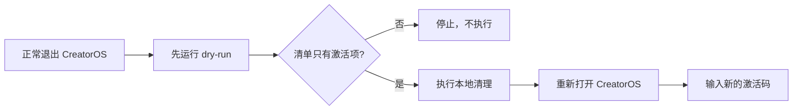

# CreatorOS 官方版本机激活清理工具

本工具只供内部开箱、客服换码和重复验收使用。它不联网、不包含激活服务器地址，也不修改服务端
记录；唯一作用是退出当前电脑上的 CreatorOS 激活态，让应用下次启动重新显示激活页。



## 会清理什么

- 官方应用数据目录中的 `.license`、`.license-seen` 和 `.channel-model-config`；
- macOS 的 `cloud.aitongban.creatoros.license` Preferences 域；
- Windows 当前用户目录下的 `.creatoros-seen`；
- 官方包尚未完成的本地权益领取记录：macOS Keychain 或 Windows Credential Manager 中唯一固定项。

文件进入系统废纸篓或回收站，脚本不会递归删除任何目录。

## 一定保留什么

- `db/`、`.auth/`、`logs/`；
- `machine-id`、`.master-key`；
- `~/CreatorOS` 工作区；
- 项目、定位、知识、素材、账号、模型密钥和采集数据；
- 服务端的激活码消费、绑定、换绑和吊销记录。

## 使用方式

先从界面正常退出 CreatorOS，再在仓库根目录运行：

```bash
# 只读预览，不修改
node tools/reset-creatoros-activation.mjs

# 确认预览无误后执行；交互输入 RESET ACTIVATION
node tools/reset-creatoros-activation.mjs --execute
```

自动化验收已得到明确授权时才可使用 `--execute --yes`。Windows 版目前只处理官方 CreatorOS；
不得用它猜测或清理渠道包路径。

清理完成后重新打开 CreatorOS。此时输入新码由 CreatorOS 主程序正常完成激活；本工具本身没有
换绑接口，也不会向任何服务器发送请求。
