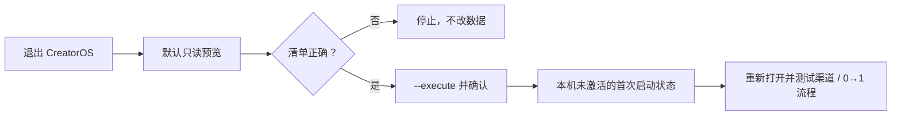

# CreatorOS 本机首次启动清理

这个工具只用于开发机验收：把本机 CreatorOS 恢复到“未激活、没有工作数据”的首次启动状态，方便重复测试渠道激活和从 0 到 1 的使用流程。

## 怎么用

先完全退出 CreatorOS，再在仓库根目录运行：

```bash
# 1. 只看清单，不改任何数据
./tools/reset-creatoros-local.mjs

# 2. 确认清单后执行；需要手动输入 RESET CREATOROS
./tools/reset-creatoros-local.mjs --execute

# 3. 已明确确认时跳过输入，适合自己重复验收
./tools/reset-creatoros-local.mjs --execute --yes
```

脚本检测到 CreatorOS 或开发 sidecar 仍在运行时会直接退出，不会进行部分清理。



## 会清什么

- `~/Library/Application Support/cloud.aitongban.creatoros`：数据库、运行时、日志、采集登录态、本机激活快照等。
- `~/CreatorOS`：默认素材、工作区和本地模型。
- CreatorOS 专属的 Caches、WebKit、HTTPStorages、Saved Application State、Cookies 和沙箱容器。
- macOS Preferences：
  - `cloud.aitongban.creatoros`
  - `cloud.aitongban.creatoros.license`
- macOS Keychain：
  - `com.creatoros.desktop / master-key`
  - `com.creatoros.desktop.entitlement-consume / pending-consume-v1`

文件会移入 macOS 废纸篓，不会直接永久删除。Preferences 和 Keychain 项由系统接口精确删除。

## 明确保留什么

- `/Applications/CreatorOS.app` 和安装包。
- 当前代码仓库。
- 可能被其他项目共用的 `~/Library/Caches/ms-playwright`。
- 配置在 `~/CreatorOS` 之外的自定义素材目录。清理后 CreatorOS 会忘记这个目录，但原文件仍在。
- 授权服务端的激活码消费、绑定和吊销记录。

因此，脚本能清除“这台 Mac 已激活”的本机凭据，但不能让服务端已经消费或绑定的激活码重新可用。渠道首激活验收应使用服务端仍有效的测试码，或由授权后台重置对应测试码。

## 恢复与验证

误操作时，可先从 macOS 废纸篓恢复文件目录；Preferences 和 Keychain 项不会随废纸篓自动恢复。重新打开 CreatorOS 后，应看到激活入口且没有旧工作区数据。若仍直接进入已激活状态，先确认应用是否使用了其他 macOS 用户、其他 bundle id，或授权服务端是否自动恢复了权益。
