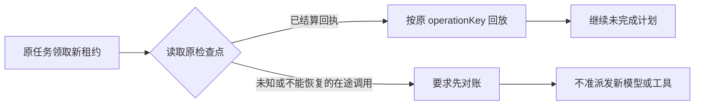

# T-1005 计划与连续执行验证（进行中）

当前实现把计划保存在原 `execution_tasks.payload.workbenchPlan`，由现有执行租约对 taskId、attempt、fence 和停止状态守门。`planRevision` 使用预期版本 CAS；只有同一计划重投幂等返回。成功步骤引用的本任务已结算成功工具回执必须存在，已成功步骤不可改写；产物引用须由后续服务注入核验。计划只是投影，任务状态、工具调用和费用继续由原账本持有。

Pi 循环新增可信 `readPlanStatus` 端口：模型输出正文时若计划仍有待办步骤，在原循环继续；无进展重复时返回 `CHAT_PLAN_NO_PROGRESS` 与步骤名；等待用户时返回 `CHAT_PLAN_REQUIRES_USER`。旧任务未提供计划端口时沿原行为运行。

本轮先执行缺模块／缺继续行为红测，再通过：`workbench-plan.service.test.ts` 3/3、`chat-pi-loop.protocol.test.ts` 6/6、ai-worker 类型检查。backend 全量类型检查仍有既存测试源码错误，当前 T-1005 文件未报新错。

## 后续接线

已加 `readWorkbenchPlan`/`saveWorkbenchPlan` 命名端口；实际 worker 对话在每轮结束时经当前 `ExecutionRef` 读取原任务计划。生产聊天装配可选的 `plan.update`，定义在提交时冻结，宿主工具经原 `reserveAgenticTool`/`startAgenticTool`/`executeAgenticTool` 链与同一租约保存计划。其参数无身份字段，成功状态仅由后端核对已结算工具回执/产物。旧冻结任务不追加工具。测试：`worker-runtime.test.ts` 32/32、`workbench-plan.service.test.ts` 3/3、`chat-workbench-plan-tool-host.test.ts` 1/1。`chat-assembly.test.ts` 新增的可选冻结用例通过；全文件运行 89 例中 26 例历史断言失败，未将其计作本任务通过。

**尚未验收：** `plan.update` 还未经过官方/自配真实模型实测；停止恢复、重规划、产物核验及完整业务交付仍需验证，不能把上述单测写成 AC-AW-01 PASS。backend 全量类型检查仍为相同的 14 处既有错误。T-1005 保持进行中。

2026-09-19 补充：`chat-workbench-plan.integration.test.ts` 使用**真实打包子进程 + 本地模型协议夹具 + 真实数据库**，完成「模型建计划 → 读取工具 → 模型引用原工具 `operationRef` 完成计划 → 原聊天终态 succeeded」，1/1 通过；`executionCalls` 中的被引用回执确为已结算工具。它验证接线与账本，不等同于官方/自配真实模型实测。停止与恢复及跨进程故障注入仍待补；故仍保持进行中。

在未包含本轮计划工具改动的隔离树 `t1006-gateway` 上重跑 `chat-assembly.test.ts`：88 例中 62 通过、26 失败；当前主树为 89 例中 63 通过、26 失败，新增的计划冻结测试通过，失败数量与隔离基线一致。两次均为真实运行，不将旧失败计作本任务 PASS。

暂停／恢复补测：真实子进程在计划首次保存后进入第二次模型流，宿主请求暂停并中断该流。计划 revision 1 与首个已结算工具回执保留；恢复后原检查点明确转为 `unknown_result` / `CHAT_CHECKPOINT_REQUIRES_RECONCILIATION`，模型请求数仍为 2，未重发未知流，也未伪造计划完成。该行为是当前原执行链的安全停止边界；尚需后续人工或自动对账后继续能力，不能把它说成自动恢复完成。集成测试 2/2 通过。

已知回执路径另用计划服务测试验证：暂停后原 attempt/fence 拒绝再次写入，resume 后新领取同一 taskId 得到新 fence，可读取 revision 3 并继续增补步骤；成功步骤和原回执保持不变。该测试与上述在途未知分支分别覆盖可安全续跑与须对账的两种情况。

## 2026-09-20 隔离树余项候选

本次只改计划服务、Pi 循环、Worker 入口、对应两份测试和本文。沿用原 `executionTaskId`、调用账本与租约。人能读懂的恢复分支如下：

改动：已记录到步骤上的操作/产物引用不可在重规划时抹掉；`supersedes` 必须指向旧步骤；新引用要核对本任务真实工具调用或由产物端口核验，步骤成功还要重新核对回执与产物。声明未知副作用或错误的工具回执不能支撑成功。无进展令牌只计回执引用和成功状态，改标题、改 revision、运行态摆动或反复调用无成果工具不会无限续跑。计划未完成时，空回复继续原循环，不进入只读最终答复恢复；失败步骤也不能被正文宣称完成。Worker 对未知调用和未列入可恢复清单的 started 调用先阻断，即使检查点的 `recovery` 字段误报 ready。

### 当场红测

安装本独立树锁文件依赖后，先写测试再改运行代码；以下均为真实运行观察：

最初的重复工具调用红测没有夹具请求上限，曾挂起；停止其父进程后，遗留孤儿 Vitest worker PID 47082，2026-09-20 已单独终止。该挂起运行不计 PASS。随后在夹具加入第 9 次请求上限，得到下表的可结束红测；修复后用 `--testTimeout=4000` 重跑整份协议测试，14/14 于 1.33 秒完成，进程检查无遗留 Vitest worker。

| 命令 | 修复前结果 |
|---|---|
| `pnpm --dir backend exec vitest run src/modules/execution/workbench-plan.service.test.ts --retry=0` | 5 例中 2 例失败：运行中步骤可抹掉 `operationRefs`；仅改标题和状态也改变进展令牌。 |
| `pnpm --dir ai-worker exec vitest run src/runtime/chat/chat-pi-loop.protocol.test.ts -t '计划未完成时空响应' --retry=0 --testTimeout=4000` | `CHAT_FINAL_RECOVERY_TOOL_CALL`：未完成计划误入只读最终答复。 |
| `pnpm --dir ai-worker exec vitest run src/runtime/chat/chat-pi-loop.protocol.test.ts -t '重复工具调用' --retry=0 --testTimeout=4000` | 测试夹具第 9 次请求报 `FIXTURE_UNBOUNDED_LOOP`，未触发 `CHAT_PLAN_NO_PROGRESS`。 |
| `pnpm --dir ai-worker exec vitest run src/runtime/chat/chat-pi-loop.protocol.test.ts -t '计划步骤失败' --retry=0` | 正文直接返回完成，没有预期的无进展错误。 |
| `pnpm --dir backend exec vitest run src/modules/execution/workbench-plan.service.test.ts -t '未知副作用' --retry=0` | 声称 `sideEffect: unknown` 的回执仍可把步骤标成功。 |
| `pnpm --dir ai-worker exec vitest run src/runtime/chat/chat-pi-loop.protocol.test.ts -t '重启前未知在途调用' --retry=0` | `recovery: ready` 与未知调用不一致时，Worker 仍进入 `reserveGenerationCall`。 |

### 修复后验证与证据边界

| 命令 | 结果 |
|---|---|
| `pnpm --dir backend exec vitest run src/modules/execution/workbench-plan.service.test.ts --retry=0` | 7/7 PASS；PGlite 真账本、停止/恢复新 fence、未知工具不补成功也不换键重发。 |
| `pnpm --dir ai-worker exec vitest run src/runtime/chat/chat-pi-loop.protocol.test.ts --retry=0` | 14/14 PASS；实际 Pi core + SDK，内存供应商流。两次启动沿同一 operationKey 回放已结算模型流及工具回执，只新增未完成步骤的调用；不把它写成真实供应商或进程重启。 |
| `pnpm --dir backend exec vitest run src/integration/chat-workbench-plan.integration.test.ts --retry=0` | 2/2 PASS；真实打包 Worker 子进程 + PGlite + 本地模型协议夹具。其暂停/恢复样例处于未知模型流，正确转 `unknown_result`，未重发。 |
| `pnpm --dir backend exec vitest run src/modules/ai-runtime/chat-workbench-plan-tool-host.test.ts --retry=0` | 1/1 PASS。 |
| `pnpm --dir ai-worker typecheck` | PASS。 |
| `pnpm --dir ai-worker exec vitest run src/execution/worker-runtime.test.ts --retry=0` | 32/32 PASS。 |
| `pnpm --dir ai-worker exec vitest run src/execution/chat-web-read-recovery.test.ts src/execution/worker-runtime.test.ts --retry=0` | 32 通过、2 失败。两例旧网页恢复测试的输入均未声明 `executionEngine: "pi"`，而 HEAD 原有 Worker 守卫已返回 `CHAT_LEGACY_RUNTIME_UPGRADE_REQUIRED`；已用 `git show HEAD` 核对守卫和测试输入，属于本写集外既有测试失配，不计本任务 PASS。 |
| `pnpm --dir backend typecheck` | FAIL，仍为 14 处既有测试源码错误；错误都不在 T-1005 写集，见本文件前述基线。不可称 backend 全量类型检查通过。 |
| `node orchestrator/process/boundary-scan.mjs` | FAIL：7 条，基线 5 条；新增 2 条均指向写集之外的 `frontend/src/features/copilot/live-chat-session.ts`，由 T-1016 跟进。本候选没有修改该文件。 |

**尚未验收：** 官方/自配真实模型凭据与调用没有在本次取得，故未做真实模型测试；安全续跑已有同一操作键协议测试、PGlite 租约测试及下述真实双子进程测试，但模型响应仍来自本地协议夹具。完整业务读取、网页、文件、产物登记与安装版交付属于后续任务，不能将本地模型夹具或 PGlite 测试冒充 AC-AW-01/03 全链路 PASS。未知外部动作必须先依据原调用对账；本候选没有自动判定其成功或重派。未推送、未发布，也未改主控制面任务状态。

主树合入后修正了续跑测试的模块边界：建会话和用户消息改经 AI 服务端口，不再跨模块直接导入 AI repository。重跑计划服务测试 8/8 通过；`boundary-scan` 中本次新增的 R3 违规已消失，剩余 2 条前端 R2 违规位于既有 `live-chat-session.ts`，由 T-1016 跟进。全量 backend 类型检查仍是既有 14 处错误，本文件没有新增类型错误。

## 2026-09-20 安全检查点的真实子进程重启补证

在 `workbench-plan.service.test.ts` 增加可运行测试，使用真实打包的 `execution-worker.cjs`、两个先后创建并分别关闭的 `WorkerSupervisor` 子进程、PGlite 原任务/租约/计划/检查点/调用账本，以及本地 HTTP 模型协议夹具。宿主端口由测试接到现有 backend service；外部动作由测试工具记录实际执行次数。第一进程在第二条模型回复**已结算且已存检查点**之后，经 `readWorkbenchPlan` 端口核对 `recovery: ready`、`ledgerSequence: 3`、消息顺序为模型→工具→模型、`pendingCalls: []`，才请求暂停并取消进程。不存在靠固定睡眠猜测安全窗口。

暂停时原任务三条调用均为 `settled`，其中外部工具只执行一次；原计划 revision 1 仍待完成，已确认模型用量为 10 tokens。关闭第一子进程后，原 taskId 经 pause→acknowledge→resume 由新 worker 领取，attempt 增加、fence 改变。第二子进程回放前三条原调用，不再次访问供应商或执行外部工具；随后新增模型调用和 `plan.update`，以原工具 `operationRef` 将步骤标为成功。最终同一 taskId 成功，供应商请求总数由 2 增至 4、外部工具执行数仍为 1，原三条调用的 ID、operationKey、完整回执和用量逐字段不变；六条调用均已结算，累计模型用量由 10 增至 20 tokens，未重复计入回放。这里的“费用”证据是现有调用账本的 token 用量；本地夹具没有真实供应商价格，不能换算成货币费用。

新测试在 `ce03759a` 原运行代码上首次执行即通过；本轮只补证据与测试，没有虚构失败红测或修改运行时。`pnpm --dir backend exec vitest run src/modules/execution/workbench-plan.service.test.ts src/integration/chat-workbench-plan.integration.test.ts --retry=0 --testTimeout=30000` 为 **10/10 PASS**，其中既有未知模型流暂停/恢复测试仍要求对账、不重发。`pnpm --dir ai-worker exec vitest run src/runtime/chat/chat-pi-loop.protocol.test.ts --retry=0 --testTimeout=4000` 为 **14/14 PASS**，`pnpm --dir ai-worker typecheck` 通过。`pnpm --dir backend typecheck` 仍仅有前述 14 处写集外既有错误，新测试无 TypeScript 错误。

证据边界：这是本地模型协议夹具和测试接线的真实 Worker 子进程重启，证明原任务安全检查点续跑；未使用官方/自配真实模型，也未经过完整生产 dispatcher 调度、真实外部平台、文件产物和安装版。未知在途分支仍按既有真实子进程/PGlite 集成测试及 Worker 协议测试 fail closed；不能把安全分支的通过解释为未知动作自动对账完成。未推送或发布，T-1005 控制面状态未改。

## 2026-09-20 连续文件能力的协议补证（独立分支）

新增 `backend/src/integration/chat-workbench-plan.integration.test.ts` 用例，复用既有真实打包 Worker 子进程、PGlite、原聊天提交服务、原任务账本、`plan.update` 宿主和本地 HTTP 模型协议夹具。模型夹具在同一轮按以下顺序回复：

两次 `files.write` 都经过 Worker 工具分发到测试注入的宿主端口，参数符合冻结的 `workbenchFileRequestSchema` 中 `operation: "write"` 形状，夹具回执经过 `workbenchResultSchema` 校验。测试核对两次参数与调用顺序、发起第二次文件调用时模型已见第一次调用 ID、完成计划前模型已见第二次调用 ID、计划两个步骤各引用对应已结算工具调用、原任务终态为 `succeeded`。模型协议请求数为 5，工具已结算回执数为 4（建计划、两次文件能力、完成计划）。

**验证范围：仅是文件能力调用协议。** 当前分支的聊天装配没有连接 T-1007 的生产文件宿主；测试端口只记录参数并返回明确写着“未连接文件宿主”的夹具回执，`sideEffect` 为 `none`，没有创建文件、计算文件 hash 或登记产物。计划服务可验证原任务已结算工具回执，不能仅凭该回执证明文件真实落盘。因此此用例不构成 AC-AW-01 文件交付、AC-AW-02 文件/产物、T-1007 文件隔离或安装版验收证据。真实文件事实需由后续生产宿主接线测试验证写后读、hash、路径归属与产物登记；本次没有跨越 T-1007/T-1009 写集。

当场测试记录：新增用例首次运行失败，任务为 `retry_wait`、错误码 `http_500`。原因是模型历史中同时含建计划和两次文件调用 ID，测试夹具误取全部三条，拒绝第 4 次请求；当时两次文件调用已到达测试端口。这是夹具解析错误，不是运行时红测或产品缺陷。过滤为两条实际文件调用 ID 后，单用例通过；本轮未改运行时代码，也没有可诚实记录的运行时 RED。

| 命令 | 当场结果 |
|---|---|
| `pnpm --dir backend exec vitest run src/integration/chat-workbench-plan.integration.test.ts -t '两次文件写入协议' --retry=0 --testTimeout=30000` | 1/1 PASS。 |
| `pnpm --dir backend exec vitest run src/integration/chat-workbench-plan.integration.test.ts src/modules/execution/workbench-plan.service.test.ts src/modules/ai-runtime/chat-workbench-plan-tool-host.test.ts --retry=0 --testTimeout=30000` | 12/12 PASS。 |
| `pnpm --dir backend typecheck` | FAIL，14 处错误均在写集外既有测试文件；新增测试文件无 TS 错误。 |
| `node orchestrator/process/boundary-scan.mjs` | FAIL，7 条对基线 5 条；新增 2 条均在写集外 `frontend/src/features/copilot/live-chat-session.ts`，由 T-1016 跟进。 |

任务继续保持进行中。没有官方/自配真实模型、生产文件宿主、真实文件落盘或安装版证据；未推送、未发布，也没有修改共享 contract、配置或其它任务文件。
