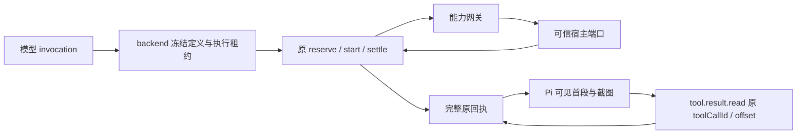

# T-1006 统一工具网关与长结果回读候选

## 已实现的边界

本候选在指定 write_set 内提供能力网关、原回执分页投影和 backend 动态工具定义接口。网关按冻结 `workbenchCapabilitySchema` 校验目录、平台、宿主授予的能力、版本、参数与结果。模型参数只含 `invocation`；完整 `WorkbenchHostCall` 应由 backend 从当前执行租约构造。进入宿主端口后若回执丢失，返回 `unknown/reconcile`，保留 `operationId`，不自动重试。进度受 4 KiB 字节预算约束；取消信号交回原执行链。`toAgenticToolOutcome` 将明确未派发失败、登录要求和未知提交映射到原回执错误码。

backend 可以用 `defineWorkbenchChatTool` 建立可信目录工具，并以 `prepareChatToolDefinitions(..., { workbenchCapabilities })` 冻结原聊天工具版本、副作用和参数。原生执行入口保留完整结果供 `executionCalls` 结算；普通工具入口仍受既有结果预算。静态工具真值表未改，动态名称不能覆盖正式工具。

`projectReceiptForPi` 只投影**已经结算**的 `AgenticToolOutcome`：文本首段按原回执 `JSON.stringify(output)` 的前 12,000 个 UTF-16 字符给模型，提示后续调用现有 `tool.result.read` 并沿原 `toolCallId`、`offset` 回读。它不另建分页文件或 TTL 状态。图片 `dataRef` 须由 backend 在当前账号、任务和租约下解析，5 MiB 以内以 Pi 的 image 块保留模型可见；没有解析端口会明确报错，不把截图悄悄替换为路径提示。后续历史仍使用既有上下文窗口策略。

## 红测与实测

- 首次 `pnpm --dir ai-worker exec vitest run src/capabilities/gateway.test.ts src/capabilities/result-pages.test.ts --retry=0`：两个模块不存在，2 个 suite 失败；此前隔离树缺依赖，已按锁文件离线安装。
- backend 动态接口测试首次运行：新增 2 个用例失败，`defineWorkbenchChatTool is not a function`。
- 实现后同一 Worker 命令：2 个文件、9 个测试通过。
- `pnpm --dir backend exec vitest run src/modules/ai-runtime/chat-tool-definitions.test.ts src/modules/ai-runtime/chat-tool-gate.test.ts src/modules/ai-runtime/chat-tool-native.test.ts --retry=0`：3 个文件、39 个测试通过。
- `pnpm --dir ai-worker typecheck`：通过。
- `pnpm --dir backend typecheck`：失败，14 处错误均在本次 write_set 外；主工作树运行同命令得到相同错误（包括 `signal-quality.test.ts` 缺 `topic-task-adapter`、`transcribe-runner.test.ts` 引用已无导出）。本候选无新增类型诊断。
- `node orchestrator/process/boundary-scan.mjs`：失败，主工作树同样为 7 条、比配置基线多 2 条；新增项均指向本次未修改的 `frontend/src/features/copilot/live-chat-session.ts`。本候选的 R5（Worker 能力适配器禁止直连数据库）为 0。

## 主会话需要闭合的集成点

1. 在 `chat-assembly.ts` / `chat-tools.ts` / `chat-turn-preparation.ts` 的可信装配路径选择可用能力，传入 `workbenchCapabilities`，并由 backend `chat-host-tool-adapter.ts` 对 `workbench.result` 使用 `toAgenticToolOutcome` 对应映射。当前普通宿主适配器只检查顶层 `error`，会误把嵌套 `result.status=failed` 当成功。
2. 在 `chat-worker-run.ts` 与 `chat-pi-loop.ts` 的**原**工具链结算后调用 `projectReceiptForPi`，把返回的 image 块交给 Pi；当前 Pi 执行器只把 JSON 文本交给模型，因此本候选未证明真实截图可见。不得在投影前丢掉完整回执，也不得新增费用或任务状态表。
3. 接入 backend 可信 `WorkbenchHostContext` 构造和宿主 `dataRef` 解析端口，复用现有账号、attempt/fence、执行租约与取消信号。Worker 本模块没有权限自行建立这些身份事实。
4. 现有 `agenticToolOutcomeSchema` 对单个回执有 1,000,000 字符限制。超过此上限的结果需要 backend 持久化/外置并扩展原 `tool.result.read` 回读来源；本候选的 12,000 字符模型投影只解决已能结算的长回执，不能声称任意大小结果已可回读。
5. 真实模型调用、费用结算、停止恢复、跨账号拒绝和截图观察还需 T-1012 全链路验证；本轮是聚焦单测与类型验证，不是安装版或真机验收。

参考来源：NomiFun `e27bd5de` 的 `apps/pi-sidecar/src/nomifun-gateway.ts`。该提交不含 `tool-result-adapter.ts`；本机参考仓该路径为未跟踪文件，仅用于理解分页及媒体预算，没有修改参考仓，也未将其文件状态算作冻结提交证据。
