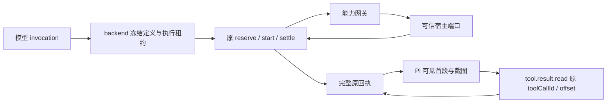

# T-1006 统一工具网关与长结果回读候选

> 下方初版记录保留当时的证据与未闭合点；本次 integration 的现状与检查结果见文末“集成候选”。

## 已实现的边界

本候选在指定 write_set 内提供能力网关、原回执分页投影和 backend 动态工具定义接口。网关按冻结 `workbenchCapabilitySchema` 校验目录、平台、宿主授予的能力、版本、参数与结果。模型参数只含 `invocation`；完整 `WorkbenchHostCall` 应由 backend 从当前执行租约构造。进入宿主端口后若回执丢失，返回 `unknown/reconcile`，保留 `operationId`，不自动重试。进度受 4 KiB 字节预算约束；取消信号交回原执行链。`toAgenticToolOutcome` 将明确未派发失败、登录要求和未知提交映射到原回执错误码。

backend 可以用 `defineWorkbenchChatTool` 建立可信目录工具，并以 `prepareChatToolDefinitions(..., { workbenchCapabilities })` 冻结原聊天工具版本、副作用和参数。原生执行入口保留完整结果供 `executionCalls` 结算；普通工具入口仍受既有结果预算。静态工具真值表未改，动态名称不能覆盖正式工具。

`projectReceiptForPi` 只投影**已经结算**的 `AgenticToolOutcome`：文本首段按原回执 `JSON.stringify(output)` 的前 12,000 个 UTF-16 字符给模型，提示后续调用现有 `tool.result.read` 并沿原 `toolCallId`、`offset` 回读。它不另建分页文件或 TTL 状态。图片 `dataRef` 须由 backend 在当前账号、任务和租约下解析，5 MiB 以内以 Pi 的 image 块保留模型可见；没有解析端口会明确报错，不把截图悄悄替换为路径提示。后续历史仍使用既有上下文窗口策略。

## 红测与实测

- 首次 `pnpm --dir ai-worker exec vitest run src/capabilities/gateway.test.ts src/capabilities/result-pages.test.ts --retry=0`：两个模块不存在，2 个 suite 失败；此前隔离树缺依赖，已按锁文件离线安装。
- backend 动态接口测试首次运行：新增 2 个用例失败，`defineWorkbenchChatTool is not a function`。
- 实现后同一 Worker 命令：2 个文件、9 个测试通过。
- `pnpm --dir backend exec vitest run src/modules/ai-runtime/chat-tool-definitions.test.ts src/modules/ai-runtime/chat-tool-gate.test.ts src/modules/ai-runtime/chat-tool-native.test.ts --retry=0`：3 个文件、39 个测试通过。
- `pnpm --dir ai-worker typecheck`：通过。
- `pnpm --dir backend typecheck`：失败，14 处错误均在本次 write_set 外；主工作树运行同命令得到相同错误（包括 `signal-quality.test.ts` 缺 `topic-task-adapter`、`transcribe-runner.test.ts` 引用已无导出）。本候选无新增类型诊断。
- `node orchestrator/process/boundary-scan.mjs`：失败，主工作树同样为 7 条、比配置基线多 2 条；新增项均指向本次未修改的 `frontend/src/features/copilot/live-chat-session.ts`。本候选的 R5（Worker 能力适配器禁止直连数据库）为 0。

## 主会话需要闭合的集成点

1. 在 `chat-assembly.ts` / `chat-tools.ts` / `chat-turn-preparation.ts` 的可信装配路径选择可用能力，传入 `workbenchCapabilities`，并由 backend `chat-host-tool-adapter.ts` 对 `workbench.result` 使用 `toAgenticToolOutcome` 对应映射。当前普通宿主适配器只检查顶层 `error`，会误把嵌套 `result.status=failed` 当成功。
2. 在 `chat-worker-run.ts` 与 `chat-pi-loop.ts` 的**原**工具链结算后调用 `projectReceiptForPi`，把返回的 image 块交给 Pi；当前 Pi 执行器只把 JSON 文本交给模型，因此本候选未证明真实截图可见。不得在投影前丢掉完整回执，也不得新增费用或任务状态表。
3. 接入 backend 可信 `WorkbenchHostContext` 构造和宿主 `dataRef` 解析端口，复用现有账号、attempt/fence、执行租约与取消信号。Worker 本模块没有权限自行建立这些身份事实。
4. 现有 `agenticToolOutcomeSchema` 对单个回执有 1,000,000 字符限制。超过此上限的结果需要 backend 持久化/外置并扩展原 `tool.result.read` 回读来源；本候选的 12,000 字符模型投影只解决已能结算的长回执，不能声称任意大小结果已可回读。
5. 真实模型调用、费用结算、停止恢复、跨账号拒绝和截图观察还需 T-1012 全链路验证；本轮是聚焦单测与类型验证，不是安装版或真机验收。

## 主会话后续集成

已把超过 12,000 字符的原工具回执投影接入 Pi 同一循环，分页文本包含 `tool.result.read` 的原调用 ID；完整结果仍保留在 UI 卡片和原工具账本。`chat-pi-loop.protocol.test.ts` 的长结果用例验证模型后续输入只含首段，UI 卡仍有原值；ai-worker 类型检查通过。尚未把图片 `dataRef` 接到后端可信解析端口；遇图片时目前沿原卡片协议保留引用，不能写成“截图已被模型看见”。可信能力目录的生产装配、超 100 万字符结果的外置回读、真实取消/费用 E2E 仍待闭合，T-1006 保持进行中。

参考来源：NomiFun `e27bd5de` 的 `apps/pi-sidecar/src/nomifun-gateway.ts`。该提交不含 `tool-result-adapter.ts`；本机参考仓该路径为未跟踪文件，仅用于理解分页及媒体预算，没有修改参考仓，也未将其文件状态算作冻结提交证据。

## 集成候选（独立工作树）

聊天提交时，从与正式聊天运行时共用的 `workbenchHost` 装配对象读取目录；按平台与宿主授予能力过滤后，将描述、schema、版本和最大副作用冻结进原 `modelInput`。模型只提交 invocation；Worker 网关按冻结目录校验，backend 在执行前重读当前租约并填入 userId、accountId、taskId、attempt、fenceToken、leaseId 与原 operationId。宿主返回结果经 backend 自身的 schema 校验后沿原 `reserve/start/settle` 工具账本结算。长文本沿原 toolCallId 回读，未知提交不自动重发。

当前生产 `persistence-client.ts` 的 `composeChatProduction` 调用没有传入 `workbenchHost`，因此通用能力目录在生产为空。可注入的 fake 验证了通用接线；**文件与浏览器生产能力尚未装配**，T-1007/T-1008 的宿主工作不在本候选范围。

**未验收：生产进度回读。** `host.progress?` 目前只是进程内回调，未持久化到原 execution stream，也未证明应用重启后可回读。fake 宿主进度测试仅证明回调边界。真实模型、费用、停止恢复和取消全链路仍需端到端验证；此处只确认通用调用复用原工具账本，不把单测等同生产费用验收。超过原 `agenticToolOutcomeSchema` 100 万字符上限的结果仍需原账本之外的受控持久化与回读扩展。

本工作树先写宿主与冻结目录测试；首次 Packet 测试命令因本工作树缺 `node_modules` 在启动前报 `vitest not found`。随后在 `/tmp` 的隔离测试副本借用既有依赖运行：Packet 指定的 backend 宿主 4/4、ai-worker 网关 7/7 通过；额外的 backend 定义与计划、Worker 分页与持久工具、frontend 准备测试通过。ai-worker、contract、frontend 的 `tsc --noEmit` 通过；backend 类型检查仍报 14 条位于本 write_set 外的既有测试文件错误，本候选文件没有类型报错。扩展的 `durable-chat-tool-ledger.test.ts` 在本候选和 HEAD 对照副本的 `completed` 案例均报 `MODEL_RESULT_UNKNOWN`，未作为通过证据。

`boundary-scan.mjs` 在本候选和 HEAD 归档均报同样两条相对旧基线的新违规，位于未修改的 `frontend/src/features/copilot/live-chat-session.ts`（`@ai-sdk/react`、`ai` 导入）；本候选引入 0 条边界违规。Packet 禁止改该文件与 baseline，因此全局命令不能记为通过。

## 原任务进度持久化候选（独立工作树）

宿主运行时的文字进度现在由 backend 的可信回调进入 `execution_stream_events`。写入时，后端在同一任务行锁事务中核验当前 attempt/fence、未停止且未过期的 lease、属于该任务且已有 Host 领取凭证的顶层 `started` 工具调用，以及该调用的 `startedAttempt`。事件固定构造成 AI SDK 可识别的 `data-workbench-progress` 块，只有 `operationId`、`progressCursor` 和受 4 KiB 限制的文字内容；宿主传来的任意 chunk 类型、账号和任务 ID 均不会照搬。Worker 原 `appendStreamEvents` 在聊天任务里仍只准写模型展示内容，不能写入工具进度。相同进度的重投按调用 ID 与内容去重；跨调用、未领取、旧 fence、停止、超限和结算后新增均拒绝。

生产组合器已将后端进度回调接入通用能力宿主。宿主调度中的进度按顺序落库，订阅断开后可由原 `sequence` 继续读取；进度写入或观察回调故障被局部吸收，不把已经成功的工具回执改成失败。`execution_tasks.status` 仍是唯一终态来源，进度事件只负责展示。聊天 HTTP 入口会按原持久订阅发送该 `data-*` 块；具体卡片渲染属于 T-1011。

- 红测：新增事件服务两个用例因 `appendWorkbenchProgress is not a function` 失败；宿主测试因持久回调从未调用失败。
- 实际 Host 执行链复核：初版校验错误地拒绝 `toolExecutionClaimId`，将测试改成真实领取状态后重新红测（2 个用例失败），修正为必须存在领取凭证后复绿。
- 绿测：`pnpm --dir backend exec vitest run src/modules/execution/execution-stream.service.test.ts src/modules/ai-runtime/chat-workbench-capability-host.test.ts src/integration/chat-tool-authority.test.ts --retry=0`，3 个文件、31 个测试通过。覆盖断线按 sequence 续读、同进度重投、跨账号读取/调用、旧 fence、坏载荷、停止与已结算调用，以及持久写入故障不覆盖工具成功。
- backend 类型检查仍有 14 条写集外既有测试错误；本候选没有新增类型诊断。`boundary-scan.mjs` 仍为 7 条，其中相对配置基线多出的 2 条位于未改动的 `live-chat-session.ts`；本候选新增 0 条。

生产尚未注入真实 `workbenchHost`，所以当前安装版不会触发通用宿主进度；文件、浏览器能力接入与真实模型/费用/停止恢复的端到端验收仍待后续任务。进度写入失败时工具可成功，但该条进度不可回放；不能据此宣称进度零丢失。

## 主工作树真实子进程集成（2026-09-19）

上述独立候选的“生产未注入”仅描述当时状态。现已通过 `frontend/src/server/workbench-native-host.ts` 将 Mac 桌面私有 socket 的文件能力接入正式 `persistence-client.ts` 组合；仅真实 socket、桌面环境和授予的能力同时存在时才发布 `files.list/read/stat/write/edit`。每次调用在 Node client 重读原任务租约并验证身份。浏览器、媒体解析、Windows 宿主仍未接入。

新增 `chat-workbench-gateway.integration.test.ts` 使用实际打包的 ai-worker 子进程、PGlite 原任务与调用账本、假 OpenAI 流及可信宿主端口走完整调用链。首次运行在模型前被 `WORKBENCH_FROZEN_DEFINITION_MISMATCH` 拒绝：数据库反序列化后 JSON 对象键顺序改变，导致动态能力版本散列不同。改为只对 Workbench 定义使用稳定 JSON 序列化后，第二次运行在工具已结算时进入 `TOOL_REQUIRES_RECONCILIATION`：进度事件占据了工具调用的 `callIndex=0`，最终卡片投影将其误判为冲突。现在投影保留进度的序号，并从其后写入最终卡片；再次投影仍逐项比对原回执，不能覆写已有卡片。

修正后该集成用例通过：宿主只执行一次，20,004 字符文本完整保存在原工具回执，下一次模型输入只含有界投影，原调用 ID 可供后续 `tool.result.read` 回读；两次模型调用各记录 5 tokens，进度可按原 stream sequence 重连读取，跨账号读取被拒绝。另跑动态定义、宿主与流服务测试，合计 4 个文件、24 个测试通过。这里的 token 数来自假模型回传的 usage，用于验证原账本没有重复计费，不代表真实供应商费用实测。

后端类型检查仍有 14 条此前已记录的写集外错误，本次新增文件修正后无新增诊断。未验证真实模型定价、图片 `dataRef` 对模型可见、超过 100 万字符的原回执、真实取消与安装版跨平台 E2E；这些不能记为 T-1006 全部验收通过。
