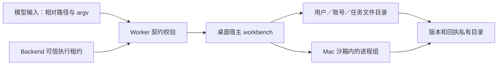

# T-1007 任务文件与受控命令验证记录

## 本次候选实现

冻结契约由 `@creatoros/contract/agent-workbench` 导入。Worker 的 `task-files.ts` 与 `command-host.ts` 仅解析模型请求、验证可信宿主上下文与 operationId，并把调用交给本机受限端口；账号、用户、任务和执行租约不能由模型参数指定。NomiFun `e27bd5de` 的 `caps_files.rs` 只作能力形状参考，没有沿用 Desktop `Unrestricted` 路径权限。

Mac 原生文件模块按 `userId/accountId/taskId` 的哈希层级创建目录；逐级 `openat` + `O_NOFOLLOW`，拒绝绝对路径、盘符、`..`、冒号、符号链接和内部保留名。相对路径归一到 NFC，避免 Unicode 等价名称使用两份版本索引。版本与命令输出放在任务根目录的兄弟私有目录；文件写入使用同目录独占临时文件、`sync_all`、`renameat` 和跨进程 `flock`。分页读取每次最多 1 MB，版本哈希流式计算；命令 stdin 引用限 1 MB，超出明确失败。中断发生在数据换名后、版本记录提交前时，下次读取按内容哈希修复版本，调用方须按未知提交核对。

命令仅解析可信配置中的绝对 runtime 路径；argv 不经过 shell，环境用 `env_clear` 后只注入 HOME/TMPDIR/PATH。Mac 使用 `sandbox-exec` 的 `deny default` 配置，仅读系统可执行目录、受管 runtime 读取根和本任务目录，只写本任务目录。stdout/stderr 经宿主管道写入私有目录，提供预览与按范围读取。进程组取消先 TERM、后 KILL，并等待组长；非 Mac 平台没有已验证隔离器时拒绝执行。**cwd 校验只是输入校验，不构成 OS 隔离。**

## 已实际执行

- 先建测试后运行 `pnpm --dir ai-worker exec vitest run src/capabilities/task-files.test.ts src/capabilities/command-host.test.ts --retry=0`：两个测试套件因实现模块尚不存在而失败（红测）；实现后 **2 文件、13 用例通过**。
- `pnpm --dir ai-worker typecheck`：通过。
- `RUSTFLAGS='-A dead_code' cargo test --manifest-path frontend/src-tauri/src/workbench/Cargo.toml --offline --locked --quiet`：本机 macOS **6 用例通过**。实际覆盖 Unicode/空格、NFC 等价冲突、账号及用户隔离、符号链接越界、任务外文件读取被 OS 沙箱拒绝、任务内读取、取消后派生子进程消失。
- `cargo test --manifest-path frontend/src-tauri/Cargo.toml --test workbench --locked --no-default-features`：**未进入测试**；现有 `build.rs` 因隔离树缺少 `binaries/creatoros-server-aarch64-apple-darwin` 中止。上面的独立测试入口只编译并测试 workbench 模块。

## 主会话集成与未闭合边界

1. `frontend/src-tauri/src/lib.rs` 不在本任务 write_set。主会话需接入 `mod workbench` 和受限 IPC，在每次调用前由 backend 校验当前 execution lease、fence 和账号归属，并注入可信 `userId/accountId/taskId`；再将 Rust 文件/命令结果映射到冻结回执。当前候选模块**未在桌面应用中可调用**。
2. 冻结 `workbenchResultSchema` 的失败分支没有 `currentVersion` 字段。Rust `FileError::Conflict` 已提供该值，Worker 提供 `versionConflictResult`，将当前版本稳定编码为 `version_conflict:<n>`。主会话接线时须把原生冲突映射到该辅助函数；若要新增独立 `currentVersion` 字段，应由主会话另行升级契约。
3. Windows 文件句柄逐级校验、受限进程 token/Job Object 与真机零遗留进程树测试尚未实现；Windows 当前 fail-closed。Mac 测试使用本机 Homebrew Python 验证派生进程，**不证明安装包内 Node/Python 已配置可用**。
4. 命令表目前在内存中。应用崩溃后还需依据持久回执和实际进程身份恢复；Mac 宿主被强杀时的孤儿清理与安装版端到端测试未验证。命令直接修改任务文件与文件 API 并发时，还需要宿主统一写入协调。

这些未闭合项不应计作 T-1007 完整验收，也不能把本机模块用例记为 Windows 或安装包 PASS。
