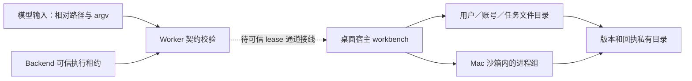
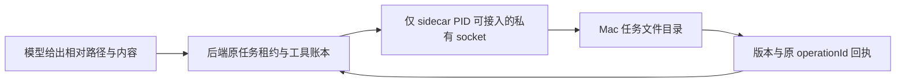
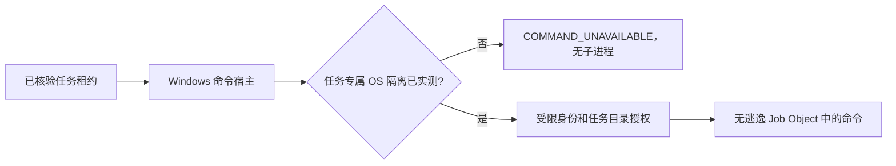
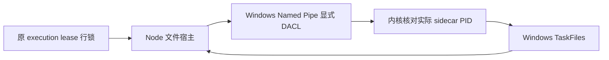

# T-1007 任务文件与受控命令验证记录

> 本文前半保留初期候选的原始证据；最新状态见文末按日期追加的验证记录。

## 本次候选实现

冻结契约由 `@creatoros/contract/agent-workbench` 导入。Worker 的 `task-files.ts` 与 `command-host.ts` 仅解析模型请求、验证可信宿主上下文与 operationId，并把调用交给本机受限端口；账号、用户、任务和执行租约不能由模型参数指定。NomiFun `e27bd5de` 的 `caps_files.rs` 只作能力形状参考，没有沿用 Desktop `Unrestricted` 路径权限。

Mac 原生文件模块按 `userId/accountId/taskId` 的哈希层级创建目录；逐级 `openat` + `O_NOFOLLOW`，拒绝绝对路径、盘符、`..`、冒号、符号链接和内部保留名。相对路径归一到 NFC，避免 Unicode 等价名称使用两份版本索引。版本与命令输出放在任务根目录的兄弟私有目录；文件写入使用同目录独占临时文件、`sync_all`、`renameat` 和跨进程 `flock`。分页读取每次最多 1 MB，版本哈希流式计算；命令 stdin 引用限 1 MB，超出明确失败。中断发生在数据换名后、版本记录提交前时，下次读取按内容哈希修复版本，调用方须按未知提交核对。

命令仅解析可信配置中的绝对 runtime 路径；argv 不经过 shell，环境用 `env_clear` 后只注入 HOME/TMPDIR/PATH。Mac 使用 `sandbox-exec` 的 `deny default` 配置，仅读系统可执行目录、受管 runtime 读取根和本任务目录，只写本任务目录。stdout/stderr 经宿主管道写入私有目录，提供预览与按范围读取。进程组取消先 TERM、后 KILL，并等待组长；非 Mac 平台没有已验证隔离器时拒绝执行。**cwd 校验只是输入校验，不构成 OS 隔离。**

## 已实际执行

- 先建测试后运行 `pnpm --dir ai-worker exec vitest run src/capabilities/task-files.test.ts src/capabilities/command-host.test.ts --retry=0`：两个测试套件因实现模块尚不存在而失败（红测）；实现后 **2 文件、13 用例通过**。
- `pnpm --dir ai-worker typecheck`：通过。
- `RUSTFLAGS='-A dead_code' cargo test --manifest-path frontend/src-tauri/src/workbench/Cargo.toml --offline --locked --quiet`：本机 macOS **6 用例通过**。实际覆盖 Unicode/空格、NFC 等价冲突、账号及用户隔离、符号链接越界、任务外文件读取被 OS 沙箱拒绝、任务内读取、取消后派生子进程消失。
- `cargo test --manifest-path frontend/src-tauri/Cargo.toml --test workbench --locked --no-default-features`：**未进入测试**；现有 `build.rs` 因隔离树缺少 `binaries/creatoros-server-aarch64-apple-darwin` 中止。上面的独立测试入口只编译并测试 workbench 模块。

## 主会话集成与未闭合边界

1. 本次 `desktop-integration` Packet 已允许修改 `frontend/src-tauri/src/lib.rs`，因此已将 `mod workbench` 纳入桌面壳编译。仍缺受限 sidecar IPC：每次调用须由 backend 校验当前 execution lease、attempt、fence 和账号归属，并注入可信 `userId/accountId/taskId`；WebView handshake token 已暴露给页面，不能代替此验证。当前候选模块**未在桌面应用中可调用**，没有注册 Tauri command。
2. 冻结 `workbenchResultSchema` 的失败分支没有 `currentVersion` 字段。Rust `FileError::Conflict` 已提供该值，Worker 提供 `versionConflictResult`，将当前版本稳定编码为 `version_conflict:<n>`。主会话接线时须把原生冲突映射到该辅助函数；若要新增独立 `currentVersion` 字段，应由主会话另行升级契约。
3. Windows 文件句柄逐级校验、受限进程 token/Job Object 与真机零遗留进程树测试尚未实现；Windows 当前 fail-closed。Mac 测试使用本机 Homebrew Python 验证派生进程，**不证明安装包内 Node/Python 已配置可用**。
4. 命令表目前在内存中。应用崩溃后还需依据持久回执和实际进程身份恢复；Mac 宿主被强杀时的孤儿清理与安装版端到端测试未验证。命令直接修改任务文件与文件 API 并发时，还需要宿主统一写入协调。

这些未闭合项不应计作 T-1007 完整验收，也不能把本机模块用例记为 Windows 或安装包 PASS。

## 2026-09-19 桌面集成候选实测与阻断

- 桌面 `lib.rs` 已编译 workbench 模块；`invoke_handler` 未增加 workbench 入口。当前没有可由 Rust 在调用时向 backend 验证 execution lease、attempt、fence、账号归属的私有 sidecar 通道。现有 `CREATOROS_SIDECAR_HANDSHAKE_TOKEN` 同时注入 WebView，只能用于既有页面请求，不能用作 workbench 授权来源。Worker 接口只校验收到的宿主上下文形状，不能证明它仍是当前租约。
- 相对路径校验补上 Win32 设备名（含扩展名、COM/LPT 的上标数字）、尾部点/空格、保留字符、控制字符和大小写变体私有目录。macOS 实际文件系统测试继续覆盖 Unicode/空格写入、NFC 冲突、账号隔离、符号链接越界及进程组取消；新增跨平台路径输入测试是**在 macOS 运行的校验测试**，不算 Windows 文件系统实测。
- `RUSTFLAGS='-A dead_code' cargo test --manifest-path frontend/src-tauri/src/workbench/Cargo.toml --offline --locked --quiet`：本次 **7/7 通过**。`CARGO_TARGET_DIR=/tmp/creatoros-t1007-win-target cargo check --manifest-path frontend/src-tauri/src/workbench/Cargo.toml --target x86_64-pc-windows-msvc --offline --locked --quiet`：**交叉编译通过**，只证明 Windows 条件代码可编译。
- `cargo check --manifest-path frontend/src-tauri/Cargo.toml --locked --offline --no-default-features`：**受阻**，`build.rs:404` 报 `resource path binaries/creatoros-server-aarch64-apple-darwin doesn't exist`。仅为核对源码编译，使用 `TAURI_CONFIG='{"bundle":{"externalBin":[],"resources":[]}}'` 覆盖资源配置重跑同一 `cargo check`：**通过**。此覆盖不代表正常打包或安装版可用。
- Windows 原生文件句柄逐级校验尚无实现，`TaskFiles::new` 在 Windows 返回 `UnsupportedPlatform`；Windows 受限 token/文件授权与 Job Object 命令隔离尚无实现，命令模块未编入 Windows。当前机器是 macOS，只有 Windows Rust target；无 Windows 主机或可用 Docker daemon，因此**没有 Windows 路径、符号链接/重解析点、进程树的真实测试**。保持 Windows 拒绝执行，不能据交叉编译宣称隔离通过。

主控制面后续需提供可信私有 lease 验证通道及 Windows 真机，才能接入可调用 IPC、实现并验证 Windows 文件/进程边界；当前候选不满足 T-1007 完整验收。

## Mac 私有通道与 Windows 文件候选（主工作树复核）

Mac 桌面壳启动 sidecar 时创建权限为 0700 的临时目录和 0600 Unix socket；Rust 服务端用内核 `LOCAL_PEERPID` 核对实际启动的 sidecar PID，没有注册 WebView 可调用的 workbench 命令。Node 后端在原 execution lease 的 admission 事务内传入用户、账号、任务、attempt、fence 和原 operationId；文件读写结束前保持租约行锁。生产聊天仅在 macOS 桌面且该私有 socket 存在时冻结 `files.list/read/stat/write/edit` 目录。读与写分别声明副作用；已确认版本冲突返回当前版本，回执不明的写入保持 unknown 并要求按原 operationId 对账。Windows 没有此私有通道，故不会向模型展示文件能力。

Windows 候选已补 `TaskFiles` 的逐级目录 HANDLE 打开、重解析点和硬链接拒绝、同目录临时文件换名及版本冲突；设备名与 Unicode 路径校验共用合同。它通过 Windows MSVC 目标的独立包交叉检查，**尚无 Windows 真机文件系统测试**，也没有 Windows 私有 IPC 或受限命令隔离，不能作为桌面功能交付。

主工作树在合并 Mac/Windows 候选后实测：独立 Rust workbench **12/12**、Windows `x86_64-pc-windows-msvc` 独立包 `cargo check --offline --locked` 通过；Node 私有客户端与生产文件宿主测试 **8/8**，frontend 类型检查通过。Mac 测试包含真实子进程准入、其他进程拒绝、越界与版本冲突。原 Tauri 全包、安装版 Node/Python runtime、Windows 真实重解析点与进程树、命令 IPC、任务文件与产物登记的完整链路仍待验证。T-1007 保持进行中。

## Mac 受控命令私有通道候选（T-1007 子任务）

沿用文件操作的 0700 目录、0600 Unix socket 与 `LOCAL_PEERPID`：实际启动的 Node sidecar PID 才能调用 Rust `CommandHost`；未向 WebView 注册 Tauri command。原生产聊天宿主在当前 `execution_tasks` admission 行锁内注入用户、账号、任务、attempt、fence 及本次 tool call ID。`execution.run/status/cancel/read` 分别提供启动、状态、进程树取消和 stdout/stderr 分页回读。查询和取消传入的是目标原操作 ID，本次工具回执仍使用当前 tool call ID；Rust 命令表按账号任务范围和原操作 ID 联合索引，不泄露别的账号是否存在同名操作。

Mac runtime 目录来自壳层已经解析的绝对 `sidecar_dir`，固定节点为 `server.app/Contents/MacOS/creatoros-server`。Python 和 approved program 只看该 runtime 下的固定路径；当前打包脚本未交付二者，因此返回 `COMMAND_UNAVAILABLE`，不会查 PATH、Homebrew 或系统程序。子进程 `env_clear`，只设置任务目录 HOME/TMPDIR 与空 PATH；继续由 `sandbox-exec` 限制文件读取和任务内写入。Rust 定期检查超时；Node 在租约失效时用该次已核验的 scope 和操作 ID 向同一 socket 请求取消，Rust 宿主销毁时也终止仍在运行的进程组。输出写在任务可写根目录之外的私有目录。文件写入 IPC 的 JSON 字段同时纠正为与 Node 一致的 `contentBase64`、`expectedVersion`，补上原先不同语言的字段名错位。

先添加 Node 失败用例：命令方法缺失 2 条、生产目录缺失 1 条；实跑 **3 失败、其余 8 通过**。实现后实跑：

- Mac Rust 独立模块 `cargo test --offline --locked`：**15/15 通过**，包含真实进程、OS 沙箱拒绝任务外读取、派生进程取消、无模型轮询时到期进程自动清理、sidecar PID 准入/其他进程拒绝、命令输出回读、跨账号相同 operation ID 隔离、缺 Python 明确 unavailable。并行执行时曾有一次 socket 测试 `Broken pipe`；单测重跑及整组再跑通过，故保留该偶发失败记录。
- Node 私有客户端与生产宿主 Vitest：**14/14 通过**；含租约行锁内调用、旧 fence 拒绝、用户停止后自动请求取消、独立命令目录、输出分页 metadata、缺失 runtime 与已分发断联的结果区分，以及无效输入拒绝。
- `pnpm --dir frontend typecheck`：通过。`TAURI_CONFIG='{"bundle":{"externalBin":[],"resources":[]}}' cargo check --manifest-path frontend/src-tauri/Cargo.toml --lib --offline --locked --quiet`：通过。该配置仅跳过隔离工作树中缺失的 sidecar 资源，用于桌面壳 Rust 源码编译，**不是安装包通过**。
- `git diff --check`：通过。`boundary-scan` 仍为 7 条、其中 2 条既有 R2 位于未修改的 `frontend/src/features/copilot/live-chat-session.ts`；本候选未增加违规。

一次探索性测试把 `/bin/echo` 复制为伪装的 `server.app` 二进制后，macOS 将该**测试副本**进程置为不可中断状态；对其 PID/进程组发送 SIGKILL 仍未退出。随后删除该运行方式，正式测试使用系统二进制作为**测试夹具**，生产解析仍严格限于随包目录；取消代码已改为有界等待，遇内核无法回收的进程返回未知。该遗留测试进程及安装版命令运行仍须单独核实，不能把本候选称为“零残留”真机验收。

尚未验收：安装版 Node 在该沙箱中实际执行脚本、随包 Python/approved program、应用或机器异常强杀后的进程身份恢复、Windows 私有 IPC 与 OS 命令隔离、Windows 真机、任务完成后的输出与产物持久登记、完整模型任务。T-1007 继续进行中。

## Windows 命令隔离复核（隔离工作树候选，2026-09-20）

目前不能安全开放 Windows 命令。Windows 文件 API 的逐级句柄检查只保护宿主自己的文件操作；如果命令进程继承桌面用户身份，它仍可直接打开任务目录外的用户文件。Job Object 可以管理和终止进程树，不能改变进程访问文件时使用的身份和授权。仅有 `cwd`、清空环境变量、固定 runtime 路径和 Job Object，不满足 FR-AW-04 的文件、网络及进程隔离。

**精确阻断点。** 本候选没有为每个任务创建 AppContainer 或受限 token，也没有为该身份配置仅任务目录可写、所需安装包文件只读的 ACL；没有证明网络默认拒绝、句柄不继承和派生进程不能越权。`command_windows.rs` 因此在解析请求和固定 runtime 后返回 `COMMAND_UNAVAILABLE`，不预占 operationId、不创建输出、不启动进程。Windows 桌面壳也尚无通过原执行租约验证的私有 IPC，不能把 WebView 可见 token 当成授权通道。微软的 [AppContainer 说明](https://learn.microsoft.com/en-us/windows/win32/secauthz/implementing-an-appcontainer)明确了包身份、能力 SID 与文件 DACL 的双重授权及无网络能力时的网络限制；[受限 token 说明](https://learn.microsoft.com/en-us/windows/win32/secauthz/restricted-tokens)明确了双重访问检查；[Job Object 说明](https://learn.microsoft.com/en-us/windows/win32/procthread/job-objects)只承诺进程组管理和限制。微软另有 [实验性 CreateProcessInSandbox API](https://learn.microsoft.com/en-us/windows/win32/secauthz/createprocessinsandbox)，最低客户端为 Windows 11、接口须动态加载；本候选没有以该实验接口代替产品所需的已验证 Windows 路径。

**本轮实际可执行证据。** 之前的交叉检查遗漏了未接入的 `command_windows.rs`。现在 `workbench/mod.rs` 将它接入 Windows 编译；macOS 测试构建也编译并运行其准入测试。独立 Rust 测试中的可执行脚本夹具在任务目录外放置触发标记，合法形状的调用返回 `Unavailable`，标记不存在；这是“当前候选未派发”的证据，**不是 Windows 内核沙箱通过**。本机装有 `x86_64-pc-windows-msvc` target，但 Docker 命令报告无法连接 daemon，且无 Wine；没有 Windows 真机或远端 runner。后续必须在 Windows 上用真实打包 runtime 验证任务内读写、任务外读写拒绝、网络拒绝、继承句柄拒绝、派生/取消/超时/宿主退出零残留以及 Unicode/空格与重解析点路径，再接入私有租约 IPC。任何一项失败继续保持拒绝执行。

- `CARGO_TARGET_DIR=/tmp/creatoros-t1007-win-target cargo check --manifest-path frontend/src-tauri/src/workbench/Cargo.toml --target x86_64-pc-windows-msvc --tests --offline --locked`：通过；编译了 Windows 模块及其测试，**未执行 Windows 二进制**。
- `CARGO_TARGET_DIR=/tmp/creatoros-t1007-mac-target RUSTFLAGS='-A dead_code' cargo test --manifest-path frontend/src-tauri/src/workbench/Cargo.toml --offline --locked command_windows::tests -- --nocapture`：Windows 候选的跨主机准入测试 **5/5 通过**。其中可执行脚本仅在 macOS 测试环境下使用。
- 同一 Mac 独立包全套并行测试两次均为 **19/20**，既有 `ipc::tests::private_socket_runs_reads_and_cancels_mac_process_for_same_task_only` 分别出现 `EOF while parsing a value` 和 `Broken pipe`；该测试单独重跑通过，全套加 `-- --test-threads=1` **20/20 通过**。这仅表明串行路径通过；并行 socket 偶发失败仍未解决，本候选没有修改 Mac IPC。
- 尝试整包 `TAURI_CONFIG='{"bundle":{"externalBin":[],"resources":[]}}' cargo check --manifest-path frontend/src-tauri/Cargo.toml --lib --target x86_64-pc-windows-msvc --offline --locked`，在依赖 `ring 0.17.14` 的 C 构建中失败：交叉编译器缺 Windows MSVC C 头文件 `assert.h`。独立 workbench Windows Rust 模块通过不等于整包通过；本机缺完整 Windows C/MSVC 工具链，且资源覆盖不代表真实打包。

## 2026-09-20 独立门卫与 Mac IPC 并行故障修复

T-1008 将浏览器模块接入 `workbench/mod.rs` 后，T-1007 独立 Rust 测试包在 macOS 上缺 NomiFun 依赖而无法编译。现将浏览器模块改为正向 `workbench-browser` feature：桌面主包默认开启，独立文件/命令测试包不启用；主包默认、`--no-default-features`、`--all-features` 的源码检查均通过（仅用临时 Tauri 资源覆盖，不代表安装包）。

原独立测试并行偶发 `Broken pipe` / 空 JSON 的根因也已实测定位：Mac 非阻塞监听 socket 接受的连接继承 `O_NONBLOCK`，客户端稍晚写入时服务端 `read_until` 返回 `EAGAIN`（os error 35），连接在回复前关闭。服务端现对**已接受的连接**切回阻塞模式并保留 10 秒读写超时；增加“先连接、100 毫秒后才写请求”的确定性回归。修复前 20 项并行测试在第 14 次复测时再次失败，带诊断运行记录到 `EAGAIN`；修复后原 20 项连续并行运行 **30/30 次整组通过**，加入延迟写入用例后独立门卫 **21/21**。浏览器私有 socket 同样修复了该继承问题并通过对应延迟写入测试。Windows 文件/命令实际隔离和安装包仍未验收，T-1007 继续进行中。

## 2026-09-20 已安装 Mac Node runtime 的实际脚本探针

对本机已安装的 `runtime/1.2.0/sidecar/server.app/Contents/MacOS/creatoros-server` 增加显式 opt-in 的 Rust 宿主回归：测试通过真实 `TaskFiles` 写入 `probe.js`，由 `CommandHost` 在原 `sandbox-exec` 内运行随包 Node，并回读 stdout。第一次红测在 Node 启动阶段失败：OpenSSL 试图读取打包机路径 `/opt/homebrew/etc/openssl@3/openssl.cnf`，被沙箱拒绝；固定传入 `--openssl-config=/dev/null` 后 `-e` 探针通过。将探针改为**真实任务目录脚本文件**后再次红测：Node 对 `/private` 祖先执行 `lstat` 被拒。沙箱现只为任务目录的祖先目录项增加 `literal` 读取，任务根的读写规则仍限在本任务内。最终脚本回执为 `succeeded`，stdout 含 `bundled-node-ok` 和正数的 Node 内置 CA 证书数量；独立 Rust 全套 **21/21**（另 1 项显式安装 runtime 探针忽略）通过，原任务外文件读取拒绝测试仍通过。主 Tauri 包在临时资源覆盖下源码检查通过；覆盖不代表打包验收。

同一已安装 runtime 的第二条 opt-in 回归经过 `0700` 私有目录、`0600` Unix socket、PID 准入，实际完成文件写入 → `command_run` → `command_status` → `command_read`，stdout 再次核对 Node 内置 CA 数量为正，**1/1** 通过。此夹具以测试进程 PID 作为允许的调用者，证明私有传输和原生命令路径连通；它尚未经过真实 Node sidecar 的数据库 execution lease/admission，也不是安装版 UI E2E。

最终独立 Rust 常规测试 **21/21**、两个需要本机已安装 runtime 的 opt-in 测试各 **1/1**；后两项在无环境变量的常规测试中明确忽略。`cargo fmt --check`、临时资源覆盖的主 Tauri `cargo check --locked --offline`、`git diff --check` 通过。

另用同一随包 Node 在原任务沙箱内尝试连接由测试进程预先建立、且已由测试进程实际连通的本机 TCP 服务：脚本得到 `blocked`，没有连上服务，显式 opt-in 网络隔离探针 **1/1** 通过。最终常规套件仍为 **21/21**，三个需要本机 runtime 的探针在默认运行中忽略。该证据只覆盖本机 loopback 连接，不代表所有网络协议或 Windows 命令隔离。

本次在现有 `runtime/1.2.0` 上验证了随包 Node 脚本能力及 Rust 私有 IPC 路径，没有新安装包。Python 与 approved program 尚未装包；Windows 命令和私有通道仍不可用。T-1007 保持进行中。

## 2026-09-20 真实数据库租约 → Node 宿主 → Mac 文件 IPC → HTML

在独立工作树 `codex/t1007-html-files` 增加显式 opt-in 的跨层集成。`workbench-native-host.test.ts` 用内存 PGlite 的真实 `execution_tasks` 创建并领取两个任务，宿主每次经 `createExecutionLeaseService.withLease(admission)` 重读任务、attempt 和 fence；Rust 独立测试包的 `external_node_files_host_fixture` 以测试 Node 的真实 PID 启动 0700 目录、0600 socket，并用本机已安装 `runtime/1.2.0/sidecar` 的固定 Node 路径配置命令宿主。fixture 只在设置 `CREATOROS_T1007_REAL_FILES=1` 与 `CREATOROS_TEST_PACKAGED_RUNTIME_ROOT` 时运行，普通测试明确跳过；不使用浏览器文件或共享配置。

同一任务对实际 `交付/报告.html` 调用 `files.write/read/stat`：UTF-8 内容逐字一致，版本 1，size 等于字节数；Rust fixture 结束前再次直接从该任务的 `TaskFiles` 读取磁盘文件核对内容。随后在任务沙箱内用随包 Node 执行 `check.js`，读取该 HTML 输出 SHA-256，和 Node 测试侧计算值一致。另一真实任务对同一路径 read/stat 返回空，不能读到首个任务的内容；把第二任务的 fence 配首个 taskId、或使用失效 fence，均在数据库 admission 处拒绝，未派发到 socket；另一任务也不能查询首个任务的命令回执。

首次真链路红测在另一任务读取嵌套路径时失败：其目录尚不存在，`TaskFiles::read_page/stat` 将父目录 `NotFound` 上报 `FILE_IO_ERROR`（Vitest 1/7 失败，默认重试 2 次均同因失败）。现仅将父目录缺失视为文件不存在并返回空，其他 IO 错误、符号链接和越界仍拒绝；Rust 单元回归覆盖同一缺失嵌套路径。

- `CREATOROS_T1007_REAL_FILES=1 CREATOROS_TEST_PACKAGED_RUNTIME_ROOT='<本机已安装 runtime/1.2.0/sidecar>' CARGO_TARGET_DIR=/tmp/creatoros-t1007-mac-target pnpm --dir frontend exec vitest run src/server/workbench-native-host.test.ts --retry=0 --reporter=verbose`：**7/7 通过**，其中真实跨层用例 1/1。
- 不设置 opt-in 环境变量运行同一 Vitest 文件：**6 通过、1 跳过**，避免普通开发环境误称已完成真宿主验收。
- `CARGO_TARGET_DIR=/tmp/creatoros-t1007-rust-verify RUSTFLAGS='-A dead_code' cargo test --manifest-path frontend/src-tauri/src/workbench/Cargo.toml --locked --offline --quiet`：常规 **21/21 通过**，4 项外部探针明确忽略。
- `pnpm --dir frontend exec tsc --noEmit --pretty false`、`cargo fmt --manifest-path frontend/src-tauri/src/workbench/Cargo.toml --check`、`git diff --check`：通过。
- `node orchestrator/process/context-plan.mjs --root . --task T-1007 --json` 路由 `4-build/desktop-integration`；`research-gate.mjs audit` 无开放研究门。`boundary-scan.mjs` 报 7 条及 2 条相对旧基线新增的 R2（均位于未改的 `frontend/src/features/copilot/live-chat-session.ts`，与本写集无关），因此全局边界门未通过，不能记为全绿。

本证据覆盖 Mac 本机测试 Node、真实数据库租约和真实 Rust 私有 socket，也执行了已安装 Node；尚未从安装版 UI 发起完整模型任务，未登记 T-1009 产物或验证导出。没有 Windows 真机、Windows 私有 IPC 或 Windows OS 命令隔离证据；T-1007 全任务继续进行中，不执行 `taskctl complete`。

## 2026-09-20 Windows 私有任务文件 IPC（独立工作树）

Windows 壳在启动 sidecar 前绑定随机 Named Pipe，并给管道设置仅当前用户和 SYSTEM 可访问的显式 DACL，同时拒绝远程连接。Node sidecar 只拿到管道地址；Rust 每次连接都调用系统 `GetNamedPipeClientProcessId`，核对壳层实际 `child.pid()` 后才读取请求。管道名、页面握手 token、请求体中的 user/account/task 都不单独授予权限。Node 宿主沿用原 `execution_tasks` 的 `withLease(admission)`：它持有行锁直到文件 IPC 回包，并从锁内当前任务派生 user、account、task、attempt、fence。Rust 只接受 list/read/stat/write，继续由现有 Windows `TaskFiles` 逐级句柄与版本边界落盘；命令 action 解析失败，Windows JS 能力目录也不列出 `execution.*`。

连接按原 Mac JSON 行协议限制请求 1.4 MB，读写有 10 秒超时；sidecar 退出或壳退出时关闭 bridge，避免旧 PID 继续获得文件访问。Windows Rust 单测已写：错误 PID 拒绝且不建任务根、正确 PID 写 Unicode/空格路径、命令请求拒绝；该单测仅被 Windows 目标**编译**，没有在 Windows 运行。本机实际验证：

- 独立 workbench 包 `cargo check --target x86_64-pc-windows-msvc --tests --offline --locked`：通过，覆盖 Windows IPC、文件模块和 Windows 测试源码的类型检查。
- Mac 独立 workbench 包常规 `cargo test --offline --locked --quiet`：21 通过、4 个需外部 runtime 的探针忽略；`cargo fmt --check` 通过。
- 前端 `workbench-native-client.test.ts`、`workbench-native-host.test.ts`：15 通过、1 个需安装 runtime 的 Mac 用例跳过；`tsc --noEmit` 通过。Windows 用例验证 lease 先于连接、只列文件能力、命令仍拒绝；真实 Named Pipe 通信不在本机模拟。
- 整体 Tauri Windows 交叉 `cargo check --lib`：受阻于本机缺 MSVC C 头文件，`ring` 编译报 `assert.h file not found`，尚未检查到完整桌面壳 Windows 目标；这不等于源码错误或 Windows 构建通过。

**确切未验：** Windows 真机的 Named Pipe DACL、`GetNamedPipeClientProcessId` 运行时返回值、Node↔Rust 文件读写/断线/并发、重解析点与 Unicode 文件系统行为、sidecar 崩溃后的清理；Windows 整体 Tauri 编译和安装包；真实模型任务从页面经数据库租约到文件落盘。Windows `command_windows.rs` 的受限 token/AppContainer 与任务目录 ACL 仍缺失，因此命令继续 fail-closed。T-1007 保持进行中。

主树合入时修正了组合宿主的平台投影：聊天冻结能力目录现在取当前实际文件/浏览器宿主的平台，Windows 文件通道不会再被标成 macOS。该改动只影响模型可见的平台标签；Windows 真机与安装版证据仍如上所述缺失。
