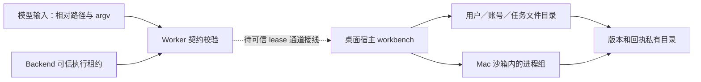
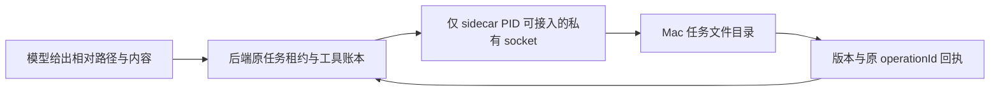

# T-1007 任务文件与受控命令验证记录

> 本文前半保留初期候选的原始证据；合并后的最新状态见文末“Mac 私有通道与 Windows 文件候选”。

## 本次候选实现

冻结契约由 `@creatoros/contract/agent-workbench` 导入。Worker 的 `task-files.ts` 与 `command-host.ts` 仅解析模型请求、验证可信宿主上下文与 operationId，并把调用交给本机受限端口；账号、用户、任务和执行租约不能由模型参数指定。NomiFun `e27bd5de` 的 `caps_files.rs` 只作能力形状参考，没有沿用 Desktop `Unrestricted` 路径权限。

Mac 原生文件模块按 `userId/accountId/taskId` 的哈希层级创建目录；逐级 `openat` + `O_NOFOLLOW`，拒绝绝对路径、盘符、`..`、冒号、符号链接和内部保留名。相对路径归一到 NFC，避免 Unicode 等价名称使用两份版本索引。版本与命令输出放在任务根目录的兄弟私有目录；文件写入使用同目录独占临时文件、`sync_all`、`renameat` 和跨进程 `flock`。分页读取每次最多 1 MB，版本哈希流式计算；命令 stdin 引用限 1 MB，超出明确失败。中断发生在数据换名后、版本记录提交前时，下次读取按内容哈希修复版本，调用方须按未知提交核对。

命令仅解析可信配置中的绝对 runtime 路径；argv 不经过 shell，环境用 `env_clear` 后只注入 HOME/TMPDIR/PATH。Mac 使用 `sandbox-exec` 的 `deny default` 配置，仅读系统可执行目录、受管 runtime 读取根和本任务目录，只写本任务目录。stdout/stderr 经宿主管道写入私有目录，提供预览与按范围读取。进程组取消先 TERM、后 KILL，并等待组长；非 Mac 平台没有已验证隔离器时拒绝执行。**cwd 校验只是输入校验，不构成 OS 隔离。**

## 已实际执行

- 先建测试后运行 `pnpm --dir ai-worker exec vitest run src/capabilities/task-files.test.ts src/capabilities/command-host.test.ts --retry=0`：两个测试套件因实现模块尚不存在而失败（红测）；实现后 **2 文件、13 用例通过**。
- `pnpm --dir ai-worker typecheck`：通过。
- `RUSTFLAGS='-A dead_code' cargo test --manifest-path frontend/src-tauri/src/workbench/Cargo.toml --offline --locked --quiet`：本机 macOS **6 用例通过**。实际覆盖 Unicode/空格、NFC 等价冲突、账号及用户隔离、符号链接越界、任务外文件读取被 OS 沙箱拒绝、任务内读取、取消后派生子进程消失。
- `cargo test --manifest-path frontend/src-tauri/Cargo.toml --test workbench --locked --no-default-features`：**未进入测试**；现有 `build.rs` 因隔离树缺少 `binaries/creatoros-server-aarch64-apple-darwin` 中止。上面的独立测试入口只编译并测试 workbench 模块。

## 主会话集成与未闭合边界

1. 本次 `desktop-integration` Packet 已允许修改 `frontend/src-tauri/src/lib.rs`，因此已将 `mod workbench` 纳入桌面壳编译。仍缺受限 sidecar IPC：每次调用须由 backend 校验当前 execution lease、attempt、fence 和账号归属，并注入可信 `userId/accountId/taskId`；WebView handshake token 已暴露给页面，不能代替此验证。当前候选模块**未在桌面应用中可调用**，没有注册 Tauri command。
2. 冻结 `workbenchResultSchema` 的失败分支没有 `currentVersion` 字段。Rust `FileError::Conflict` 已提供该值，Worker 提供 `versionConflictResult`，将当前版本稳定编码为 `version_conflict:<n>`。主会话接线时须把原生冲突映射到该辅助函数；若要新增独立 `currentVersion` 字段，应由主会话另行升级契约。
3. Windows 文件句柄逐级校验、受限进程 token/Job Object 与真机零遗留进程树测试尚未实现；Windows 当前 fail-closed。Mac 测试使用本机 Homebrew Python 验证派生进程，**不证明安装包内 Node/Python 已配置可用**。
4. 命令表目前在内存中。应用崩溃后还需依据持久回执和实际进程身份恢复；Mac 宿主被强杀时的孤儿清理与安装版端到端测试未验证。命令直接修改任务文件与文件 API 并发时，还需要宿主统一写入协调。

这些未闭合项不应计作 T-1007 完整验收，也不能把本机模块用例记为 Windows 或安装包 PASS。

## 2026-09-19 桌面集成候选实测与阻断

- 桌面 `lib.rs` 已编译 workbench 模块；`invoke_handler` 未增加 workbench 入口。当前没有可由 Rust 在调用时向 backend 验证 execution lease、attempt、fence、账号归属的私有 sidecar 通道。现有 `CREATOROS_SIDECAR_HANDSHAKE_TOKEN` 同时注入 WebView，只能用于既有页面请求，不能用作 workbench 授权来源。Worker 接口只校验收到的宿主上下文形状，不能证明它仍是当前租约。
- 相对路径校验补上 Win32 设备名（含扩展名、COM/LPT 的上标数字）、尾部点/空格、保留字符、控制字符和大小写变体私有目录。macOS 实际文件系统测试继续覆盖 Unicode/空格写入、NFC 冲突、账号隔离、符号链接越界及进程组取消；新增跨平台路径输入测试是**在 macOS 运行的校验测试**，不算 Windows 文件系统实测。
- `RUSTFLAGS='-A dead_code' cargo test --manifest-path frontend/src-tauri/src/workbench/Cargo.toml --offline --locked --quiet`：本次 **7/7 通过**。`CARGO_TARGET_DIR=/tmp/creatoros-t1007-win-target cargo check --manifest-path frontend/src-tauri/src/workbench/Cargo.toml --target x86_64-pc-windows-msvc --offline --locked --quiet`：**交叉编译通过**，只证明 Windows 条件代码可编译。
- `cargo check --manifest-path frontend/src-tauri/Cargo.toml --locked --offline --no-default-features`：**受阻**，`build.rs:404` 报 `resource path binaries/creatoros-server-aarch64-apple-darwin doesn't exist`。仅为核对源码编译，使用 `TAURI_CONFIG='{"bundle":{"externalBin":[],"resources":[]}}'` 覆盖资源配置重跑同一 `cargo check`：**通过**。此覆盖不代表正常打包或安装版可用。
- Windows 原生文件句柄逐级校验尚无实现，`TaskFiles::new` 在 Windows 返回 `UnsupportedPlatform`；Windows 受限 token/文件授权与 Job Object 命令隔离尚无实现，命令模块未编入 Windows。当前机器是 macOS，只有 Windows Rust target；无 Windows 主机或可用 Docker daemon，因此**没有 Windows 路径、符号链接/重解析点、进程树的真实测试**。保持 Windows 拒绝执行，不能据交叉编译宣称隔离通过。

主控制面后续需提供可信私有 lease 验证通道及 Windows 真机，才能接入可调用 IPC、实现并验证 Windows 文件/进程边界；当前候选不满足 T-1007 完整验收。

## Mac 私有通道与 Windows 文件候选（主工作树复核）

Mac 桌面壳启动 sidecar 时创建权限为 0700 的临时目录和 0600 Unix socket；Rust 服务端用内核 `LOCAL_PEERPID` 核对实际启动的 sidecar PID，没有注册 WebView 可调用的 workbench 命令。Node 后端在原 execution lease 的 admission 事务内传入用户、账号、任务、attempt、fence 和原 operationId；文件读写结束前保持租约行锁。生产聊天仅在 macOS 桌面且该私有 socket 存在时冻结 `files.list/read/stat/write/edit` 目录。读与写分别声明副作用；已确认版本冲突返回当前版本，回执不明的写入保持 unknown 并要求按原 operationId 对账。Windows 没有此私有通道，故不会向模型展示文件能力。

Windows 候选已补 `TaskFiles` 的逐级目录 HANDLE 打开、重解析点和硬链接拒绝、同目录临时文件换名及版本冲突；设备名与 Unicode 路径校验共用合同。它通过 Windows MSVC 目标的独立包交叉检查，**尚无 Windows 真机文件系统测试**，也没有 Windows 私有 IPC 或受限命令隔离，不能作为桌面功能交付。

主工作树在合并 Mac/Windows 候选后实测：独立 Rust workbench **12/12**、Windows `x86_64-pc-windows-msvc` 独立包 `cargo check --offline --locked` 通过；Node 私有客户端与生产文件宿主测试 **8/8**，frontend 类型检查通过。Mac 测试包含真实子进程准入、其他进程拒绝、越界与版本冲突。原 Tauri 全包、安装版 Node/Python runtime、Windows 真实重解析点与进程树、命令 IPC、任务文件与产物登记的完整链路仍待验证。T-1007 保持进行中。
