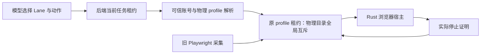

# T-1008 浏览器迁移与采集交接验证（进行中）

## 当前接线边界

新 `workbench-browser-admission.service.ts` 仅接受 Lane、模式与域名；账号和物理目录摘要必须由可信 `resolveProfile` 按当前任务账号得出。解析后，原 `execution-browser-profile-lease.service.ts` 再次核验 attempt/fence 与任务停止状态，才领取物理 profile。旧 Playwright 宿主持有同一目录时，新任务得到 `BROWSER_PROFILE_BUSY`，不按 TTL 抢占。只有可信宿主确认实际 profile 进程已停，且仍持有原 lease ID，才释放占用；此服务本身不启动浏览器，也不声称完成新旧所有权交接。

红测：新增服务测试首次运行因模块不存在失败。实现后 `pnpm --dir backend exec vitest run src/modules/execution/workbench-browser-admission.service.test.ts --retry=0` 为 3/3。测试覆盖模型自报账号/目录被拒、当前账号绑定、同任务多 Lane 复用原档案租约、旧采集占用阻止接管、缺停止证明不得释放、旧租约不能覆盖下一持有者，以及取消/旧 fence 不得领取。

随后补了原 `createHostBrowserProfileLifecycle` 与新准入的同库交接测试：旧采集领取后新任务得到 `BROWSER_PROFILE_BUSY`；旧采集停止并释放后新任务可领；新任务持有期间旧采集仍不得启动；新任务获实际停止证明释放后旧采集可重新领取。当前该文件为 4/4。这验证两套适配器共用物理租约，但测试以宿主停止回调模拟实际关闭，不替代真实 Chromium 停止实测。

已从 NomiFun 冻结提交 `e27bd5de9a58ce444032ef4e63bb753992555c4c` 导入 12 个 crate 与许可证、NOTICE、逐文件 SHA-256 来源清单，见 `frontend/src-tauri/vendor/nomifun/SOURCE.md`。主工作树运行 `CARGO_TARGET_DIR=/tmp/t1008-vendor-main-target cargo check --manifest-path frontend/src-tauri/vendor/nomifun/Cargo.toml -p nomifun-browser-platform -p nomi-browser-engine -p nomi-browser --target aarch64-apple-darwin --locked --offline --quiet` 退出 0。该结果仅证明冻结依赖包在 Mac arm64 可独立编译。

构建脚本已增加 NomiFun 固定 Chrome for Testing `149.0.7827.155` 的 Mac arm64、Mac x64、Windows x64 归档映射，三份官方 zip 经下载计算并固定 SHA-256。构建时逐字节核对后解压到 `sidecar/layers/browser/workbench-cft/149.0.7827.155/`；可用 `CREATOROS_REQUIRE_WORKBENCH_BROWSER=1` 令工作台正式构建缺包即失败。普通旧功能构建下载失败时只禁用新增浏览器能力，不阻断旧功能。`node --check frontend/scripts/desktop/build-sidecar.mjs` 退出 0；三份归档均通过该脚本的真实解包/路径验证；Mac arm64 解包可执行的 `--version` 返回 `149.0.7827.155`；原 `build-sidecar.test.mjs` 用 Vitest 运行 19/19。Windows 尚未在 Windows 上执行，完整 sidecar 构建和安装包亦未运行。

Mac arm64 官方 CfT 解包后的 `.app` 执行 `codesign --verify --deep --strict` 返回“code has no resources but signature indicates they must be present”；同机现有 Playwright CfT 缓存也返回相同结果。浏览器二进制本身 `--version` 可运行，但这不是安装包签名/公证或网页操作通过的证据；正式发布前仍须在最终包内核实签名链和浏览器启动。

Rust Hub/Lane、独立浏览器 IPC、浏览器二进制随包及 Mac/Windows 安装实测仍未完成。旧采集单元回归：`douyin-cdp`、`douyin-traffic`、`collection-abort` 共 144/144；后端 profile lease、旧宿主生命周期、dispatcher 与新准入在补交接测试前共 29/29。作品/评论/封面/流量的真实采集与错峰验收仍待执行。不能把适配器测试或依赖包独立编译等同于 T-1008 验收。

## 2026-09-20 前端私有宿主接线

桌面 Mac 仅在 Tauri 提供独立浏览器私有 socket 时注册 `browser.open/status/navigate/observe/extract/screenshot/act/close`；Windows 和普通网页不展示虚假的可执行能力。模型只能选择 Lane、主身份或匿名模式及站点域，不能提交账号或物理 profile 路径。宿主先核对原任务当前 attempt/fence/账号，再向 Rust 查询将实际使用的目录摘要，并经旧采集共用的数据库租约领取；每次动作前再次核对执行租约。Node 已校验导航目标在声明域内；Rust 对导航及跳转的复核仍待隔离候选合入与实测。重要页面操作作为外部写入效果走原工具门控。主身份当前是独立受管档案，`legacyIdentityImported=false`、登录状态为 `unverified`，没有冒称旧采集登录态已经迁移。

`browser.close` 或原生 `open` 失败后，仅在 Rust 返回相同 profileKey 和 leaseId 的实际停止证明时释放数据库占用。私有 socket 报文限制大小并绑定 operationId；已发出但连接断开记未知结果，原占用保持，待对账。当前内存 Lane 索引仍缺进程重启后的持久恢复；Rust 候选接线、真实浏览器页面动作、取消清理、旧采集真机交接与双平台安装版验证尚未完成。故本节只证明 Node 宿主契约，T-1008 继续进行中。

当场验证：`frontend` 浏览器 socket/宿主测试 8/8、原生文件宿主与现有持久化组合 17/17、前端 `tsc --noEmit` 通过；后端工作台能力宿主与计划集成 7/7。测试中的 socket 是本地协议夹具，不是浏览器 E2E。

## 2026-09-20 Rust 候选合入与真实 Chromium 冒烟

Mac 桌面壳已接入冻结的 NomiFun `ManagedEngineHostFactory` 和 `BrowserSessionHub`，浏览器 socket 以当前 sidecar PID 和内核对端身份限制接入。只有随包路径存在当前 Mac 架构可执行的固定 CfT 149 时才注入 socket；缺失时旧功能继续启动。Primary 独立档案以可见窗口启动，供用户手动登录，但当前登录态仍是 `unverified`；Anonymous 使用另一个目录并保持无头。原始 Playwright 采集档案没有迁移。Rust 检查声明域、实际目录摘要、Lane/epoch 和停止状态；停止证明需要 Hub 没有 Lane/Host/待清理项，并核对系统进程命令行中不再有该目录。领到数据库租约但尚未建立 Rust 状态时，仅空目录及系统进程检查也可给出精确 lease 的“从未启动”证明。

主树执行 `TAURI_CONFIG='{"bundle":{"resources":[],"externalBin":[]}}' CARGO_TARGET_DIR=/tmp/t1008-rust-check cargo check --manifest-path frontend/src-tauri/Cargo.toml --locked --offline --quiet` 通过。临时 `TAURI_CONFIG` 仅跳过当前开发树缺少的打包资源，不能当成正式安装包编译。`cargo test ... workbench::browser --lib` 的 19 项 Rust 浏览器/IPC 测试通过；Node 浏览器 socket/宿主 8/8 通过。

另以环境变量 `CREATOROS_TEST_CFT_ROOT=/tmp/t1008-chrome-stage` 显式运行仓库内忽略的 `real_chromium_anonymous_lane_opens_and_closes`：本机已核验的固定 CfT 149 真正启动匿名 Chromium，导航 `https://example.com`，observe 成功，extract 的实际页面文本含 “Example Domain”，screenshot 返回非空 `image/png` 数据；close 后 `stopProof.profileStopped=true`。测试 1/1 通过，整个测试约 3.4 秒，关闭与 `shutdown` 后清除临时档案。此项没有经过应用安装包、Node socket、模型或旧采集调用，不能替代对应 E2E。

剩余风险：当前 Pi 回执尚无可信图片引用解析端口，模型没有看到上述 PNG；截图模型可见性与下载交付需接 T-1009 产物通道。旧采集真实登录档案交接、同账号跨任务/跨账号双浏览器实测、任务取消和 sidecar 重启后旧租约对账、重定向请求发出前的站点隔离，以及 Mac/Windows 安装包都未验收。T-1008 继续进行中。

## 2026-09-20 停止证明与旧租约恢复复测

Node 宿主已增加数据库旧租约对账：新 `browser.open` 遇到物理 profile 被占用时，只读取对应的旧 Worker 租约；当前仍运行的旧任务不能被回收。它以旧 attempt/fence/leaseId 让 Rust 清理对应档案，并要求 `profileStopped=true`、同一 `profileKey` 和 `profileLeaseId`，随后再次核对数据库旧记录未变，才释放旧占用并重试领取。协议夹具覆盖仍运行的旧任务、证明为假时保留占用、证明为真后新任务接管。后端 profile/admission 22/22、前端 browser client/host 9/9、前端 `tsc --noEmit` 通过。这些夹具不能证明已安装应用的跨进程恢复。

Rust 在宿主重启后可对无内存 Hub 状态的旧租约提供停止证明，但还会检查系统进程的 `--user-data-dir` 和真实档案目录下打开的文件；检查失败或发现存活进程时拒绝释放。匿名 Chromium 正常关闭会删掉临时档案目录：确认系统中没有该目录的浏览器进程后，目录不存在可作为停止条件；实际目录存在时仍须 `lsof` 无打开文件。此前真实冒烟因对已删除目录执行 `lsof +D` 而误报未停止，修正后 `workbench::browser` Rust 单元 19/19（另 1 项忽略）与固定 CfT 149 的真实匿名页面冒烟 1/1 再次通过；关闭回复立即返回 `stopProof.profileStopped=true`。重启恢复的 Rust 测试以 `ps`/`lsof` 核对非空真实目录及错误持有者，未用假停止证明替代系统检查。

本节当时仍缺 Node↔Rust↔数据库的真实重启对账（后文已补旧宿主退出后的非空档案分支）、旧 Playwright 采集进程的真实交接、双账号主身份隔离、最终安装包的浏览器启动。不能将 T-1008 标为完成。

补充固定 CfT 的双任务真机测试 `real_chromium_two_tasks_keep_independent_lanes`：同账号的两个不同任务同时打开匿名 Lane，实际生成不同物理 profile key；两者分别可查状态，任务一用自身身份关闭任务二 Lane 被拒；关闭任务一后任务二仍可查状态，随后各自关闭均获得实际停止证明。本机 1/1 通过，使用与前述源码检查相同的临时 Tauri 资源覆盖。该测试覆盖 Rust Hub 内的并发和隔离；双账号主身份和安装包仍未验收。

补充跨 Node/数据库/Rust/Chromium 的显式本机集成用例（`workbench-browser-host.test.ts` 中由固定 CfT 环境变量启用）：测试 Node 进程领取真实数据库任务租约，Rust 测试夹具只授权该 Node PID 的私有 socket；Node 宿主解析物理匿名档案并领数据库 profile 租约，实际打开固定 CfT，导航 `https://example.com`、提取 “Example Domain”、关闭 Lane，最后数据库同 attempt/fence 的 profile 占用为空。前端该用例 1/1、`tsc --noEmit` 通过。第一次新夹具编译时 Vitest 报 180 秒超时；Rust 编译缓存建立后同一用例重跑 1/1（约 15 秒）。该用例仍是测试夹具，未经过安装版、旧 Playwright 采集，也没有注入进程重启。

## 2026-09-20 文档请求预发拦截

冻结 NomiFun 的 `allow_etld1` 有意豁免 `Document` 请求，所以宿主原先的最终 URL 检查无法阻止重定向请求先发出。现为该来源包登记 CreatorOS 本地补丁（原始与当前哈希见 `frontend/src-tauri/vendor/nomifun/SOURCE.md`）：新增默认关闭的文档域限制，只由 CreatorOS 当前 Lane 配置注入。CDP 的 `Fetch.requestPaused` 在 `continueRequest` 前对域外、伪子域、主身份 HTTPS 降级及非默认端口返回 `Fetch.failRequest`；合法子域继续，NomiFun 默认行为保留。先运行新测试得到预期的缺字段编译失败（E0560）；实现后 CDP 定向测试 1/1、原防火墙单元 60/60、真实固定 CfT 匿名页面冒烟 1/1、Node/数据库/Rust/Chromium 宿主测试 5/5。当前 CDP `Document` 标记包括内嵌文档；普通子资源与跨域出口仍按上游策略处理，不能把此补丁称为所有网络请求的完整域隔离。安装版、旧采集与真实第三方跳转页面尚未验收。

## 2026-09-20 非空主身份档案的跨宿主恢复

新增显式本机集成用例：旧任务经第一个 PID 绑定 Rust 宿主解析主身份物理档案，领取真实数据库 profile 租约并写入测试文件；旧任务转暂停后，第一宿主退出。第二个全新 Rust 宿主使用同一目录，新的同账号任务在 `browser.open` 遇到旧占用时，凭旧 attempt/fence/leaseId 请求 cleanup，Rust 对非空档案用系统进程和打开文件检查取得停止证明；数据库释放精确旧租约，新任务再领新租约，实际启动可见的固定 CfT 主身份窗口。测试文件跨宿主和浏览器启动保持原内容，关闭后新租约也释放。此路径**没有**模拟旧浏览器曾经启动，也没有旧 Playwright 进程或登录态迁移；它证明的是“旧租约留在数据库、旧宿主已退出且非空档案仍在”的安全恢复分支。

该实测首次发现：原生 close 回复已有 `profileStopped=true` 时，Node 随后的一次全新停止证明可能短暂未通过，导致 close 返回成功而数据库新租约仍占用。为此增加最后一条 Lane 关闭后的有界重新核验：最多四次只接受 Rust 新停止证明，成功才释放精确数据库 lease；始终无法证明时返回 `unknown` 并保留占用，供后续对账。先添加协议测试，修复前因只查一次而失败；修复后短暂未就绪和始终未就绪两条路径均通过。固定 CfT 环境下 `workbench-browser-host.test.ts` **8/8**（含匿名页面与上述真实重启主身份窗口）、前端 `tsc --noEmit` 通过。跨宿主恢复仍未覆盖旧 Chromium 进程在崩溃后存活、旧 Playwright 采集、双账号主身份同时登录及安装包。

任务要求的现有采集单元回归当场重跑：`douyin-cdp.test.ts` 与 `douyin-traffic.test.ts` **132/132**；后端 profile lease、旧宿主生命周期和新准入 **29/29**。它们不证明作品、评论、封面、流量的真账号现场采集。`boundary-scan` 仍为 7 条（基线 5）：新增的 2 条均在本任务写集外的 `frontend/src/features/copilot/live-chat-session.ts`，已由 T-1016 登记；本轮未改该文件，也未称全局门卫通过。T-1008 继续进行中。

另补 Mac 浏览器私有 socket 的非阻塞继承修复：监听仍为非阻塞，接受的单个连接切回阻塞并保留读写超时，避免客户端稍晚写完请求时 `EAGAIN` 导致未知回执。确定性延迟写入 IPC 测试通过；浏览器 IPC 测试 **6/6**（另 1 项显式外部夹具忽略），固定 CfT 下跨 Node/数据库/Rust/Chromium 宿主回归 **8/8**。此改动与 T-1007 的同根因修复共用桌面主包，未放宽 PID 身份检查。

## 2026-09-20 双账号主身份档案隔离实测

新增仅在显式配置固定 CfT 149 时运行的本机集成用例：同一个 CreatorOS 用户下创建两个不同账号任务，分别从 PID 绑定 Rust 宿主取得真实主身份档案位置，并发执行两个 `browser.open`。实测物理目录摘要、数据库 profile 租约及 Lane ID 均不同；账号 A 不能读取账号 B 的 Lane。向 A 的档案写入测试标记后，B 的档案中不存在该文件。关闭 A 的 Lane 后，A 的数据库占用释放，B 的占用和 Chromium Lane 仍在；B 继续导航并提取 `https://example.com` 的真实 “Example Domain” 文本，A 的标记未被 B 的操作删除；关闭 B 后其占用释放。

固定 CfT 下 `workbench-browser-host.test.ts` **9/9**、前端 `tsc --noEmit` 通过。该用例证明当前 Mac 测试夹具中的双账号主身份目录和 Lane 隔离，**没有**验证两个真实网站账号同时登录、旧 Playwright 身份迁移、Windows 或安装包。模型截图可见性仍依赖 T-1009 的可信媒体引用解析；当前 Pi 只看到回执文本，不能据此声称看过画面。T-1008 保持进行中。

进一步核对 Pi 结果投影后发现，当前 `browser.screenshot` 的 PNG 只作为原生 JSON 中的 base64 文本返回；即使原生截图成功，Pi 会把该文本截断，模型没有收到图片内容。先增加目录回归并跑到红测（原目录误展示截图能力），随后将截图从**生产模型可见目录**暂时移除；Rust 截图动作与受信任宿主直接调用仍保留作测试。目录红转绿 1/1，前端类型检查通过。T-1009 接通按账号、任务和租约解析的媒体引用并验证模型真正收到图片后，再将截图放回目录。此前文段中“注册 screenshot”描述的是当时状态，现以本段为准。

双账号用例最初为隔离档案创建竞争而顺序解析位置；将两个账号的首次 `profile_location` 改为**并发**后，真实 Rust socket 连续复现其中一方返回 `BROWSER_UNAVAILABLE`。根因是两个调用都看到共享父目录不存在，先创建者成功，后创建者收到 `AlreadyExists` 却被误映射为不可用。Rust 现在仅在 `AlreadyExists` 时继续，并重新检查胜出者创建的是目录、不是符号链接或文件。并发用例红转绿且连续两次单独通过；固定 CfT 下完整 Node/数据库/Rust/Chromium 宿主回归 **9/9**，Rust 浏览器目标测试 **20/20**（另 3 项显式环境夹具忽略），前端 `tsc --noEmit` 与 `rustfmt --check` 通过。这证明本机两个账号同时初始化受管档案可用，仍不代表真实双账号登录或安装版。

## 2026-09-20 任务停止后的 Lane 回收

原宿主只在新任务争用同一档案时回收旧租约；旧任务取消后若无人接手，Lane 与数据库占用可能持续存在。现在持有浏览器租约的 Node 宿主每 5 秒对账一次。当前 attempt 运行中、等待用户登录或结果未知时保留 Lane；取消、暂停、结束或 attempt 已变更时，才用原 attempt/fence/leaseId 调用 Rust `cleanup`。Rust 确认该档案没有 Lane、浏览器进程和打开文件后，数据库只释放同一租约；证明为假或 socket 不可用时保留占用，下一轮重试。清理成功同时删除宿主内存 Lane 索引；关闭数据库前停止定时对账并等待已在途的对账结束。

先新增取消测试，旧实现因缺少停止任务对账入口而失败；实现后协议测试确认运行中与等待登录不清理、取消后停止证明为假不释放、随后证明为真才释放，且无需新任务来抢占。关机测试还让原生清理回复保持在途，确认 `dispose` 等其完成后才继续关闭数据库。固定 CfT 本机集成测试把双账号主档案用例中的账号 A 改为真正取消：Node/数据库/Rust/Chromium 清理 A 并释放 A 租约后，账号 B 的租约及真实网页导航、提取仍可用。该宿主测试 **11/11**，前端浏览器与旧采集相关测试 **144/144**（3 项需显式 CfT 环境而跳过），后端 profile/旧宿主/新准入 **29/29**，前端类型检查与 Rust 源码检查通过。`boundary-scan` 仍有 7 条、比基线多 2 条，均在本任务写集外的 `live-chat-session.ts`，由 T-1016 跟进。此验证仍未覆盖已安装应用的真账号采集、旧 Playwright 身份迁移及 Windows。

## 2026-09-20 导航默认端口预检一致性

新任务浏览器声明域只允许无显式端口的页面请求；主身份还只允许 HTTPS。Node 入口以前会放行同域 HTTP 及显式默认端口，再由 Rust 拒绝；更深一层的 Rust `url::Url` 与冻结 NomiFun 防火墙会把 `:443` 规范化成无端口，使显式默认端口绕过本来写明的禁用规则。现在 Node、Rust 原生导航预检和 CDP `Fetch.requestPaused` 放行前均检查原始 authority：主身份 HTTP 和任意显式端口在发送前拒绝；匿名模式的同域普通 HTTP 仍可用。这样既阻止直接导航，也覆盖页面重定向。未改变普通子资源的上游出口策略。

当场红测：Node 主身份 `http://example.com` 被假宿主当作成功；Rust `https://example.com:443` 在范围测试中被放行；CDP 该 URL 实际走 `Fetch.continueRequest`。修复后对应测试均通过。`nomi-browser-engine` 的防火墙单元 **60/60**、全部集成测试目标 `--tests --no-run` 编译通过；编译时另发现先前新增防火墙配置字段后，旧 OOPIF 测试夹具缺默认字段，已在冻结包本地补丁中修复。来源哈希清单 309 个文件逐项核对无误，更新见 `frontend/src-tauri/vendor/nomifun/SOURCE.md`。Rust 浏览器组 **20/20**（3 项显式环境测试忽略）；前端浏览器与旧采集组 **145/145**（3 项显式环境测试忽略）；后端 profile 与旧宿主组 **25/25**；固定 CfT 的 Node/数据库/Rust/Chromium 宿主组 **11/11**；前端类型检查通过。全局 `boundary-scan` 仍报告 T-1016 登记的两条范围外 R2 违规。T-1008 仍须完成真账号交接、安装包和 Windows 验收。

## 2026-09-20 浏览器回执只返回 Lane 必需状态

检查模型可见的 `browser.open`、`browser.status` 与 `browser.close` 后发现，原先前两者会传出原生 Lane 快照中的调用者身份、内部租约和物理档案路径，关闭动作还会传出含档案路径的停止证明。现由 Rust 的打开与状态回执先投影为 Lane ID、浏览器 epoch、生命周期和可选排队位置；Node 宿主再次按白名单投影，关闭只返回 Lane ID、关闭成功及档案停止布尔值。原生停止证明仍在可信宿主和数据库租约释放流程内部使用。

先让假原生回执带入调用者、租约、档案路径，测试在旧实现下因模型结果包含这些字段而失败；修复后精确比对三项模型结果，协议测试 **8/8**（3 项需显式固定 CfT 而跳过）。固定 CfT 的 Rust 真匿名 Chromium 打开、状态、关闭测试 **1/1**，核实打开与状态回执不含调用者和档案路径；Rust 浏览器组 **20/20**（3 项显式环境测试忽略）、跨 Node/数据库/Rust/Chromium 宿主测试 **11/11**、前端 `tsc --noEmit` 与本文件 `rustfmt --check` 通过。此项验证不代表 T-1008 的真账号、旧采集、安装版及 Windows 验收已完成。
