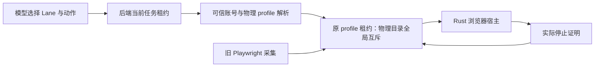

# T-1008 浏览器迁移与采集交接验证（进行中）

## 当前接线边界

新 `workbench-browser-admission.service.ts` 仅接受 Lane、模式与域名；账号和物理目录摘要必须由可信 `resolveProfile` 按当前任务账号得出。解析后，原 `execution-browser-profile-lease.service.ts` 再次核验 attempt/fence 与任务停止状态，才领取物理 profile。旧 Playwright 宿主持有同一目录时，新任务得到 `BROWSER_PROFILE_BUSY`，不按 TTL 抢占。只有可信宿主确认实际 profile 进程已停，且仍持有原 lease ID，才释放占用；此服务本身不启动浏览器，也不声称完成新旧所有权交接。

红测：新增服务测试首次运行因模块不存在失败。实现后 `pnpm --dir backend exec vitest run src/modules/execution/workbench-browser-admission.service.test.ts --retry=0` 为 3/3。测试覆盖模型自报账号/目录被拒、当前账号绑定、同任务多 Lane 复用原档案租约、旧采集占用阻止接管、缺停止证明不得释放、旧租约不能覆盖下一持有者，以及取消/旧 fence 不得领取。

随后补了原 `createHostBrowserProfileLifecycle` 与新准入的同库交接测试：旧采集领取后新任务得到 `BROWSER_PROFILE_BUSY`；旧采集停止并释放后新任务可领；新任务持有期间旧采集仍不得启动；新任务获实际停止证明释放后旧采集可重新领取。当前该文件为 4/4。这验证两套适配器共用物理租约，但测试以宿主停止回调模拟实际关闭，不替代真实 Chromium 停止实测。

已从 NomiFun 冻结提交 `e27bd5de9a58ce444032ef4e63bb753992555c4c` 导入 12 个 crate 与许可证、NOTICE、逐文件 SHA-256 来源清单，见 `frontend/src-tauri/vendor/nomifun/SOURCE.md`。主工作树运行 `CARGO_TARGET_DIR=/tmp/t1008-vendor-main-target cargo check --manifest-path frontend/src-tauri/vendor/nomifun/Cargo.toml -p nomifun-browser-platform -p nomi-browser-engine -p nomi-browser --target aarch64-apple-darwin --locked --offline --quiet` 退出 0。该结果仅证明冻结依赖包在 Mac arm64 可独立编译。

构建脚本已增加 NomiFun 固定 Chrome for Testing `149.0.7827.155` 的 Mac arm64、Mac x64、Windows x64 归档映射，三份官方 zip 经下载计算并固定 SHA-256。构建时逐字节核对后解压到 `sidecar/layers/browser/workbench-cft/149.0.7827.155/`；可用 `CREATOROS_REQUIRE_WORKBENCH_BROWSER=1` 令工作台正式构建缺包即失败。普通旧功能构建下载失败时只禁用新增浏览器能力，不阻断旧功能。`node --check frontend/scripts/desktop/build-sidecar.mjs` 退出 0；三份归档均通过该脚本的真实解包/路径验证；Mac arm64 解包可执行的 `--version` 返回 `149.0.7827.155`；原 `build-sidecar.test.mjs` 用 Vitest 运行 19/19。Windows 尚未在 Windows 上执行，完整 sidecar 构建和安装包亦未运行。

Mac arm64 官方 CfT 解包后的 `.app` 执行 `codesign --verify --deep --strict` 返回“code has no resources but signature indicates they must be present”；同机现有 Playwright CfT 缓存也返回相同结果。浏览器二进制本身 `--version` 可运行，但这不是安装包签名/公证或网页操作通过的证据；正式发布前仍须在最终包内核实签名链和浏览器启动。

Rust Hub/Lane、独立浏览器 IPC、浏览器二进制随包及 Mac/Windows 安装实测仍未完成。旧采集单元回归：`douyin-cdp`、`douyin-traffic`、`collection-abort` 共 144/144；后端 profile lease、旧宿主生命周期、dispatcher 与新准入在补交接测试前共 29/29。作品/评论/封面/流量的真实采集与错峰验收仍待执行。不能把适配器测试或依赖包独立编译等同于 T-1008 验收。

## 2026-09-20 前端私有宿主接线

桌面 Mac 仅在 Tauri 提供独立浏览器私有 socket 时注册 `browser.open/status/navigate/observe/extract/screenshot/act/close`；Windows 和普通网页不展示虚假的可执行能力。模型只能选择 Lane、主身份或匿名模式及站点域，不能提交账号或物理 profile 路径。宿主先核对原任务当前 attempt/fence/账号，再向 Rust 查询将实际使用的目录摘要，并经旧采集共用的数据库租约领取；每次动作前再次核对执行租约。Node 已校验导航目标在声明域内；Rust 对导航及跳转的复核仍待隔离候选合入与实测。重要页面操作作为外部写入效果走原工具门控。主身份当前是独立受管档案，`legacyIdentityImported=false`、登录状态为 `unverified`，没有冒称旧采集登录态已经迁移。

`browser.close` 或原生 `open` 失败后，仅在 Rust 返回相同 profileKey 和 leaseId 的实际停止证明时释放数据库占用。私有 socket 报文限制大小并绑定 operationId；已发出但连接断开记未知结果，原占用保持，待对账。当前内存 Lane 索引仍缺进程重启后的持久恢复；Rust 候选接线、真实浏览器页面动作、取消清理、旧采集真机交接与双平台安装版验证尚未完成。故本节只证明 Node 宿主契约，T-1008 继续进行中。

当场验证：`frontend` 浏览器 socket/宿主测试 8/8、原生文件宿主与现有持久化组合 17/17、前端 `tsc --noEmit` 通过；后端工作台能力宿主与计划集成 7/7。测试中的 socket 是本地协议夹具，不是浏览器 E2E。

## 2026-09-20 Rust 候选合入与真实 Chromium 冒烟

Mac 桌面壳已接入冻结的 NomiFun `ManagedEngineHostFactory` 和 `BrowserSessionHub`，浏览器 socket 以当前 sidecar PID 和内核对端身份限制接入。只有随包路径存在当前 Mac 架构可执行的固定 CfT 149 时才注入 socket；缺失时旧功能继续启动。Primary 独立档案以可见窗口启动，供用户手动登录，但当前登录态仍是 `unverified`；Anonymous 使用另一个目录并保持无头。原始 Playwright 采集档案没有迁移。Rust 检查声明域、实际目录摘要、Lane/epoch 和停止状态；停止证明需要 Hub 没有 Lane/Host/待清理项，并核对系统进程命令行中不再有该目录。领到数据库租约但尚未建立 Rust 状态时，仅空目录及系统进程检查也可给出精确 lease 的“从未启动”证明。

主树执行 `TAURI_CONFIG='{"bundle":{"resources":[],"externalBin":[]}}' CARGO_TARGET_DIR=/tmp/t1008-rust-check cargo check --manifest-path frontend/src-tauri/Cargo.toml --locked --offline --quiet` 通过。临时 `TAURI_CONFIG` 仅跳过当前开发树缺少的打包资源，不能当成正式安装包编译。`cargo test ... workbench::browser --lib` 的 19 项 Rust 浏览器/IPC 测试通过；Node 浏览器 socket/宿主 8/8 通过。

另以环境变量 `CREATOROS_TEST_CFT_ROOT=/tmp/t1008-chrome-stage` 显式运行仓库内忽略的 `real_chromium_anonymous_lane_opens_and_closes`：本机已核验的固定 CfT 149 真正启动匿名 Chromium，导航 `https://example.com`，observe 成功，extract 的实际页面文本含 “Example Domain”，screenshot 返回非空 `image/png` 数据；close 后 `stopProof.profileStopped=true`。测试 1/1 通过，整个测试约 3.4 秒，关闭与 `shutdown` 后清除临时档案。此项没有经过应用安装包、Node socket、模型或旧采集调用，不能替代对应 E2E。

剩余风险：当前 Pi 回执尚无可信图片引用解析端口，模型没有看到上述 PNG；截图模型可见性与下载交付需接 T-1009 产物通道。旧采集真实登录档案交接、同账号跨任务/跨账号双浏览器实测、任务取消和 sidecar 重启后旧租约对账、重定向请求发出前的站点隔离，以及 Mac/Windows 安装包都未验收。T-1008 继续进行中。

## 2026-09-20 停止证明与旧租约恢复复测

Node 宿主已增加数据库旧租约对账：新 `browser.open` 遇到物理 profile 被占用时，只读取对应的旧 Worker 租约；当前仍运行的旧任务不能被回收。它以旧 attempt/fence/leaseId 让 Rust 清理对应档案，并要求 `profileStopped=true`、同一 `profileKey` 和 `profileLeaseId`，随后再次核对数据库旧记录未变，才释放旧占用并重试领取。协议夹具覆盖仍运行的旧任务、证明为假时保留占用、证明为真后新任务接管。后端 profile/admission 22/22、前端 browser client/host 9/9、前端 `tsc --noEmit` 通过。这些夹具不能证明已安装应用的跨进程恢复。

Rust 在宿主重启后可对无内存 Hub 状态的旧租约提供停止证明，但还会检查系统进程的 `--user-data-dir` 和真实档案目录下打开的文件；检查失败或发现存活进程时拒绝释放。匿名 Chromium 正常关闭会删掉临时档案目录：确认系统中没有该目录的浏览器进程后，目录不存在可作为停止条件；实际目录存在时仍须 `lsof` 无打开文件。此前真实冒烟因对已删除目录执行 `lsof +D` 而误报未停止，修正后 `workbench::browser` Rust 单元 19/19（另 1 项忽略）与固定 CfT 149 的真实匿名页面冒烟 1/1 再次通过；关闭回复立即返回 `stopProof.profileStopped=true`。重启恢复的 Rust 测试以 `ps`/`lsof` 核对非空真实目录及错误持有者，未用假停止证明替代系统检查。

仍缺 Node↔Rust↔数据库的真实重启对账、旧 Playwright 采集进程的真实交接、双账号主身份隔离、最终安装包的浏览器启动。此时不能将 T-1008 标为完成。

补充固定 CfT 的双任务真机测试 `real_chromium_two_tasks_keep_independent_lanes`：同账号的两个不同任务同时打开匿名 Lane，实际生成不同物理 profile key；两者分别可查状态，任务一用自身身份关闭任务二 Lane 被拒；关闭任务一后任务二仍可查状态，随后各自关闭均获得实际停止证明。本机 1/1 通过，使用与前述源码检查相同的临时 Tauri 资源覆盖。该测试覆盖 Rust Hub 内的并发和隔离；双账号主身份、Node/数据库接线和安装包仍未验收。
