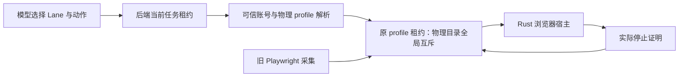

# T-1008 浏览器迁移与采集交接验证（进行中）

## 当前接线边界

新 `workbench-browser-admission.service.ts` 仅接受 Lane、模式与域名；账号和物理目录摘要必须由可信 `resolveProfile` 按当前任务账号得出。解析后，原 `execution-browser-profile-lease.service.ts` 再次核验 attempt/fence 与任务停止状态，才领取物理 profile。旧 Playwright 宿主持有同一目录时，新任务得到 `BROWSER_PROFILE_BUSY`，不按 TTL 抢占。只有可信宿主确认实际 profile 进程已停，且仍持有原 lease ID，才释放占用；此服务本身不启动浏览器，也不声称完成新旧所有权交接。

红测：新增服务测试首次运行因模块不存在失败。实现后 `pnpm --dir backend exec vitest run src/modules/execution/workbench-browser-admission.service.test.ts --retry=0` 为 3/3。测试覆盖模型自报账号/目录被拒、当前账号绑定、同任务多 Lane 复用原档案租约、旧采集占用阻止接管、缺停止证明不得释放、旧租约不能覆盖下一持有者，以及取消/旧 fence 不得领取。

随后补了原 `createHostBrowserProfileLifecycle` 与新准入的同库交接测试：旧采集领取后新任务得到 `BROWSER_PROFILE_BUSY`；旧采集停止并释放后新任务可领；新任务持有期间旧采集仍不得启动；新任务获实际停止证明释放后旧采集可重新领取。当前该文件为 4/4。这验证两套适配器共用物理租约，但测试以宿主停止回调模拟实际关闭，不替代真实 Chromium 停止实测。

已从 NomiFun 冻结提交 `e27bd5de9a58ce444032ef4e63bb753992555c4c` 导入 12 个 crate 与许可证、NOTICE、逐文件 SHA-256 来源清单，见 `frontend/src-tauri/vendor/nomifun/SOURCE.md`。主工作树运行 `CARGO_TARGET_DIR=/tmp/t1008-vendor-main-target cargo check --manifest-path frontend/src-tauri/vendor/nomifun/Cargo.toml -p nomifun-browser-platform -p nomi-browser-engine -p nomi-browser --target aarch64-apple-darwin --locked --offline --quiet` 退出 0。该结果仅证明冻结依赖包在 Mac arm64 可独立编译。

构建脚本已增加 NomiFun 固定 Chrome for Testing `149.0.7827.155` 的 Mac arm64、Mac x64、Windows x64 归档映射，三份官方 zip 经下载计算并固定 SHA-256。构建时逐字节核对后解压到 `sidecar/layers/browser/workbench-cft/149.0.7827.155/`；可用 `CREATOROS_REQUIRE_WORKBENCH_BROWSER=1` 令工作台正式构建缺包即失败。普通旧功能构建下载失败时只禁用新增浏览器能力，不阻断旧功能。`node --check frontend/scripts/desktop/build-sidecar.mjs` 退出 0；三份归档均通过该脚本的真实解包/路径验证；Mac arm64 解包可执行的 `--version` 返回 `149.0.7827.155`；原 `build-sidecar.test.mjs` 用 Vitest 运行 19/19。Windows 尚未在 Windows 上执行，完整 sidecar 构建和安装包亦未运行。

Mac arm64 官方 CfT 解包后的 `.app` 执行 `codesign --verify --deep --strict` 返回“code has no resources but signature indicates they must be present”；同机现有 Playwright CfT 缓存也返回相同结果。浏览器二进制本身 `--version` 可运行，但这不是安装包签名/公证或网页操作通过的证据；正式发布前仍须在最终包内核实签名链和浏览器启动。

Rust Hub/Lane、独立浏览器 IPC、浏览器二进制随包及 Mac/Windows 安装实测仍未完成。旧采集单元回归：`douyin-cdp`、`douyin-traffic`、`collection-abort` 共 144/144；后端 profile lease、旧宿主生命周期、dispatcher 与新准入在补交接测试前共 29/29。作品/评论/封面/流量的真实采集与错峰验收仍待执行。不能把适配器测试或依赖包独立编译等同于 T-1008 验收。
