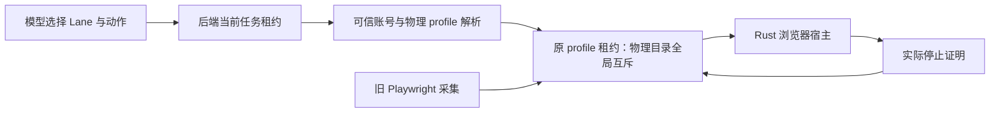

# T-1008 浏览器迁移与采集交接验证（进行中）

## 当前接线边界

新 `workbench-browser-admission.service.ts` 仅接受 Lane、模式与域名；账号和物理目录摘要必须由可信 `resolveProfile` 按当前任务账号得出。解析后，原 `execution-browser-profile-lease.service.ts` 再次核验 attempt/fence 与任务停止状态，才领取物理 profile。旧 Playwright 宿主持有同一目录时，新任务得到 `BROWSER_PROFILE_BUSY`，不按 TTL 抢占。只有可信宿主确认实际 profile 进程已停，且仍持有原 lease ID，才释放占用；此服务本身不启动浏览器，也不声称完成新旧所有权交接。

红测：新增服务测试首次运行因模块不存在失败。实现后 `pnpm --dir backend exec vitest run src/modules/execution/workbench-browser-admission.service.test.ts --retry=0` 为 3/3。测试覆盖模型自报账号/目录被拒、当前账号绑定、同任务多 Lane 复用原档案租约、旧采集占用阻止接管、缺停止证明不得释放、旧租约不能覆盖下一持有者，以及取消/旧 fence 不得领取。

冻结 NomiFun crate 包、Rust Hub/Lane、独立浏览器 IPC、浏览器二进制随包、旧作品/评论/封面/流量采集回归和 Mac/Windows 安装实测均尚未完成。不能把本服务的 3 个测试或 NomiFun 独立 crate 编译等同于 T-1008 验收。
