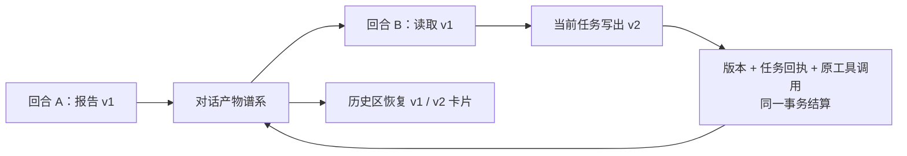

# T-1009 跨回合产物谱系验证

日期：2026-09-20  
规格：[跨回合产物版本补充规格](../features/t1009-artifact-lineage-proposal.md)  
授权：`DEC-AW-1009`

## 用户可见结果

同一对话的新回合可以先列出并读取旧产物，再把当前任务中的真实文件登记为下一版本。每一版继续指向自己的任务、原工具调用和不可变 Blob；旧版可单独预览、导出。不同账号或不同对话不能借用该谱系。

## 已实现的边界

- 新聊天任务由后端固定 `artifactProtocolVersion=2`。`artifact.register/copy` 只经原 `executionCalls.id` 的专用原子结算；旧 v1 与非聊天任务保留原 task 范围路径。
- 谱系归属 `(userId, accountId, conversationId, artifactId)`。版本索引记录真实 `taskId`、`operationId`、hash、MIME、大小、路径及来源。
- 并发修订由谱系行和 `expectedVersion` 串行化。Blob 提交前先冻结操作摘要、当前文件版本、hash、工具调用和领取凭证。
- 应用启动后持久扫描 `pending_blob/reconciling/unknown`。对账使用谱系自身的短租约和领取凭证，可在 execution fence 更换或原租约过期后接管同一 operationId；不会重传未知 Blob。
- Blob 服务只有在对象存储明确返回不存在时才给出 `absent`。旧 writer 已失权且间隔 30 秒复查仍不存在，才结算 `dispatched=true, confirmedNoCommit=true`，释放占位；其它错误保持 unknown。
- 升级前聊天产物按“用户消息 → aiTask → executionTask → conversation”映射逐谱系核对。已结算回执必须与 artifactRef 和元数据一致；started/unknown 的旧调用按原 ID 补结算。坏回执只生成 `migration_blocked` 和 `legacyReadOnly` 卡，不进入正式版本列表。
- HTML 新版本冻结最多 12 张、总计 2 MiB 的精确 PNG 版本清单。预览按清单再次验 hash；旧 HTML 没有可证明清单时省略相对图片，正文仍可读。
- 历史区按服务端会话列表分页恢复正式卡片，与当前消息卡按 `artifactId/version/taskId` 去重。unknown 状态提供“重新核对”，只唤醒原 operationId。

## 当场验证

- backend 定向测试：**37/37 通过**。覆盖 Blob 三态、跨回合 1→2、并发占位、跨账号/跨对话、复制、HTML 精确图片、fence 更换、`reconciling` 接管、旧版迁移、`failed_confirmed` 及 v1/v2 排他。
- frontend 定向测试：核心新增用例 **18/18 通过**；任务声明的完整前端集合 **47/47 通过**。覆盖历史分页恢复与去重、会话切换取消、列表故障提示、用户重核对、API 账号/会话范围、宿主目录与 HTML 预览。
- contract：**6/6 通过**，覆盖 `confirmedNoCommit` 的失败语义和 unknown 排他。
- frontend 完整 TypeScript：通过；本次前端触及文件定向 ESLint：通过。
- backend 完整 TypeScript 仍有 12 项范围外既有测试错误；用错误路径过滤核对，本次 T-1009 触及文件无新增类型错误。既有错误主要位于 asset/chat assembly/topic adapter/transcribe/legacy patch 等测试。
- `git diff --check`：通过。

## 安装版与发布边界

本任务获得的是本地实现、重装和验收授权。`pnpm -C frontend desktop:package-local` 已通过，并完成以下安装后复验：

- `/Applications/CreatorOS.app` 已替换并启动，版本与构建号均为 `1.2.0`，验收进程 PID 为 `91031`。
- `codesign --verify --deep --strict` 通过；本地包使用 ad hoc 签名且未公证，所以 Gatekeeper `spctl` 拒绝属于该本地流程的预期结果。
- `/Users/zyongzhu/Downloads/CreatorOS-1.2.0.dmg` 通过 `hdiutil verify`，SHA-256 为 `a6e8627d838452f1e725781771ebd6ded11d3d76fb4d35c0c6e684daf4392b31`。
- 应用启动完成后，`creatoros status` 自动返回 `connected=true, access=full`；`creatoros access status` 返回 `enabled=true, access=full`。无需手动开启本次启动的 CLI 权限。

没有公开发布、生产放量或修改外部仓库。
