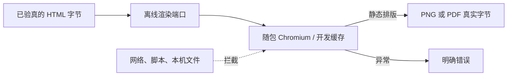

# T-1009：可信静态 HTML 离线渲染端口

## 给使用者看的说明

已核对归属和摘要的 HTML 可以交给 `renderTrustedWorkbenchHtml`，指定 `png` 或 `pdf` 后获得真实文件字节。浏览器临时启动，只显示内联静态内容；脚本、远程地址和本机文件资源都不能参与画面。浏览器缺失、生成超时或字节格式不对会返回明确错误，不会交付占位图片。

## 接口与边界

- `frontend/src/server/workbench-artifact-render.ts` 导出 `renderTrustedWorkbenchHtml({html,format})`，`html` 为 UTF-8 字符串或字节，`format` 为 `png | pdf`，返回 `Buffer`。调用方须先经产物服务核实用户、账号、任务、版本、大小及 SHA-256；本端口不接受 artifactId，也不自己读数据库或任务文件。
- 桌面态优先使用 Rust 注入 `CREATOROS_RUNTIME_ROOT` 下的固定工作台 CfT 149；其次使用 `CREATOROS_BROWSERS_DIR` 下的随包 Playwright Chromium。路径需属于注入的运行时根。开发态使用 Playwright 本地缓存。没有可用二进制时抛 `BROWSER_RUNTIME_UNAVAILABLE`，不尝试系统 Chrome、下载或远程服务。
- 每次调用新建浏览器与无状态 context。子进程只继承最小运行环境，`HOME` 和临时目录另建；不继承 sidecar 凭据。页面禁 JavaScript、service worker、下载与权限，context 离线；路由只在内存中响应固定 `.invalid` 文档地址，其余请求中止。响应强制 `sandbox` 与预览共用的静态资源 CSP，允许内联 CSS/SVG 和 data 图片，禁止脚本、网络、表单、子框架及文件资源。
- PNG 使用真实 Chromium 截图，PDF 使用 Chromium 打印。检查文件头尾及 20 MiB 交付上限。输入非法为 `INVALID_INPUT`；浏览器启动、加载、截图或打印失败为 `RENDER_FAILED`。临时浏览器和目录在成功或失败后清理。
- 本端口只是 T-1009 的独立渲染侧任务。预览 route、已登记产物读取、原生保存和聊天 UI 的接线由各自工作树处理；此 commit 不声明 T-1009 全任务完成。

## 本机真实验证

- 基线 `ff1bc4b8`，macOS arm64，Node 25.9.0，Playwright Chromium 本地缓存 `chromium-1223`。无安装包构建或发布。
- RED：新增真实渲染测试后执行 `pnpm --dir frontend exec vitest run src/server/workbench-artifact-render.test.ts --retry=0`，因渲染模块不存在而失败。
- GREEN：同一命令 **1 文件、3 测试通过**。真实 Chromium 产生 PNG，`pngjs` 解码后检查 1280 宽和红色像素 `[223,40,40,255]`；内联脚本未把它改为蓝色，本地 HTTP 服务器收到 0 次请求，本机私有 PNG 没有进入画面。真实 Chromium 产生 PDF，检查 `%PDF-`/`%%EOF`，`pdf-parse` 成功读回 `Offline report 2026`。桌面运行时目录不存在时得到 `BROWSER_RUNTIME_UNAVAILABLE`。
- `pnpm --dir frontend exec tsc --noEmit --pretty false` 与定向 ESLint 通过；`git diff --check` 通过。
- `node orchestrator/process/boundary-scan.mjs` 未通过：报告未改的 `frontend/src/features/copilot/live-chat-session.ts` 两条既有 R2 导入违规。本侧任务没有新增边界违规，也不把该全局失败写成通过。

## 尚缺的验收

固定 CfT 149 的桌面安装包运行、Windows 安装包运行、调用方从已登记产物到原生选址导出的完整链路均未在本侧任务验证。当前测试只证明本机 Playwright 缓存 Chromium 上真实渲染及隔离行为；上述安装版链路仍需主任务集成验收。
