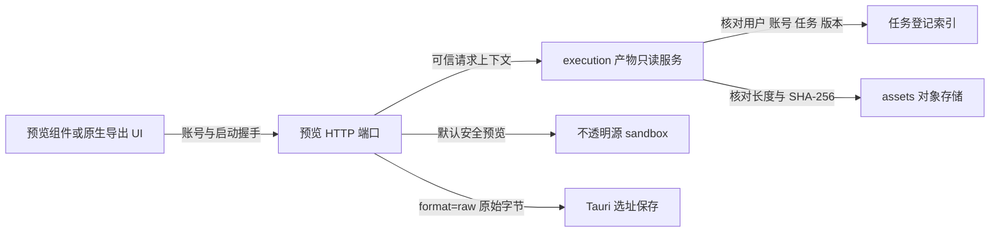

# T-1009 已登记产物隔离预览与原始字节端口

## 给使用者看的说明

打开预览时，应用先按当前用户和账号核对任务、产物 ID 与版本，再从已保存快照取字节。HTML 被放进独立的受限框架：它能显示静态排版、行内 SVG 和 data 图片，不能运行脚本、调用原生桥、读取主页面凭据或加载远程 CDN。Markdown 和 CSV 以静态文字显示；PNG 和 PDF 交给浏览器的图片/PDF 显示能力。

## HTTP 约定

- 路径：`GET /api/v1/workbench-preview/{taskId}/{artifactId}/{version}`。路径中的三个值是已登记产物引用，不接受 storageKey 或本机文件路径。
- 请求：同源会话 cookie；桌面 `fetch` 附 `x-creatoros-handshake`；`x-account-id` 表示当前账号，服务端仍重新验属主与 active 状态。桌面全局代理要求握手头，故原生 iframe 直接导航此 API 不作为桌面调用方式。
- 默认响应：已登记 HTML 返回 `text/html; charset=utf-8`；Markdown/CSV 返回 `text/plain; charset=utf-8`，避免浏览器解释为活动内容；PNG/PDF 返回对应二进制 MIME。在线预览上限 4 MiB。
- 原始字节：加 `?format=raw`，返回登记快照的原始字节，MIME 保留为 `text/html`、`text/markdown`、`text/csv`、`image/png` 或 `application/pdf`；上限 20 MiB。`Content-Disposition` 始终为 `inline`，不会自动触发浏览器下载。Mac/Windows UI 可 `fetch` 后交给 Tauri save dialog。
- 成功响应头：`Content-Type` 为上述可信类型；`Content-Length` 与 `X-Workbench-Size` 是真实字节长度；`X-Workbench-Hash` 是 SHA-256；`X-Workbench-Filename` 是建议文件名的 `encodeURIComponent` 形式，可用 `decodeURIComponent` 读取。`Content-Disposition` 同时包含 RFC 5987 的 `filename*`。建议名只来自登记相对路径的末段，并按 MIME 固定扩展名，不是可写路径。另有 `X-Workbench-Mime` 供预览组件分流。
- 错误：400 引用/format 无效，401 身份失效，403 非本机可信请求，404 账号/任务/版本不属当前请求，409 分页/哈希校验异常，413 超过模式上限，503 存储或身份服务暂不可用。错误不回传产物字节。

## 隔离措施与边界

HTTP 响应设置 `Content-Security-Policy: sandbox`，不授予 `allow-same-origin` 或 `allow-scripts`；并设置 `default-src 'none'`、`script-src 'none'`、`connect-src 'none'`、`frame-src 'none'`、`object-src 'none'`、`form-action 'none'`、`frame-ancestors 'self'`、`nosniff`、`no-store` 和同源资源策略。`WorkbenchPreviewFrame` 用携带握手头的 `fetch` 取回内容；HTML/文字进入空 `sandbox` 的 iframe，同时在 `srcDoc` 前置同一静态资源 CSP。换账号会立即隐藏旧内容，卸载时中止请求和撤销 Blob URL。

**明确缺口：**相对 CSS、JS、图片等资产未映射到已登记版本，CSP 会阻断其加载；本轮不宣称支持相对资产。活动 JavaScript 图表也不会运行，只支持静态 HTML/CSS/行内 SVG 或 data 图片。PDF 在组件中使用空 sandbox iframe；实际 macOS/Windows WebView 的内建 PDF 阅读器仍需安装版验收。原始字节经公共分页读端口汇总，每页都会复核完整对象；接近 20 MiB 时重复读取成本较高，后续可在 backend 提供等价的整对象只读端口优化，不绕过现有归属校验。

## 验证记录

- frontend Vitest：`pnpm --dir frontend exec vitest run src/server/workbench-preview-read.test.ts 'src/app/api/v1/workbench-preview/[taskId]/[artifactId]/[version]/route.test.ts' src/components/workbench-preview-frame.test.tsx --retry=0`，3 文件、16 测试通过。使用真实 PGlite 任务登记与真实 local-fs 临时目录，经只读服务和 HTTP route 回读；覆盖五种 MIME、跨用户/账号/任务/版本拒绝、损坏字节、原始字节响应头、分页拼接与账号切换。
- backend 现有产物服务回归：`pnpm --dir backend exec vitest run src/modules/execution/workbench-artifact.service.test.ts --retry=0`，5 测试通过。
- frontend TypeScript：`pnpm --dir frontend typecheck` 通过；新增 TS/TSX 文件定向 ESLint 通过。
- Chromium 本地隔离检查：同样的 `sandbox` 与 CSP 下，观察到 `sandbox=""`、父页无法读取子文档、子文档脚本未改写父页变量；该检查只验证浏览器隔离语义，不冒充安装版验收。
- 工程边界扫描仍报未触及的 `frontend/src/features/copilot/live-chat-session.ts` 两条 AI SDK 导入违规；本次预览文件未新增对应违规。
- 未执行安装版、双端 PDF 阅读器或相对资产验收；这些项目保持待验证/缺口状态。
