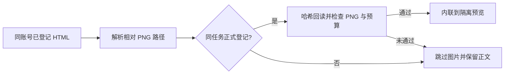

# T-1009 HTML 相对图片预览验证

## 用户可见行为

已登记报告中的 `` 会显示为离线图片。图片缺失、损坏、越界或只存在于其他账号任务时，图片被跳过，正文仍可阅读。`format=raw` 保留已登记 HTML 的原始字节，供导出使用。

## 实现边界

- 后端只在当前用户、账号、任务的 `workbenchArtifactVersions` 查找与相对路径完全相同的 PNG；由既有对象端口回读并核对大小、SHA-256。待登记文件及任务工作目录不参与预览。
- 前端只解析 HTML 中的字面相对 PNG 路径；拒绝父目录、绝对路径、URL、百分号编码、查询参数、反斜杠和控制字符。解析器复用已安装的 `jsdom`，不加载网络资源。预览移除脚本、事件属性、表单、子框架及导航链接；现有 CSP 与空 `sandbox` 继续生效。
- 每份报告最多内联 12 张图片，总原始图片字节不超过 2 MiB，单图像素不超过 16,777,216。原有内联 PNG 也受同一预算。预览 HTML 仍受 4 MiB 原文件读取上限约束。
- 预览响应的哈希和大小对应实际返回的安全 HTML；`format=raw` 对应原始登记字节。

## 当场验证

- RED：新增解析测试在实现前以 `renderRegisteredHtmlPreview is not a function` 失败。初次运行还受临时复用的旧依赖目录影响；随后在独立工作树按锁文件离线安装依赖。
- `pnpm --dir frontend exec vitest run src/server/workbench-preview-read.test.ts src/app/api/v1/workbench-preview/'[taskId]'/'[artifactId]'/'[version]'/route.test.ts`：16/16 通过。路由集成测试使用真实 PGlite 登记与本地对象存储，覆盖相对 PNG、跨账号图片、损坏对象、路径穿越、远程地址、原始字节模式。
- `pnpm --dir backend exec vitest run src/modules/execution/workbench-artifact.service.test.ts`：7/7 通过。
- `pnpm --dir frontend exec tsc --noEmit --pretty false` 与定向 ESLint：通过。
- `pnpm --dir backend exec tsc --noEmit --pretty false`：仍因 `ai-runtime`、`artifacts` 及其他 execution 测试文件中的范围外既有类型错误失败；本次触及文件没有出现在错误列表。
- `boundary-scan.mjs`：报 `live-chat-session.ts` 的两个 AI SDK 导入；该导入存在于基线 `ff1bc4b8`，不在本次改动范围。`semantic-boundary-scan.mjs`：报 `video-decisions-runner.ts` 未调用 `material.match` Skill，也不在本次改动范围。

本侧任务未执行安装版截图、发布或 T-1009 完成状态转换。
