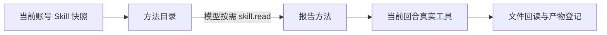

# T-1010 工作台方法装配记录

## 用户能得到什么

助手接到研究、写稿和制作报告的目标时，可在原对话按需读取当前账号冻结的 `method.report`。方法指导它核对来源、制作离线可编辑文件、回读核查并登记真实版本；方法本身不增加工具权限。实际可调用工具仍取决于本轮桌面宿主的真实能力目录。

## 实现与版本

- `method.report` 走已有 official Skill 注册表、账号覆盖、快照冻结和 `skill.read` 分页通道。基版固定为 `workbench-report-2026-09-20`，仅 `system`、`template` 可按既有账号覆盖规则编辑，工具列表为空，不能凭方法名称扩大文件、浏览器或原生命令权限。
- 普通聊天提交会在当前账号的原任务快照中包含该方法。模型看到简短目录后自行决定是否读取；报告正文不会在每轮对话中无条件注入。已提交任务继续使用当时冻结的版本。
- 报告方法明确要求离线静态 HTML、真实数字与来源、失败时保留可用正文、版本登记后再声称交付。用户修改反馈应沿原任务生成新版本。

## 当场验证与缺口

- RED：增加正式聊天入口断言后，`frontend/src/server/prepare-chat-reply.test.ts` 2/2 因快照缺少 `method.report` 失败；增加注册表断言后，backend 对应测试 1/1 因目录缺少该 ID 失败。
- GREEN：backend 快照测试 13/13、frontend 正式聊天准备测试 2/2、ai-worker 方法快照测试 7/7；ai-worker TypeScript 检查通过。测试还核对基版、可编辑字段和空工具列表。
- 这只证明方法可按需发现、冻结和回读。真实模型自主选择该方法、受管扩展兼容、完整研究写稿报告链路、双端安装版仍待 T-1010/T-1012/T-1013 后续验证。T-1010 保持进行中。
