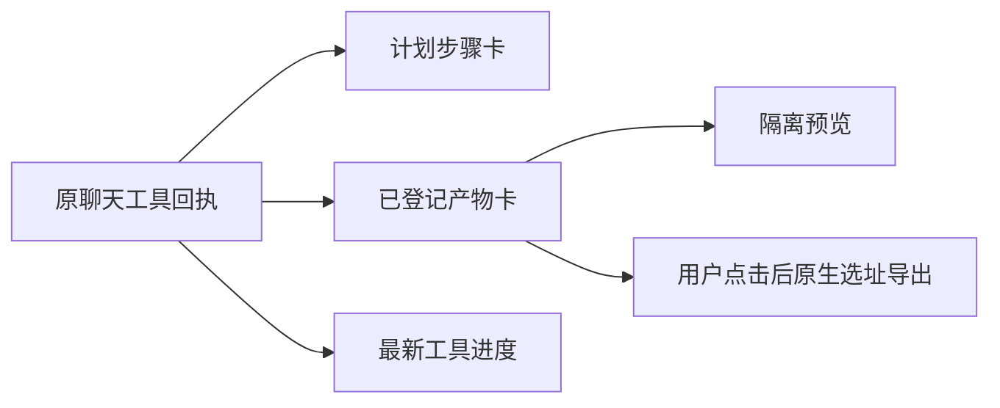

# T-1011 对话内工作台展示记录

## 用户看到什么

模型保存计划后，对话里出现每步的真实状态、完成数与回执数量。已登记的 HTML 等产物在同一对话显示文件名和版本，用户点击“预览”可在隔离框架里看静态内容；桌面版点击“导出文件”才打开系统保存面板。正在执行的工具进度只显示该操作最新一条，不让旧进度堆满对话。

## 本轮边界与验证

- 只解析 `plan.update`、`artifact.register` 的成功回执；产物卡还要核对 `artifactId@version` 在工具回执的 `artifactRefs` 中。任意 JSON 自报的产物不显示成交付卡。
- 无当前账号时不显示产物交付卡；切号后的预览组件会立即隐藏旧内容并中止旧请求。
- 长计划默认只渲前五步，用户展开时才渲剩余步骤。停止/恢复沿现有原任务控件；这里没有新增任务队列或轮询。
- 同一批次连点“导出文件”只发起一次读取；切换产物或卸载会中止在途请求。测试验证了连点与卸载，真实设备打开延迟仍需另测。
- 定向前端交互和计划卡测试通过；TypeScript 检查通过。完整安装版同对话续改、实际模型多步任务及 LED-047 页面性能仍待验收；上游 T-1005/1006/1009 未全部关闭，T-1011 保持进行中。
