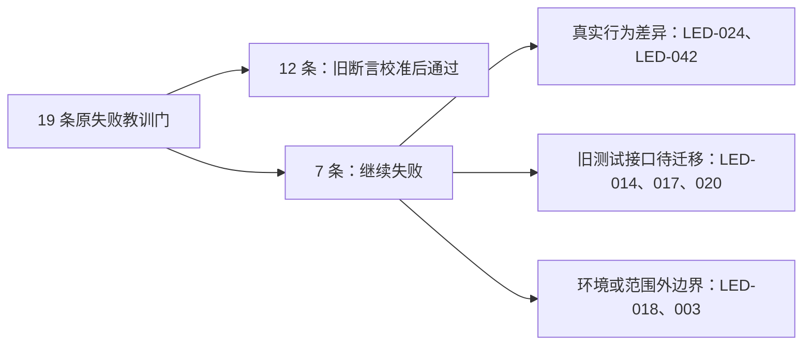

# T-1015 剩余教训门与旧断言核实

工作树：`codex/t1015-lesson-verification`，起点 `78dabe2134010fbad4ff7af85e59b2ace73aa2dd`。基线取自 [T-1014 实测清单](t1014-lesson-diagnostics.json) 与 [分类说明](t1014-reconcile-triage.md)。本轮只改教训扫描、回归测试及本验证文档；未改产品运行时、T-1008/T-1009 代码、任务状态或跨回合产物谱系。执行过 `context-compile`，未补拍历史红测。

入口核对：已按 `AGENTS.md` 读取 BACKLOG、上述实测清单、`PROJECT.md`、`PROJECT_CONTEXT.md`、product-to-code-orchestrator 技能与 stage-router、`SYSTEM_ARCHITECTURE.md`。技能 `VERSION` 与项目 `.skill-version` 同为 `3.27.2`；路由为 stage 4-build / compat-full。为独立工作树生成 T-1015 context packet 时所需的临时绑定已撤销，未提交治理状态变更。

## 一眼看懂

19 条原失败教训命令中，12 条在校准旧断言后通过；7 条仍不通过。下面的红项继续由原检查拦截，不能因为别的用例已绿就视为修好。

## 逐条结果

| 教训门 | 当前结果 | 本轮核实 |
| --- | --- | --- |
| LED-044 | 通过 | `video.cards` 官方版本是模板版号加业务方法版号，模板正文仍与运行时相同；移除固定 `v7` 预期，改比两个来源。 |
| LED-003 | **失败** | 物理边界仍有 `live-chat-session.ts` 的两处 R2 新导入；归 T-1016，不更新边界基线。 |
| LED-006 | 通过 | 抖音浏览器入口已委托 Worker 的 profile context 与 browser launch；测试沿真实调用链查 lease、Chrome 优先和随包 Chromium 回退。 |
| LED-007 | 通过 | 模型探针及最小生图现传入可信 `ctx`；测试核对规范参数和上下文。 |
| LED-008 | 通过 | 设置页现有“数据服务”共 7 页签；激活拉取 URL 的版本来自当前 `frontend/package.json`，不再写死 1.1.0。 |
| LED-009 | 通过 | backend 文件现仅再导出 Worker runner。门卫继续扫描危险启发式，并核对 backend → Worker 执行入口 → 两条视频编排路径 → `decideMaterialBroll` 的首轮 `material.match` 调用。新增 7 个反例/正例测试；删入口、改 Skill、闲置首轮调用或绕开任一路径均失败。 |
| LED-014 | **失败** | `frontend/src/app/api/chat/route.test.ts` 仍模拟同步 `runChatStream` / `onFinish`；实际路由已改成 `runtime.durable.submit` + 持久事件订阅。单测 29/50 失败，不能据旧 mock 推断持久链路安全；需按新契约重写并保留局部改稿锚点、权限、持久化断言。 |
| LED-016 | 通过 | 同 LED-044 的 Skill 复合版本校准；其他视频检查通过。 |
| LED-017 | **失败** | `redfox.query` 夹具原把判别联合各动作字段塞在同一对象；已改合法 `hotspots` 样本并保留跨动作字段拒绝检查。整门仍被同一份旧聊天路由测试挡住。 |
| LED-018 | **失败** | Douyin 前端检查 137/137 通过；`cargo test --lib windows_` 在编译前缺少 `frontend/src-tauri/binaries/creatoros-server-aarch64-apple-darwin`，本工作树没有该打包 sidecar。未能据此验证 Windows 测试，也未放宽门。 |
| LED-020 | **失败** | 工具参数样本校准后通过；整门仍被旧聊天路由测试挡住。 |
| LED-023 | 通过 | `maxRetries=0` 约束 SDK 自动重试，不取消节点两次共享格式修复预算；实际一轮结构化加两轮修复共 3 次，与 T-921 既定预算一致。 |
| LED-024 | **失败** | Skill 版本断言已校准；真实 Playwright 动效预览的 portrait 主时间线 `15.34 !== 15` 秒。保留 15 秒约束，待动效实现/需求核查，不把预期改成 15.34。 |
| LED-025 | 通过 | 同 LED-044；其他主画面/时序检查通过。 |
| LED-028 | 通过 | 相关模型连接断言改为核对传给正式探针的 `ctx`；其余检查通过。 |
| LED-032 | 通过 | 同 LED-044；相关素材与字幕检查通过。 |
| LED-035 | 通过 | 同 LED-044；信息卡协议检查通过。 |
| LED-038 | 通过 | 队列恢复是每轮至多 4 项、并发 2，周期唤醒最终处理 25 项；测试不再要求单轮吃完全部，同时核对有界批次、并发上限和队列归零。 |
| LED-042 | **失败** | 内容雷达旧错误提示/等待态/分享导入断言已按实际 UI 和排队任务更新；56 例中 55 通过。T-900 成功候选仅有改写初稿时，实际缺“确认写入选题池”按钮；有效产品回归断言保留。 |

## 对未通过项的判定

- **已观察到真实行为差异**：LED-024 的 portrait 时间线多 0.34 秒；LED-042 的 T-900 按钮缺失。后者在 `topic-candidate-editor.tsx` 用 `canRetryTopicTask(status)` 控制确认按钮，而 `topic-task-state.ts` 只允许 failed/blocked/cancelled，成功且已有 `adaptedDraft` 的候选因此无法确认。只改测试会掩盖问题，本轮不动产品运行时。
- **旧测试装配失效，业务结论待验**：LED-014/017/020 共用聊天路由测试。当前 mock 没有 `runtime.durable`，很多旧断言仍读取已经不使用的 `runChatStream`、`toUIMessageStreamResponse.onFinish`。应针对持久任务提交、消息快照、事件订阅与完成事务重建检查；旧的中断和落库语义也要逐项重新验证，不能机械改预期为 400。
- **环境前提/范围外边界**：LED-018 缺桌面 sidecar，Windows Rust 用例尚未运行；LED-003 的两处 AI SDK 导入由 T-1016 查架构边界。均保持红门。

## 验证记录与限制

- 最终全量命令：`node orchestrator/process/reconcile.mjs`；结果见本轮终端，仍非全绿。T-1014 的 36 error / 1 warning 在断言校准后降为 **24 error / 1 warning**：16 条旧评审回执（T-916）、1 条物理边界（T-1016）、7 条上述教训命令。看板体积 warning 仍在。全量输出保存在本机 `/tmp/t1015-reconcile-final.log`，不是仓库历史证据。
- LED-009 完整命令：7/7 门卫反例/正例、扫描、98/98 视频 runner 测试通过；仍保留危险启发式禁令和原 `material.match` 运行测试。
- `pnpm --dir frontend exec tsc --noEmit` 与 `pnpm --dir ai-worker exec tsc --noEmit` 通过。backend `tsc --noEmit` 仍报其他未修改测试文件的既有类型错误；本轮改动文件未出现在其错误列表。
- 修改涉及的 AI Worker 两套测试 33/33、后端两套测试 213/213、前端四套测试 90/90 通过；内容雷达 55/56、portrait 动效预览未通过。全局红项没有标为已解决。
- 本轮测试中看到的失败即本轮实测；未伪造 TDD 红测、评审回执或安装验收。未运行 `taskctl complete`，留主会话审查后按实际 Gate 处理。

## 主树合入与结算核对

主树合入 `8a704a4f` 后，T-1016 已消除两条新增 R2 导入。定向复核：语义门卫 7/7 及扫描通过，AI Worker 33/33、后端 213/213、前端启动安全 11/11；内容雷达与设置/激活组为 **134 通过、1 失败**，失败仍是 T-900 成功候选缺确认按钮。使用 `pmem sync` 后重跑全局 `reconcile`，结果为 **22 error、1 warning**：16 条旧评审回执由 T-916 承接；6 条教训门为 LED-014/017/018/020/024/042，均保留原失败。LED-003 已通过。

后续根因已入 BACKLOG：T-1017 承接三条共用旧聊天路由测试，T-1018 承接 portrait 时长，T-1019 承接 T-900 确认按钮；LED-018 的真实随包 sidecar 与 Windows 安装门由 T-1013 验证。这里完成的是逐项核实与旧断言校准，不把这些仍失败的产品或环境 Gate 写为通过。
