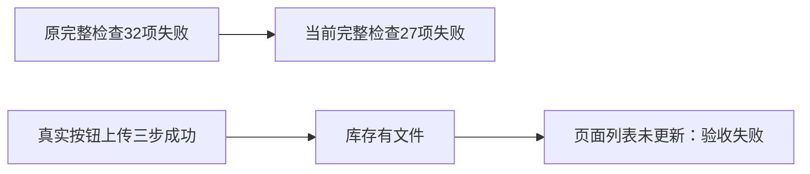

# 当前完整检查与素材上传实际失败

本轮完整检查在main b34447aa上真实运行1158.662秒，2026-10-10 01:29:46–01:49:05 UTC，退出1，27 ERROR/1 WARN。相对5a1929ca安装包后原32 ERROR，五条教训标识消除：LED006、022、048、049、050。没有新增ERROR标识。剩余19条历史评审链/SPEC不一致与8条教训失败均保留原责任任务，详CURRENT_FAILURE_OWNERS.json；相同标识不证明相同根因或已重核子检查原因。

五个测试源文件和reconcile.config.json与开跑SHA完全一致。运行期间T1181/T1182控制文档、评审事件和研究门发生合法变更，不能称整个控制面冻结。完整原日志在早期审查时只列T1135/T1155；当前单独控制审计确认T1135/T1155/T1181均开放，研究结构无错误，原19条review错误未增。首次单独审计因本轮调用者误将root对象传给只接受字符串的auditResearchGates，真实TypeError/exit1保留；按真实函数签名改正后原19条review错误仍exit1，不以此称审计全绿。

T1176导航/封面恢复、T1177指标夹具、T1178打包资源校准已具备精确RED/GREEN、原完整命令、独立实施复核及必要隔离浏览器证据，可仅完成这些范围。T1179上传测试虽通过，T1180请求体观察修正也没有删保护，但其实际公开UI旅程未闭合，不完成它们。T1015整体、看板警告T1171及真实安装/模型/平台验收仍未完成。

T1182真实上传按钮控制当场失败：没有force，点击前disabled=false、真实chooser选中PNG；创建/PUT/完成均200，公开库存一项，页面DOM没有素材卡片，120秒文件名可见性等待失败。该结果推翻“全部是隐藏input绕过按钮造成”的解释，不能据此认定router.refresh竞态。源码仅读确认assets.list无展示缓存，SSR还等待trash/projects/usage/storage；未保留失败轮RSC请求/响应/ctx或这些读取完成时间，根因UNKNOWN。两次最小实验2/2用尽，T1181继续暂停、T1182研究未validated，不追加同族第三次，不修改产品，也不以旧诊断轮两文件下载PASS代签本控制失败。

实际CANONICAL.receipt.json为包装器原字节，CANONICAL.log.gz解压后SHA等于34e36c225d9ab3429c82470294d13ab8c3b7adb266919d6d1e65c09713c9caee。START_INPUTS.json与CURRENT_CANONICAL_COMPARISON.json区分开跑和收尾控制快照，未修改失败日志。新包运行时仍5a1929ca，未重建相同产品包、未替换或启动真实安装App，无原生/真实平台/模型全绿结论。
